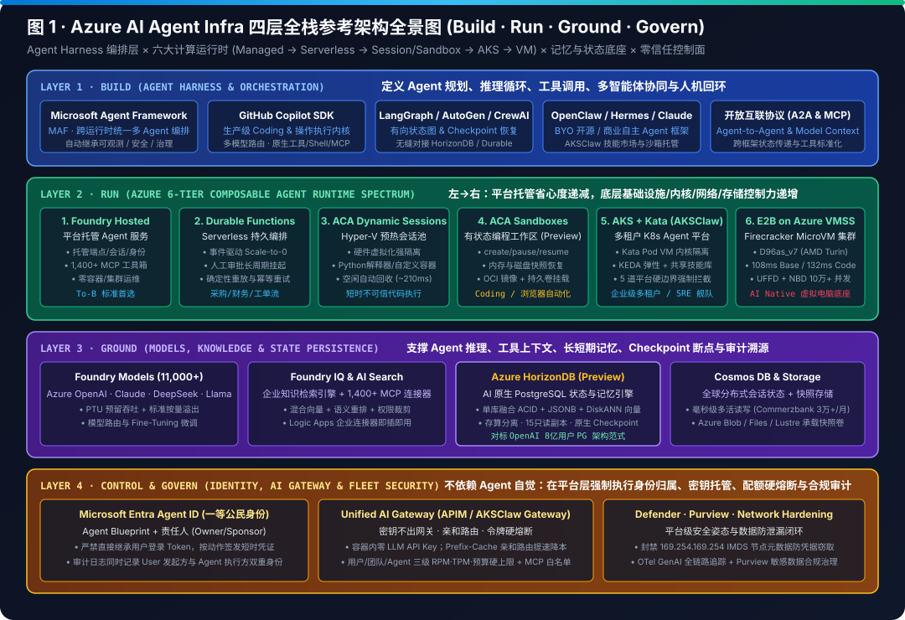
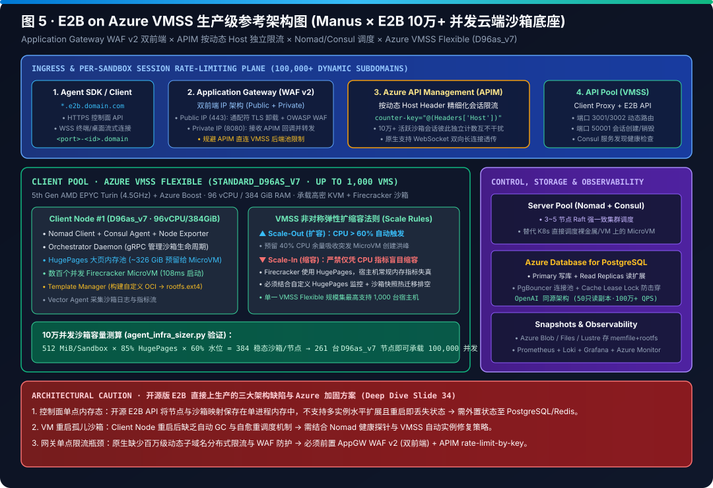
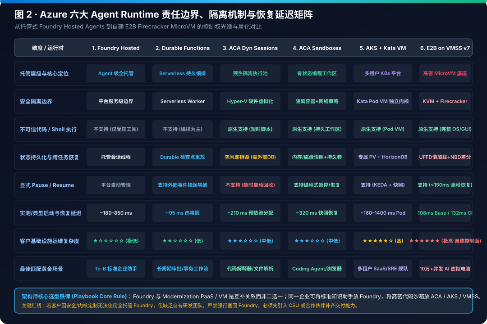
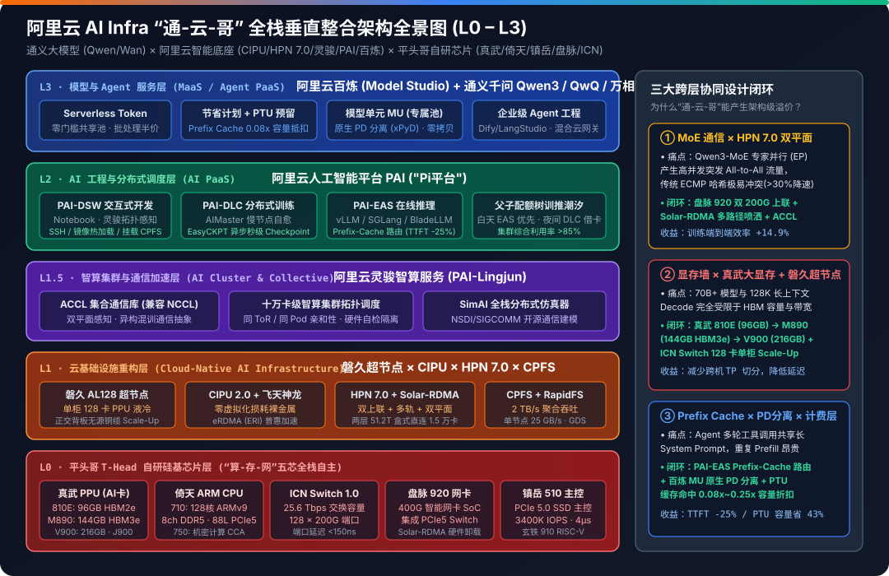

# AI Infra Lab — Enterprise Cloud & AI Infrastructure Architecture Lab

> 🌐 **Language / 语言切换**: **[🇨🇳 中文主页 (`README.md`)](README.md)** | **English Homepage (`README.en.md`)** | **[📚 199 Architecture Selection FAQs (`docs/azure-agent-infra/`)](docs/azure-agent-infra/README.en.md)** | **[🛠️ 28-Chapter Playbook & IaC (`workshops/azure-agent-infra/`)](workshops/azure-agent-infra/README.en.md)**

A production-oriented reference architecture, platform trade-off catalog, capacity/TCO sizing model, and deployable Infrastructure-as-Code (IaC) repository built for **Cloud & AI Solution Architects**. Every deliverable focuses on concrete architectural decisions encountered when designing enterprise LLM inference, multi-agent orchestration, and secure sandbox platforms:

- **Application Scenarios**: Untrusted code execution sandboxes, 1K–100K concurrent cloud browser and software-engineering agents, multi-region PTU/PAYG AI gateways, zero-trust user-delegated agent identity (`Microsoft Entra Agent ID OBO`), durable multi-agent state checkpointing, and cross-cloud AI Factory benchmarking.
- **Reference Architectures**: The 6-layer `Build · Run · Ground · Govern` enterprise agent stack, `AKSClaw` five multi-tenant hard boundaries, `E2B on Azure VMSS` (`Standard_D96as_v7`) 100K concurrent Firecracker MicroVM topology, and L0–L3 vertical stack analysis across custom silicon, RDMA fabrics, cluster schedulers, and MaaS platforms.
- **Platform Selection Trade-offs**: Quantitative comparisons across isolation boundaries (MicroVM vs. Hypervisor Pod VM vs. container), cold-start & UFFD snapshot restore latency (`80 ms / 108 ms` vs. `1,420 ms`), throughput predictability (reserved PTU vs. Serverless PAYG spillover vs. self-hosted AKS KAITO), and monthly TCO.



---

## 🧭 Four Core Deliverable Pillars (100% Bilingual `en` / `zh-CN`)

| Pillar | Solution Architect Scope & Key Questions Answered | Scale & Assets | Entrypoints (English / 中文) |
|---|---|---|---|
| **1. Azure AI & Agent Architecture Selection Library** | **8 Enterprise SA Domains**: **Sandboxes & Execution** (`ACA Dynamic Sessions` / `Foundry Code Interpreter` / `AKS Kata` / `E2B`), **Model Hosting & GPU** (`PTU` / `Serverless GPU` / `AKS KAITO`), **AI Gateway & Protocols** (`APIM Token Quotas` / `A2A + Remote MCP`), **Zero-Trust Identity & Network** (`Entra Agent ID OBO` / `Private Link`), **State Stores** (`Cosmos DB` / `Managed Redis` / `PostgreSQL pgvector`), **Enterprise Grounding** (`AI Search Hybrid RAG` / `Fabric IQ`), **Observability & FinOps**, and **Cross-Stack Orchestration** (`Copilot Studio` / `Power Automate` / `Playwright MCP`) | **199 bilingual Selection FAQs** (`398` docs) + **8 SVG** diagrams | [🇬🇧 EN Catalog](docs/azure-agent-infra/README.en.md) · [🇨🇳 中文选型总览](docs/azure-agent-infra/README.md) |
| **2. Azure AI Agent Infra Full-Stack Playbook & Toolkit** | **28-Chapter Architecture Playbook** + **23 Production IaC Blueprints** (Bicep / AKS Kata `RuntimeClass` / Cilium IMDS block / Nomad / APIM AI Gateway XML / OTEL Collector) + **Deterministic Capacity & Cost Sizer** (`agent_infra_sizer.py`) + **7-Card 4:5 Benchmark Report** + **Interactive H5 Workbench** | 28 chapters · 23 blueprints · 16 SVGs · 34 unit tests | [🇬🇧 EN Playbook](workshops/azure-agent-infra/README.en.md) · [🇨🇳 中文版](workshops/azure-agent-infra/README.md) · [📊 7-Card Report](workshops/azure-agent-infra/test-report.en.md) |
| **3. Alibaba Cloud Full-Stack AI Infra Evaluation (Cross-Cloud Benchmark)** | End-to-end architectural teardown of **L0 T-Head Silicon** (`Zhenwu 810E PPU` / `Yitian CPU` / `ICN Switch` / `Panmai SmartNIC` / `Zhenyue SSD`), **L1 Panjiu AL128 Supernode & HPN 7.0 Dual-Plane Fabric** (`Solar-RDMA` / `ACCL` / `CPFS`), **L2 PAI Tidal Preemption & PD Disaggregation**, and **L3 Bailian MaaS** (`Token / PTU / DTU / MU`), mapped layer-by-layer against **Azure, AWS, and GCP** | L0–L3 Deep-Dive + **6 SVG** architecture diagrams | [🇬🇧 EN Evaluation](docs/alibaba-cloud-ai-infra/README.en.md) · [🇨🇳 中文深度测评](docs/alibaba-cloud-ai-infra/README.md) |
| **4. AI Infrastructure Architecture Video Explainers** | Concise 4-act bilingual technical storyboards for engineering & executive briefings: **EP03** (*FlashInfer 0.6 Block-Sparse Kernels & Mooncake RDMA PD Disaggregation*) and **EP05** (*Zero-Trust Hardware Sandboxes & APIM AI Gateway for Enterprise Agents*) | **2 bilingual episodes** (`EP03` · `EP05`) | [🇬🇧 Video Index](docs/video-explainers/README.en.md) · [🇨🇳 视频脚本目录](docs/video-explainers/README.md) |

---

## ⚡ Top Architecture Selection Trade-offs at a Glance

| Scenario | Primary Recommendation | Alternative / Evolution Path | Key Quantitative Decision Boundary | Deep-Dive Guide |
|---|---|---|---|---|
| **Untrusted Python / Shell Code Execution** | **ACA Dynamic Sessions** (managed Hyper-V warm pools) | **AKS Kata Containers** / **E2B on VMSS** | Choose Dynamic Sessions for zero-ops sub-second pools; choose AKS Kata or E2B when requiring custom RootFS, GPUs, or `100K` concurrent `108 ms` UFFD snapshot restores | [Sandbox Selection FAQ](docs/azure-agent-infra/aca-dynamic-sessions-vs-foundry-code-interpreter-vs-aks-sandbox-selection-faq.en.md) |
| **Enterprise LLM & Open-Weight Model Hosting** | **Foundry PTU + PAYG Spillover** (strict P99 SLA) | **ACA Serverless GPU** / **AKS KAITO** | Reserve PTUs for steady `>60%` utilization; burst to PAYG or Serverless GPU for spiky custom models; adopt AKS KAITO for multi-node vLLM/SGLang kernel control | [GPU & Endpoint FAQ](docs/azure-agent-infra/aca-serverless-gpu-vs-foundry-managed-endpoints-vs-aks-kaito-custom-model-hosting-selection-faq.en.md) |
| **Multi-Model AI Gateway & Remote MCP Tools** | **Azure API Management (AI Gateway)** | Direct SDK calls (single-team PoC only) | Centralize `llm-token-limit` quotas, semantic caching, automatic HTTP 429 PTU-to-PAYG failover, and MCP Streamable HTTP OAuth validation in APIM | [APIM A2A+MCP FAQ](docs/azure-agent-infra/a2a-mcp-federation-apim-istio-ambient-faq.en.md) |
| **Downstream Enterprise Data Authorization** | **Microsoft Entra Agent ID + OBO Delegation** | Managed Identity (headless background jobs only) | Never share app-wide secrets when acting for human users; enforce On-Behalf-Of (OBO) tokens to preserve SharePoint/SQL row-level ACLs and per-user audit trails | [Entra Agent ID OBO FAQ](docs/azure-agent-infra/entra-agent-id-workload-federation-cae-jit-pim-faq.en.md) |
| **Multi-Turn Memory & Durable Checkpoints** | **Cosmos DB** (durable state) + **Managed Redis** (hot locks) | **Azure Database for PostgreSQL (`pgvector`)** | Pair Cosmos DB multi-region JSON checkpoints with Redis sub-ms idempotency locks; choose PostgreSQL when ACID relational joins with business tables dominate | [Agent State Store FAQ](docs/azure-agent-infra/cosmos-vs-managed-redis-vs-pgvector-agent-state-memory-selection-faq.en.md) |
| **Business Process & Legacy UI Automation** | **Copilot Studio** + **Power Automate** (API connectors) | **Playwright MCP** (isolated browser sandbox) | Always prefer governed API connectors; reserve sandboxed Playwright MCP strictly for legacy web apps without APIs, gated by Human-in-the-Loop (HITL) write approval | [Automation Selection FAQ](docs/azure-agent-infra/copilot-studio-computer-use-rpa-vs-power-automate-vs-playwright-mcp-legacy-ui-automation-selection-faq.en.md) |

---

## 🏗️ Featured Reference Architecture Diagrams

### 1. 100K Concurrent Sandbox Production Topology (`Standard_D96as_v7` · `~$148K/mo` Optimized TCO)


### 2. Azure Six-Tier Agent Runtime Spectrum (Isolation · State Durability · Restore Latency)


### 3. Alibaba Cloud L0–L3 Full-Stack Vertical Integration (Cross-Cloud Reference)


---

## 🗂️ Repository Structure

```text
ai-infra-lab/
├── README.md / README.en.md          # Bilingual repository overview & quick-decision trade-off matrix
├── docs/
│   ├── README.md / README.en.md      # Bilingual documentation hub index
│   ├── azure-agent-infra/            # 199 Enterprise Azure AI & Agent Selection FAQs (398 bilingual docs + 8 SVGs)
│   ├── alibaba-cloud-ai-infra/       # Alibaba Cloud L0–L3 AI Infra evaluation & cross-cloud mapping (bilingual + 6 SVGs)
│   └── video-explainers/             # Bilingual 4-act architecture explainer storyboards (EP03 & EP05)
└── workshops/
    └── azure-agent-infra/            # 28-Chapter Playbook, 23 IaC blueprints, deterministic sizer, H5 workbench & 7-Card report
        ├── blueprints/               # 23 production Bicep / AKS Kata / Cilium / Nomad / APIM / OTEL templates
        ├── simulator/                # Deterministic capacity & TCO sizer (agent_infra_sizer.py) + 34 unit tests
        ├── demo/                     # Zero-dependency end-to-end local simulation harness (run_live_demo.py)
        └── index.html / cards.html   # Self-contained offline H5 workbench & 7-Card 4:5 visual benchmark report
```

---

## 🧪 Quick Local Verification

All sizing math, JSON report contracts, SVG XML schemas, Content-Security-Policy headers, and relative Markdown links are verified using Python's standard library (zero external dependencies):

```powershell
# 1. Verify deterministic capacity & TCO outputs match sealed benchmark artifacts
python workshops/azure-agent-infra/simulator/agent_infra_sizer.py --check

# 2. Run all 34 unit tests covering sizing math, CSV parity, SVG validity & link integrity
python workshops/azure-agent-infra/simulator/test_agent_infra_sizer.py

# 3. Run the end-to-end interactive sizing & runtime selection self-test
python workshops/azure-agent-infra/demo/run_live_demo.py --self-test
```
