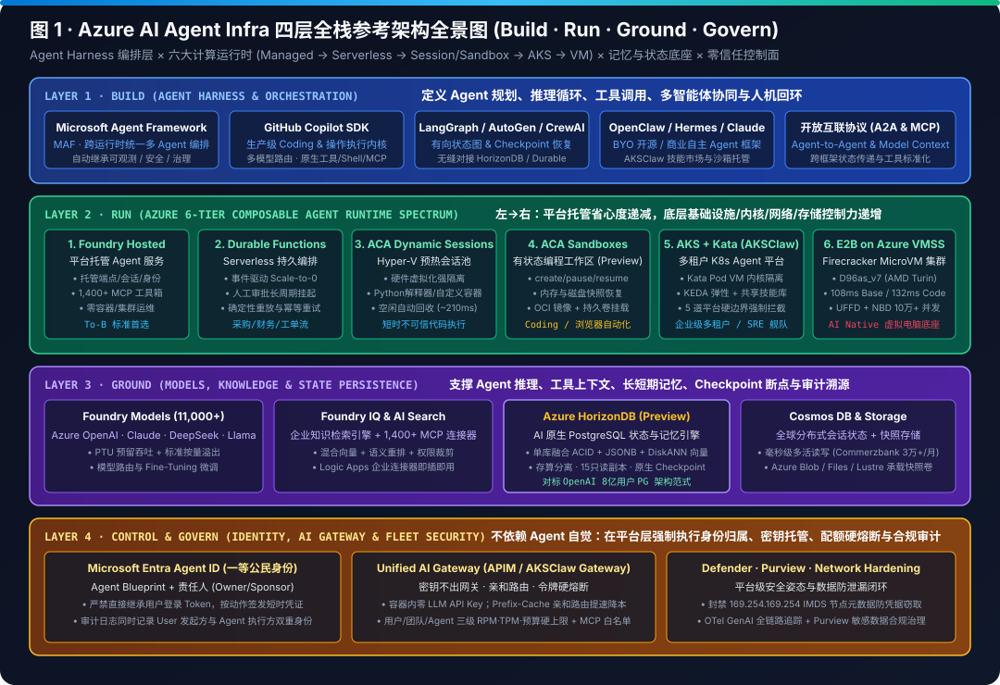
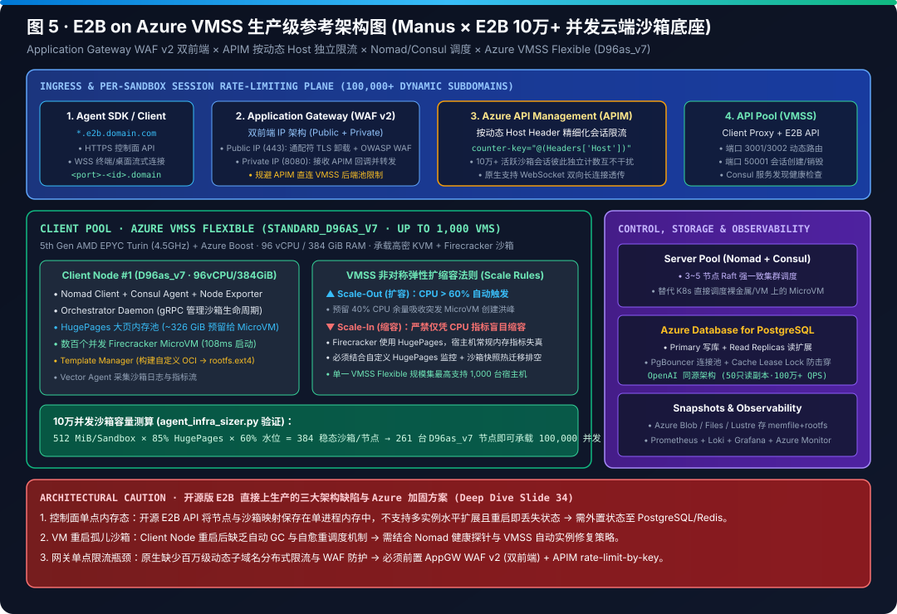
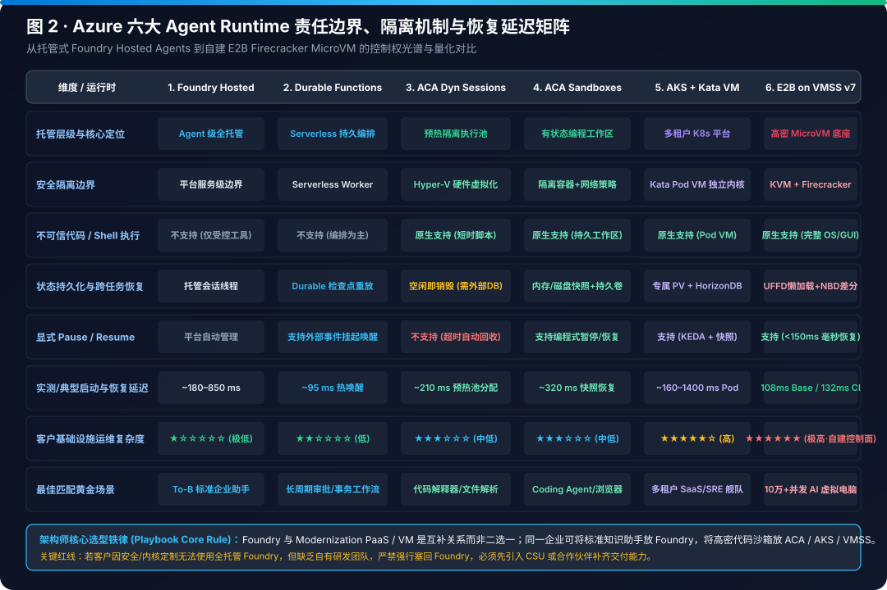
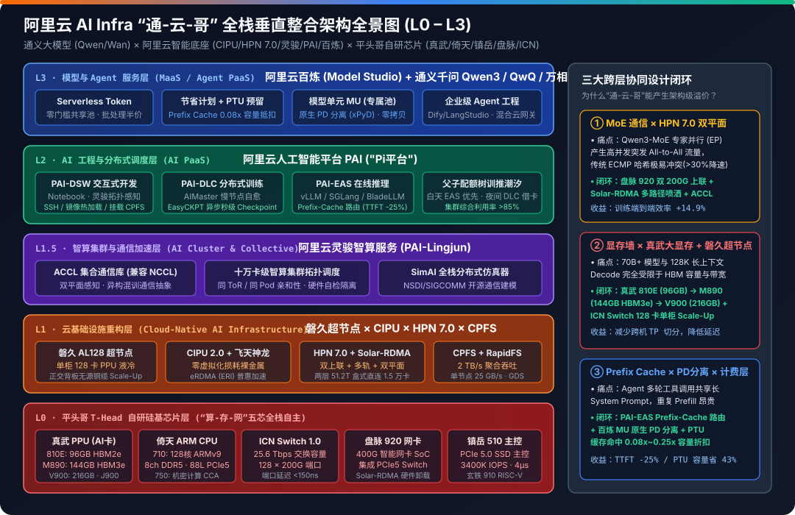

# AI Infra Lab — 云原生与企业级 AI 基础设施架构实验室

> 🌐 **Language / 语言切换**: **中文主页 (`README.md`)** | **[🇬🇧 English Homepage (`README.en.md`)](README.en.md)** | **[📚 423 篇架构选型决策库 (`docs/azure-agent-infra/`)](docs/azure-agent-infra/README.md)** | **[🛠️ 28 章全栈手册与蓝图 (`workshops/azure-agent-infra/`)](workshops/azure-agent-infra/README.md)**

面向 **Cloud & AI Solution Architect（云与 AI 解决方案架构师）** 的生产级参考架构、平台选型权衡（Trade-offs）、容量与 TCO 测算模型以及可部署基础设施即代码（IaC）知识库。本仓库聚焦企业在落地大规模 LLM 推理、多智能体编排与安全沙箱时的真实架构决策：

- **应用场景（Application Scenarios）**：不受信任代码执行沙箱、千至十万并发云端浏览器/研发智能体、跨区域 PTU/PAYG 模型路由网关、基于 Microsoft Entra Agent ID 的零信任身份委派（OBO）、高并发智能体状态检查点（Checkpointing）与多云智算底座对标。
- **参考架构（Reference Architectures）**：`Build · Run · Ground · Govern` 六层企业级智能体全栈架构、`AKSClaw` 五道多租户硬边界、`E2B on Azure VMSS` 十万并发 Firecracker MicroVM 拓扑，以及跨云 L0–L3（芯片—超节点网络—调度平台—MaaS）垂直整合架构。
- **平台选型权衡（Platform Selection Trade-offs）**：量化对比隔离边界（MicroVM vs Hypervisor Pod VM vs 容器）、冷启动/快照恢复延迟（`80 ms / 108 ms` vs `1,420 ms`）、吞吐可预测性（PTU 预留 vs Serverless PAYG 溢出 vs AKS KAITO 自托管）与月度 TCO。



---

## 🧭 四大核心资产模块（Core Deliverables · 100% 中英双语）

| 模块 | 架构师核心问题与覆盖范围 | 资产规模 | 快速入口（中文 / English） |
|---|---|---|---|
| **1. Azure AI 与智能体架构选型决策库** | 8 大企业架构域：**沙箱与执行环境**（ACA Dynamic Sessions / Foundry Code Interpreter / AKS Kata / E2B）、**模型托管与 GPU**（PTU / Serverless GPU / AKS KAITO）、**AI Gateway 与协议**（APIM 令牌治理 / A2A + Remote MCP）、**零信任身份与网络**（Entra Agent ID OBO / Private Link）、**状态存储**（Cosmos DB / Managed Redis / PostgreSQL `pgvector`）、**企业知识底座**（AI Search Hybrid RAG / Fabric IQ）、**可观测与 FinOps**、**跨栈编排**（Copilot Studio / Power Automate / Playwright MCP） | **423 篇**双语选型 FAQ（`846` 份文档）+ **8 张**矢量架构图 | [🇨🇳 中文选型总览](docs/azure-agent-infra/README.md) · [🇬🇧 EN Catalog](docs/azure-agent-infra/README.en.md) |
| **2. Azure AI Agent Infra 全栈架构手册与工程套件** | **28 章全栈架构 Playbook** + **23 套生产级 IaC 蓝图**（Bicep / AKS Kata RuntimeClass / Cilium IMDS 封禁 / Nomad / APIM AI Gateway XML / OTEL Collector）+ **确定性容量与成本测算器**（`agent_infra_sizer.py`）+ **7-Card 4:5 基准测试报告** + **交互式 H5 仿真工作台** | 28 章手册 · 23 套蓝图 · 16 张 SVG · 34 项单测 | [🇨🇳 Playbook 中文版](workshops/azure-agent-infra/README.md) · [🇬🇧 EN Playbook](workshops/azure-agent-infra/README.en.md) · [📊 7-Card 评测](workshops/azure-agent-infra/test-report.md) |
| **3. 阿里云 AI Infra 全栈架构深度测评（跨云对标）** | 系统拆解 **L0 平头哥自研芯片**（真武 810E PPU / 倚天 CPU / ICN 交换芯片 / 磐脉网卡 / 镇岳主控）、**L1 磐久 AL128 超节点与 HPN 7.0 双平面网络**（Solar-RDMA / ACCL / CPFS）、**L2 PAI 潮汐配额与 PD 分离推理**、**L3 百炼平台（Token / PTU / DTU / MU）**，并与 **Azure / AWS / GCP** 逐层横向对标 | L0–L3 深度报告 + **6 张**高清矢量架构图 | [🇨🇳 中文深度测评](docs/alibaba-cloud-ai-infra/README.md) · [🇬🇧 EN Evaluation](docs/alibaba-cloud-ai-infra/README.en.md) |
| **4. AI 基础设施硬核架构视频脚本库** | 面向技术分享与高管汇报的分幕双语脚本：**EP03**（FlashInfer 0.6 块稀疏算子与 Mooncake RDMA PD 分离架构）与 **EP05**（Azure 企业级零信任 Agent 硬件沙箱与 APIM AI Gateway） | **2 期**完整四幕双语分镜脚本 | [🇨🇳 视频脚本目录](docs/video-explainers/README.md) · [🇬🇧 Video Index](docs/video-explainers/README.en.md) |

---

## ⚡ 高频架构选型速查矩阵（Top Architecture Selection Trade-offs）

| 业务场景 | 首选推荐方案 | 备选 / 演进方案 | 关键决策分水岭（SA 定量判据） | 对应深度指南 |
|---|---|---|---|---|
| **不受信任的 Python / Shell 代码执行** | **ACA Dynamic Sessions**（全托管 Hyper-V 强隔离） | **AKS Kata Containers** / **E2B on VMSS** | 免运维毫秒级热池选 Dynamic Sessions；需自定义 RootFS、GPU 或 `100K` 并发快照恢复（`108 ms`）选 AKS Kata / E2B | [代码沙箱选型](docs/azure-agent-infra/aca-dynamic-sessions-vs-foundry-code-interpreter-vs-aks-sandbox-selection-faq.md) |
| **企业大模型推理与开源权重托管** | **Foundry PTU + PAYG 溢出**（核心生产 SLA） | **ACA Serverless GPU** / **AKS KAITO** | P99 延迟敏感且利用率 `>60%` 选 PTU；波峰波谷剧烈的轻量自研模型选 Serverless GPU；千卡级 vLLM/SGLang 深度定制选 AKS KAITO | [GPU 与端点选型](docs/azure-agent-infra/aca-serverless-gpu-vs-foundry-managed-endpoints-vs-aks-kaito-custom-model-hosting-selection-faq.md) |
| **多模型统一网关与远程工具治理** | **Azure API Management (AI Gateway)** | 应用内直连 SDK（仅限单团队 PoC） | 多团队共享配额必须前置 APIM 实现 `llm-token-limit` 令牌限流、语义缓存、PTU 429 自动降级切换与 MCP Streamable HTTP 鉴权 | [APIM A2A+MCP 治理](docs/azure-agent-infra/a2a-mcp-federation-apim-istio-ambient-faq.md) |
| **智能体访问下游受保护企业数据** | **Microsoft Entra Agent ID + OBO 委派令牌** | Managed Identity（仅限无用户上下文后台任务） | 只要涉及自然人权限边界（SharePoint / SQL 行级安全 / CRM），严禁共享高权限应用密钥，必须走 OBO 细粒度审计 | [Entra Agent ID OBO](docs/azure-agent-infra/entra-agent-id-workload-federation-cae-jit-pim-faq.md) |
| **多轮会话记忆与工作流状态持久化** | **Cosmos DB**（持久化检查点）+ **Managed Redis**（亚毫秒热锁） | **Azure Database for PostgreSQL (`pgvector`)** | 跨区域多活与海量 JSON 会话状态选 Cosmos DB；工具幂等锁与流式增量缓冲选 Redis；强关系事务联合查询选 PostgreSQL | [状态存储三选一](docs/azure-agent-infra/cosmos-vs-managed-redis-vs-pgvector-agent-state-memory-selection-faq.md) |
| **企业流程自动化与遗留系统 UI 操作** | **Copilot Studio**（对话编排）+ **Power Automate**（API 连接器） | **Playwright MCP**（受控沙箱浏览器） | 有标准连接器走 Power Automate；仅当老旧系统无 API 时在隔离沙箱运行 Playwright MCP，并在写操作前强制人工审批（HITL） | [低代码与浏览器自动化](docs/azure-agent-infra/copilot-studio-computer-use-rpa-vs-power-automate-vs-playwright-mcp-legacy-ui-automation-selection-faq.md) |

---

## 🏗️ 代表性架构图谱预览（Featured Reference Architecture Diagrams）

### 1. 100K 并发沙箱生产拓扑与五步落地工作流（`Standard_D96as_v7` · `~$148K/mo` 优化后 TCO）


### 2. Azure 六大智能体运行时光谱对比矩阵（隔离级别 · 状态持久化 · 恢复延迟）


### 3. 阿里云“通-云-哥” L0–L3 全栈垂直整合架构（跨云对标参考）


---

## 🗂️ 仓库目录结构（Repository Layout）

```text
ai-infra-lab/
├── README.md / README.en.md          # 中英双语仓库总览与高频选型矩阵
├── docs/
│   ├── README.md / README.en.md      # 文档中心总索引（中英双语）
│   ├── azure-agent-infra/            # 423 篇企业级 Azure AI 与智能体架构选型 FAQ（846 份双语文档 + 8 张 SVG）
│   ├── alibaba-cloud-ai-infra/       # 阿里云 L0–L3 AI Infra 全栈测评与跨云对标报告（双语 + 6 张 SVG）
│   └── video-explainers/             # AI 基础设施硬核架构科普视频分镜脚本（EP03 · EP05 双语）
└── workshops/
    └── azure-agent-infra/            # 28 章全栈架构 Playbook、23 套 IaC 蓝图、容量测算器、H5 工作台与 7-Card 评测报告
        ├── blueprints/               # 23 套可直接裁剪落地的 Bicep / K8s Kata / Cilium / APIM / OTEL 生产模板
        ├── simulator/                # 确定性容量与成本测算引擎（agent_infra_sizer.py）及 34 项单测套件
        ├── demo/                     # 零外部依赖全链路本地仿真验证脚本（run_live_demo.py）
        └── index.html / cards.html   # 离线自包含交互式架构工作台与 7-Card 4:5 基准测试报告卡
```

---

## 🧪 本地快速验证（Quick Verification）

本仓库所有容量测算器、JSON 数据契约、SVG 图表语法、CSP 安全头及文档相对链接均配备零第三方依赖的 Python 标准库验证套件：

```powershell
# 1. 校验确定性容量与 TCO 测算结果与已归档基准报告完全一致
python workshops/azure-agent-infra/simulator/agent_infra_sizer.py --check

# 2. 运行全部 34 项架构测算、数据契约与链接完整性单元测试
python workshops/azure-agent-infra/simulator/test_agent_infra_sizer.py

# 3. 运行本地全链路选型与沙箱容量仿真自检
python workshops/azure-agent-infra/demo/run_live_demo.py --self-test
```
