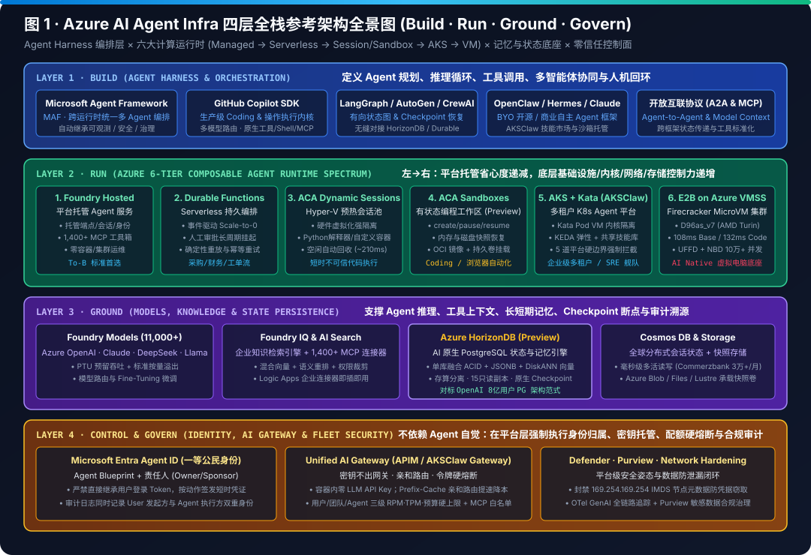
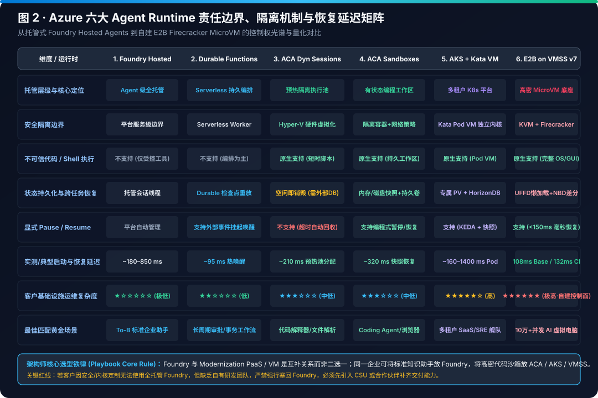
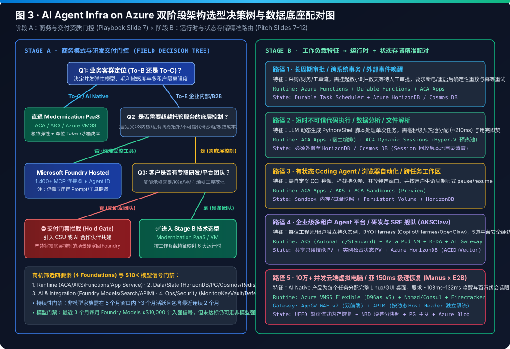
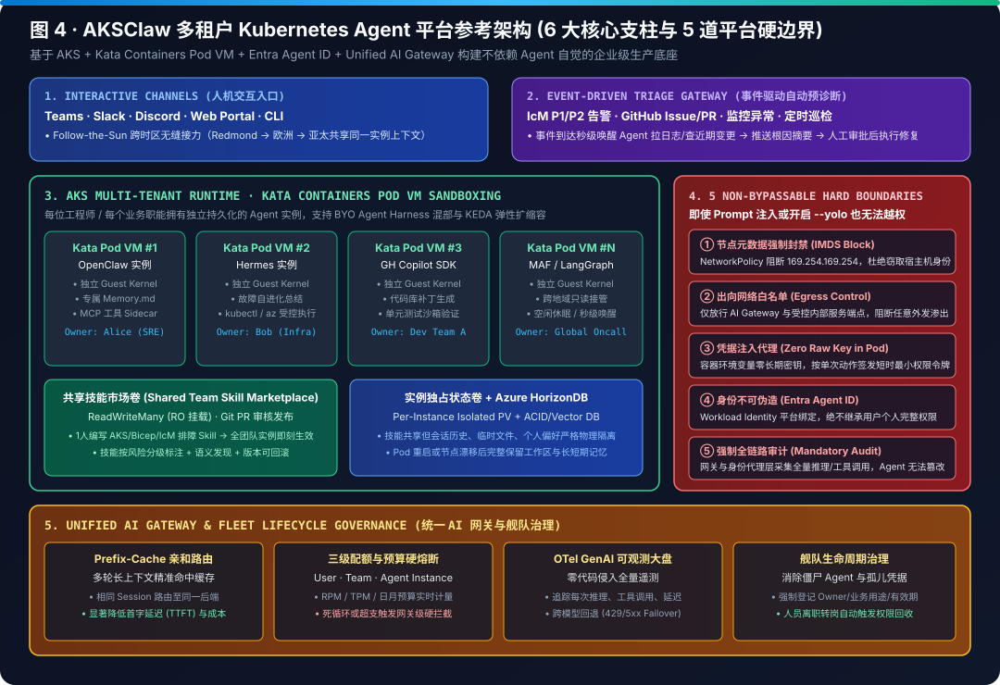
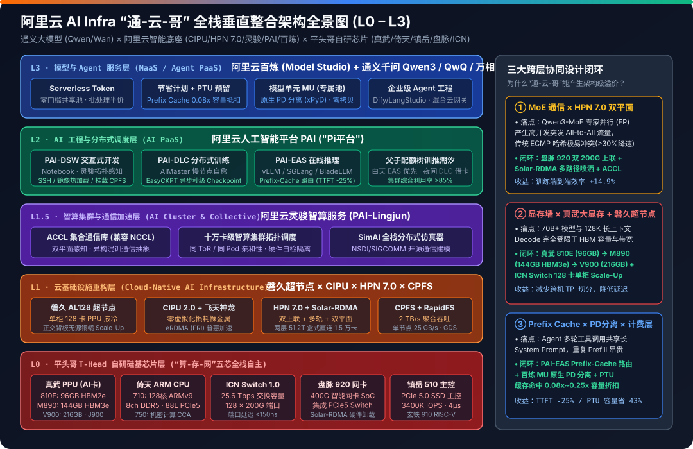
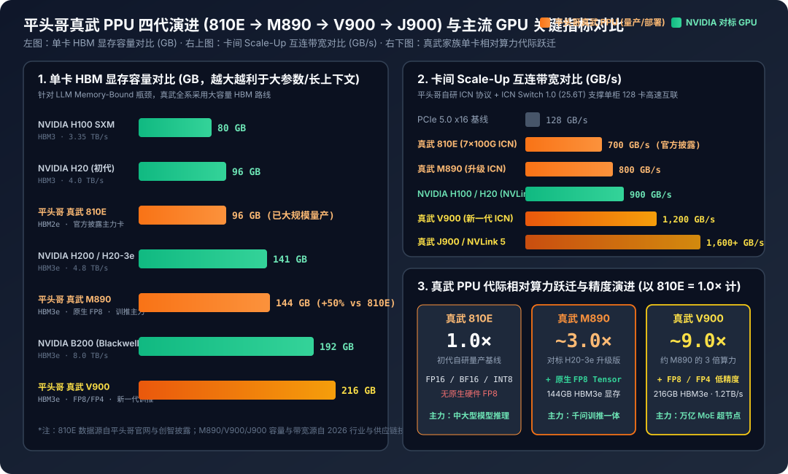
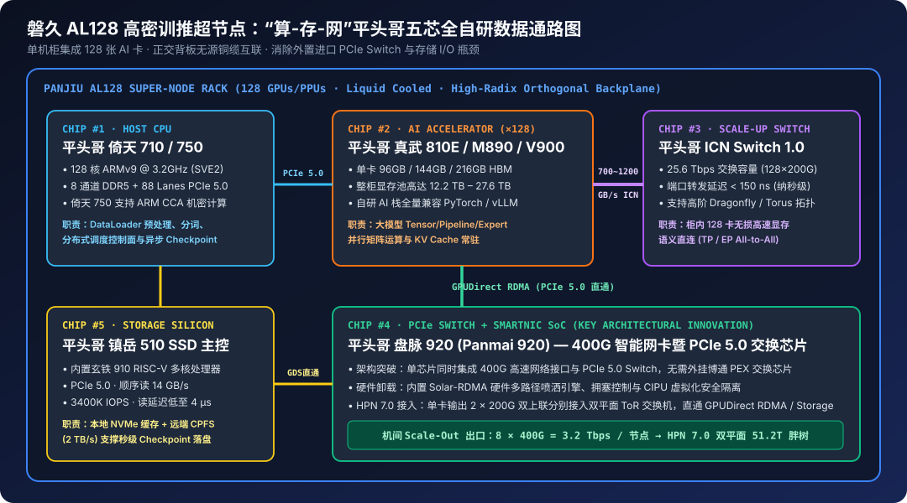
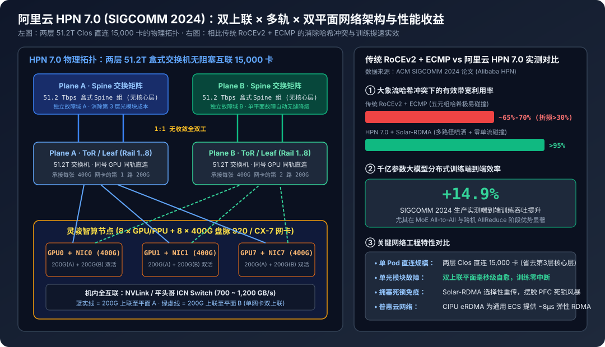
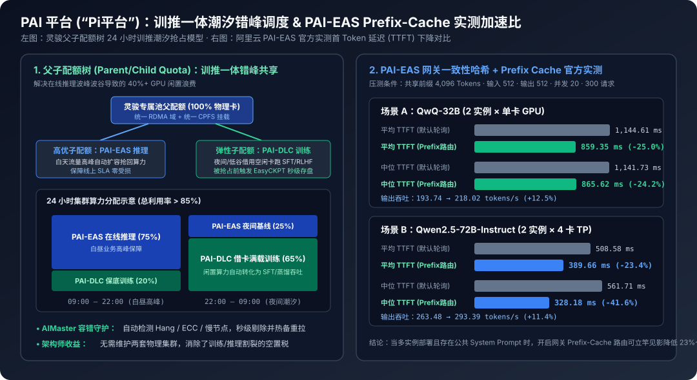
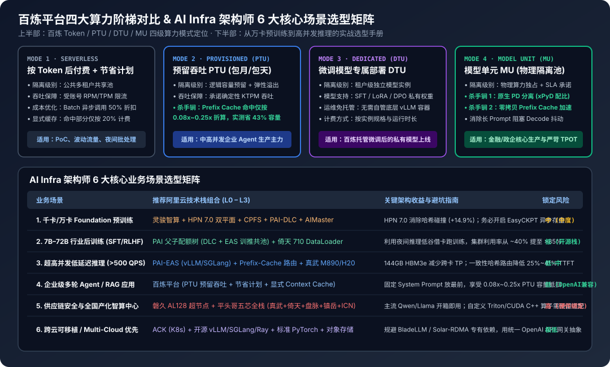

# AI Infra Lab (`turbo998/ai-infra-lab`) · 中英双语版 (Bilingual Edition)

> 🌐 **Language / 语言版本切换**: **[🇨🇳 中文主页 (README.zh-CN.md)](README.zh-CN.md)** | **[🇬🇧 English Homepage (README.en.md)](README.en.md)** | **[📘 Azure Agent Infra Playbook (中文)](docs/azure-agent-infra/README.zh-CN.md)** | **[📘 Azure Agent Infra Playbook (English)](docs/azure-agent-infra/README.en.md)**

面向 **AI Infra 架构师** 的云厂商与智算基础设施全栈技术深度测评与可视化图谱仓库，覆盖 **AI 算力芯片（GPU / PPU / ASIC / CPU / Switch / SmartNIC / SSD 主控）**、**超节点与 Scale-Up/Scale-Out 智算网络（RDMA / RoCE / CXL / ICN）**、**异构算力调度平台**、**云原生分布式训推平台** 与 **企业级 MaaS / AI Agent 运行时与安全沙箱基础设施（Azure AI Agent Infra）**。

---

## 📚 深度测评报告目录（Research & Architecture Evaluations · Bilingual EN/中文）

| 专题报告 | 核心覆盖范围 | 可视化图表 (`SVG` + `H5` + `7-Card`) | 证据台账 | 审校记录 | 更新日期 |
|---|---|---|---|---|---|
| **[Azure AI Agent Infra 全栈方案设计、技术选型与架构师 Playbook (中文)](docs/azure-agent-infra/README.md)** · **[English Edition](docs/azure-agent-infra/README.en.md)** | **L1 Build 编排层**（MAF · GitHub Copilot SDK · LangGraph · OpenClaw · Hermes · MCP/A2A）· **L2 Run 六大运行时光谱**（Foundry Hosted Agents · Durable Functions · ACA Dynamic Sessions · ACA Sandboxes Preview · AKS + Kata `AKSClaw` · E2B on Azure VMSS `D96as_v7` `108ms/132ms`）· **L3 Ground 状态与记忆底座**（Azure HorizonDB Preview + PgBouncer 5ms + Cosmos DB + Firecracker UFFD/NBD Snapshot）· **L4 Govern 零信任控制面**（Entra Agent ID · Unified AI Gateway · 169.254.169.254 IMDS 封禁 · 5 道平台硬边界）· **254 章行业物理模型、247 套 IaC 蓝图与 246 项交互式测算器（255/255 单测全绿）** | 8 张高清矢量架构图 + [7-Card 基准报告 (中文)](docs/azure-agent-infra/test-report.md) / [English](docs/azure-agent-infra/test-report.en.md) + [4 页交互式双语 H5 套件](docs/azure-agent-infra/h5/index.html) + [可运行 Demo](docs/azure-agent-infra/demo/run_live_demo.py) | [`evidence.json`](docs/azure-agent-infra/evidence.json)（5 份核心工程资产 + 官方信源） | [`review.md`](docs/azure-agent-infra/review.md) | 2026-10-26 |
| **[阿里云 AI Infra 全栈架构深度测评报告](docs/alibaba-cloud-ai-infra/README.md)** | **L0 平头哥芯片**（含光 800、真武 810E / M890 / V900 / J900、倚天 710/750、ICN Switch 1.0、磐脉 920、镇岳 510）· **L1 智算底座与网络**（磐久 AL128 超节点、CIPU、HPN 7.0 双上联×多轨×双平面、Solar-RDMA、eRDMA、ACCL、CPFS）· **L1.5 灵骏智算**（`hz` 亲和性调度、双平面网卡）· **L2 人工智能平台 PAI（“Pi平台”）**（DSW / DLC AIMaster+EasyCKPT / EAS Prefix-Cache 路由+EP/PD 分离 / 父子配额潮汐抢占）· **L3 百炼平台（Model Studio）**（Token / PTU / DTU / MU 四大算力阶梯与后训练流水线） | 6 张高清矢量架构图 + 2 幅交互式 Mermaid 决策图 | [`evidence.json`](docs/alibaba-cloud-ai-infra/evidence.json)（21 篇一手信源） | [`review.md`](docs/alibaba-cloud-ai-infra/review.md) | 2026-10-14 |

---

## 📊 Azure AI Agent Infra 核心可视化图谱速览（Visual Atlas）

- **核心技术资产入口（中英双语 / Bilingual）**：[完整 Playbook 中文版 (`README.zh-CN.md`)](docs/azure-agent-infra/README.zh-CN.md) · [English Full Playbook (`README.en.md`)](docs/azure-agent-infra/README.en.md) · [7-Card 4:5 基准评测报告 (中文)](docs/azure-agent-infra/test-report.md) · [7-Card Benchmark Report (EN)](docs/azure-agent-infra/test-report.en.md) · [离线自包含 7-Card HTML (`test-report-cards.html`)](docs/azure-agent-infra/test-report-cards.html) · [交互式 H5 全景手册 (`h5/index.html`)](docs/azure-agent-infra/h5/index.html) · [AKSClaw × E2B 实时仿真台 (`h5/demo.html`)](docs/azure-agent-infra/h5/demo.html) · [选型决策与 10万沙箱计算器 (`h5/selector.html`)](docs/azure-agent-infra/h5/selector.html) · [64 套 IaC 与网关策略蓝图 (`blueprints/`)](docs/azure-agent-infra/blueprints)

### 1. Azure AI Agent Infra 四层全栈参考架构全景图（Build · Run · Ground · Govern）

### 2. Azure 六大 Agent Runtime 责任边界、隔离机制与恢复延迟对比矩阵

### 3. AI Agent Infra on Azure 双阶段架构选型决策树与数据底座配对图

### 4. AKSClaw 多租户 Kubernetes Agent 平台参考架构（六大支柱与五道平台硬边界）

### 5. E2B on Azure VMSS 生产级参考架构图（Manus × E2B 10万+ 并发云端沙箱底座）

### 6. Firecracker MicroVM 沙箱内部机理（UFFD + NBD）与 Azure v6/v7 实测启动延迟对比

### 7. 多智能体协同工作流（MAF × Copilot SDK × Durable）与状态持久化选型矩阵

### 8. Azure Agent Infra Playbook 六大高优场景、四维资质筛查与五步落地工作流

---

## 📊 阿里云 AI Infra 核心可视化图谱速览（Visual Atlas）

### 1. “通-云-哥” L0–L3 全栈垂直整合架构与三大跨层协同闭环

### 2. 平头哥真武 PPU 四代演进（810E → M890 → V900 → J900）与主流 GPU 关键指标对比

### 3. 磐久 AL128 高密超节点“算-存-网”平头哥五芯全自研数据通路图

### 4. 阿里云 HPN 7.0（SIGCOMM 2024）双上联 × 多轨 × 双平面网络架构与实测收益

### 5. PAI 训推一体潮汐配额树与 PAI-EAS Prefix-Cache 智能路由官方实测加速比

### 6. 百炼平台四大算力阶梯对比与 AI Infra 架构师 6 大核心场景选型矩阵

