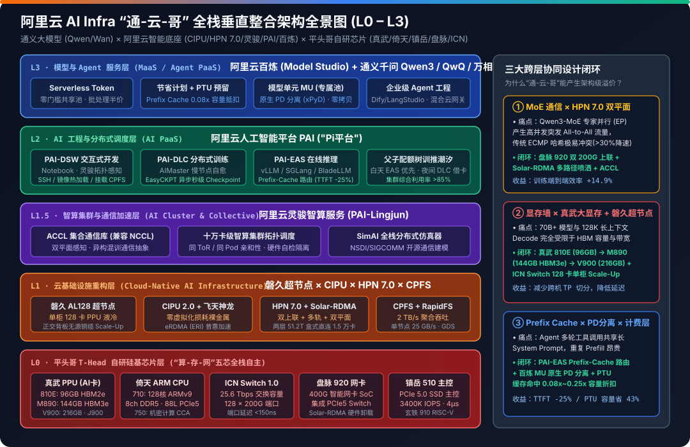
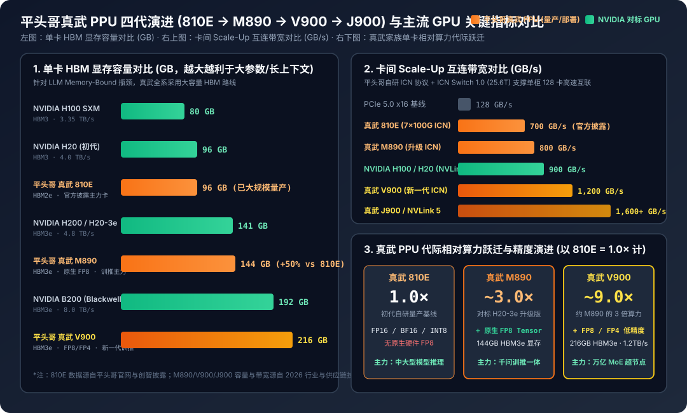
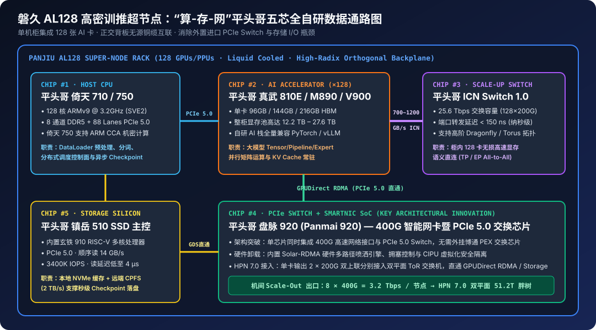
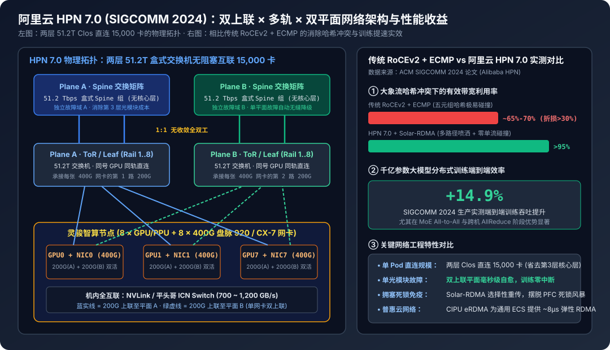
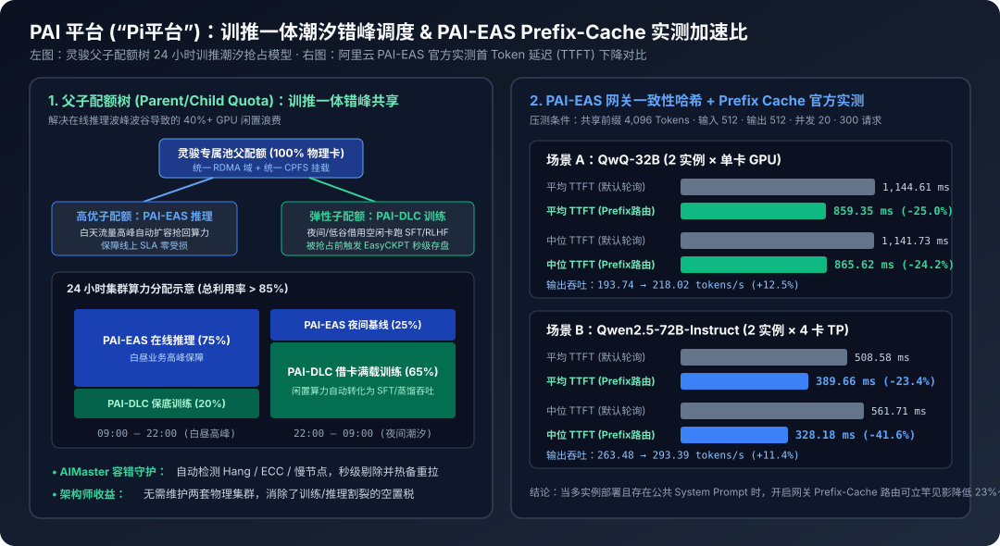
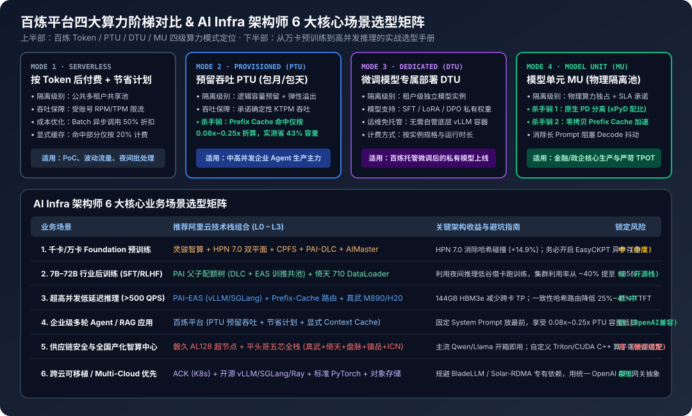

# Alibaba Cloud Full-Stack AI Infrastructure Architectural Evaluation: From T-Head Silicon to Panjiu Supernodes, HPN 7.0, PAI & Bailian

> 🌐 **Language / 语言切换**: **[🇨🇳 中文完整版 (`README.md`)](README.md)** | **English Edition (Current)** | **[🧭 Azure 84 Selection FAQs (`../azure-agent-infra/README.en.md`)](../azure-agent-infra/README.en.md)** | **[🏠 Repository Home (`../../README.en.md`)](../../README.en.md)**

- **Evaluation Date**: 2026-10-14
- **Positioning (Solution Architect Lens)**: Full-stack architectural evaluation of Alibaba Cloud's L0–L3 AI infrastructure stack — analyzing silicon trade-offs, scale-up/scale-out networking, cluster scheduling, MaaS pricing tiers, and multi-cloud comparison against **Microsoft Azure**, **AWS**, and **Google Cloud** (architectural specification analysis; not an independent hardware benchmark).
- **Stack Scope (`L0 – L3`)**:
  - **L0 — Custom Silicon (T-Head / Pingtouge)**: Zhenwu AI Accelerators/PPUs (`Hanguang 800 → Zhenwu 810E → M890 → V900 → J900`), Yitian Arm Server CPUs (`710 / 720 / 730 / 750`), Scale-Up Interconnect Switch (`ICN Switch 1.0`), AI SmartNIC (`Panmai 920`), and Enterprise PCIe 5.0 SSD Controller (`Zhenyue 510`).
  - **L1 — Compute, Storage & Network Fabric**: `Panjiu AL128` cableless orthogonal supernode rack, `CIPU` infrastructure offload processor, `HPN 7.0` (*SIGCOMM 2024* dual-uplink × multi-rail × dual-plane Clos), `Solar-RDMA`, `ACCL` collective communication library, and `CPFS` parallel file system.
  - **L1.5 / L2 — AI Cluster & Engineering Platform**: `PAI-Lingjun` bare-metal HPN clusters and `Platform for AI (PAI)` (`PAI-DLC` distributed training, `PAI-EAS` prefix-cached & EP/PD-disaggregated serving, `PAI-DSW` notebooks, and hierarchical parent-child tidal quota preemption).
  - **L3 — Managed Model & Agent Platform**: `Alibaba Cloud Bailian (Model Studio)` (`CPT → SFT → DPO → RL` post-training pipeline and 4-tier serving consumption: `Pay-per-Token` → `PTU` → `DTU` → `MU` native PD-disaggregated units).

---

## 0. Executive Summary (One-Page Solution Architect Verdict)

Alibaba Cloud is one of the few cloud providers globally executing full **"Tong-Yun-Ge" (`Qwen Foundation Models + Alibaba Cloud Infra + T-Head Custom Silicon`) L0–L3 vertical integration**, analogous in strategic structure to **AWS (`Trainium/Graviton/Nitro + UltraCluster + SageMaker + Bedrock`)**, **Google Cloud (`TPU + ICI/Jupiter + Vertex AI`)**, and **Microsoft Azure (`Maia/Cobalt/Boost + InfiniBand/ Quantum-2 + AKS/KAITO + Microsoft Foundry`)**:

1. **T-Head PPU Silicon Strategy: Offsetting Per-Die Raw FLOP Constraints via HBM Capacity + High Scale-Up Bandwidth**:
   - Across `Zhenwu 810E` (`96 GB HBM2e`, `700 GB/s` interconnect) → `Zhenwu M890` (`144 GB HBM3`, `800 GB/s` 8×ICN, `3×` 810E performance) → `Zhenwu V900` (`216 GB HBM`, `1,200 GB/s` interconnect, `3×` M890 performance, targeting 2027Q1 volume) plus native `FP8 / FP4`, each generation scales **HBM capacity and inter-chip bandwidth by ~50%+**.
   - Architectural intent: optimize specifically for **trillion-parameter sparse MoE weight residency (`Qwen3.5/3.8`, `DeepSeek-V3/V4`, `Kimi`)** and **memory-bandwidth-bound million-token KV-Cache decode** in agentic workloads.
2. **Five-Chip Co-Design Inside the `Panjiu AL128` Supernode**:
   - Combining `Zhenwu PPU` + `Yitian 710/750 Arm CPU` (native ICN link on 750) + `ICN Switch 1.0` (`25.6 Tbps`, `<150 ns` latency, unified load/store memory addressing) + `Panmai 920` (`400G` SmartNIC with integrated PCIe switch) + `Zhenyue 510` (`PCIe 5.0` SSD controller, `3.4M IOPS`, `4 μs` latency, ZNS+QLC for KV-Cache offloading & fast checkpoints) creates a **64/128-card lossless single-rack Scale-Up domain (`GP9A`)**.
3. **HPN 7.0 + Solar-RDMA Solves RoCEv2 Elephant-Flow Polarization at 15,000-GPU Scale**:
   - Published at *SIGCOMM 2024*, **HPN 7.0** uses a **Dual-Uplink + Multi-Rail + Dual-Plane** design over `51.2 Tbps` switches to connect `15,000+` accelerators in a 2-tier non-blocking Clos fabric, eliminating single-ToR blast radius and PFC deadlock storms. Paired with CIPU-offloaded **Solar-RDMA** (multipath packet spraying + HPCC congestion control) and **ACCL**, effective distributed training utilization improves by **+14.9%**.
4. **Clear L1.5 / L2 / L3 Platform Funnel (`Lingjun → PAI → Bailian`)**:
   - **PAI-Lingjun (`L1.5`)**: HPN-aware (`hz`) bare-metal supernodes, dual-plane pod networking (`net0` RDMA + `eth1` VPC), automated hardware sanity checks, and hot-standby node swap.
   - **PAI (`L2`)**: Hierarchical **Parent-Child Quota Tree** (daytime `PAI-EAS` online inference preempts capacity; nighttime `PAI-DLC` training backfills valleys for `>85%` cluster utilization), **EAS Prefix-Cache routing (`-23%` to `-25%` TTFT)**, and one-click **MoE EP + Prefill/Decode (PD) disaggregation**.
   - **Bailian / Model Studio (`L3`)**: Four consumption tiers — **Pay-per-Token**, **PTU** (Provisioned Throughput with `0.08×–0.25×` cached-prefix token discount), **DTU** (Dedicated Throughput), and **MU** (Model Units exposing explicit Prefill vs. Decode instance ratios).
5. **Key Architectural Risks & Multi-Cloud Trade-Offs for Enterprise SAs**:
   - **CUDA Ecosystem Gap**: T-Head's `SAIL` software stack is deeply tuned for mainstream Chinese/open foundation models (`Qwen`, `DeepSeek`, `Kimi`), but custom CUDA C++/PTX kernels or niche scientific operators incur non-trivial porting cost.
   - **Peak TFLOPS Opacity**: Public datasheets disclose generational multipliers (`3×`) and HBM/interconnect bandwidth rather than absolute dense/sparse TFLOPS per precision tier — always run end-to-end PoC benchmarks on real customer prompts before sizing multi-year commitments.
   - **Commercial & Stack Lock-In**: Flagship supernode SKUs (`GP9A`) and `DTU` pools have regional concentration, allowlist gating, and early-termination multipliers (`1.2×` on consumed months), while deep adoption of `ICN + Solar-RDMA + ACCL + BladeLLM` increases cross-cloud portability friction.

---

## 1. Visual Architecture Atlas (6 Verified SVG Diagrams)

1. [Figure 1: Alibaba Cloud "Tong-Yun-Ge" L0–L3 Full-Stack Vertical Integration & Cross-Layer Loops](assets/01-tong-yun-ge-architecture.svg)
2. [Figure 2: T-Head Zhenwu PPU 4-Generation Roadmap (`810E → M890 → V900 → J900`) vs. Mainstream GPUs](assets/02-zhenwu-ppu-vs-gpu-comparison.svg)
3. [Figure 3: Panjiu AL128 Supernode Five-Chip Compute-Storage-Network Datapath](assets/03-panjiu-al128-five-chip-datapath.svg)
4. [Figure 4: HPN 7.0 (*SIGCOMM 2024*) Dual-Uplink × Multi-Rail × Dual-Plane Fabric Topology](assets/04-hpn7-dual-plane-topology.svg)
5. [Figure 5: PAI Parent-Child Quota Tidal Preemption & PAI-EAS Prefix-Cache Speedup](assets/05-pai-tidal-preemption-and-eas-benchmark.svg)
6. [Figure 6: Bailian 4-Tier Consumption Ladder & Solution Architect 6-Scenario Decision Matrix](assets/06-bailian-resource-modes-and-architect-matrix.svg)

---

## 2. L0 Custom Silicon Matrix (T-Head / Pingtouge)

| Silicon Family | Generation / SKU | Key Architectural Specs | Target AI Infra Bottleneck Addressed |
|---|---|---|---|
| **Zhenwu PPU (AI Accelerator)** | `810E` → `M890` → `V900` → `J900` | `96 GB HBM2e (700 GB/s)` → `144 GB HBM3 (800 GB/s, 3×)` → `216 GB HBM (1,200 GB/s, 3× M890)`; `FP8 / FP4` | Sparse MoE active/total weight residency & long-context KV-Cache HBM bandwidth wall |
| **Yitian Arm Server CPU** | `Yitian 710` (128c) → `Yitian 750` | Armv9 server host CPU; `750` adds native `ICN` protocol direct PPU attach | Eliminates PCIe root-complex bottlenecks for host-to-accelerator KV/embedding transfers |
| **Scale-Up Switch ASIC** | `ICN Switch 1.0` | `25.6 Tbps` switching capacity, `<150 ns` port-to-port latency, unified memory load/store | Enables 64/128-card rack-scale unified memory domain (`All-to-All` MoE expert dispatch) |
| **AI SmartNIC** | `Panmai 920` | `400 Gbps` throughput + integrated PCIe Switch | Direct GPU-NIC-NVMe data path bypassing host CPU bounce buffers |
| **Enterprise SSD Controller** | `Zhenyue 510` | `PCIe 5.0`, `3,400K IOPS`, `4 μs` latency, `ZNS + QLC` support | Tiered NVMe KV-Cache offloading & multi-terabyte distributed training checkpointing |

---

## 3. L1 Supernode & Scale-Out Networking (`Panjiu AL128` + `HPN 7.0`)

- **Scale-Up (`Panjiu AL128`)**: Cableless orthogonal backplane connects up to 64/128 accelerators inside a single liquid-cooled supernode rack via `ICN Switch 1.0`, isolating latency-sensitive Tensor Parallelism (`TP`) and Expert Parallelism (`EP`) traffic inside sub-150ns rack fabric.
- **Scale-Out (`HPN 7.0` + `Solar-RDMA`)**: Replaces fragile single-ToR RoCEv2 with dual-plane rail-optimized `51.2 Tbps` switches (`15,000+` GPUs in 2 Clos tiers) and CIPU-accelerated multipath packet spraying, delivering `+14.9%` end-to-end distributed training efficiency.

---

## 4. L1.5 / L2 / L3 Platform Selection & Multi-Cloud Comparison

### 4.1 Cross-Cloud Full-Stack Mapping (Solution Architect Reference)

| Layer | Alibaba Cloud | Microsoft Azure | AWS | Google Cloud |
|---|---|---|---|---|
| **L0 Custom Silicon** | Zhenwu PPU + Yitian Arm + CIPU | Azure Maia + Cobalt Arm + Azure Boost | Trainium / Inferentia + Graviton + Nitro | Cloud TPU (`v5p / Trillium / Ironwood`) + Axion |
| **L1 AI Fabric & Storage** | Panjiu AL128 + HPN 7.0 (`Solar-RDMA`) + CPFS | Quantum-2 InfiniBand / Azure AI RoCE + AMLFS | EC2 UltraCluster (`EFAv2/v3` SRD) + FSx Lustre | Jupiter + Optical Circuit Switching (`ICI`) + Parallelstore |
| **L2 AI Engineering & K8s** | PAI (`DLC / EAS / DSW`) + ACK Lingjun | Azure ML + **AKS (`KAITO / Kata / DRA`)** | Amazon SageMaker HyperPod + EKS | Vertex AI Training/Prediction + GKE |
| **L3 Managed MaaS & Agent PaaS** | **Bailian (`Token / PTU / DTU / MU`)** | **Microsoft Foundry (`Standard / DataZone / PTU`)** | **Amazon Bedrock (`On-Demand / PT`)** | **Vertex AI Model Garden (`PayGo / PT`)** |

### 4.2 Enterprise Selection Decision Summary on Alibaba Cloud

| Enterprise Scenario | Recommended Stack Tier | Key Architectural Rationale |
|---|---|---|
| **Rapid enterprise RAG / Copilot prototyping (`< 50 QPS`, bursty traffic)** | **Bailian Pay-per-Token + Prompt Caching** | Zero GPU idle waste; instant access to `Qwen` / `DeepSeek` frontier models |
| **Steady-state production assistant with strict TTFT SLO & shared system prompts** | **Bailian PTU** (`0.08×–0.25×` prefix-cache token discount) | Predictable throughput reservation with major cost reduction on long system/tool prefixes |
| **Long-prompt / short-output asymmetric agentic workloads at high concurrency** | **Bailian MU (Model Units)** or **PAI-EAS PD-Disaggregated Serving** | Independently scales compute-bound Prefill instances vs. HBM-bandwidth-bound Decode instances |
| **Mixed daytime online serving + nighttime SFT/RL post-training on dedicated GPUs** | **PAI-Lingjun + PAI Parent-Child Quota Tree (`EAS + DLC`)** | Daytime inference automatically preempts elastic quota; nighttime training backfills idle GPUs (`>85%` utilization) |
| **Multi-cloud enterprise governance across Azure Foundry + Alibaba Bailian / AWS / GCP** | **Unified AI Gateway (e.g., Azure APIM Multi-Cloud Gateway)** | Standardizes OAuth/Entra identity, token budgets, semantic caching, and regional compliance routing across clouds |

> For the complete section-by-section Chinese hardware parameter tables, PAI configuration details, and primary source index, see [`README.md`](README.md).
