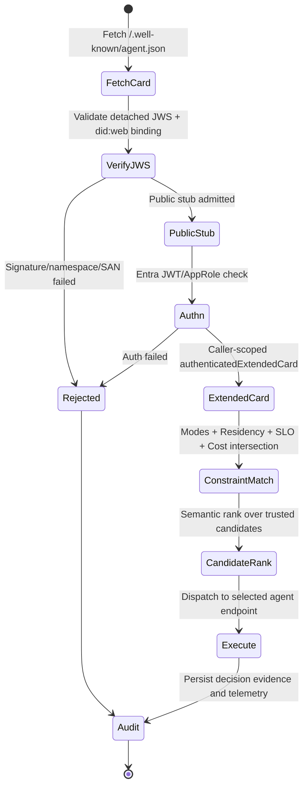

# Enterprise A2A Agent Card Discovery and Capability-Negotiation Selection FAQ: `/.well-known/agent.json` + JWS vs API Center Extended Card Projection vs Semantic Capability Broker

> 🌐 **Language Switch**: [中文](./a2a-agent-card-discovery-capability-negotiation-well-known-jws-vs-apicenter-extended-card-vs-semantic-broker-selection-faq.md) | **English (current)**
> **Audience**: Cloud & AI Solution Architects, API platform owners, cross-organization B2B integration teams, identity and zero-trust governance teams, SRE/FinOps/compliance stakeholders.
> **Scope**: Discovery, negotiation, trust validation, and anti-spoofing governance for `200+` internal and partner agents, spanning `/.well-known/agent.json`, `authenticatedExtendedCard`, semantic capability brokering, static GitOps peer manifests, and mesh-native service discovery.

## 1. Problem framing: why agent discovery becomes a governance-critical control plane once the network crosses dozens of agents
In small pilots, agent discovery often relies on static endpoint lists and informal schema agreements that appear manageable because topology and ownership boundaries are still local and stable.  
When the organization expands to multi-BU, multi-region, and partner-connected ecosystems, the same approach quickly collapses into stale catalogs, inconsistent capability semantics, and unverifiable trust assumptions.  

The first failure mode is untrusted discovery surface ingestion, where any URL that appears to host a valid `agent.json` can be mistakenly treated as authoritative without cryptographic provenance checks and namespace ownership verification.  
The second failure mode is capability hijacking by description manipulation, where adversarial or low-quality publishers overstate skills, embed prompt-injection narratives, or misreport SLO/cost metadata to bias routing decisions.  

The third failure mode is extended-card leakage, where unauthenticated callers can enumerate sensitive internal `skills[]`, `securitySchemes`, or tenant-tier details because projection boundaries are not identity-scoped.  
The fourth failure mode is callback trust breakage, where signed cards still route notifications to unauthorized hosts because callback-domain and certificate SAN binding are not validated at runtime.  

Therefore, enterprise A2A discovery must be engineered as a layered trust-and-negotiation control plane rather than treated as a convenience metadata endpoint.  
The design objective is not “discover more agents faster,” but “discover only verifiable agents, negotiate only policy-compliant capabilities, and route only to runtime-feasible targets with auditable evidence.”  

## 2. Four-pattern architecture portfolio (A/B/C/D): responsibility boundaries and composition logic
Pattern A secures decentralized cross-organization discovery through `/.well-known/agent.json` retrieval with detached JWS verification, `did:web` identity binding, callback-host certificate consistency checks, and APIM outbound SSRF protection.  
Pattern B secures enterprise least-disclosure by implementing a two-tier projection model on Azure API Center + APIM, where public discovery stubs remain minimal and `authenticatedExtendedCard` content is caller-scoped after Entra JWT/AppRole authorization.  

Pattern C secures large-scale routing correctness through a semantic capability broker that combines hybrid skill matching with namespace authority proof and deterministic intersection filtering over modalities, residency, SLO, and budget constraints.  
Pattern D secures low-latency deterministic wiring for stable intra-stamp topologies through static GitOps peer manifests and mesh-native service discovery under Istio Ambient or Kubernetes-native identity boundaries.  

These patterns are additive and should be assembled by risk domain and topology volatility rather than framed as mutually exclusive implementation choices.  
In mature enterprise networks, A is the minimum trust baseline, B is the minimum disclosure baseline, C is the scaling core for correctness, and D is the deterministic fast lane for stable fixed peer graphs.  

## 3. End-to-end reference architecture: decoupling trust discovery, governed catalog projection, semantic negotiation, and execution planes
```mermaid
flowchart LR
    CL[Client Agent / Orchestrator] --> GW[APIM AI Gateway]
    GW --> DISC[Discovery Service]
    DISC --> WK[/.well-known/agent.json]
    DISC --> SIG[JWS Detached Verify]
    SIG --> DID[did:web / JWKS Binding]
    DISC --> SSRF[Outbound SSRF Guard]

    GW --> CATALOG[API Center Agent Catalog]
    CATALOG --> PUB[Public Agent Stub]
    CATALOG --> EXT[authenticatedExtendedCard Projection]
    EXT --> ENTRA[Entra JWT/AppRole Validation]

    GW --> BROKER[Semantic Capability Broker]
    BROKER --> SEARCH[Azure AI Search Hybrid Matcher]
    BROKER --> AUTHZ[Namespace Authority & Signature Check]
    BROKER --> FILTER[Residency/SLO/Cost Constraints]

    BROKER --> TARGET[Selected Agent Endpoint]
    TARGET --> RT[Runtime Agent Service / MAF Workers]
    RT --> OBS[Telemetry + Cost + Audit Ledger]
```

The key architectural property is strict separation between trust validation and capability selection, because a signature-valid card can still be an unsuitable routing target if modality, latency, residency, or cost constraints are violated.  
By isolating these decisions into distinct control layers, incident triage becomes tractable: signature-chain defects are diagnosed in discovery services, overexposure defects are diagnosed in catalog projection policies, and routing-quality defects are diagnosed in semantic brokerage policy and live telemetry fusion.  

This decomposition also enables independent lifecycle management, where key-rotation policy can evolve without retraining semantic rankers, and ranking policy can evolve without modifying signature-validation mechanics.  
At enterprise scale, that decoupling is one of the strongest predictors of sustainable operating cost and change velocity under simultaneous security and performance pressure.  

## 4. Pattern A deep dive: decentralized `/.well-known` discovery with detached JWS and callback-host binding
Pattern A starts from the principle that discoverability is never equivalent to trustworthiness, especially in cross-organization federations where DNS adjacency and naming similarity can be exploited for social and technical spoofing.  
Each discovered card must pass detached JWS signature validation, `did:web` ownership binding, callback host-domain alignment, and certificate SAN consistency checks before it can be admitted into candidate negotiation pools.  

The operational recommendation is to sign cards with keys anchored in Key Vault Managed HSM and expose verifiable key material through controlled JWKS endpoints with explicit key-rotation cadence and overlap windows.  
Validation pipelines should reject cards when signature verification fails, key identity does not map to registered namespace ownership, or callback hosts fall outside approved domain and SAN-bound identity policy.  

APIM outbound SSRF controls are mandatory because discovery crawlers can otherwise be coerced into fetching metadata endpoints, private RFC1918 targets, or internal administrative surfaces that were never intended for external metadata traversal.  
Allowlist-based outbound egress policy with explicit loopback/private-range denial and protocol constraints should be treated as baseline security posture rather than optional hardening.  

Caching strategy should combine bounded TTL with conditional `ETag` revalidation so that latency remains predictable while stale-card risk stays bounded under key rotation, capability revocation, or emergency endpoint migration.  
Pattern A therefore establishes not only cryptographic authenticity, but also freshness guarantees and callback trust integrity that are prerequisites for safe A2A execution chains.  

## 5. Pattern B deep dive: governed split-card projection using API Center catalog and APIM identity-scoped extended cards
Pattern B addresses the enterprise need to expose enough metadata for ecosystem discovery while preventing capability reconnaissance and sensitive-policy leakage to unauthenticated or under-privileged callers.  
The split-card model publishes a minimal public stub containing non-sensitive metadata and defers detailed capability disclosure to `authenticatedExtendedCard` projections generated only after Entra authorization succeeds.  

Projection should be role-aware and tenant-aware, meaning two authorized callers can legitimately receive different skill sets, rate tiers, allowed modalities, and security-scheme hints based on AppRole, contract tier, and compliance boundary.  
This model sharply reduces leakage blast radius because sensitive internal skills never appear in the anonymous surface, and even authorized views remain least-privilege by caller context instead of static global exposure.  

Azure API Center provides lifecycle and version governance for card definitions, while APIM enforces runtime identity evaluation and policy-driven field projection, creating a clean separation between catalog authority and runtime disclosure control.  
That separation is critical when governance teams need to patch projection logic quickly without republishing every catalog entry, especially during incident response or partner-specific policy changes.  

Pattern B should include explicit telemetry for anonymous overreach attempts, unauthorized extended-card retrieval attempts, and projection-diff anomalies across versions to detect reconnaissance patterns early.  
Without these controls, split-card models can quietly drift back into overexposed static-card anti-patterns that nullify their intended security value.  

## 6. Pattern C deep dive: semantic capability broker with namespace authority and deterministic constraint intersection
Pattern C solves the scale problem where dozens or hundreds of agents advertise overlapping capabilities and textual descriptions are insufficiently reliable for deterministic operational routing.  
A robust broker architecture uses hybrid semantic retrieval for recall, cryptographic namespace authority for trust admission, and deterministic constraint intersection for final selection under runtime conditions.  

Namespace authority is the anti-squatting core: a skill description is ineligible for indexing unless its namespace is cryptographically bound to an approved owner identity and certificate chain.  
This prevents capability squatting, reduces poisoning opportunities, and ensures semantic ranking operates over trusted candidates rather than arbitrary publisher claims.  

Deterministic filtering must include `inputModes/outputModes` compatibility, required data-zone residency, current P95 latency budget fit, error-rate guardrails, and explicit cost ceilings aligned with tenant policy.  
Live telemetry integration is mandatory because static metadata is frequently stale under burst conditions, maintenance windows, or asymmetric regional degradation events.  

The broker should emit full decision evidence, including candidate set, disqualification reasons, applied constraints, and final ranking rationale, so that routing behavior is explainable to platform teams and auditable by governance stakeholders.  
Pattern C therefore acts as the scaling intelligence layer that balances discovery breadth with safety, correctness, and economic predictability in large A2A ecosystems.  

## 7. Pattern D deep dive: static GitOps peer manifests with Istio Ambient / Kubernetes discovery for fixed topologies
Pattern D is optimized for stable, low-volatility internal topologies where peer sets are known, controlled, and rarely change outside planned release cycles.  
In such environments, static peer manifests managed through GitOps and reconciled into mesh/service-discovery state can deliver deterministic sub-millisecond to low-millisecond discovery overhead.  

The key benefit is predictable latency and reduced dependency on central semantic broker lookups for every call path, which is especially useful for high-frequency intra-domain traffic with fixed call graphs.  
However, static manifests are not a universal replacement for dynamic discovery because they degrade quickly when organizational boundaries, partner integrations, or capability sets evolve rapidly.  

Pattern D should be treated as a scoped performance lane under strict configuration governance, with explicit change control, signed manifest provenance, and periodic consistency checks against actual service identity state.  
If these controls are not enforced, static mappings can become a hidden fragility source that routes traffic to stale or unauthorized endpoints after topology drift.  

In mature platforms, D is commonly combined with C, where dynamic brokering is used for cross-domain or volatile routes and static manifests are used for high-confidence fixed routes within controlled stamps.  
This hybrid pattern captures deterministic performance benefits without sacrificing adaptive governance and trust verification for broader ecosystem interactions.  

## 8. Discovery latency and cache-invalidation math: balancing responsiveness, freshness, and trust overhead
Assume request rate `Q`, cache hit ratio `H`, remote discovery latency `L_remote`, and local cache latency `L_cache`; the average discovery latency can be approximated as `L_avg = H * L_cache + (1 - H) * L_remote`.  
With `H=0.92`, `L_cache=4ms`, and `L_remote=120ms`, `L_avg` is approximately `13.3ms`, which is generally acceptable for upstream orchestration paths under moderate concurrency.  

If poor invalidation strategy drops hit ratio to `H=0.55`, average discovery latency rises to roughly `54.8ms`, creating visible route-selection lag and increasing queueing pressure in orchestrators under burst traffic.  
This demonstrates that trust-safe caching is not merely a performance optimization but an availability and stability requirement in high-fanout A2A ecosystems.  

A practical invalidation strategy uses three layers: TTL-bound expiration, conditional `ETag` revalidation, and event-driven targeted invalidation for catalog updates, key rotations, or emergency revocation signals.  
TTL-only policies produce stale windows, while aggressive revalidation without event targeting increases remote dependency and cost under high churn, so layered invalidation is operationally superior.  

Freshness SLOs should include measurable objectives such as “critical revocation propagates within 60 seconds” and “non-critical metadata update visible within 5 minutes,” with alerting tied to observed propagation lag.  
When these SLOs are absent, teams often optimize only average latency and overlook stale-trust windows that become root causes during security incidents.  

### 8.1 Negotiation state machine and anti-spoofing gate order (verify first, negotiate second, execute last)


This state machine enforces a strict trust sequence, ensuring no card can reach semantic recall before signature, namespace ownership, and callback binding checks are completed successfully.  
Rejected branches must also be fully auditable, because blocked attempts often provide the earliest measurable indicators of reconnaissance, spoofing, or policy-regression behavior.  
`ConstraintMatch` needs live telemetry override of static metadata, or route selection will drift toward stale historical claims during regional degradation, burst pressure, and asymmetric cost spikes.  
Limiting `CandidateRank` to trusted candidate sets reduces semantic poisoning risk and keeps retrieval focused on relevance while hard controls enforce authenticity and compliance boundaries.  
In large B2B federations, this ordered gating model converts many cross-org negotiation failures from post-incident analysis problems into pre-execution policy denials with replayable evidence.  

## 9. Capability-hijacking threat matrix: attack classes, blast radius, controls, and detection signals
| Threat class | Typical attack path | Potential blast radius | Primary controls | Detection signal |
|---|---|---|---|---|
| Card spoofing | Lookalike domain hosts forged card metadata | Misrouted execution and trust confusion | JWS + `did:web` + domain cert binding | Signature failure spike |
| Callback hijack | Signed card points callback to unauthorized host | Notification leakage or takeover | SAN allowlist + mTLS callback validation | Callback domain drift alerts |
| Capability inflation | Overstated `skills[]` descriptions | Semantic routing bias and wrong tool selection | Namespace authority gate + review sampling | Candidate-rank anomaly drift |
| Prompt-injection skill text | Malicious instruction in skill description | Broker recall contamination | Pre-index text sanitization + classifier | High-risk text detection rate |
| Extended-card leakage | Anonymous retrieval of detailed card fields | Internal capability reconnaissance | Split projection + AppRole scoping | Anonymous overexposure hits |
| Replay of stale card | Reusing expired signed metadata | Deprecated capability invocation | TTL + nonce + `iat/exp` enforcement | Expired-token reject trend |
| Catalog poisoning | Unauthorized catalog write path | Global discovery integrity compromise | API Center write approval + signed ingestion | Unsanctioned publish attempts |
| SSRF-driven discovery abuse | Card references internal URL targets | Internal metadata exposure | APIM outbound SSRF guard | Private-range block counters |
| Constraint forgery | False low-cost/low-latency claims | Cost blowout and SLO breach | Live telemetry override in broker | Declared-vs-observed mismatch |
| Mode spoofing | Claims streaming/audio support without capability | Negotiation failure storms | Mode preflight probes + health gates | Negotiation fail-rate spikes |
| Namespace squatting | Similar namespace pre-registration | Legitimate provider shadowing | Namespace certificate authority model | Certificate collision events |
| Cross-tenant metadata bleed | Wrong tenant policy fields exposed | Contract/compliance violations | Caller-scoped projection + tenant isolation | Cross-tenant field detections |

A threat matrix is useful only when each row maps to enforceable controls and monitored signals with explicit operational ownership.  
Without that mapping, matrices decay into documentation artifacts that do not influence runtime behavior during actual attack or drift conditions.  

Enterprises should bind each threat signal to actionable thresholds, incident playbooks, and policy rollback procedures so that control failures are detected and mitigated before they propagate into large-scale routing corruption.  
This operationalization step is often the difference between “security by design on paper” and sustained trust integrity in production A2A meshes.  

## 10. 12-dimension head-to-head matrix: trust coverage, negotiation quality, latency profile, and operating complexity
| Dimension | Pattern A `/.well-known` + JWS | Pattern B API Center + ExtendedCard | Pattern C Semantic Broker | Pattern D Static Manifest |
|---|---|---|---|---|
| 1. Cross-org trustable discovery | Very high | High | Medium | Low |
| 2. Least-disclosure enforcement | Medium | Very high | Medium | Low |
| 3. Large-scale routing precision | Medium | Medium | Very high | Low |
| 4. Deterministic low-latency behavior | Medium | Medium | Medium | Very high |
| 5. Catalog auditability | High | High | High | Medium |
| 6. Capability-hijack resistance | High | High | Very high | Medium |
| 7. Change adaptability | High | High | High | Medium-low |
| 8. Implementation complexity | Medium | Medium-high | High | Low-medium |
| 9. Runtime operating cost | Medium | Medium | Medium-high | Low |
| 10. Multi-region scalability | High | High | High | Medium |
| 11. Fixed-topology suitability | Medium | Medium | Medium | Very high |
| 12. Recommended role | Trust baseline | Disclosure baseline | Scale-routing core | Stable-topology fast lane |

The matrix reinforces that no single pattern dominates all operational objectives across trust, performance, disclosure control, and scaling correctness.  
Pattern A secures provenance, Pattern B secures disclosure boundaries, Pattern C secures selection correctness under dynamic constraints, and Pattern D secures deterministic low-latency paths in stable environments.  

Enterprise architectures should therefore route requests through pattern combinations based on risk class, topology volatility, and contractual requirements rather than forcing all traffic through one universal discovery path.  
This policy-driven composition strategy is more resilient to both attack evolution and operational entropy than static one-pattern standardization.  

## 11. Quantitative architecture review Q&A (Q1–Q6): recurring board-level decision questions
### Q1: Why should extended cards not be publicly exposed
Public extended cards reveal internal skill boundaries, security expectations, and contract tier hints that materially reduce reconnaissance cost for adversaries.  
Split-card projection allows broad discoverability while preserving strict least-disclosure semantics for sensitive capability metadata.  
In most enterprise threat models, this boundary is foundational rather than optional hardening.  

### Q2: Does JWS verification create unacceptable discovery latency
Single verification adds measurable overhead, but practical implementations keep it in low-millisecond to low-double-digit ranges with key and metadata caching.  
Under high cache-hit conditions, end-to-end discovery latency remains dominated by local cache lookups rather than repeated remote cryptographic fetches.  
The trust and anti-spoofing gain is typically far larger than the latency cost.  

### Q3: How does a semantic broker prevent capability squatting
By enforcing namespace authority proof before index admission, the broker excludes unverified publishers from candidate recall regardless of textual relevance.  
Semantic ranking then operates only over trusted candidate pools, reducing manipulative description impact on selection outcomes.  
This two-stage gate is more robust than rank-time filtering alone.  

### Q4: Is static manifest routing always safer than dynamic brokerage
It is safer and faster in narrow fixed-topology domains but becomes brittle under rapid capability churn, partner onboarding, and cross-domain expansion.  
Static mapping without continuous consistency governance can silently drift into stale or unauthorized target routing.  
Therefore static manifests should be scoped and continuously reconciled, not globally mandated.  

### Q5: When must live SLO/cost filtering be enforced during negotiation
Whenever multiple candidates satisfy functional requirements and runtime conditions vary materially across latency, error rates, or cost envelopes.  
Static metadata-only routing will diverge from live reality under bursts, incidents, and region-specific degradation events.  
Live telemetry-aware intersection filtering is required to keep routing outcomes policy-compliant and economically predictable.  

### Q6: Which control is most often neglected in cross-organization implementations
Callback host binding validation is frequently omitted even when card signatures are enforced, creating a dangerous gap where signed metadata can still direct notifications to attacker-controlled infrastructure.  
Enforcing callback domain allowlists and SAN-consistent mTLS validation closes this gap and should be treated as a mandatory verification step.  
Ignoring this control undermines much of the value provided by signature-based card authenticity.  

## 12. Production configuration block A: signed AgentCard with detached JWS, `did:web` binding, and controlled freshness
```json
{
  "schemaVersion": "1.0",
  "agentId": "finance.recon.apac.v3",
  "card": {
    "url": "https://agents.contoso.com/.well-known/agent.json",
    "title": "APAC Reconciliation Agent",
    "description": "Performs ledger matching and discrepancy triage with policy-bound actions.",
    "provider": {
      "name": "Contoso Finance AI",
      "did": "did:web:agents.contoso.com:finance:recon"
    },
    "inputModes": ["text", "json"],
    "outputModes": ["text", "json", "event-stream"],
    "securitySchemes": ["entra_oauth2_obo"],
    "authenticatedExtendedCardUrl": "https://agents.contoso.com/cards/finance.recon.apac.v3/extended",
    "pushNotifications": {
      "callbackUrl": "https://callbacks.contoso.com/a2a/notify",
      "mtlsRequired": true
    },
    "skills": [
      {
        "name": "reconcile_invoices",
        "namespace": "contoso.finance.recon",
        "version": "3.2.1",
        "inputSchemaRef": "https://agents.contoso.com/schemas/reconcile_invoices.json",
        "outputSchemaRef": "https://agents.contoso.com/schemas/reconcile_invoices.out.json"
      }
    ]
  },
  "signature": {
    "format": "JWS-DETACHED",
    "alg": "PS256",
    "kid": "https://kv-prod-contoso.vault.azure.net/keys/a2a-card-signing/78d9",
    "jws": "eyJhbGciOiJQUzI1NiIsImtpZCI6Ii4uLiJ9..Q1czQ0x5dF9fVG9rZW5TaWduYXR1cmU"
  },
  "cache": {
    "etag": "\"a2a-card-v3-2026-11-23T01:30:00Z\"",
    "maxAgeSeconds": 300
  }
}
```

```yaml
namespace_authority:
  namespace: contoso.finance.recon
  owner_did: did:web:agents.contoso.com:finance:recon
  owner_cert_san:
    - agents.contoso.com
    - callbacks.contoso.com
  card_signature_required: true
  accepted_algorithms:
    - PS256
    - ES256
  freshness_policy:
    max_age_seconds: 300
    enforce_etag_revalidation: true
    reject_on_expired_signature: true
```

This configuration expresses the minimum trust bundle for production use: cryptographic signature integrity, namespace ownership binding, callback identity consistency, and bounded freshness semantics.  
A signature-valid card without namespace authority proof should still be rejected from negotiation admission, because authenticity without ownership legitimacy is insufficient for anti-squatting governance.  

## 13. Production configuration block B: APIM extended-card projection policy plus Python verifier and capability matcher
```xml
<policies>
  <inbound>
    <base />
    <validate-jwt header-name="Authorization" failed-validation-httpcode="401" failed-validation-error-message="Unauthorized">
      <openid-config url="https://login.microsoftonline.com/<tenant-id>/v2.0/.well-known/openid-configuration" />
      <required-claims>
        <claim name="aud"><value>api://a2a-catalog</value></claim>
      </required-claims>
    </validate-jwt>
    <set-variable name="role" value="@{
      var jwt = context.Principal;
      return jwt?.Claims.GetValueOrDefault("roles","public_reader");
    }" />
  </inbound>
  <backend>
    <base />
  </backend>
  <outbound>
    <base />
    <choose>
      <when condition="@(context.Variables.GetValueOrDefault<string>("role").Contains("agent.extended.read"))">
        <set-body>@{
          var obj = context.Response.Body.As<JObject>(preserveContent:true);
          obj["skills"] = FilterSkillsByRole(obj["skills"], "agent.extended.read");
          obj["securitySchemes"] = new JArray("entra_oauth2_obo","mtls_sender_constrained");
          obj["rateTier"] = "enterprise";
          return obj.ToString();
        }</set-body>
      </when>
      <otherwise>
        <set-body>@{
          var stub = new JObject();
          stub["title"] = "Agent Discovery Stub";
          stub["inputModes"] = new JArray("text");
          stub["outputModes"] = new JArray("text");
          return stub.ToString();
        }</set-body>
      </otherwise>
    </choose>
  </outbound>
</policies>
```

```python
from dataclasses import dataclass
from typing import Dict, List, Any
import json
import time
import requests
import jwt


@dataclass
class NegotiationRequest:
    required_input_modes: List[str]
    required_output_modes: List[str]
    max_p95_ms: int
    max_cost_per_1k: float
    data_zone: str


def verify_detached_jws(card_payload: Dict[str, Any], jws_token: str, jwks_url: str) -> bool:
    jwks = requests.get(jwks_url, timeout=5).json()
    headers = jwt.get_unverified_header(jws_token)
    key = next((k for k in jwks["keys"] if k["kid"] == headers["kid"]), None)
    if not key:
        return False
    try:
        jwt.decode(
            jws_token,
            jwt.algorithms.RSAAlgorithm.from_jwk(json.dumps(key)),
            algorithms=[headers["alg"]],
            options={"verify_aud": False},
        )
        return True
    except Exception:
        return False


def capability_match(candidates: List[Dict[str, Any]], req: NegotiationRequest) -> List[Dict[str, Any]]:
    qualified: List[Dict[str, Any]] = []
    for c in candidates:
        if not set(req.required_input_modes).issubset(set(c.get("inputModes", []))):
            continue
        if not set(req.required_output_modes).issubset(set(c.get("outputModes", []))):
            continue
        if c.get("p95_ms", 999999) > req.max_p95_ms:
            continue
        if c.get("cost_per_1k", 999999.0) > req.max_cost_per_1k:
            continue
        if req.data_zone not in c.get("dataZones", []):
            continue
        if not c.get("namespace_verified", False):
            continue
        qualified.append(c)
    return sorted(qualified, key=lambda x: (x["p95_ms"], x["cost_per_1k"]))


def is_fresh(metadata: Dict[str, Any]) -> bool:
    now = int(time.time())
    return int(metadata.get("exp", 0)) > now
```

The implementation sequence should always be verify-first, negotiate-second, execute-last, with each stage producing auditable evidence records that explain why candidates were admitted, filtered, or selected.  
If unverified candidates are allowed into ranking pools, semantic quality improvements become irrelevant because trust contamination has already entered the decision path.  

## 14. Enterprise scenarios and three-year TCO: partner federation and internal multi-BU capability fabrics
### Scenario A: cross-organization B2B federation for claims and settlement automation
This scenario requires frequent onboarding of partner agents with heterogeneous governance maturity, uneven metadata quality, and strict anti-spoofing requirements under contractual audit obligations.  
A+B+C composition is recommended so that provenance is cryptographically validated, disclosure remains least-privilege, and routing decisions remain policy-consistent under modality, residency, latency, and cost constraints.  

The operational benefit is reduced partner-integration ambiguity because onboarding moves from ad-hoc human validation to verifiable identity and namespace authority checks backed by runtime policy.  
The security benefit is reduced capability-hijack and metadata poisoning exposure because unverified entries are excluded before semantic matching and execution planning.  

### Scenario B: internal 200+ agent enterprise directory across finance, legal, procurement, and customer operations
This scenario emphasizes role-scoped discoverability, budget-aware routing, and deterministic low-latency flows for high-frequency stable call graphs.  
B+C+D composition is recommended so that projection controls enforce disclosure boundaries, semantic brokerage handles dynamic policy intersection, and static manifest lanes accelerate fixed internal topologies.  

As the internal network evolves, D should be applied selectively to stable lanes while C remains the default for volatile or cross-domain routes where static assumptions decay quickly.  
This hybrid approach avoids over-centralization bottlenecks while preserving governance evidence and route correctness at scale.  

### Three-year TCO comparison (same 99.9% discovery-plane availability objective)
| Pattern mix | Year 1 | Year 2 | Year 3 | 3-year total | Primary cost drivers |
|---|---:|---:|---:|---:|---|
| A only | $0.74M | $0.81M | $0.89M | $2.44M | Signature verification and trust-cache infrastructure |
| A+B | $0.88M | $0.97M | $1.05M | $2.90M | Identity-scoped projection and catalog governance |
| A+B+C | $1.06M | $1.16M | $1.27M | $3.49M | Semantic brokerage, telemetry fusion, policy filtering |
| A+B+C+D | $1.11M | $1.19M | $1.30M | $3.60M | Added static-lane operations and manifest governance |

Direct infrastructure cost increases with governance richness, but total business risk cost often decreases due to fewer misroutes, fewer policy violations, and lower post-incident forensic burden.  
Enterprise investment decisions should therefore evaluate total governance economics, not only direct control-plane spend, especially in partner-connected environments where discovery defects can propagate quickly.  

## 15. Day-0 / Day-2 checklist: from initial trust enablement to sustained discovery governance operations
### Day-0 checklist (before production enablement)
- Define namespace authority registry with certificate-backed ownership and explicit onboarding approval workflow.  
- Enable detached JWS signatures for all `agent.json` cards and enforce `did:web` binding validation in discovery admission paths.  
- Configure APIM outbound SSRF controls and callback host allowlists with SAN-consistent mTLS enforcement.  
- Implement split-card projection with public stub minimum disclosure and AppRole-scoped extended-card output.  
- Deploy semantic broker constraint intersection for modality compatibility, residency compliance, latency budget, and cost ceiling enforcement.  

### Day-2 checklist (after go-live)
- Monitor signature-failure rate, anonymous extended-card rejection rate, negotiation failure rate, and misroute incident rate as primary control-plane health indicators.  
- Continuously sanitize and classify skill descriptions before index admission to block prompt-injection text and manipulative capability inflation attempts.  
- Tune TTL and conditional revalidation policies weekly based on observed churn, freshness lag, and remote dependency behavior.  
- Audit end-to-end decision evidence chains to ensure discovery, negotiation, and execution decisions remain replayable and governance-explainable.  
- Reassess static-manifest lane coverage periodically so D remains aligned with truly stable topologies rather than becoming stale governance debt.  

Recommended rollout order is A first, then B, then C, with D introduced selectively where topology stability and latency profile justify deterministic static wiring benefits.  
For rapidly growing ecosystems, prioritize A/B/C completeness before broad D adoption so trust integrity and negotiation correctness are not sacrificed for premature micro-latency gains.  

In enterprise-scale multi-organization ecosystems, agent discovery and capability negotiation should be treated as durable control-plane engineering disciplines rather than metadata plumbing tasks.  
Only with verifiable provenance, least-disclosure projection, constraint-aware semantic routing, and auditable operational loops can A2A networks scale safely, predictably, and economically over multi-year horizons.  

