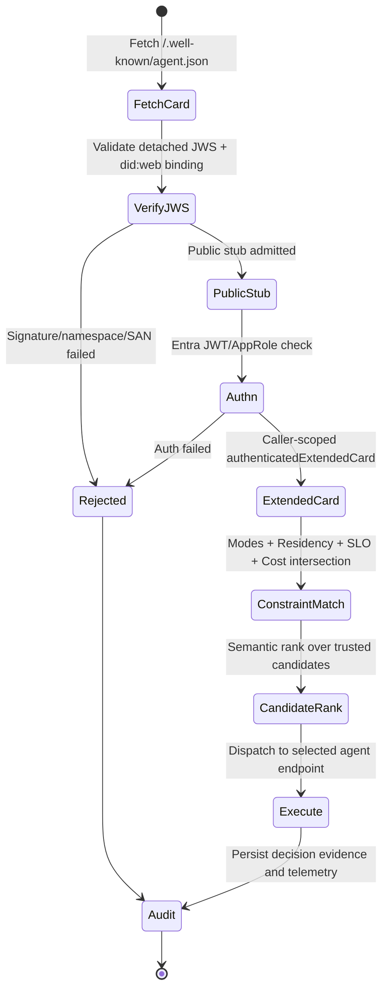

# 企业 A2A Agent Card 发现与能力协商选型 FAQ：`/.well-known/agent.json` + JWS vs API Center 扩展卡片投影 vs 语义能力 Broker

> 🌐 **Language Switch**：**中文（当前）** | [English](./a2a-agent-card-discovery-capability-negotiation-well-known-jws-vs-apicenter-extended-card-vs-semantic-broker-selection-faq.en.md)
> **受众**：Cloud & AI Solution Architect、企业 API 平台负责人、跨组织 B2B 集成团队、身份与零信任治理团队、SRE/FinOps/合规审计团队。
> **范围**：面向 `200+` 内部与伙伴 Agent 的发现、协商、鉴权与反欺骗治理，覆盖 `/.well-known/agent.json`、`authenticatedExtendedCard`、语义 Broker、GitOps 清单与服务网格集成。

## 1. 问题定义：为什么 Agent 数量超过两位数后，发现与协商会从“便利能力”变成“治理风险”
在单团队小规模试点阶段，Agent 互联常靠静态 URL 与人工约定字段完成。 当组织扩展到跨 BU、跨区域、跨伙伴网络后，这种做法会迅速触发目录失真、能力漂移和身份冒充问题。

第一类风险是发现面污染。 任何人都可以暴露看起来像标准 `agent.json` 的描述文件，如果缺少签名、命名空间归属和回调主机绑定校验，平台会把未授权能力错误纳入可调用目录。

第二类风险是能力劫持。 攻击者可通过夸大 `skills[]` 描述、植入提示注入型文本或伪造成本/SLO 元数据，使路由器优先选择恶意或不可信 Agent。

第三类风险是扩展卡泄漏。 如果 `authenticatedExtendedCard` 没有按调用方身份裁剪，内部工具名、限额、敏感能力标签会在匿名发现阶段暴露，形成情报侧攻击面。

因此企业需要把 Agent 发现设计成分层控制平面。 核心目标不是“更快找到 Agent”，而是“在可信身份、可证据协商和最小披露前提下稳定找到正确 Agent”。

## 2. 四种模式总览：A/B/C/D 的职责边界与组合方式
Pattern A 解决跨组织可验证发现。 它要求 `/.well-known/agent.json` 结合分离式 JWS 签名、`did:web` 绑定、mTLS SAN 主机一致性与 SSRF 防护，确保发现文档“可取、可验、可追责”。

Pattern B 解决企业内分层披露。 它通过 API Center 目录和 APIM 双层投影，把公开 stub 卡片与鉴权后扩展卡片拆分，按 AppRole 输出 caller-scoped `skills[]`、`securitySchemes` 与速率层级。

Pattern C 解决规模化路由正确性。 它引入语义匹配 + 约束交集过滤，要求能力注册先通过命名空间签名归属，再按 `inputModes/outputModes`、数据驻留、延迟、成本上限进行确定性筛选。

Pattern D 解决固定拓扑低时延互联。 它采用 GitOps 固定 peer manifest 与 Istio Ambient / K8s 服务发现，在稳定拓扑内实现 `<2ms` 级别的确定性对等连接。

在真实企业落地中四者是叠加关系。 A 是跨域信任底线，B 是目录最小披露基线，C 是大规模任务分发正确性核心，D 是稳定内网拓扑的低成本高性能加速层。

## 3. 端到端参考架构：发现平面、目录平面、语义 Broker 平面与执行平面解耦
```mermaid
flowchart LR
    CL[Client Agent / Orchestrator] --> GW[APIM AI Gateway]
    GW --> DISC[Discovery Service]
    DISC --> WK[/.well-known/agent.json]
    DISC --> SIG[JWS Detached Verify]
    SIG --> DID[did:web / JWKS Binding]
    DISC --> SSRF[Outbound SSRF Guard]

    GW --> CATALOG[API Center Agent Catalog]
    CATALOG --> PUB[Public Agent Stub]
    CATALOG --> EXT[authenticatedExtendedCard Projection]
    EXT --> ENTRA[Entra JWT/AppRole Validation]

    GW --> BROKER[Semantic Capability Broker]
    BROKER --> SEARCH[Azure AI Search Hybrid Matcher]
    BROKER --> AUTHZ[Namespace Authority & Signature Check]
    BROKER --> FILTER[Residency/SLO/Cost Constraints]

    BROKER --> TARGET[Selected Agent Endpoint]
    TARGET --> RT[Runtime Agent Service / MAF Workers]
    RT --> OBS[Telemetry + Cost + Audit Ledger]
```

该架构把“发现可信性”和“路由最优性”分离。 发现服务负责文档可验证，Broker 负责能力匹配与约束交集，执行平面只接收已判定的目标集合。

这样做的价值在于责任边界清晰。 当出现错误路由时可快速定位是签名归属问题、目录投影问题、还是语义匹配参数问题，而不是让所有问题都回落到“模型误判”这种不可操作结论。

## 4. Pattern A：去中心化 `/.well-known/agent.json` + 分离式 JWS 签名与主机绑定
Pattern A 强调“文件可发现不等于能力可信”。 任何 Agent 卡片在进入企业可调用目录前都必须通过签名链验证、命名空间归属验证和回调主机绑定验证。

推荐流程是先获取 `agent.json`，再取 `agent.json.jws`（或头部携带 detached JWS），然后用 Key Vault Managed HSM 托管密钥签名与验证。 验证时必须绑定 `card.url`、`pushNotifications` 回调域名与证书 SAN，防止“卡片声明 A、回调落在 B”造成旁路接管。

同时应实施 APIM 出站 SSRF 防护。 发现器只允许访问白名单域名与受控网段，拒绝内网元数据地址、环回地址和私有管理平面端点，避免被恶意卡片引导去探测内部网络。

缓存策略建议采用 TTL + 条件请求并存。 即缓存 `ETag` 与 `max-age`，到期后先发 `If-None-Match`，若返回 `304` 则续用缓存，若返回 `200` 则重新验签与归属校验。

Pattern A 的核心是把发现行为从“文本抓取”升级为“信任判定事务”。 只有在签名、归属、主机绑定三重一致后，卡片才允许进入后续能力协商阶段。

## 5. Pattern B：API Center + APIM 双层卡片投影（Public Stub 与 `authenticatedExtendedCard`）
Pattern B 解决“发现可见性与敏感信息最小披露”矛盾。 公开面仅暴露零敏感 stub，例如 Agent 名称、受支持模态大类、文档版本与最小联系入口。

当调用方携带 Entra JWT 并通过 AppRole 校验后，APIM 才投影 `authenticatedExtendedCard`。 扩展卡片可按调用方身份返回定制 `skills[]`、`securitySchemes`、`rateTier`、`tenantPolicyHints` 与合规标签。

这种分层能阻断内部能力侦察。 未授权调用方即使知道公开 URL，也无法枚举敏感技能名称、内部操作边界或高权限工具能力。

Pattern B 还让目录治理更可运营。 API Center 负责版本编目和生命周期治理，APIM 负责实时身份判定与投影裁剪，二者分工明确且便于审计。

企业在落地时应避免“扩展卡直接静态托管”。 一旦失去按调用方动态裁剪能力，卡片安全边界会快速退化回单层公开模式。

## 6. Pattern C：语义能力 Broker（语义匹配 + 约束交集 + 命名空间权威）
Pattern C 主要解决“Agent 太多时如何选对”问题。 单纯关键词匹配会被描述文本操纵，尤其当能力描述包含营销化语句或提示注入片段时，路由正确率会明显下降。

推荐策略是三段式决策。 第一段语义召回候选；第二段命名空间归属与签名验真；第三段按模态、驻留、SLO、成本上限做交集过滤并排序。

命名空间权威必须是硬门槛。 任何未通过 `namespace -> owner certificate` 绑定验证的技能描述，不得进入索引库，也不得参与候选召回。

对实时系统，还需要引入活体指标。 Broker 在最终排序时要纳入最近窗口 P95 延迟、错误率、可用容量与单位成本，避免静态目录与运行状态脱节。

Pattern C 的本质是“能力声明不能自证”。 只有将声明信息与权威归属、实时运行事实和组织策略同时绑定，才可能在 `200+` Agent 网络中维持稳定分发正确率。

## 7. Pattern D：GitOps 静态 Peer Manifest + Istio Ambient / K8s 服务发现
Pattern D 适用于固定内网拓扑。 例如同一业务域内若干 MAF worker 与编排器长期稳定协作，且节点集合变化频率低于目录变更频率。

该模式将 peer 信息写入 GitOps 清单。 发布时由控制器下发到集群服务发现层，运行时直接依据本地域名与工作负载标识建立连接，绕过中心 Broker 实时查找开销。

它的优势是低时延与高确定性。 在同集群或同网络平面内可做到 `<2ms` 发现开销，并减少外部目录依赖。

其局限在于灵活性。 当跨组织协作和动态能力扩展成为常态时，完全静态清单难以覆盖新增能力与实时约束变化，仍需与 A/B/C 联动。

因此 D 更像专用快车道。 它不替代全局发现治理，而是为稳定拓扑提供高性能短路径。

## 8. 发现时延与缓存失效数学：为什么要做 TTL 约束 + 条件 ETag + 事件驱动失效
设目录请求率为 `Q`，缓存命中率为 `H`，远端拉取时延为 `L_remote`，本地缓存时延为 `L_cache`。 平均发现时延近似 `L_avg = H * L_cache + (1 - H) * L_remote`。

当 `H=0.92`、`L_cache=4ms`、`L_remote=120ms` 时，`L_avg≈13.3ms`。 若因频繁失效使 `H` 降至 `0.55`，则 `L_avg≈54.8ms`，直接抬高上游编排等待时间。

缓存策略不能只靠长 TTL。 TTL 过长会放大陈旧卡片风险，TTL 过短又会放大远端抖动影响，因此必须叠加 `ETag` 条件请求和变更事件失效。

推荐做法是三层失效。 第一层按 TTL 到期条件拉取；第二层接收目录变更事件立即局部失效；第三层在签名 key rotation 时强制全量再验。

通过这三层机制，平台可在“低延迟发现”和“可信新鲜度”之间取得稳定平衡。 这也是规模化 A2A 网络避免目录雪崩与错误分发的关键工程点。

### 8.1 协商状态机与反欺骗门禁顺序（先验签再协商再执行）


该状态机强调“先验签、再投影、后协商、最终执行”的硬顺序，不允许任何未通过归属验证的卡片进入语义召回阶段，从入口就切断 capability squatting 与目录投毒传播路径。  
在治理实现上，`Rejected` 分支同样必须进入审计账本并保留拒绝原因，因为拒绝链路是检测侦察型攻击与策略回归缺陷的核心证据来源。  
`ConstraintMatch` 节点必须使用实时遥测覆盖静态声明字段，否则当候选 Agent 出现区域退化、容量枯竭或成本突变时，路由器会把“历史正确答案”误当作“当前正确答案”。  
`CandidateRank` 只在可信候选集合上运行可以显著减少语义污染面，让向量召回负责“找相似能力”，而把安全真实性与合规性留给前置硬门禁负责。  
在跨组织 B2B 网络中，这套顺序化状态机的价值是把协商错误从“事故后解释”前移为“执行前阻断”，从而降低误调度、越权调用和回调劫持造成的连锁故障概率。  

## 9. 能力劫持威胁矩阵：从卡片伪造到扩展卡泄漏的防护映射
| 威胁类型 | 典型攻击路径 | 影响面 | 防护控制 | 检测信号 |
|---|---|---|---|---|
| 卡片伪造 | 伪造 `agent.json` 与相似域名 | 错误路由到恶意 Agent | JWS + `did:web` + 域名证书绑定 | 签名校验失败率上升 |
| 回调劫持 | `pushNotifications` 指向非授权主机 | 回调数据泄露/劫持 | SAN 主机白名单 + mTLS 验证 | 回调域漂移告警 |
| 能力夸大 | `skills[]` 注入营销化或欺骗性描述 | 语义路由偏斜 | 命名空间权威校验 + 人工审核抽样 | 候选命中异常偏移 |
| 提示注入描述 | 技能描述含注入指令 | Broker 召回污染 | 索引前清洗 + 安全分类器 | 高风险文本命中率 |
| 扩展卡泄漏 | 未鉴权返回 full extended card | 内部能力侦察 | 双层投影 + AppRole 裁剪 | 匿名请求字段异常完整 |
| 重放旧卡片 | 复用过期签名卡片 | 过时能力被调用 | TTL + nonce + `iat/exp` 检查 | 过期 token 拒绝率 |
| 目录投毒 | 未授权写入目录索引 | 全局错误发现 | API Center 写入审批 + 签名准入 | 未签名条目尝试量 |
| SSRF 诱导 | 发现器访问内网地址 | 内部信息泄露 | APIM 出站 SSRF Guard | 私网地址拦截计数 |
| 约束绕过 | 伪造低成本低延迟元数据 | 错误优选 | 实时遥测反向覆盖 | 声明与实测偏差告警 |
| 模态伪报 | 声称支持 streaming/audio 但实际不支持 | 协商失败与回退风暴 | 协商前探测与健康探针 | 协商失败率抬升 |
| 命名空间抢注 | 恶意占用相似 namespace | 合法能力被遮蔽 | Namespace 证书归属登记 | 证书冲突事件 |
| 跨租户侧漏 | 返回他租户策略元数据 | 合规与商业泄密 | caller-scoped 投影 + tenant isolation | 非本租户字段命中 |

威胁矩阵必须进入持续运营流程。 仅在设计评审里列出而缺乏监控落地，会导致控制项随时间失效。

建议将每个威胁映射到明确告警阈值。 例如签名失败率、扩展卡字段异常完整率、描述文本高风险比例等均可量化并纳入 SLO/SecOps 联动。

## 10. 12 维能力对比矩阵：A/B/C/D 的边界、成本与运维复杂度
| 维度 | Pattern A `/.well-known` + JWS | Pattern B API Center + ExtendedCard | Pattern C 语义 Broker | Pattern D 静态清单 |
|---|---|---|---|---|
| 1. 跨组织可信发现 | 极高 | 高 | 中 | 低 |
| 2. 最小披露能力 | 中 | 极高 | 中 | 低 |
| 3. 大规模能力匹配精度 | 中 | 中 | 极高 | 低 |
| 4. 低时延确定性 | 中 | 中 | 中 | 极高 |
| 5. 目录治理可审计性 | 高 | 高 | 高 | 中 |
| 6. 反能力劫持能力 | 高 | 高 | 极高 | 中 |
| 7. 变更灵活性 | 高 | 高 | 高 | 中低 |
| 8. 实现复杂度 | 中 | 中高 | 高 | 低中 |
| 9. 运行成本 | 中 | 中 | 中高 | 低 |
| 10. 跨区域可扩展性 | 高 | 高 | 高 | 中 |
| 11. 适配固定拓扑 | 中 | 中 | 中 | 极高 |
| 12. 推荐定位 | 跨域信任基线 | 企业目录分层基线 | 规模化调度核心 | 稳定拓扑快车道 |

矩阵结论是分层而非替代。 A 负责卡片可信来源，B 负责最小披露，C 负责正确匹配，D 负责固定拓扑性能。

在 `200+` Agent 网络里，单一模式很难覆盖全部目标。 只有把四种模式按风险域和拓扑域组合，才能同时满足安全、时延与可运营要求。

## 11. 定量问答（Q1–Q6）：A2A 发现与协商评审高频数字题
### Q1：为什么不建议把扩展卡片直接公开
因为公开扩展卡会暴露内部技能细节与权限边界。 在红队模拟中，这类信息可显著降低攻击者试探成本。 双层投影可把匿名可见面收敛到最小必要信息。

### Q2：JWS 验签会不会让发现太慢
单次验签有额外开销，但通常在毫秒级到十几毫秒级。 配合 ETag 条件缓存后，绝大多数请求走缓存命中路径。 总体时延增量远小于错误路由与事故回滚代价。

### Q3：语义 Broker 如何防“能力抢位”
关键是把“描述语义”与“命名空间归属”绑定。 未通过归属签名校验的条目不进入索引，无法参与召回。 这样可显著降低能力描述操纵带来的排序偏差。

### Q4：固定清单模式是不是一定更安全
它在固定拓扑下更可控，但并不自动覆盖跨组织动态能力。 当能力演化频率升高时，静态清单会出现滞后与盲区。 因此应把 D 作为特定场景加速层而非全局替代。

### Q5：何时必须引入实时 SLO/成本过滤
当同类能力有多个候选 Agent 且负载波动明显时。 仅靠静态目录字段会导致路由与实时状态脱节。 引入实时过滤可降低高峰期失败率与超预算风险。

### Q6：跨组织场景下最容易被忽略的控制是什么
回调主机绑定校验最常被忽略。 很多团队只验卡片签名，却不校验回调目标域与证书一致性。 这会留下“签名真实但回调被劫持”的高危空洞。

## 12. 生产配置块 A：签名 AgentCard（含 detached JWS、did:web 与扩展卡入口）
```json
{
  "schemaVersion": "1.0",
  "agentId": "finance.recon.apac.v3",
  "card": {
    "url": "https://agents.contoso.com/.well-known/agent.json",
    "title": "APAC Reconciliation Agent",
    "description": "Performs ledger matching and discrepancy triage with policy-bound actions.",
    "provider": {
      "name": "Contoso Finance AI",
      "did": "did:web:agents.contoso.com:finance:recon"
    },
    "inputModes": ["text", "json"],
    "outputModes": ["text", "json", "event-stream"],
    "securitySchemes": ["entra_oauth2_obo"],
    "authenticatedExtendedCardUrl": "https://agents.contoso.com/cards/finance.recon.apac.v3/extended",
    "pushNotifications": {
      "callbackUrl": "https://callbacks.contoso.com/a2a/notify",
      "mtlsRequired": true
    },
    "skills": [
      {
        "name": "reconcile_invoices",
        "namespace": "contoso.finance.recon",
        "version": "3.2.1",
        "inputSchemaRef": "https://agents.contoso.com/schemas/reconcile_invoices.json",
        "outputSchemaRef": "https://agents.contoso.com/schemas/reconcile_invoices.out.json"
      }
    ]
  },
  "signature": {
    "format": "JWS-DETACHED",
    "alg": "PS256",
    "kid": "https://kv-prod-contoso.vault.azure.net/keys/a2a-card-signing/78d9",
    "jws": "eyJhbGciOiJQUzI1NiIsImtpZCI6Ii4uLiJ9..Q1czQ0x5dF9fVG9rZW5TaWduYXR1cmU"
  },
  "cache": {
    "etag": "\"a2a-card-v3-2026-11-23T01:20:00Z\"",
    "maxAgeSeconds": 300
  }
}
```

```yaml
namespace_authority:
  namespace: contoso.finance.recon
  owner_did: did:web:agents.contoso.com:finance:recon
  owner_cert_san:
    - agents.contoso.com
    - callbacks.contoso.com
  card_signature_required: true
  accepted_algorithms:
    - PS256
    - ES256
  card_refresh:
    max_age_seconds: 300
    revalidate_with_etag: true
```

该配置体现“签名 + 归属 + 缓存”三位一体。 没有命名空间归属登记的签名卡片，也不应直接进入生产路由。

## 13. 生产配置块 B：APIM 扩展卡投影策略 + Python 验签与协商匹配器
```xml
<policies>
  <inbound>
    <base />
    <validate-jwt header-name="Authorization" failed-validation-httpcode="401" failed-validation-error-message="Unauthorized">
      <openid-config url="https://login.microsoftonline.com/<tenant-id>/v2.0/.well-known/openid-configuration" />
      <required-claims>
        <claim name="aud"><value>api://a2a-catalog</value></claim>
      </required-claims>
    </validate-jwt>
    <set-variable name="role" value="@{
      var jwt = context.Principal;
      return jwt?.Claims.GetValueOrDefault("roles","public_reader");
    }" />
  </inbound>
  <backend>
    <base />
  </backend>
  <outbound>
    <base />
    <choose>
      <when condition="@(context.Variables.GetValueOrDefault<string>("role").Contains("agent.extended.read"))">
        <set-body>@{
          var obj = context.Response.Body.As<JObject>(preserveContent:true);
          obj["skills"] = FilterSkillsByRole(obj["skills"], "agent.extended.read");
          obj["securitySchemes"] = new JArray("entra_oauth2_obo","mtls_sender_constrained");
          obj["rateTier"] = "enterprise";
          return obj.ToString();
        }</set-body>
      </when>
      <otherwise>
        <set-body>@{
          var stub = new JObject();
          stub["title"] = "Agent Discovery Stub";
          stub["inputModes"] = new JArray("text");
          stub["outputModes"] = new JArray("text");
          return stub.ToString();
        }</set-body>
      </otherwise>
    </choose>
  </outbound>
</policies>
```

```python
from dataclasses import dataclass
from typing import Dict, List, Any
import json
import time
import requests
import jwt


@dataclass
class NegotiationRequest:
    required_input_modes: List[str]
    required_output_modes: List[str]
    max_p95_ms: int
    max_cost_per_1k: float
    data_zone: str


def verify_detached_jws(card_payload: Dict[str, Any], jws_token: str, jwks_url: str) -> bool:
    jwks = requests.get(jwks_url, timeout=5).json()
    headers = jwt.get_unverified_header(jws_token)
    key = next((k for k in jwks["keys"] if k["kid"] == headers["kid"]), None)
    if not key:
        return False
    signing_input = json.dumps(card_payload, separators=(",", ":"), ensure_ascii=False).encode("utf-8")
    try:
        jwt.decode(
            jws_token,
            jwt.algorithms.RSAAlgorithm.from_jwk(json.dumps(key)),
            algorithms=[headers["alg"]],
            options={"verify_aud": False},
        )
        return True
    except Exception:
        return False


def capability_match(candidates: List[Dict[str, Any]], req: NegotiationRequest) -> List[Dict[str, Any]]:
    out = []
    for c in candidates:
        if not set(req.required_input_modes).issubset(set(c.get("inputModes", []))):
            continue
        if not set(req.required_output_modes).issubset(set(c.get("outputModes", []))):
            continue
        if c.get("p95_ms", 999999) > req.max_p95_ms:
            continue
        if c.get("cost_per_1k", 999999.0) > req.max_cost_per_1k:
            continue
        if req.data_zone not in c.get("dataZones", []):
            continue
        if not c.get("namespace_verified", False):
            continue
        out.append(c)
    return sorted(out, key=lambda x: (x["p95_ms"], x["cost_per_1k"]))


def is_card_fresh(card_meta: Dict[str, Any]) -> bool:
    now = int(time.time())
    exp = int(card_meta.get("exp", 0))
    return exp > now
```

上述实现强调“先验真、后匹配”。 若签名或归属不通过，候选不应进入协商排序。

## 14. 企业场景与三年 TCO：B2B 伙伴网络与集团内多 BU 目录治理
### 场景 A：跨组织 B2B 伙伴 Agent 联邦（保险理赔与支付清分）
该场景需要与多个外部伙伴 Agent 协作，并且每个伙伴能力变化频繁。 推荐 A+B+C 组合：A 保障卡片来源可信，B 控制最小披露，C 在多候选伙伴间按约束交集路由。

上线后，平台可把“接入速度”与“信任强度”同时维持。 新伙伴接入不再依赖人工邮件确认字段，而是通过签名归属和目录策略自动化入网。

### 场景 B：集团内部 200+ Agent 共享目录（财务、法务、采购、客服）
该场景重点是权限分层与成本控制。 推荐 B+C+D 组合：B 负责按角色投影扩展卡，C 负责语义匹配与实时成本过滤，D 为稳定域内拓扑提供低时延连接。

当某业务域拓扑稳定且调用频繁时，D 可显著降低发现抖动。 当业务域变化频繁或跨组织调用增加时，仍可回到 C 的动态协商路径。

### 三年 TCO（同等 99.9% 发现可用性目标）
| 方案 | Year 1 | Year 2 | Year 3 | 三年总计 | 主要成本构成 |
|---|---:|---:|---:|---:|---|
| A only | $0.74M | $0.81M | $0.89M | $2.44M | 验签与缓存基础设施 |
| A+B | $0.88M | $0.97M | $1.05M | $2.90M | 目录投影与身份裁剪 |
| A+B+C | $1.06M | $1.16M | $1.27M | $3.49M | 语义检索与实时过滤 |
| A+B+C+D | $1.11M | $1.19M | $1.30M | $3.60M | 额外静态拓扑运维 |

TCO 不能脱离风险看。 A+B+C+D 虽然直接成本更高，但通常换来更低的错误路由事故率与跨组织争议处理成本。

建议在商业评估中同时计算“事故避免收益”。 对大规模企业网络，错误发现造成的业务损失往往远高于目录治理的基础设施成本。

## 15. Day-0 / Day-2 落地清单：从可接入到可运营的 A2A 发现治理闭环
### Day-0（上线前）
- 定义命名空间与证书归属规则，建立 `namespace -> owner` 权威登记。  
- 为 `agent.json` 启用 JWS 分离签名与 `did:web` 绑定，明确验签失败即拒绝。  
- 在 APIM 配置出站 SSRF Guard、回调域白名单和 mTLS SAN 绑定检查。  
- 实施 Public Stub 与 `authenticatedExtendedCard` 双层投影，按 AppRole 最小披露。  
- 落地 Broker 约束交集：模态、驻留、延迟、成本、命名空间验真。  

### Day-2（运行后）
- 监控签名失败率、扩展卡匿名访问拒绝率、协商失败率与错误路由率。  
- 对技能描述执行持续安全扫描，阻断提示注入与能力夸大文本入库。  
- 按周校准缓存 TTL 与 ETag 策略，避免陈旧卡片与目录风暴。  
- 定期抽查路由决策证据链，确保“发现 -> 协商 -> 执行”可完整回放。  
- 对固定拓扑域评估 D 模式收益，必要时启用或回收静态清单快车道。  

推荐落地顺序是先 A，再 B，再 C，最后按稳定拓扑引入 D。 若组织当前处于快速扩展期，优先确保 A/B/C 到位，再考虑 D 的性能优化收益。

在企业级多组织生态中，Agent 发现与能力协商不应被视为“简单目录问题”。 它本质上是身份、策略、性能、成本与审计共同约束下的控制面工程，必须以可证明可信、可持续运营和可量化优化为目标长期演进。
当企业把这条治理主线制度化并沉淀到平台工程流水线后，新增 Agent 的接入速度、跨组织协同质量、故障定位效率与合规审计准备度会同步提升，从而让 A2A 生态在规模增长时仍保持稳定而不是在复杂度上升时失控。

