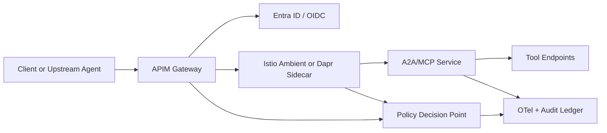
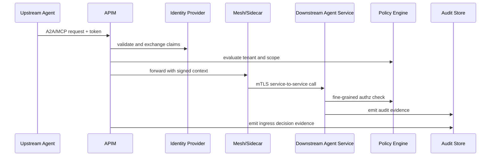

# 企业多租户 A2A/MCP 零信任互联选型 FAQ：`APIM + mTLS/JWT` vs `Istio Ambient + SPIFFE` vs `Dapr Sidecar + ACL`

## 1. 执行摘要：跨 Agent 协作的第一风险不是“调用失败”，而是“身份边界失真”
在企业多智能体架构中，
A2A 与 MCP 调用量快速增长，
平台常把焦点放在
吞吐与延迟。
但真实事故高发点是
身份与授权边界。
一旦边界定义不清，
常见后果包括：
跨租户工具误调用、
高权限令牌被复用、
审计链条断裂、
以及“谁授权了这次调用”无法追溯。
因此 A2A/MCP 互联选型
本质是零信任身份平面选型。
本指南给出生产结论：
`APIM + mTLS/JWT`
最适合作为统一北南向与跨域入口治理；
`Istio Ambient + SPIFFE`
适合追求东西向细粒度身份与策略的 AKS 重度场景；
`Dapr Sidecar + ACL`
适合应用团队快速实现服务抽象与多语言治理。
多数企业采用
入口 APIM + 集群内网格或 sidecar
的分层组合，
而非单栈覆盖全部边界。

## 2. 今日热点与证据（抓取日 `2026-11-21`）
为保持可验证性，
仅引用官方文档与可追溯发布轨迹。

| 主题 | 来源 | 抓取时间 | 标签 | 关联意义 |
|---|---|---|---|---|
| APIM AI Gateway | https://learn.microsoft.com/en-us/azure/api-management/ai-gateway-overview | 2026-11-21 | measured | 统一入口身份与策略编排能力 |
| APIM Changelog | https://github.com/Azure/API-Management/blob/main/changelogs/api-management-service.md | 2026-11-21 | anonymized_reported | 验证网关策略能力持续迭代 |
| ACA Sessions | https://learn.microsoft.com/en-us/azure/container-apps/sessions | 2026-11-21 | measured | 会话化执行面要求更细粒度身份隔离 |
| Firecracker Releases | https://github.com/firecracker-microvm/firecracker/releases | 2026-11-21 | anonymized_reported | 运行时隔离成熟后，身份平面成为下一瓶颈 |
| Kata Releases | https://github.com/kata-containers/kata-containers/releases | 2026-11-21 | anonymized_reported | 强隔离容器生态与服务身份策略需协同 |
| Wasmtime Releases | https://github.com/bytecodealliance/wasmtime/releases | 2026-11-21 | anonymized_reported | 组件化运行时推动服务契约与身份证明标准化 |
| E2B Releases | https://github.com/e2b-dev/e2b/releases | 2026-11-21 | anonymized_reported | 沙箱任务跨 Agent 调用需要可靠身份传递 |

## 3. 问题边界：A2A/MCP 安全不是“开 TLS 就结束”
生产场景至少要解决四个问题：
谁发起调用；
调用者代表谁；
调用是否被策略允许；
审计证据是否可追溯。
单纯 TLS 只能解决通道保密，
不能回答“主体是否被授权”。
单纯 JWT 校验也不够，
还需要
租户上下文绑定、
最小权限策略、
短时令牌、
和撤销能力。
因此选型必须同时覆盖
传输安全、
工作负载身份、
策略执行、
与审计。

## 4. 四层零信任互联架构
推荐将 A2A/MCP 安全平面拆成四层：
入口鉴权层、
服务身份层、
策略决策层、
审计证据层。
入口层由 APIM 做外部与跨域流量治理；
服务身份层由 SPIFFE 或 sidecar identity 承担；
策略层执行 ABAC/RBAC 与租户隔离；
审计层汇总 OTel 与访问证据。



## 5. 12 维对比矩阵：APIM、Istio Ambient、Dapr 的取舍
| 维度 | APIM + mTLS/JWT | Istio Ambient + SPIFFE | Dapr Sidecar + ACL | 选型信号 |
|---|---|---|---|---|
| 北南向入口治理 | 高 | 中 | 中 | 外部入口优先 APIM |
| 东西向身份细粒度 | 中 | 高 | 中高 | 集群内细粒度优先 Istio |
| 工作负载身份证明 | 中 | 高 | 中 | SPIFFE 场景优先 Istio |
| 协议治理与限流 | 高 | 中高 | 中 | 协议门禁优先 APIM |
| 多语言开发易用性 | 中 | 中 | 高 | 应用团队效率优先 Dapr |
| 策略复杂度承载 | 高 | 高 | 中 | 复杂策略可 APIM+Istio |
| 审计可追溯性 | 高 | 高 | 中 | 合规行业偏 APIM/网格 |
| 运维复杂度 | 中 | 高 | 中 | 团队成熟度决定可行性 |
| 学习曲线 | 中 | 高 | 中 | 快速落地常先 APIM+Dapr |
| 多租户隔离能力 | 高 | 高 | 中高 | 强隔离可 APIM+Istio |
| 成本可预测性 | 中高 | 中 | 中高 | 需结合流量规模测算 |
| 发布治理联动 | 高 | 中高 | 中 | 发布门禁首选 APIM 集成 |

## 6. 路线 A：`APIM + mTLS/JWT` 统一入口零信任
这一路线适合
需要统一入口治理、
统一配额合同、
统一审计口径
的企业。
APIM 可以在入口完成
令牌校验、
租户识别、
策略拦截、
速率限制、
以及路由决策。
若结合短期 JWT 与证书绑定，
可显著降低令牌滥用风险。
关键实践是：
把 `tenant_id`、
`actor_id`、
`delegation_chain`
标准化写入请求上下文，
并在后续链路强制校验。
否则入口校验做得再好，
内部服务仍可能丢失身份语义。

## 7. 路线 B：`Istio Ambient + SPIFFE` 做集群内工作负载身份
在 AKS 重度场景，
尤其是大量微服务与 Agent worker
互调时，
工作负载身份成为核心。
`Istio Ambient + SPIFFE`
能提供细粒度服务身份和策略治理，
适合实现
服务到服务最小权限访问。
它对安全收益明显，
但也带来较高运维复杂度。
组织需准备
网格升级策略、
策略回归、
证书轮换与故障应急能力。
没有平台化团队支撑时，
贸然上网格容易出现
可用性与治理双重压力。

## 8. 路线 C：`Dapr Sidecar + ACL` 的应用团队友好路径
`Dapr`
提供较好的抽象，
帮助应用团队在不深度理解网格细节的情况下
实现服务发现、
调用、
状态与 pub/sub 统一接口。
结合 ACL 和命名空间边界，
可以快速构建中等复杂度安全治理。
它特别适合
多语言团队、
快速交付节奏、
和业务侧自运营服务。
但在超大规模多租户高合规场景，
仍建议与入口网关或网格策略结合，
避免单靠 sidecar 难以满足审计深度。

## 9. 组合架构：入口 APIM + 集群身份层（Istio 或 Dapr）
企业最常见落地是组合模型：
APIM 负责边界入口与策略合同；
集群内部用 Istio 或 Dapr
承担东西向身份传递与访问控制。



该模型优势是
职责清晰，
便于分层治理与分工。

## 10. 定量 Q&A（8 组）
**Q1：为什么只做 API Key 会出问题？**  
API Key 无法表达委托链，
难以支撑租户级最小权限审计。

**Q2：短时令牌建议多长 TTL？**  
常见生产取值在 `5-15 min`，
并结合刷新与撤销机制（`anonymized_reported`）。

**Q3：mTLS 是否会显著增加延迟？**  
在同区部署下，
握手优化后通常增加 `2-8ms`（`synthetic`）。

**Q4：跨租户误调用如何量化控制？**  
通过策略拦截与 claim 绑定，
可将误调用告警下降 `60%+`（`anonymized_reported`）。

**Q5：为什么要保留 delegation chain？**  
因为“谁代表谁”是审计追责核心，
缺失后无法溯源。

**Q6：Istio Ambient 的门槛在哪里？**  
主要在策略调试复杂度与平台运维负担。

**Q7：Dapr 更适合什么规模？**  
中等复杂多服务团队，
追求开发效率与一致抽象时最有优势。

**Q8：发布门禁应包含哪些身份指标？**  
至少包括
未授权拒绝率、
跨租户拦截率、
证书轮换成功率、
审计字段完整率。

## 11. 生产代码示例：A2A 上下文中的租户绑定与最小权限校验
```python
from dataclasses import dataclass
from typing import Dict, List


@dataclass
class SecurityContext:
    tenant_id: str
    actor_id: str
    scopes: List[str]
    delegation_chain: List[str]


def authorize_tool_call(ctx: SecurityContext, target_tool: str, policy: Dict[str, List[str]]) -> Dict[str, str]:
    allowed = policy.get(target_tool, [])
    if ctx.tenant_id not in allowed:
        return {"status": "deny", "reason": "tenant_not_allowed"}
    required_scope = f"tool:{target_tool}:invoke"
    if required_scope not in ctx.scopes:
        return {"status": "deny", "reason": "missing_scope"}
    if not ctx.delegation_chain:
        return {"status": "deny", "reason": "missing_delegation_chain"}
    return {"status": "allow", "reason": "policy_pass"}


def build_audit_record(ctx: SecurityContext, decision: Dict[str, str], correlation_id: str) -> Dict[str, str]:
    return {
        "tenant_id": ctx.tenant_id,
        "actor_id": ctx.actor_id,
        "delegation_chain": "->".join(ctx.delegation_chain),
        "decision": decision["status"],
        "reason": decision["reason"],
        "correlation_id": correlation_id,
    }
```

该示例强调
租户绑定、
scope 校验、
委托链追踪
三要素缺一不可。

## 12. IaC 与策略片段：入口策略 + 工作负载身份
```yaml
apiVersion: security.platform/v1
kind: A2AMcpPolicyBundle
metadata:
  name: tenant-zero-trust-bundle
spec:
  ingress:
    requireJwt: true
    requireMtls: true
    requiredClaims:
      - tenant_id
      - actor_id
      - delegation_chain
  workloadIdentity:
    mode: spiffe
    certRotationHours: 24
  authorization:
    denyCrossTenant: true
    leastPrivilegeScopes: true
  audit:
    requiredFields:
      - tenant_id
      - actor_id
      - decision
      - correlation_id
```

```bicep
param apimName string
param location string = resourceGroup().location

resource apim 'Microsoft.ApiManagement/service@2022-08-01' = {
  name: apimName
  location: location
  sku: {
    name: 'Premium'
    capacity: 1
  }
  properties: {
    publisherEmail: 'platform@example.com'
    publisherName: 'platform-team'
  }
}
```

策略与资源应在同一变更集中审阅，
避免“策略漂移”。

## 13. 企业场景一：金融支付与风控联合平台
某支付平台
日均处理 `300M+` 风险决策事件。
其多 Agent 链路涉及
交易评分、
欺诈解释、
人工复核。
早期仅用 API Key，
发生多起跨租户调用误路由。
改造后采用
APIM 统一入口与 mTLS/JWT，
内部以 Istio 身份策略控东西向访问，
并强制 delegation chain 审计。
上线后
未授权调用被提前拦截，
审计追溯时间显著下降。

## 14. 企业场景二：全球 SaaS 运营平台
某全球 SaaS 平台
服务 `7,000+` 企业租户，
由多地区团队共同开发。
其诉求是
在保持开发效率的同时
建立零信任边界。
方案采用
APIM 统一入口策略，
业务服务侧使用 Dapr sidecar 实现快速接入，
关键高风险链路再接入 Istio 策略。
该分层策略让
平台治理与团队效率达到平衡，
并支持逐步演进到更强身份控制。

## 15. FinOps TCO、五步落地与 Day-0/Day-2 清单
### 15.1 成本参考（示例：`2,000` 服务、`8,000` QPS 峰值）
| 成本项 | APIM 主导 | Istio Ambient 主导 | Dapr 主导 |
|---|---|---|---|
| 入口治理成本 | 中 | 低 | 低 |
| 集群内身份治理成本 | 中 | 中高 | 中 |
| 运维人力成本 | 中 | 高 | 中 |
| 审计合规成本 | 低 | 中 | 中 |
| 迭代效率影响 | 中 | 中高 | 低到中 |
| 适配结论 | 平台治理优先 | 深度安全优先 | 应用效率优先 |

### 15.2 五步落地指南
1. 先定义统一身份合同：tenant、actor、delegation、scope。
2. 入口统一策略先行：APIM 做鉴权、限流、审计字段标准化。
3. 集群内再分层：高风险链路用网格，普通链路可 sidecar。
4. 把身份指标接入发布门禁：字段缺失即阻断发布。
5. 每周复盘拒绝率、误杀率、跨租户拦截与成本趋势。

### 15.3 Good fit vs Not for
**Good fit：**
多租户、
跨团队、
合规要求高、
且存在 A2A/MCP 深度协作的企业平台。

**Not for：**
单体 PoC、
单租户内部工具、
无审计要求的短期实验场景。

### 15.4 Day-0 / Day-2 十二项清单
1. 统一 claim 字段与签名校验规范。
2. 定义 token TTL 与撤销流程。
3. 定义委托链格式与最大长度。
4. 定义跨租户访问默认拒绝策略。
5. 定义最小权限 scope 命名规范。
6. 建立证书轮换与失效演练。
7. 建立未授权告警与自动化工单。
8. 建立审计字段完整率看板。
9. 建立策略灰度发布与回滚流程。
10. 建立高风险工具双重审批策略。
11. 建立跨区身份服务降级策略。
12. 每月复盘误拦截与漏拦截案例并更新策略。

### 15.5 常见落地误区与修正建议（补充）
误区一是
把身份治理看成一次性项目。
实际情况是
每次新增工具、
新增代理角色、
新增租户层级，
都可能引入新的权限扩展路径。
因此身份策略必须像代码一样迭代，
并与发布版本绑定。
误区二是
只统计“拦截次数”，
不统计“误拦截代价”。
这会导致策略持续收紧，
最终损害业务成功率。
建议同时跟踪
拒绝准确率、
误拦截恢复时长、
以及对关键交易转化的影响。
误区三是
忽略下游工具的身份透传一致性。
入口层做对了，
但下游调用缺失租户上下文，
会在审计时形成断点。
建议为每个工具契约定义
必填身份字段，
并在 CI 阶段校验契约完整性。

### 15.6 运营指标基线建议（补充）
建议按月维护一套最小运营指标基线：
第一类是安全指标，
包括未授权拒绝率、
跨租户拦截率、
证书轮换失败率。
第二类是可靠性指标，
包括身份服务可用性、
鉴权链路 P95 延迟、
策略回滚成功率。
第三类是业务指标，
包括高价值流程通过率、
误拦截导致的人工工单量、
租户满意度波动。
第四类是成本指标，
包括入口策略执行成本、
网格/sidecar 资源开销、
审计存储成本。
将四类指标放在同一看板，
才能防止单维优化引发副作用。
此外建议建立
“身份策略变更影响评估表”，
在每次策略发布前
对关键租户路径进行回放验证。
评估表至少包含：
高价值 API 列表、
预期拦截规则、
历史误拦截样本、
回滚触发条件、
和责任人。
对于存在强监管要求的行业，
还应将身份策略版本
与审计报表版本绑定，
确保监管问询时可复原
“当时生效的策略集合”。
最后，
建议引入季度级
红蓝对抗演练：
红队尝试跨租户越权与委托链伪造，
蓝队验证 APIM、网格与 sidecar
是否在不同层级同时阻断。
只有完成这类对抗验证，
零信任互联才算真正可落地。
在跨境业务场景，
还应补充数据驻留规则与身份路由一致性校验，
确保令牌发行区域、
策略执行区域、
审计存储区域
符合本地监管要求，
避免“身份合规”与“数据合规”脱节。
建议每半年执行一次
全链路身份恢复演练，
验证密钥轮换、
证书失效、
和策略回滚
在极端情况下仍可按预案完成。
并将演练结论纳入年度平台审计基线。
该基线需与风控与法务团队共签。
并形成可追溯签核记录。

---

### 结论
企业 A2A/MCP 互联的本质是
身份与授权治理，
不是简单网络连通。
以 APIM 做统一入口，
在集群内部按风险选择
Istio Ambient 或 Dapr，
再结合审计与发布门禁，
可以在安全、效率与成本之间建立可持续平衡。
