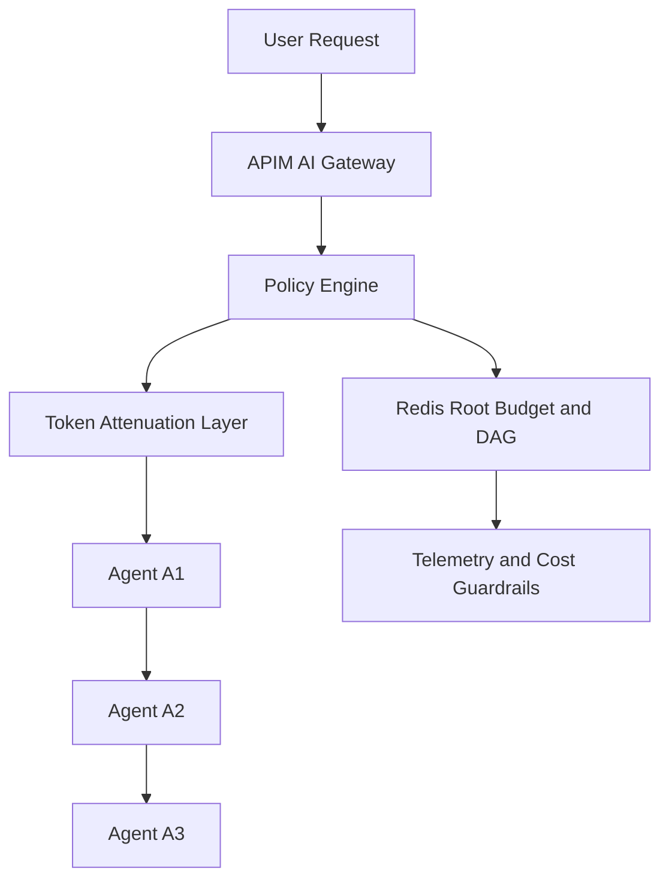
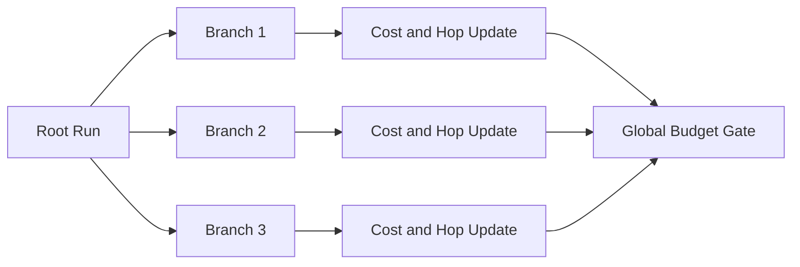
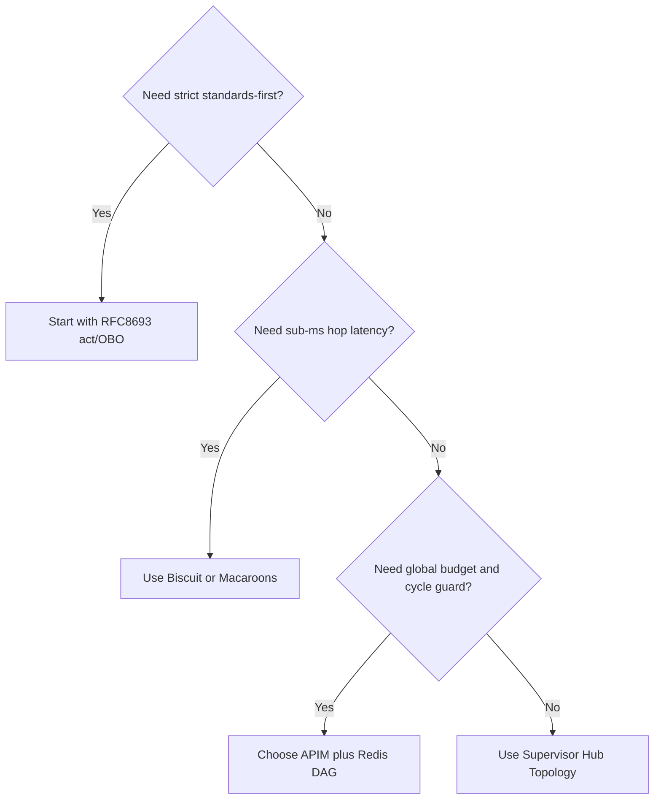

# Enterprise A2A Multi-Hop Delegation Attenuation and Cycle-Budget Governance FAQ: RFC8693 act/OBO vs Biscuit/Macaroons vs APIM+Redis DAG vs Supervisor Hub

> 🌐 **Language Switch**: [中文](./a2a-multi-hop-delegation-attenuation-cycle-budget-governance-rfc8693-act-obo-vs-biscuit-macaroon-vs-apim-redis-callgraph-selection-faq.md) | **English (current)**
> **Audience**: Cloud & AI Solution Architects, platform security architects, gateway engineering teams, multi-agent orchestration owners, FinOps, and SRE teams.
> **Context**: Federated A2A + MCP ecosystems often fail under transitive privilege escalation, cyclic delegation, and branching budget blowups.

## 1. Why multi-hop delegation becomes unstable in production

As agents delegate to peers, one user task expands into dynamic execution graphs across tool domains.

Without per-hop scope intersection, low-privilege contexts can inherit high-privilege tool paths via peers.

Without dynamic cycle checks, indirect loops such as `A -> B -> C -> A` emerge under skill routing.

Without shared root budget, `B^D` branching can exhaust quotas before parent deadlines fire.

Production safety requires unified control over permission attenuation, graph topology, and budget state.

## 2. Three formal failure models

Failure A: transitive confused-deputy, where effective permissions are not reduced by per-hop intersections.

Failure B: runtime cyclic delegation that bypasses static DAG assumptions through dynamic route choices.

Failure C: fan-out amplification where branch factor and depth multiply cost and call volume geometrically.

These failures reinforce each other when retries and timeout races appear under pressure.

## 3. Zero-trust multi-hop delegation reference architecture



Put attenuation, cycle checks, budget accounting, and deadline propagation at gateway enforcement points.

Agents should emit intent and minimal context, not own global graph-state mutation.

## 4. Architecture A: RFC 8693 token exchange with nested act chain

A uses standards-compliant token exchange and nested actor claims, integrating well with Entra OBO flows.

Its strength is compatibility, auditability, and clear identity lineage across organizational boundaries.

Its weakness is per-hop exchange latency (`25–65ms`) and JWT growth beyond practical header limits.

After 4–5 hops, `act` payload expansion often crosses `4KB` and challenges proxies and gateways.

A is best where standards and governance traceability outweigh high-hop latency sensitivity.

## 5. Architecture B: offline-attenuated Biscuit or Macaroons capabilities

B appends immutable caveats offline, such as hop caps, tool-prefix limits, tenant constraints, and visited-agent bans.

Verification is local in APIM or Envoy WASM and can stay below `1ms` without IdP round-trips.

This excels in high-throughput, low-latency federated invocation paths.

Tradeoffs include revocation and key-rotation complexity plus lack of native shared branch-budget state.

B performs best when paired with an external global budget and cycle-governance plane.

## 6. Architecture C: APIM plus Redis DAG global budget enforcer

C tracks directed call-graph edges per `root_run_id` and applies atomic Lua checks for cycle rejection.

Shared budget spans token count, spend units, hop depth, and global deadline propagation headers.

Cycle rejection and budget checks can complete in under `2ms` when Redis is properly tuned.

C gives strong observability and deterministic enforcement across parallel branches.

Its main risk is Redis criticality, requiring resilient topology and multi-region failover readiness.

## 7. Architecture D: deterministic supervisor star topology

D enforces no peer-to-peer sub-delegation, forcing all handoffs through one supervisor node.

This gives structural cycle immunity with `max_hop=1` in single-domain orchestration workflows.

Tradeoffs are extra supervisor turns and tighter coupling around a central orchestration authority.

D is strong where deterministic control and debug simplicity are more valuable than full federation flexibility.

It is a topology choice first, not a credential strategy by itself.

## 8. Core math: B^D amplification, JWT growth, and latency budgets

Fan-out amplification: `Calls_total = Σ_{i=0..D} B^i = (B^{D+1}-1)/(B-1)`.

With `B=4` and `D=5`, total calls reach `1365`, which can overwhelm quotas without root budgeting.

Token-exchange latency: `Latency_added ≈ hops * RTT_exchange`.

JWT growth estimate: `Size ≈ Base + hops * act_claim_bytes`, often crossing proxy safety thresholds.

Root-budget invariant: `Budget_remain = Budget_root - Σ(branch_cost_i)` with atomic updates required.



## 9. Twelve-dimension quantitative matrix

| Dimension | A RFC8693 act/OBO | B Biscuit/Macaroons | C APIM+Redis DAG | D Supervisor Hub |
|---|---|---|---|---|
| Standards compliance | High | Medium | High | Medium-High |
| Per-hop latency overhead | Medium-High | Low | Low | Medium |
| Multi-hop scalability | Medium | High | High | Medium |
| Cycle immunity | Medium | Medium | High | High |
| Permission granularity | Medium | High | High | Medium-High |
| Revocation responsiveness | High | Medium | High | High |
| Parallel budget consistency | Medium | Low | High | High |
| Audit friendliness | High | Medium | High | High |
| Implementation complexity | Medium | High | Medium-High | Medium |
| Cross-org federation fit | High | Medium-High | High | Medium |
| 3-year TCO competitiveness | Medium | Medium-High | High | Medium-High |
| Debug explainability | Medium-High | Medium | High | High |

## 10. Decision flow for architecture selection



In practice, many enterprises use C as governance foundation with A or B as credential-attestation layer.

Prioritize graph and budget safety first when federation complexity rises rapidly.

## 11. Production snippets: Redis Lua enforcer and APIM policy

```lua
-- KEYS[1]=graph:{root_run_id}, KEYS[2]=budget:{root_run_id}
-- ARGV: from_agent,to_agent,cost_tokens,cost_usd,now_ms,deadline_ms,max_hops
local fromA = ARGV[1]
local toA = ARGV[2]
local costTok = tonumber(ARGV[3])
local costUsd = tonumber(ARGV[4])
local nowMs = tonumber(ARGV[5])
local ddlMs = tonumber(ARGV[6])
local maxHops = tonumber(ARGV[7])
if nowMs > ddlMs then return {err='deadline_exceeded'} end
local edgeKey = fromA .. '->' .. toA
if redis.call('HEXISTS', KEYS[1], toA .. '->' .. fromA) == 1 then return {err='cycle_detected'} end
redis.call('HSET', KEYS[1], edgeKey, nowMs)
local remainTok = tonumber(redis.call('HINCRBY', KEYS[2], 'remain_tokens', -costTok))
local remainUsd = tonumber(redis.call('HINCRBYFLOAT', KEYS[2], 'remain_usd', -costUsd))
local hops = tonumber(redis.call('HINCRBY', KEYS[2], 'hops_used', 1))
if remainTok < 0 or remainUsd < 0 or hops > maxHops then return {err='budget_exceeded'} end
return {ok='accepted', remainTok, remainUsd, hops}
```

```xml
<policies>
  <inbound>
    <base />
    <set-header name="x-root-run-id" exists-action="override">
      <value>@(context.Request.Headers.GetValueOrDefault("x-root-run-id", Guid.NewGuid().ToString()))</value>
    </set-header>
    <set-header name="x-deadline-epoch-ms" exists-action="override">
      <value>@(DateTimeOffset.UtcNow.ToUnixTimeMilliseconds() + 12000)</value>
    </set-header>
    <rate-limit-by-key calls="90" renewal-period="60" counter-key="@(context.Subscription.Id + "-" + context.Request.Headers.GetValueOrDefault("x-root-run-id","n/a"))" />
  </inbound>
  <backend><base /></backend>
  <outbound><base /></outbound>
</policies>
```

```python
from dataclasses import dataclass

@dataclass
class ActChainHop:
    actor: str
    scopes: set[str]

def effective_permission(user_scopes: set[str], chain: list[ActChainHop]) -> set[str]:
    eff = set(user_scopes)
    for hop in chain:
        eff &= hop.scopes
    return eff
```

## 12. Enterprise scenarios and KPI table

Scenario 1: cross-BU federated A2A platform with average chain depth `4` and peak branch fan-out `6`.

A+C improves audit lineage and keeps root-budget control stable under parallel tool invocations.

Scenario 2: platform SRE orchestration with unstable peer routing and historical retry storms.

D+C removes runtime cycles and reduces downstream quota exhaustion incidents significantly.

| KPI | Scenario 1 A+C | Scenario 2 D+C |
|---|---:|---:|
| Cycle block effectiveness | `99.6%` | `100%` |
| Pre-exhaustion budget rejection | `94%` | `97%` |
| Added mean latency | `+78ms` | `+52ms` |
| Audit lineage coverage | `98.9%` | `99.4%` |
| Quota exhaustion incidents/month | `3 -> 0.8` | `4 -> 0.3` |

### 3-year TCO (10M / 50M / 200M root runs)

| Architecture path | 10M runs | 50M runs | 200M runs | 3-year total |
|---|---:|---:|---:|---:|
| A RFC8693 act/OBO | `$0.96M` | `$4.80M` | `$17.20M` | `$22.96M` |
| B Biscuit/Macaroons | `$0.88M` | `$4.20M` | `$15.10M` | `$20.18M` |
| C APIM+Redis DAG | `$0.92M` | `$3.90M` | `$13.80M` | `$18.62M` |
| D Supervisor Hub | `$0.84M` | `$4.05M` | `$14.90M` | `$19.79M` |
| A+C hybrid | `$1.02M` | `$4.26M` | `$14.20M` | `$19.48M` |
| B+C hybrid | `$0.98M` | `$4.10M` | `$13.94M` | `$19.02M` |

## 13. Day-0 / Day-1 / Day-2 checklist

### Day-0

1. Standardize root_run_id, deadline, and budget headers across all agent calls.

2. Define scope-intersection policy and per-agent scope declaration schema.

3. Enable gateway-level cycle checks and atomic budget accounting.

4. Set default `max_hop` and `max_branch` safety limits.

5. Wire actor-chain and budget telemetry into central audit logs.

6. Define human override and appeal flow for false blocks.

### Day-1

1. Track cycle_detected and budget_exceeded rates daily.

2. Sample-check actor chain integrity against actual call traces daily.

3. Review high-fanout workflow efficiency weekly.

4. Monitor JWT size distribution and proxy-limit proximity weekly.

5. Tune scope and step-up authorization policy weekly.

6. Drill Redis failover and fallback behavior weekly.

### Day-2

1. Recompute B^D risk profiles monthly and tune branch limits.

2. Review revocation-propagation latency monthly.

3. Analyze false-block appeals monthly and improve exception handling.

4. Run quarterly red-team exercises for cycle and escalation bypass paths.

5. Update TCO baseline and budget policy quarterly.

6. Publish quarterly multi-agent governance maturity reports.

## 14. Quantitative Q&A (Q1 to Q6)

### Q1: How quickly does B^D amplification grow?

With `B=5` and `D=4`, total calls are `1+5+25+125+625=781`.

Without root budget constraints, retries can push this even higher in failure storms.

### Q2: What is the latency impact of per-hop token exchange?

At `38ms` exchange RTT and 5 hops, added latency is about `190ms`.

This can consume a significant portion of interactive SLA headroom.

### Q3: When does JWT growth become operationally risky?

With `1.2KB` baseline and `620B` per hop for nested actor claims, 5 hops reach roughly `4.3KB`.

That often approaches gateway/proxy header limits and increases failure probability.

### Q4: Why enforce scope intersection at every hop?

Single-entry checks ignore capability differences across intermediaries and allow privilege tunneling.

Per-hop intersection guarantees monotonic permission reduction across the chain.

### Q5: How does Redis Lua help under high parallelism?

Atomic edge and budget updates prevent race-driven double-spend or missed cycle detection.

Without atomicity, concurrent branches can exceed shared limits within milliseconds.

### Q6: When should D be preferred over A or B?

D is preferable when workflows are stable and cross-domain peer delegation is limited.

For open federation with stronger standards needs, A or B plus C is usually more flexible.

## 15. Good fit, not-for, and runtime alert dictionary

Good fit: federated enterprise agent platforms with deep delegation chains and strict audit plus quota governance requirements.

Not for: simple single-agent workflows without cross-domain delegation or budget pressure.

| Alert key | Trigger | Immediate action | Owner |
|---|---|---|---|
| `cycle_detect_rate_spike` | Cycle rejections surge | Freeze risky routes and roll back latest policy | Platform Engineering |
| `root_budget_exhaustion` | Root budget frequently depleted | Tighten branch limits and trigger graceful degradation | FinOps Team |
| `jwt_header_near_limit` | JWT size approaches limits | Reduce act depth and prune claims | Identity Team |
| `token_exchange_latency_high` | Per-hop exchange latency rises | Shift to cached or offline capability validation | Gateway Team |
| `revocation_lag_alert` | Revocation propagation exceeds target | Force cache flush and replay revocation events | Security Team |
| `redis_lua_conflict` | Atomic-script contention increases | Rebalance shards and optimize keyspace strategy | Middleware Team |
| `false_block_appeal_burst` | Appeals spike sharply | Temporarily relax policy and expand manual review | Customer Success |
| `deadline_propagation_missing` | Child calls miss deadline header | Reject call and patch SDK middleware | Agent SDK Team |

### References (retrieved on 2026-11-24)

1. RFC 8693 OAuth 2.0 Token Exchange: https://www.rfc-editor.org/rfc/rfc8693

2. Microsoft identity platform OBO flow: https://learn.microsoft.com/entra/identity-platform/v2-oauth2-on-behalf-of-flow

3. Azure API Management policies: https://learn.microsoft.com/azure/api-management/api-management-policies

4. Azure Cache for Redis docs: https://learn.microsoft.com/azure/azure-cache-for-redis/

5. Biscuit token project: https://www.biscuitsec.org/

6. Macaroons publication: https://research.google/pubs/pub41892/

These references anchor delegation credentials, gateway controls, and distributed budget-graph governance boundaries.

Thresholds should be tuned continuously by organizational scale, delegation depth profile, and downstream quota policies.
