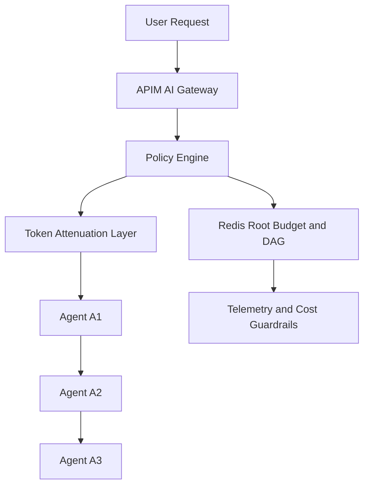
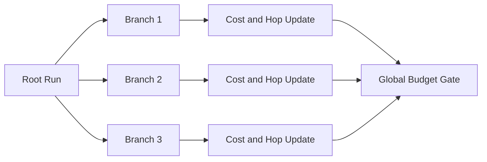
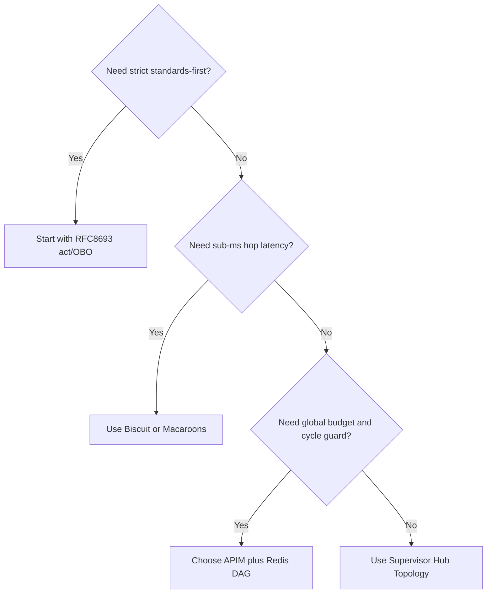

# 企业 A2A 多跳委派衰减与环路预算治理选型 FAQ：RFC8693 act/OBO vs Biscuit/Macaroon vs APIM+Redis DAG vs Supervisor Hub

> 🌐 **Language Switch**：**中文（当前）** | [English](./a2a-multi-hop-delegation-attenuation-cycle-budget-governance-rfc8693-act-obo-vs-biscuit-macaroon-vs-apim-redis-callgraph-selection-faq.en.md)
> **适用对象**：Cloud & AI Solution Architect、平台安全架构师、网关工程团队、多智能体编排负责人、FinOps 与 SRE 团队。
> **问题背景**：企业 A2A + MCP 生态在跨团队扩张后，常出现权限传递失控、循环委派死锁与分支放大成本雪崩。

## 1. 为什么多跳委派在生产环境会快速失控

Agent 能互相调用后，单次用户请求会在隐式链路中扩散成多跳执行图。

若未做权限交集，`A1 -> A2` 可能把高权限能力借壳暴露给低权限上下文。

若未做环检测，`A -> B -> C -> A` 这类间接环会在并行分支中被放大。

若未做共享预算，`B^D` 级联扇出会先耗尽 PTU/API 配额，再触发父超时。

因此必须把权限、拓扑和预算三条治理线统一设计，而非单点补丁。

## 2. 三个核心故障模型与形式化定义

故障一是传递式 confused-deputy：`Perm_eff = P_user ∩ ⋂P_Ai` 未被强制时，代理链会放大能力。

故障二是循环调用：静态无环不代表运行时无环，动态技能路由可在并行分支形成回边。

故障三是预算雪崩：分支因子 `B` 在深度 `D` 下会形成 `B^D` 级任务与令牌消耗。

这三类故障会互相耦合，预算不足时常触发重试风暴，进一步放大环路和权限风险。

## 3. 端到端零信任多跳委派参考架构



建议把 token 衰减、环检测、预算扣减和截止时间传播都放在网关侧强制执行。

Agent 侧只负责声明意图与最小上下文，不应自主管理全局预算状态。

## 4. Architecture A：RFC 8693 Token Exchange + act 链

A 通过 RFC 8693 交换令牌，并在 `sub` + 嵌套 `act` 中保留 actor 链，可与 Entra OBO 联动。

优点是标准化与审计友好，便于跨组织审计主体归因和 CAE 撤权联动。

缺点是每跳 `25–65ms` 交换延迟与 JWT 膨胀问题，4–5 跳后 header 常超过 `4KB`。

OAuth scope 粒度对工具级最小权限表达能力有限，仍需补充细粒度策略层。

A 适合监管与标准合规优先场景，但要警惕多跳性能与尺寸边界。

## 5. Architecture B：Biscuit/Macaroons 离线衰减能力票据

B 在本地追加不可逆 caveat，如 `hop<=3`、`allow_tool_prefix(read_)`、`!visited(agent-sre)`。

验证可在 APIM/Envoy WASM 本地完成，单跳可低于 `1ms` 且无需每跳回 IdP。

它对高并发低延迟链路极具吸引力，尤其适合跨域工具代理密集调用。

挑战在于撤权和密钥轮转治理复杂，且并行分支共享预算状态需额外外部存储。

B 更像高性能权限平面，需要与预算平面组合才能完整落地。

## 6. Architecture C：APIM + Redis DAG 预算与环路强治理

C 在网关入口维护 `root_run_id` 级别有向图，借助 Lua 原子脚本检测回边并扣减预算。

共享预算包含 token、美元成本、工具调用数和统一截止时间 `X-Deadline-Epoch-Ms`。

该模型可在 `<2ms` 内拒绝循环边，并在并行分支间统一执行预算仲裁。

C 的优点是可观测、可审计、可统一治理，缺点是 Redis 可用性成为关键依赖。

建议部署主从分区与多区域热备，避免预算平面自身成为单点瓶颈。

## 7. Architecture D：Hub-and-Spoke Supervisor 星型拓扑

D 禁止 spoke 之间直接互调，所有委派必须回到 supervisor，天然实现 `max_hop=1`。

该模式对环路有结构性免疫，尤其适合单域流程和强治理场景。

代价是 supervisor turn 增加与跨组织耦合上升，复杂跨域协作灵活性下降。

当业务流程高度标准化时，D 可显著降低意外拓扑复杂度与调试成本。

D 不是性能最优，而是拓扑确定性最优的治理选择。

## 8. 关键数学：B^D 放大、JWT 膨胀与延迟预算

扇出放大：`Calls_total = Σ_{i=0..D} B^i = (B^{D+1}-1)/(B-1)`。

若 `B=4,D=5`，总调用达 `1365`，若无共享预算会瞬间击穿下游限额。

多跳交换延迟：`Latency_added ≈ hops * RTT_exchange`，5 跳、每跳 `40ms` 额外约 `200ms`。

JWT 尺寸近似 `Size ≈ Base + hops * act_claim_bytes`，跨 5 跳常触发网关 header 上限警戒。

根预算保护：`Budget_remain = Budget_root - Σ(branch_cost_i)`，需原子更新防竞争。



## 9. 12 维定量矩阵（中文）

| 维度 | A RFC8693 act/OBO | B Biscuit/Macaroons | C APIM+Redis DAG | D Supervisor Hub |
|---|---|---|---|---|
| 标准合规性 | 高 | 中 | 高 | 中高 |
| 单跳延迟开销 | 中高 | 低 | 低 | 中 |
| 多跳扩展性 | 中 | 高 | 高 | 中 |
| 环路免疫能力 | 中 | 中 | 高 | 高 |
| 权限细粒度表达 | 中 | 高 | 高 | 中高 |
| 撤权实时性 | 高 | 中 | 高 | 高 |
| 并行预算一致性 | 中 | 低 | 高 | 高 |
| 观测与审计友好度 | 高 | 中 | 高 | 高 |
| 工程复杂度 | 中 | 高 | 中高 | 中 |
| 跨组织协作适配 | 高 | 中高 | 高 | 中 |
| 三年 TCO 竞争力 | 中 | 中高 | 高 | 中高 |
| 调试可解释性 | 中高 | 中 | 高 | 高 |

## 10. 决策流：按风险、性能与治理成熟度选型



实际落地可采用“C 为治理底座 + A 或 B 作为权限凭据层”的组合路线。

当组织跨域复杂度快速上升时，应优先保证预算与拓扑安全，再优化凭据性能。

## 11. 生产片段：Redis Lua 原子环路+预算防护与 APIM 策略

```lua
-- KEYS[1]=graph:{root_run_id}, KEYS[2]=budget:{root_run_id}
-- ARGV: from_agent,to_agent,cost_tokens,cost_usd,now_ms,deadline_ms,max_hops
local fromA = ARGV[1]
local toA = ARGV[2]
local costTok = tonumber(ARGV[3])
local costUsd = tonumber(ARGV[4])
local nowMs = tonumber(ARGV[5])
local ddlMs = tonumber(ARGV[6])
local maxHops = tonumber(ARGV[7])
if nowMs > ddlMs then return {err='deadline_exceeded'} end
local edgeKey = fromA .. '->' .. toA
if redis.call('HEXISTS', KEYS[1], toA .. '->' .. fromA) == 1 then return {err='cycle_detected'} end
redis.call('HSET', KEYS[1], edgeKey, nowMs)
local remainTok = tonumber(redis.call('HINCRBY', KEYS[2], 'remain_tokens', -costTok))
local remainUsd = tonumber(redis.call('HINCRBYFLOAT', KEYS[2], 'remain_usd', -costUsd))
local hops = tonumber(redis.call('HINCRBY', KEYS[2], 'hops_used', 1))
if remainTok < 0 or remainUsd < 0 or hops > maxHops then return {err='budget_exceeded'} end
return {ok='accepted', remainTok, remainUsd, hops}
```

```xml
<policies>
  <inbound>
    <base />
    <set-header name="x-root-run-id" exists-action="override">
      <value>@(context.Request.Headers.GetValueOrDefault("x-root-run-id", Guid.NewGuid().ToString()))</value>
    </set-header>
    <set-header name="x-deadline-epoch-ms" exists-action="override">
      <value>@(DateTimeOffset.UtcNow.ToUnixTimeMilliseconds() + 12000)</value>
    </set-header>
    <rate-limit-by-key calls="90" renewal-period="60" counter-key="@(context.Subscription.Id + "-" + context.Request.Headers.GetValueOrDefault("x-root-run-id","n/a"))" />
  </inbound>
  <backend><base /></backend>
  <outbound><base /></outbound>
</policies>
```

```python
from dataclasses import dataclass

@dataclass
class ActChainHop:
    actor: str
    scopes: set[str]

def effective_permission(user_scopes: set[str], chain: list[ActChainHop]) -> set[str]:
    eff = set(user_scopes)
    for hop in chain:
        eff &= hop.scopes
    return eff
```

## 12. 场景与 KPI（跨域协作 / 平台运维联邦）

场景一：跨 BU 平台采用 A2A 联邦执行，平均链路深度 `4`，峰值并行分支 `6`。

采用 A+C 组合后，权限审计完整性与预算稳定性显著提升，拒绝环路调用的响应更快。

场景二：平台 SRE 编排体系原先存在 peer-to-peer 乱调，导致夜间重试风暴。

采用 D+C 后，环路事件清零，且预算超限被前置拦截，PTU 峰值波动明显收敛。

| KPI 指标 | 场景一 A+C | 场景二 D+C |
|---|---:|---:|
| 循环调用阻断率 | `99.6%` | `100%` |
| 预算超限前置拦截率 | `94%` | `97%` |
| 平均链路附加时延 | `+78ms` | `+52ms` |
| 审计链可追溯覆盖 | `98.9%` | `99.4%` |
| 下游配额耗尽事件/月 | `3 -> 0.8` | `4 -> 0.3` |

### 三年 TCO（100 / 500 / 2000 万 Root Runs）

| 架构路径 | 1000万 runs | 5000万 runs | 2亿 runs | 三年总成本 |
|---|---:|---:|---:|---:|
| A RFC8693 act/OBO | `$0.96M` | `$4.80M` | `$17.20M` | `$22.96M` |
| B Biscuit/Macaroons | `$0.88M` | `$4.20M` | `$15.10M` | `$20.18M` |
| C APIM+Redis DAG | `$0.92M` | `$3.90M` | `$13.80M` | `$18.62M` |
| D Supervisor Hub | `$0.84M` | `$4.05M` | `$14.90M` | `$19.79M` |
| A+C 混合 | `$1.02M` | `$4.26M` | `$14.20M` | `$19.48M` |
| B+C 混合 | `$0.98M` | `$4.10M` | `$13.94M` | `$19.02M` |

## 13. Day-0 / Day-1 / Day-2 落地清单

### Day-0

1. 统一 root_run_id、deadline、budget 字段与 header 规范。

2. 定义权限交集策略并明确 agent scope 声明格式。

3. 在网关层上线环路检测与预算原子扣减。

4. 设定默认 `max_hop` 与 `max_branch` 防护阈值。

5. 打通审计链路，把 actor 链和预算事件写入统一日志。

6. 建立异常申诉与人工兜底机制，防止误拦截影响生产。

### Day-1

1. 每日跟踪 cycle_detected、budget_exceeded 事件比例。

2. 每日抽样审查 act 链与实际调用主体一致性。

3. 每周复盘高分支任务的预算利用率与收益。

4. 每周评估 JWT 尺寸分布与 header 超限风险。

5. 每周校准 step-up 授权策略与工具最小权限清单。

6. 每周演练 Redis 故障降级策略与恢复流程。

### Day-2

1. 每月重算 B^D 风险参数并调整默认分支阈值。

2. 每月评估撤权传播时延与链路残留风险。

3. 每月复盘误拦截案例并优化白名单治理。

4. 每季度执行多域红队演练验证环路逃逸路径。

5. 每季度更新 TCO 基线与预算策略。

6. 每季度发布多智能体治理成熟度报告。

## 14. 六个量化问答（Q1~Q6）

### Q1: B^D 放大在生产中有多快？

若 `B=5,D=4`，总调用 `1+5+25+125+625=781`，远超单链路直觉。

没有根预算时，重试叠加会把调用量进一步推高到不可控区间。

### Q2: 多跳 token exchange 的时延代价如何估算？

若每跳交换 RTT `38ms`，5 跳附加时延约 `190ms`。

在交互式链路中，这部分延迟可能直接影响用户体感与 SLA 余量。

### Q3: JWT 尺寸膨胀何时成为网关风险？

若基线 `1.2KB`，每跳 act 增量 `620B`，5 跳后约 `4.3KB`。

这会逼近部分网关与代理的 header 限制，需提前限跳或压缩声明。

### Q4: ACL 交集为何必须在每跳强制？

只在入口做一次校验会忽略中间代理能力差异，形成权限旁路。

每跳交集可把有效权限单调收敛，避免高权限工具被链路借壳调用。

### Q5: Redis DAG 如何控制并发分支竞争？

通过 Lua 原子更新边与预算，可避免并发请求下的双花和环路漏检。

若不原子化，分支并发会在毫秒级窗口内突破预算护栏。

### Q6: 何时选择 D 而不是 A/B？

当业务流程稳定且跨域委派少，D 的拓扑确定性与调试性最优。

当需要开放联邦互调和标准化审计，A 或 B 结合 C 更具弹性。

## 15. Good fit / Not for 与运行告警字典

Good fit：多团队联邦 Agent 生态、工具委派深度高、且必须可审计可限额的企业生产平台。

Not for：单 Agent 单工具轻量流程，且无跨域委派与预算压力的低复杂场景。

| 告警键 | 触发条件 | 即时动作 | 责任团队 |
|---|---|---|---|
| `cycle_detect_rate_spike` | 环路拦截率突升 | 冻结高风险路由并回滚新策略 | 平台工程团队 |
| `root_budget_exhaustion` | 根预算频繁见底 | 降低分支阈值并启用强降级 | FinOps 团队 |
| `jwt_header_near_limit` | JWT 尺寸接近上限 | 缩短 act 链并启用最小声明 | 身份团队 |
| `token_exchange_latency_high` | 每跳交换时延超标 | 切换缓存策略或离线能力票据 | 网关团队 |
| `revocation_lag_alert` | 撤权传播超时 | 强制清缓存并重放撤权事件 | 安全团队 |
| `redis_lua_conflict` | 原子脚本冲突增长 | 扩容分片并优化键空间 | 中间件团队 |
| `false_block_appeal_burst` | 误拦截申诉激增 | 临时放宽策略并人工复核 | 客户成功团队 |
| `deadline_propagation_missing` | 子调用缺失 deadline | 拒绝执行并修复 SDK 中间件 | Agent SDK 团队 |

### 参考来源（抓取日期：2026-11-24）

1. RFC 8693 OAuth 2.0 Token Exchange: https://www.rfc-editor.org/rfc/rfc8693

2. Microsoft identity platform OBO flow: https://learn.microsoft.com/entra/identity-platform/v2-oauth2-on-behalf-of-flow

3. Azure API Management policies: https://learn.microsoft.com/azure/api-management/api-management-policies

4. Azure Cache for Redis docs: https://learn.microsoft.com/azure/azure-cache-for-redis/

5. Biscuit authorization token: https://www.biscuitsec.org/

6. Macaroons paper/resources: https://research.google/pubs/pub41892/

以上来源用于约束多跳委派凭据、网关策略与预算拓扑治理的实现边界。

阈值需要根据组织规模、代理深度和下游配额策略持续校准。
