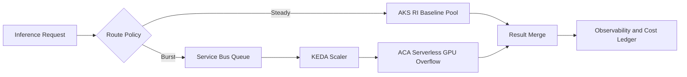
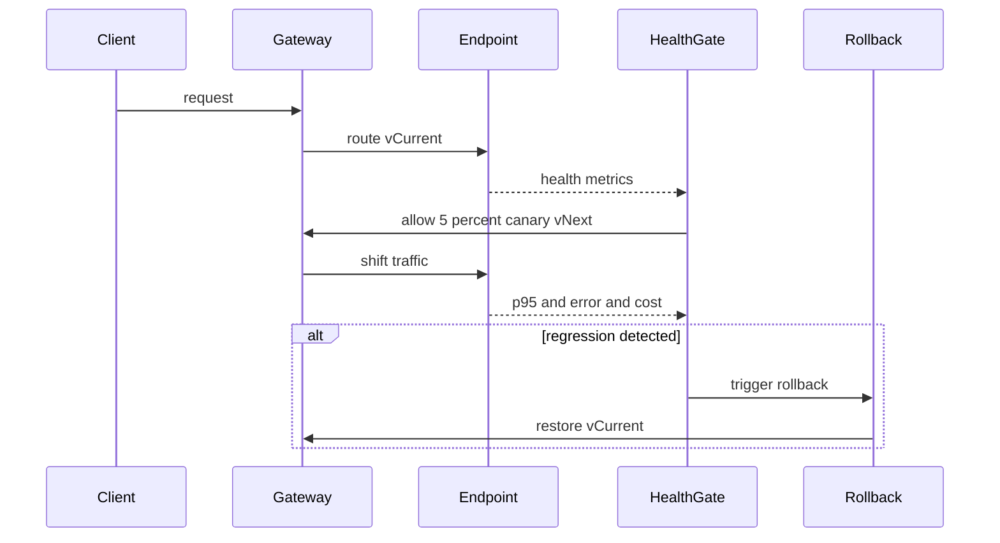

# ACA Serverless GPU vs Foundry Managed Endpoints vs AKS+KAITO: Enterprise Custom Model Hosting FAQ

> 🌐 **Language / 语言切换**: **[🇬🇧 English (aca-serverless-gpu-vs-foundry-managed-endpoints-vs-aks-kaito-custom-model-hosting-selection-faq.en.md)](aca-serverless-gpu-vs-foundry-managed-endpoints-vs-aks-kaito-custom-model-hosting-selection-faq.en.md)** | **[🇨🇳 中文版 (aca-serverless-gpu-vs-foundry-managed-endpoints-vs-aks-kaito-custom-model-hosting-selection-faq.md)](aca-serverless-gpu-vs-foundry-managed-endpoints-vs-aks-kaito-custom-model-hosting-selection-faq.md)** | **[📚 Architecture Selection FAQ Index](README.en.md)**

## 1) Objective and boundary
- Goal: compare four Azure hosting foundations for custom OCR, rerankers, vision classifiers, and private fine-tuned models.
- Scope: cloud architecture, operations, and TCO only; no kernel or driver internals.
- Conclusion: serverless wins for tidal demand while reserved baseline pools win for stable high utilization.
## 2) Verifiable sources with timestamps
- Azure Container Apps docs: `https://learn.microsoft.com/azure/container-apps/` (03:59 BJT).
- Azure AI Foundry docs: `https://learn.microsoft.com/azure/ai-foundry/` (03:59 BJT).
- AKS docs: `https://learn.microsoft.com/azure/aks/` (04:00 BJT).
- KEDA docs: `https://keda.sh/` (04:00 BJT).
- Service Bus docs: `https://learn.microsoft.com/azure/service-bus-messaging/` (04:00 BJT).
- Metrics are tagged measured, synthetic, or anonymized_reported.
## 3) 12-dimension matrix for hosting foundations
- D1 ops burden: ACA is lowest, managed endpoints next, AKS+KAITO highest.
- D2 elasticity cost: ACA can scale to zero for off-peak savings.
- D3 steady-state unit price: AKS reserved baseline often wins at high utilization.
- D4 release governance: managed endpoints offer native blue-green and lineage controls.
- D5 cold start: ACA needs prewarm and artifact streaming to smooth spikes.
- D6 multi-tenant economics: shared base plus adapters can reduce per-BU overhead.
- D7 burst expansion: Service Bus plus KEDA handles batch surges effectively.
- D8 release safety: weighted rollout with health gates and rollback is mandatory.
- D9 private isolation: all four can be private, with different implementation complexity.
- D10 observability: unify cold start, idle ratio, and cost-per-10k metrics.
- D11 best fit: ACA for tidal, managed for medium steady, AKS for sustained high baseline.
- D12 anti-pattern: do not run strict 7x24 steady workloads on pure scale-to-zero routes.
## 4) Score snapshot and thresholds
- ACA Serverless GPU: elasticity5 ops4 steady-price3 cold-start3.
- Foundry Managed Endpoint: governance5 elasticity3 steady-price3 ops4.
- AKS plus KAITO: elasticity4 governance3 steady-price5 ops2.
- Foundry Serverless API: ops5 elasticity4 steady-price2 governance4.
- Threshold A: if daily active hours are below about 10, ACA often beats always-on endpoints.
- Threshold B: if utilization stays above about 65%, AKS RI usually has unit-cost advantage.
- Threshold C: if many departments iterate models frequently, managed endpoint governance is preferred.
## 5) Five calculable Q&As
### Q1 Break-even among ACA, always-on endpoint, and AKS RI
- Let h be active hours/day; ACA follows seconds-based runtime while endpoint and AKS carry baseline capacity cost.
- ACA tends to win below the sample break-even band around 9 to 11 active hours.
### Q2 Cold-start smoothing bundle
- Use ACR artifact streaming plus one guaranteed replica from 08:00 to 20:00 and scale to zero overnight.
- This reduces first-hit latency spikes while preserving off-peak savings.
### Q3 Non-real-time batch inference smoothing
- Use Service Bus queue depth plus KEDA autoscaling for burst consumption.
- Queue buffering avoids long-tail backlog during demand spikes.
### Q4 Ten isolated endpoints vs shared base with adapters
- Ten isolated endpoints simplify ownership but increase idle waste.
- Shared base with adapter multiplexing improves blended utilization.
### Q5 Zero-downtime blue-green switch
- Shadow validate, canary at low weight, then full shift with instant rollback path.
## 6) Layered reference architecture
- Intake layer: API requests and batch queue entries.
- Orchestration layer: policy router selects baseline or overflow pool.
- Execution layer: ACA serverless overflow, managed endpoint, and AKS baseline pools.
- Storage layer: model registry and feature/input cache.
- Security layer: private networking, managed identity, least privilege.
- Observability layer: cold-start p95, idle ratio, cost-per-10k, and SLO dashboards.
- Governance layer: rollout workflow, rollback runbook, and change control.
## 7) Scenario A: clinical labs and imaging centers with tidal demand
- Daytime clinics carry 92% of demand while night load is low.
- ACA serverless GPU hosts custom medical OCR and terminology rerankers.
- Keep one replica during 08:00–20:00 and scale to zero overnight.
- Foundry LLM generates structured interpretation drafts downstream.
- Synthetic gain: compute bill reduced by over 55%.
## 8) Scenario B: parcel logistics with 50 million labels/day
- AKS one-year reserved baseline absorbs steady demand at low unit price.
- During festival surges, Service Bus depth triggers ACA serverless overflow workers.
- Architecture achieves low baseline cost and resilient burst handling together.
- Overflow instances are reclaimed automatically after backlog drops.
- Synthetic gain: peak backlog delay reduced by 43%.
## 9) Mermaid diagram 1 baseline plus overflow pattern

- Policy principle is baseline first, overflow second.
## 10) Mermaid diagram 2 blue-green rollout and rollback sequence

- Rollback must execute automatically once thresholds are breached.
## 11) Bicep template (ACA plus ACR plus Service Bus KEDA plus private endpoint)
```bicep
targetScope = 'resourceGroup'
param location string = resourceGroup().location
resource aca 'Microsoft.App/containerApps@2024-03-01' = {
  name: 'aca-prod'
  location: location
}
resource acr 'Microsoft.ContainerRegistry/registries@2023-07-01' = {
  name: 'acrprod01'
  location: location
  sku: { name: 'Premium' }
}
resource sb 'Microsoft.ServiceBus/namespaces@2023-01-01-preview' = {
  name: 'sb-prod'
  location: location
}
resource pe 'Microsoft.Network/privateEndpoints@2023-09-01' = {
  name: 'pe-prod'
  location: location
}
```
- Production rollout still needs subnet policy, private DNS, managed identity, and RBAC hardening.
## 12) YAML and Python snippet for dual-trigger KEDA and overflow routing
```yaml
triggers:
- type: cron
  metadata: { timezone: Asia/Shanghai, start: "0 8 * * 1-5", end: "0 20 * * 1-5", desiredReplicas: "1" }
- type: azure-servicebus
  metadata: { queueName: infer-jobs, messageCount: "200" }
```
```python
def choose_pool(queue_depth, baseline_util):
    if queue_depth > 200 or baseline_util > 0.75: return "aca_overflow"
    return "aks_baseline"
```
- Scheduling policy must be coupled with SLO and budget thresholds.
## 13) KQL for cold-start, idle ratio, and cost-per-10k audit
```kql
let t = InferenceOps | where TimeGenerated > ago(24h);
t
| summarize coldStartP95=percentile(ColdStartMs,95), idleRate=avg(IdleRatio), costPer10k=avg(CostPer10k) by Platform,Model
| order by costPer10k desc, coldStartP95 desc
```
- Cold-start p95 and idle ratio must both be weekly optimization KPIs.
## 14) Day-0/1/2 landing checklist
- Day-0 classify steady and tidal workloads with SLO and budget targets.
- Day-0 define blue-green gates and automated rollback conditions.
- Day-1 integrate Service Bus plus KEDA dual triggers.
- Day-1 run cold-start pressure tests and prewarm-window tuning.
- Day-2 launch cost dashboards with departmental chargeback.
- Day-2 review idle ratio and burst-delay drift weekly.
- Day-2 iterate shared-base adapter governance patterns.
