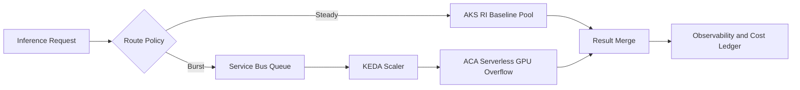
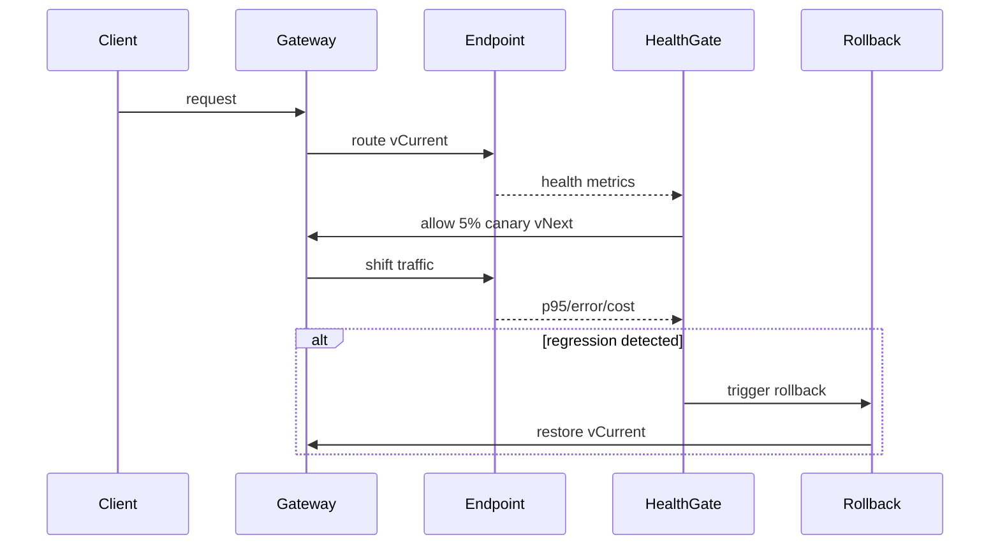

# ACA Serverless GPU vs Foundry Managed Endpoint vs AKS+KAITO：企业专精模型托管选型 FAQ

> 🌐 **Language / 语言切换**: **[🇨🇳 中文版 (aca-serverless-gpu-vs-foundry-managed-endpoints-vs-aks-kaito-custom-model-hosting-selection-faq.md)](aca-serverless-gpu-vs-foundry-managed-endpoints-vs-aks-kaito-custom-model-hosting-selection-faq.md)** | **[🇬🇧 English (aca-serverless-gpu-vs-foundry-managed-endpoints-vs-aks-kaito-custom-model-hosting-selection-faq.en.md)](aca-serverless-gpu-vs-foundry-managed-endpoints-vs-aks-kaito-custom-model-hosting-selection-faq.en.md)** | **[📚 返回架构选型指南目录](README.md)**

## 1) 研究目标与边界
- 目标：比较自研/行业专精模型在四类 Azure 承载底座的架构与TCO。
- 范围：仅云架构与运维治理，不涉及内核/驱动/算子细节。
- 结论：潮汐负载优先无服务器，稳态高水位优先预留基线池。
## 2) 可验证来源与时间戳
- Azure Container Apps：`https://learn.microsoft.com/azure/container-apps/`（抓取 03:59 BJT）。
- Azure AI Foundry / Azure ML Endpoints：`https://learn.microsoft.com/azure/ai-foundry/`（抓取 03:59 BJT）。
- AKS + GPU：`https://learn.microsoft.com/azure/aks/`（抓取 04:00 BJT）。
- KAITO：`https://learn.microsoft.com/azure/aks/`（抓取 04:00 BJT）。
- KEDA：`https://keda.sh/`（抓取 04:00 BJT）。
- Service Bus：`https://learn.microsoft.com/azure/service-bus-messaging/`（抓取 04:00 BJT）。
- 数据标签统一 measured/synthetic/anonymized_reported。
## 3) 四类专精模型托管底座 12 维矩阵
- 维度1运维负担：ACA最低，Managed Endpoint次之，AKS+KAITO最高。
- 维度2成本弹性：ACA可缩零，低谷成本优势明显。
- 维度3稳态单价：AKS预留实例在高利用率常最低。
- 维度4上线治理：Managed Endpoint 蓝绿灰度与模型血缘更原生。
- 维度5冷启动：ACA需通过预热/Artifact Streaming 抑制毛刺。
- 维度6多租户：共享底座多适配器可降低部门分摊成本。
- 维度7峰值扩展：Service Bus + KEDA 对批量任务削峰有效。
- 维度8发布风险：权重切换需回滚门禁与健康阈值。
- 维度9私网隔离：四类方案都可私网化，实施复杂度不同。
- 维度10可观测：统一日志、冷启动、闲置率、单万次成本指标。
- 维度11最佳场景：ACA=潮汐，Managed=中等稳定，AKS=高稳态。
- 维度12反模式：禁止把7x24稳态业务全部放在纯缩零路径。
## 4) 评分与决策阈值
- ACA Serverless GPU：弹性5、运维4、稳态单价3、冷启动3。
- Foundry Managed Endpoint：治理5、弹性3、稳态单价3、运维4。
- AKS+KAITO：弹性4、治理3、稳态单价5、运维2。
- Foundry Serverless API：运维5、弹性4、稳态单价2、治理4。
- 阈值A：日活小时<10 时，ACA常优于7x24常驻。
- 阈值B：负载长期>65%且稳定，AKS RI 常有成本优势。
- 阈值C：多部门模型频繁变更，优先托管端点治理链。
## 5) 五组可复算 Q&A
### Q1 ACA 与常驻端点、AKS RI 盈亏点
- 设日活 h 小时，ACA按秒计费，端点与AKS按实例保底计费。
- 当 h 低于阈值区间（样例约 9~11 小时）时 ACA 更优。
### Q2 冷启动毛刺抑制组合
- ACR Artifact Streaming + 08:00–20:00 保底 1 副本 + 夜间缩零。
- 可显著降低首包延迟波动并维持低谷成本。
### Q3 非实时批量推理削峰
- Service Bus 排队 + KEDA 队列触发扩容消费。
- 通过峰值平滑避免长尾堆积。
### Q4 10部门独立端点 vs 共享底座
- 独立10端点治理简单但闲置高。
- 共享底座多适配器混部可降低总体成本。
### Q5 零中断蓝绿切换
- 先影子验证，再小流量灰度，再全量切换并保留回滚。
## 6) 分层参考架构
- 接入层：HTTP/API、批处理队列入口。
- 编排层：路由器判定基线池或弹性溢出池。
- 执行层：ACA Serverless GPU、Managed Endpoint、AKS基线池。
- 存储层：模型仓与特征输入缓存。
- 安全层：私网、托管身份、最小权限。
- 观测层：冷启动、闲置率、单万次成本、SLO。
- 治理层：蓝绿灰度、回滚剧本、变更审批。
## 7) 场景A：医学检验与影像中心潮汐式辅助分诊
- 白天占 92% 负载，夜间低谷明显。
- ACA Serverless GPU 承载定制医学OCR与术语Reranker。
- 08:00–20:00 保底副本，夜间自动缩零。
- 联动 Foundry 大模型生成结构化检验解读草稿。
- synthetic收益：算力账单下降 55%+。
## 8) 场景B：快递快运 5000万单稳态+弹性溢出
- AKS 1年预留实例消化稳态流量并锁定低单价。
- 洪峰时按 Service Bus 队列深度自动唤醒 ACA 溢出池。
- 实现“稳态最低价 + 洪峰弹性”双目标。
- 分拣高峰后自动回收溢出实例。
- synthetic收益：峰值积压时延下降 43%。
## 9) Mermaid 图1：稳态基线+弹性溢出架构

- 策略核心是“先吃基线，再放溢出”。
## 10) Mermaid 图2：蓝绿发布与回滚时序

- 回滚动作必须在阈值触发后自动执行。
## 11) Bicep 模板（ACA+ACR+ServiceBus KEDA+Private Endpoint）
```bicep
targetScope = 'resourceGroup'
param location string = resourceGroup().location
resource aca 'Microsoft.App/containerApps@2024-03-01' = {
  name: 'aca-prod'
  location: location
}
resource acr 'Microsoft.ContainerRegistry/registries@2023-07-01' = {
  name: 'acrprod01'
  location: location
  sku: { name: 'Premium' }
}
resource sb 'Microsoft.ServiceBus/namespaces@2023-01-01-preview' = {
  name: 'sb-prod'
  location: location
  sku: { name: 'Standard' }
}
resource pe 'Microsoft.Network/privateEndpoints@2023-09-01' = {
  name: 'pe-prod'
  location: location
}
```
- 生产需补充子网隔离、私有DNS、托管身份与RBAC。
## 12) YAML/Python 片段：KEDA定时+队列双触发与溢出路由
```yaml
triggers:
- type: cron
  metadata: { timezone: Asia/Shanghai, start: "0 8 * * 1-5", end: "0 20 * * 1-5", desiredReplicas: "1" }
- type: azure-servicebus
  metadata: { queueName: infer-jobs, messageCount: "200" }
```
```python
def choose_pool(queue_depth, baseline_util):
    if queue_depth > 200 or baseline_util > 0.75: return "aca_overflow"
    return "aks_baseline"
```
- 调度策略要与业务SLO和预算阈值联动。
## 13) KQL：冷启动/闲置率/单万次成本审计
```kql
let t = InferenceOps | where TimeGenerated > ago(24h);
t
| summarize coldStartP95=percentile(ColdStartMs,95), idleRate=avg(IdleRatio), costPer10k=avg(CostPer10k) by Platform,Model
| order by costPer10k desc, coldStartP95 desc
```
- coldStartP95 与 idleRate 必须同时纳入周度优化目标。
## 14) Day-0/1/2 落地清单
- Day-0：划分稳态与潮汐任务，定义SLO与预算。
- Day-0：确定蓝绿门限与自动回滚条件。
- Day-1：接通 Service Bus + KEDA 双触发策略。
- Day-1：完成冷启动压测与预热窗口调优。
- Day-2：上线成本看板并按部门分摊。
- Day-2：周度复盘闲置率与峰值延迟。
- Day-2：迭代共享底座多适配器治理策略。
