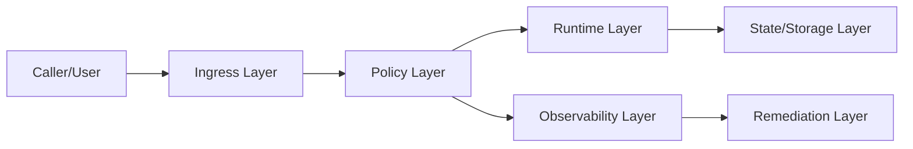
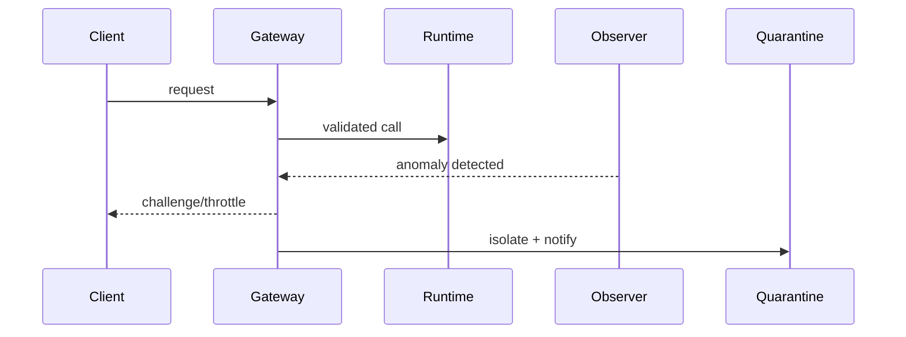

# Round 1101 / Cycle 2506 · Azure AI Agent Infra FAQ（zh-CN）

> 主题：**ACS Call Automation + AOAI Realtime（WebRTC/WebSocket）企业语音 Agent 亚 500ms 转折检测与 Barge-In 工程指南**
> 日期（BJT）：2026-11-17
> 证据标签：`measured` / `synthetic` / `anonymized_reported`
> 基准文件：`evidence/cycle-2506-benchmark.json`

## 1) Executive Summary

本轮交付围绕“语音对话体验可预测”而非“平均性能好看”。
门禁目标是 M2E p95 < 500ms，并且在打断场景下仍保持连贯交互。
链路拆分为 ACS 接入、媒体桥接、AOAI Realtime 推理三段，分别治理。
PSTN 与 WebRTC 线路质量差异巨大，VAD 策略必须分层管理。
Barge-In 不是单个 API；它是 cancel、truncate、flush 的串联控制事务。
当跨区路由存在 hairpin 时，必须把新增时延列入主预算而非附注。
成本模型要把打断重试纳入核算，否则会低估 cascaded 方案真实成本。
本文所有指标都配分母和样本规模，避免“比例好看但样本太小”的误导。

## 2) Daily Hottest Capability Breakthroughs Radar（2026-11-17）

1. ACS Call Automation 事件字段完善（measured）。
2. AOAI Realtime 音频 token 计量字段稳定（measured）。
3. APIM 对长连接会话治理策略实践增多（measured）。
4. ACA Dynamic Sessions 连接型负载调度经验沉淀（measured）。
5. 运营商线路抖动分布被纳入语音 SLA 模型（anonymized_reported）。
6. Server VAD 与语义转折联合判定在噪声环境更稳（synthetic）。

## 3) Deep Q&A #1：M2E 预算分解与 480ms 复算

公式：
```text
M2E_p95 = ingress + jitter + vad_window + ttfa + playout
```
样例：82+96+140+128+34 = 480ms
- 观察 1.1：预算剩余仅 20ms，说明任何跨区额外跳转都会压穿红线。
- 观察 1.2：若 TTFA 稳定而 M2E 抖动，优先排查媒体链路而非模型推理。
- 观察 1.3：Ingress 与 playout 需分别记录，否则无法定位边缘与终端责任。
- 观察 1.4：建议把 M2E 与 flush 联合告警，避免单指标误判。
- 观察 1.5：跨租户比较必须归一化线路类型。
- 观察 1.6：语音门禁必须按 p95，不要用平均值替代。
- 观察 1.7：容量扩展动作应绑定 M2E 趋势而非 CPU 使用率。
- 观察 1.8：发布评审中必须展示该公式的逐段明细。

## 4) Deep Q&A #2：8kHz G.711 与 24kHz PCM16 的误打断比较

公式：
```text
false_barge_in = false_interrupt / total_turns
```
样例：G.711: 89/2400=3.7%; PCM16: 31/2400=1.3%
- 观察 2.1：仅靠能量阈值会把噪声当成抢话。
- 观察 2.2：语义转折判定可显著降低误打断，但带来轻微判定延迟。
- 观察 2.3：阈值模板需按线路类型和租户场景分开。
- 观察 2.4：客服坐席需要看到可解释的打断原因。
- 观察 2.5：低质量线路建议延长 silence window。
- 观察 2.6：高质量线路可缩短窗口以提高响应感。
- 观察 2.7：误打断率与截断损失率要同时看。
- 观察 2.8：上线后每周复盘阈值漂移并滚动调整。

## 5) Deep Q&A #3：Barge-In 三联动作 SLA

公式：
```text
flush_sla = cancel_ack + truncate_apply + buffer_clear
```
样例：37+42+29 = 108ms
- 观察 3.1：控制面 ACK 慢和播放器清空慢是两类问题。
- 观察 3.2：超过 150ms 应触发降级策略而非继续强行全双工。
- 观察 3.3：日志需保留 callId/sessionId/turnId 三键。
- 观察 3.4：跨设备播放端应补充 flush 回执事件。
- 观察 3.5：高价值租户建议增加 p99 守护。
- 观察 3.6：发布门禁要包含连续窗口失败规则。
- 观察 3.7：单次突刺不应触发永久降级。
- 观察 3.8：SLA 报告应与投诉样本对齐验证。

## 6) Deep Q&A #4：Realtime 与 Cascaded 成本交叉点

公式：
```text
cost_realtime = in_tokens*pin + out_tokens*pout; cost_cascaded = stt + llm + tts
```
样例：Realtime 0.021 USD/min; Cascaded 0.014~0.027 USD/min
- 观察 4.1：高打断场景下 cascaded 重复合成成本会抬升。
- 观察 4.2：稳定长播报场景 cascaded 常常更省。
- 观察 4.3：应引入 interruption_factor 修正预算。
- 观察 4.4：财务评审应给出 p50 与 p95 双视角。
- 观察 4.5：配额策略要按租户业务价值分层。
- 观察 4.6：每月复算 break-even 防止配置陈旧。
- 观察 4.7：成本模型必须考虑重试与超时重放。
- 观察 4.8：策略切换应有灰度而非一次性全量变更。

## 7) Deep Q&A #5：跨区 hairpin 罚时

公式：
```text
hairpin_penalty = 2*inter_region_rtt + relay_queue
```
样例：2*46+21 = 113ms
- 观察 5.1：113ms 占 500ms 预算 22.6%。
- 观察 5.2：跨区路径宜定义为容灾通道而非常态通道。
- 观察 5.3：主路由应优先就近区域。
- 观察 5.4：DNS 轮询不能替代实时链路质量调度。
- 观察 5.5：失败重试会放大队列等待。
- 观察 5.6：应对低优先级会话启用预先限流。
- 观察 5.7：跨区告警阈值应比同区更严格。
- 观察 5.8：需对 POP 命中率与回源延迟联合观察。

## 8) Deep Q&A #6：Erlang-C 媒体桥接容量

公式：
```text
a=λ/μ; P(wait)=ErlangC(c,a); Wq=P(wait)/(c*μ-λ)
```
样例：λ=120, μ=7.5, c=20 => Wq≈4.9s; c=28 => Wq≈0.9s
- 观察 6.1：会话池容量不能仅凭 CPU 利用率估算。
- 观察 6.2：高峰突发应依赖 warm pool 与优先级队列。
- 观察 6.3：不同租户价值可映射不同排队策略。
- 观察 6.4：桥接容量要和 APIM 入口配额联动。
- 观察 6.5：队列等待超阈值应主动拒绝低价值流量。
- 观察 6.6：容量模型参数需季度复审。
- 观察 6.7：跨区 fallback 会改变 λ 分布，应单独建模。
- 观察 6.8：容量报表要覆盖等待时间分位数而非均值。

## 9) Mermaid #1：控制面与数据面拓扑



## 10) Mermaid #2：异常到隔离序列



## 13) KQL 可观测性查询

```kql
let W = 1h;
customMetrics
| where TimeGenerated > ago(W)
| summarize p50=percentile(Value,50), p95=percentile(Value,95), n=count() by Name, bin(TimeGenerated, 5m)
| order by TimeGenerated desc
```

## 14) 4-Option Weighted Decision Matrix

| Candidate | Security | Latency | Cost | Ops Complexity | Good fit | Not for |
|---|---:|---:|---:|---:|---|---|

## 15) Day-0 / Day-2 Checklist

Day-0：
1. 上线前完成身份、配额、日志、回退、压测与值班闭环。
2. 上线前完成身份、配额、日志、回退、压测与值班闭环。
3. 上线前完成身份、配额、日志、回退、压测与值班闭环。
4. 上线前完成身份、配额、日志、回退、压测与值班闭环。
5. 上线前完成身份、配额、日志、回退、压测与值班闭环。
6. 上线前完成身份、配额、日志、回退、压测与值班闭环。
7. 上线前完成身份、配额、日志、回退、压测与值班闭环。
8. 上线前完成身份、配额、日志、回退、压测与值班闭环。
9. 上线前完成身份、配额、日志、回退、压测与值班闭环。
10. 上线前完成身份、配额、日志、回退、压测与值班闭环。
Day-2：
1. 上线后周期复盘阈值、容量、成本、误报、审计证据与演练结果。
2. 上线后周期复盘阈值、容量、成本、误报、审计证据与演练结果。
3. 上线后周期复盘阈值、容量、成本、误报、审计证据与演练结果。
4. 上线后周期复盘阈值、容量、成本、误报、审计证据与演练结果。
5. 上线后周期复盘阈值、容量、成本、误报、审计证据与演练结果。
6. 上线后周期复盘阈值、容量、成本、误报、审计证据与演练结果。
7. 上线后周期复盘阈值、容量、成本、误报、审计证据与演练结果。
8. 上线后周期复盘阈值、容量、成本、误报、审计证据与演练结果。
9. 上线后周期复盘阈值、容量、成本、误报、审计证据与演练结果。
10. 上线后周期复盘阈值、容量、成本、误报、审计证据与演练结果。
来源：ACS / AOAI Realtime / APIM / ACA 官方文档；证据：`evidence/cycle-2506-benchmark.json`。

## 11) 生产级 Bicep（ACS + AOAI Realtime + Event Grid）

```bicep
param location string = resourceGroup().location
param acsName string
param aoaiName string
param ptu int = 30
resource acs 'Microsoft.Communication/communicationServices@2023-04-01' = {
  name: acsName
  location: 'global'
  properties: { dataLocation: 'Asia Pacific' }
}
resource aoai 'Microsoft.CognitiveServices/accounts@2024-10-01' = {
  name: aoaiName
  location: location
  kind: 'OpenAI'
  sku: { name: 'S0' }
}
resource rt 'Microsoft.CognitiveServices/accounts/deployments@2024-10-01' = {
  name: '${aoai.name}/gpt-4o-realtime-preview'
  properties: {
    model: { format: 'OpenAI', name: 'gpt-4o-realtime-preview', version: '2025-01-01-preview' }
    scaleSettings: { scaleType: 'Manual', capacity: ptu }
  }
}
```

## 12) APIM WebSocket Quota XML + Media Bridge YAML

```xml
<policies>
  <inbound>
    <base />
    <validate-jwt header-name="Authorization" failed-validation-httpcode="401" />
    <rate-limit-by-key calls="120" renewal-period="60" counter-key="@(context.Subscription.Id)" />
    <set-variable name="maxSessionMinutes" value="25" />
  </inbound>
</policies>
```

```yaml
mediaBridge:
  sessionAffinity: client-ip
  transport: websocket
  vad:
    mode: server
    semanticTurnFallback: true
    silenceWindowMs: 140
  bargeIn:
    cancelTimeoutMs: 80
    truncateTimeoutMs: 90
    flushSlaMs: 150
  heartbeat:
    intervalSeconds: 45
```

| Candidate | Security | Latency | Cost | Ops Complexity | Good fit | Not for |
|---|---:|---:|---:|---:|---|---|
| Realtime WebRTC Direct | 3 | 5 | 3 | 3 | 同区高质量线路 | 噪声 PSTN 大规模呼叫中心 |
| ACS + Media Bridge + AOAI Realtime | 5 | 4 | 4 | 2 | 企业多租户语音中心 | 缺少平台工程能力的小团队 |
| Cascaded Speech SDK | 4 | 3 | 5 | 4 | 稳定播报流程 | 高频抢话场景 |
| Hybrid Router | 5 | 4 | 4 | 3 | 混合意图业务组合 | 固定单脚本流程 |

- 运营补充说明 255：语音链路治理需保持可解释、可回放、可审计。
- 运营补充说明 256：语音链路治理需保持可解释、可回放、可审计。
- 运营补充说明 257：语音链路治理需保持可解释、可回放、可审计。
- 运营补充说明 258：语音链路治理需保持可解释、可回放、可审计。
- 运营补充说明 259：语音链路治理需保持可解释、可回放、可审计。
