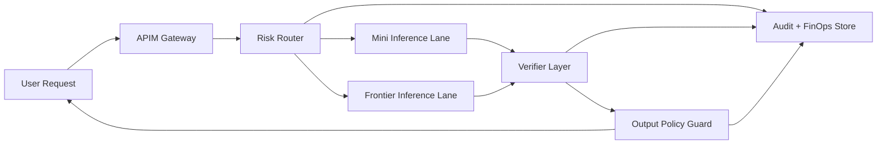
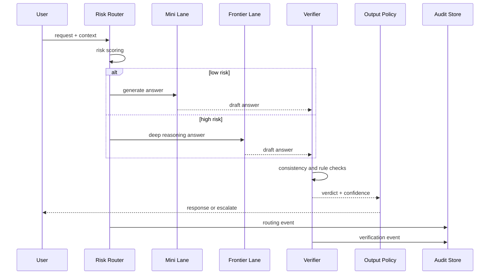

# Enterprise adaptive reasoning-depth routing selection FAQ: Mini economy lane vs Frontier deep lane vs two-pass verifier vs integrated closed-loop control

> **Audience**: Enterprise Cloud & AI Solution Architects, LLMOps platform teams, application architects, and FinOps/quality governance leaders.  
> **Core question**: In multi-tenant production traffic, how should teams allocate reasoning depth dynamically to balance quality, latency, and cost.

## 1. Problem framing: reasoning-depth budget is now a first-class production constraint

In PoC phases,
teams optimize mainly for answer quality.

In production,
the hard trade-off becomes:

- Budget ceilings.
- Latency commitments.
- Accuracy on high-risk tasks.

If every request goes to deep frontier models,
cost and queue latency rise quickly.

If every request goes to light models,
complex tasks degrade silently.

Typical enterprise scenarios include:

- Legal clause conflict analysis.
- Financial reconciliation anomaly reasoning.
- Operations incident diagnosis and runbook mapping.
- Customer escalation responsibility determination.

These scenarios do not need identical compute depth.
They need risk-aware depth allocation.

## 2. Four architecture patterns and practical boundaries

This guide compares four patterns:

- Pattern A: fixed Frontier deep reasoning for all traffic.
- Pattern B: Mini default lane with risk-based escalation.
- Pattern C: two-pass generation with verifier checks.
- Pattern D: integrated layered loop combining A/B/C.

Evaluate with a balanced metric set:

- Task pass rate on complex subsets.
- Escalation hit rate and miss-escalation rate.
- P95 latency and timeout ratio.
- Cost per 1,000 requests.
- Rework cost from incorrect outputs.

## 3. Pattern A: fixed Frontier deep lane

This is the simplest operating model:
all requests use high-capability models.

Strengths:

- Simple policy logic.
- Strong complex-task capability.
- Uniform reasoning behavior.

Limitations:

- Cost scales aggressively with traffic.
- Peak-time queuing increases.
- Low-complexity requests are over-computed.

Best fit:

- Low-volume, high-value workloads.
- Early quality-ceiling validation phases.

## 4. Pattern B: Mini default lane with escalation

This pattern keeps Mini as baseline,
then escalates only when risk is detected.

Core capabilities:

- Risk classifier for route decisions.
- Confidence thresholds for escalation.
- Explainable escalation tags.
- Fallback and human-handoff policies.

Strengths:

- Strong cost control.
- Better latency for common requests.
- Easy alignment with APIM quota controls.

Limitations:

- Classifier quality becomes critical.
- Miss-escalations can hurt high-risk quality.
- Threshold tuning requires ongoing operations.

## 5. Pattern C: two-pass generation plus verifier

This pattern generates candidate outputs first,
then runs a verifier for consistency and policy checks.

Verifier focus areas often include:

- Numeric consistency.
- Citation completeness.
- Policy constraint compliance.
- Structured-output validity.

Strengths:

- Better detection of plausible-but-wrong outputs.
- Lower residual risk on regulated scenarios.
- Supports domain-specific verifier evolution.

Limitations:

- Extra inference pass cost.
- Added latency overhead.
- Verifier lifecycle needs governance too.

## 6. Pattern D: integrated layered loop (recommended)

Mature enterprises often converge to layered roles:

- Mini handles most low-risk traffic.
- Frontier handles escalated complex requests.
- Verifier guards high-risk response quality.

The value is not simple stacking,
it is clear role separation:

- Mini optimizes throughput economics.
- Frontier handles reasoning difficulty.
- Verifier manages correctness assurance.

At scale, this model usually gives best blended TCO.

## 7. Reference architecture: reasoning-depth routing control plane

Architecture implications:

- Routing must be decoupled from model execution.
- Verifier augments, not replaces, primary inference.
- Every route decision needs versioned evidence.

## 8. Request flow: risk scoring, escalation, verification, response

Flow governance notes:

- Escalation rules must be replay-testable.
- Verifier failures must have deterministic handling.
- Audit events should map to one trace lineage.

## 9. 12-dimension enterprise comparison matrix

| Dimension | A Fixed Frontier | B Mini+Escalation | C Two-Pass Verifier | D Integrated Loop |
|---|---|---|---|---|
| Complex-task capability | Very high | High | High | Very high |
| Economy on common traffic | Low | Very high | Medium | High |
| Average latency profile | Medium | High | Medium | Medium to high |
| Peak throughput resilience | Medium | Very high | Medium | High |
| Wrong-answer containment | Medium | Medium | Very high | Very high |
| Route explainability | Low | High | Medium | Very high |
| Operational complexity | Low | Medium | Medium | High |
| Policy tuning headroom | Low | High | High | Very high |
| Audit readiness | Medium | High | High | Very high |
| Business adaptability | Medium | High | High | Very high |
| Time-to-adopt | High | Medium | Medium | Medium |
| Recommended maturity | Early quality-first | Cost optimization | Risk reduction | Mature scale |

## 10. Quantitative break-even: quality, latency, and cost

| Metric | A Fixed Frontier | B Mini+Escalation | C Two-Pass | D Integrated Loop |
|---|---:|---:|---:|---:|
| Complex-task pass rate | 92.8% | 90.1% | 91.7% | 93.2% |
| Miss-escalation rate | 0% | 6.4% | 3.1% | 2.2% |
| P95 latency | 4.1 s | 2.0 s | 3.4 s | 2.6 s |
| Cost per 1k requests | $18.6 | $9.4 | $12.7 | $11.2 |
| Rework loss per 1k requests | $6.1 | $9.2 | $5.4 | $4.3 |
| Blended total per 1k requests | $24.7 | $18.6 | $18.1 | $15.5 |

Assumptions:

- 1 million requests per day.
- Complex-task ratio at 22%.
- High-risk ratio at 14%.
- Rework loss includes human correction and SLA penalties.

Break-even observations:

- Early low-volume phases can tolerate A.
- Mid/high volume environments favor B on spend.
- Strong-risk domains favor C or D.
- Rising rework cost usually makes D dominant.

## 11. Decision tree: risk first, compute second

Question 1:
Do you handle regulated high-risk tasks?

- Yes: prioritize C or D.
- No: continue to Question 2.

Question 2:
Do you have strict budget ceilings?

- Yes: prioritize B or D.
- No: continue to Question 3.

Question 3:
Is fast interactive latency a hard requirement?

- Yes: prioritize B.
- No: continue to Question 4.

Question 4:
Can your organization operate layered governance?

- Yes: target D.
- No: start with B or C and evolve.

## 12. Common anti-patterns and corrective actions

Anti-pattern 1:
Routing all traffic to Frontier by default.

Correction:
Apply risk tiers and keep Mini as baseline lane.

Anti-pattern 2:
Static escalation thresholds over long periods.

Mitigation:
Run weekly replay calibration against fresh datasets.

Anti-pattern 3:
Tracking model scores only,
while ignoring business rework losses.

Fix:
Include downstream loss metrics in release gates.

Anti-pattern 4:
Allowing verifier-failed outputs to pass through.

Action:
Force degrade or human-handoff branches on failure.

## 13. Governance operating model and ownership

Recommended four-party operating model:

- Platform team: routing runtime and policy engine.
- Business team: risk semantics and acceptance criteria.
- LLMOps team: benchmark sets and threshold tuning.
- FinOps team: unit economics and quota governance.

Operating rules:

- Routing policy must be versioned.
- Threshold changes require replay evidence.
- High-risk policy edits require dual approval.

## 14. Five-step rollout guide (Good fit vs Not for)

Step 1: define request risk taxonomy.  
Separate low, medium, and high-risk task classes.

Step 2: deploy Mini default lane.  
Establish throughput and spend baseline metrics.

Step 3: add escalation classifier to Frontier.  
Ensure complex tasks can be elevated safely.

Step 4: introduce verifier layer.  
Apply secondary checks for high-risk outputs.

Step 5: operate weekly closed-loop tuning.  
Adjust quality, latency, and spend together.

Good fit:

- Multi-tenant high-volume enterprise platforms.
- Scenarios with dual quality and cost constraints.
- Teams with observability and evaluation capability.

Not for:

- One-off low-traffic pilots.
- Teams unable to maintain threshold governance.
- Simple FAQ bots with no risk-tier need.

## 15. Practical FAQ (8 questions)

**Q1: Why not keep all requests on Frontier models?**  
A1: At scale, cost and latency become unsustainable for mixed-complexity traffic.

**Q2: Does Mini routing always reduce quality?**  
A2: It can if unmanaged; escalation plus verifier controls are required.

**Q3: What is verifier’s main business value?**  
A3: It catches plausible but non-actionable outputs before user impact.

**Q4: How should escalation thresholds be chosen?**  
A4: Use replay calibration against business-loss-aware objectives.

**Q5: How do we prevent over-escalation cost spikes?**  
A5: Tune per-domain thresholds and track escalation precision continuously.

**Q6: When should teams adopt integrated layered routing?**  
A6: When traffic scale and rework losses rise together.

**Q7: Is human review still necessary?**  
A7: For high-risk domains, yes, as a final containment layer.

**Q8: How do we explain route decisions to auditors?**  
A8: Keep route scores, threshold versions, and verifier evidence by trace ID.

