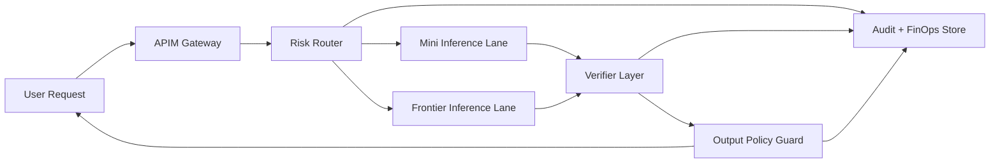
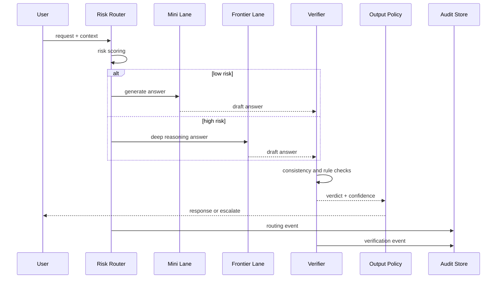

# 企业 Agent 自适应推理深度路由选型 FAQ：Mini 经济通道 vs Frontier 高深度通道 vs 双阶段 Verifier 复核 vs 混合闭环

> **适用对象**：企业 Cloud & AI Solution Architect、LLMOps 平台团队、应用架构团队、FinOps 与质量治理负责人。  
> **目标问题**：在多租户生产环境中，如何在质量、时延与成本之间动态分配推理深度预算，避免“全量重模型”或“全量轻模型”带来的系统性损失。

## 1. 问题定义：为什么推理深度预算是企业 Agent 的关键约束

在企业 PoC 阶段，
团队常把“回答正确”放在首位。

进入生产后，
真实约束会变成三角平衡：

- 成本预算上限。
- 交互时延目标。
- 关键任务准确性。

如果所有请求都走高深度模型，
成本与排队时延会迅速上升。

如果所有请求都走轻量模型，
复杂任务会出现静默错误。

常见场景包括：

- 法务条款比对与差异归因。
- 财务对账异常解释。
- 运维根因分析与修复建议。
- 客服升级单的责任判定。

这些场景并非都需要同等推理深度。
关键在于“按请求风险分层”。

## 2. 四类企业方案概览与边界

本文比较四条路径：

- 方案 A：固定高深度 Frontier 全量通道。
- 方案 B：Mini 主通道 + 风险升级路由。
- 方案 C：双阶段生成 + Verifier 复核。
- 方案 D：分层混合闭环（A+B+C 协同）。

评估时建议统一看五组指标：

- 任务通过率（含复杂任务子集）。
- 升级命中率与漏升率。
- P95 时延与超时率。
- 每千请求综合成本。
- 误判导致的业务返工成本。

## 3. 方案 A：固定高深度 Frontier 全量通道

该方案最直观：
所有请求都使用高能力模型。

优点：

- 上线策略简单。
- 复杂任务成功率高。
- 风险解释口径统一。

缺点：

- 高并发时成本线性放大。
- 峰值排队明显增加。
- 简单请求被“过度计算”。

适用阶段：

- 高价值低流量场景。
- 早期需要快速验证质量上限。

## 4. 方案 B：Mini 主通道 + 风险升级路由

该方案以 Mini 作为默认通道，
仅在高风险请求时升级 Frontier。

关键能力：

- 风险分层分类器。
- 升级阈值与置信度门限。
- 升级原因可解释标签。
- 失败回退与人工接管策略。

优点：

- 成本控制效果显著。
- 常规请求时延更低。
- 易与 APIM 配额策略联动。

缺点：

- 需要稳定分类器质量。
- 漏升会导致复杂任务失真。
- 阈值调优需要持续运营。

## 5. 方案 C：双阶段生成 + Verifier 复核

该方案先由主模型生成答案，
再由 Verifier 做一致性与约束复核。

复核维度常见包括：

- 数值一致性。
- 引用完整性。
- 规则约束符合性。
- 结构化输出合法性。

优点：

- 对“看似合理但错误”更敏感。
- 可显著降低高风险误答。
- 支持按规则域独立迭代。

缺点：

- 额外增加一次推理成本。
- 对实时场景有时延压力。
- Verifier 自身也需门禁治理。

## 6. 方案 D：分层混合闭环（企业推荐）

成熟企业通常采用三段协同：

- Mini 处理大多数低风险请求。
- Frontier 处理升级复杂请求。
- Verifier 处理高风险结果复核。

该模式的核心不在“叠加”，
而在“职责清晰”：

- Mini 负责吞吐与成本。
- Frontier 负责深度与难题。
- Verifier 负责质量兜底。

在规模化阶段，
该模式通常具备最佳综合 TCO。

## 7. 参考架构：推理深度路由控制平面

架构要点：

- 路由与模型执行解耦。
- Verifier 不直接替代主模型。
- 全链路保留路由证据与阈值版本。

## 8. 请求时序：风险判定、升级、复核与回执

治理要点：

- 升级条件需可重放验证。
- 复核失败必须有处置分支。
- 审计记录需关联请求 Trace ID。

## 9. 12 维企业选型对比矩阵

| 维度 | A 固定 Frontier | B Mini+升级 | C 双阶段 Verifier | D 混合闭环 |
|---|---|---|---|---|
| 复杂任务能力 | 很高 | 高 | 高 | 很高 |
| 常规任务成本 | 低效 | 很高 | 中 | 高 |
| 平均时延表现 | 中 | 高 | 中 | 中到高 |
| 高峰吞吐能力 | 中 | 很高 | 中 | 高 |
| 误答兜底能力 | 中 | 中 | 很高 | 很高 |
| 可解释路由能力 | 低 | 高 | 中 | 很高 |
| 运维复杂度 | 低 | 中 | 中 | 高 |
| 策略调优空间 | 低 | 高 | 高 | 很高 |
| 审计友好度 | 中 | 高 | 高 | 很高 |
| 业务适配弹性 | 中 | 高 | 高 | 很高 |
| 上线速度 | 高 | 中 | 中 | 中 |
| 推荐成熟阶段 | 早期高价值 | 成本优化期 | 风险收敛期 | 规模成熟期 |

## 10. 定量对比：成本、时延与质量拐点

| 指标 | A 固定 Frontier | B Mini+升级 | C 双阶段 | D 混合闭环 |
|---|---:|---:|---:|---:|
| 复杂任务通过率 | 92.8% | 90.1% | 91.7% | 93.2% |
| 漏升率 | 0% | 6.4% | 3.1% | 2.2% |
| P95 时延 | 4.1 s | 2.0 s | 3.4 s | 2.6 s |
| 每千请求成本（美元） | 18.6 | 9.4 | 12.7 | 11.2 |
| 每千请求返工损失（美元） | 6.1 | 9.2 | 5.4 | 4.3 |
| 综合成本（美元） | 24.7 | 18.6 | 18.1 | 15.5 |

测算假设：

- 日请求量 100 万。
- 复杂任务占比 22%。
- 高风险请求占比 14%。
- 返工成本含人工复核与 SLA 赔付。

拐点结论：

- 低并发高价值阶段可用 A 快速落地。
- 中高并发场景 B 成本优势明显。
- 强质量约束场景 C 与 D 更稳健。
- 当返工成本上升时 D 综合优势最大。

## 11. 选型决策树：先定风险，再定算力路径

第一问：
是否存在强监管高风险任务？

- 是：优先 C 或 D。
- 否：进入第二问。

第二问：
是否有严格成本上限？

- 是：优先 B 或 D。
- 否：进入第三问。

第三问：
是否要求分钟级快速响应？

- 是：优先 B。
- 否：进入第四问。

第四问：
是否具备跨团队运营能力？

- 是：优先 D。
- 否：先采用 B 或 C 逐步演进。

## 12. 常见反模式与纠偏

反模式一：
全量请求一刀切走 Frontier。

纠偏措施：
建立风险分层并默认 Mini 通道。

反模式二：
升级阈值长期不调，
导致漏升持续放大。

修复措施：
按周回放样本并重校阈值。

反模式三：
只看模型分数，
忽略返工与客诉成本。

治理措施：
将业务损失纳入门禁 KPI。

反模式四：
Verifier 命中失败后直接放行。

改进措施：
强制降级或人工接管分支。

## 13. 平台治理模型与职责划分

建议采用四方协同模型：

- 平台团队：维护路由、模型池、策略执行。
- 业务团队：定义风险等级与验收标准。
- LLMOps 团队：维护评测集与阈值校准。
- FinOps 团队：监控成本与资源配额。

治理规则：

- 路由规则必须版本化。
- 阈值变更必须附回放证据。
- 高风险规则变更双人审批。

## 14. 五步落地指南（Good fit vs Not for）

步骤 1：建立请求风险分层字典。  
定义低、中、高风险任务特征。

步骤 2：上线 Mini 主通道。  
先拿到吞吐与成本基线。

步骤 3：接入升级到 Frontier 的判定器。  
确保复杂任务可自动升级。

步骤 4：引入 Verifier 复核层。  
对高风险输出做二次验证。

步骤 5：形成周度混合闭环运营。  
联动准确率、时延与成本迭代调优。

Good fit：

- 多租户大流量业务平台。
- 质量与成本双约束场景。
- 具备可观测与评测基础的团队。

Not for：

- 低流量一次性试验项目。
- 无法维护阈值与评测资产的团队。
- 不需要风险分层的简单问答工具。

## 15. 实战 FAQ（8 问）

**Q1：为什么不直接全量用 Frontier？**  
A1：在高并发时成本与时延不可持续。

**Q2：Mini 路由会不会牺牲质量？**  
A2：会有风险，需配合升级判定与复核层。

**Q3：Verifier 的价值是什么？**  
A3：用于发现“看似正确但不可执行”的输出。

**Q4：升级阈值如何确定？**  
A4：基于历史样本回放与业务损失函数校准。

**Q5：如何避免误升导致成本激增？**  
A5：按业务域设置不同阈值并持续观测。

**Q6：什么时候需要混合闭环？**  
A6：当请求规模与返工损失同步上升时。

**Q7：是否必须引入人工复核？**  
A7：高风险场景建议保留人工兜底通道。

**Q8：如何向审计解释路由决策？**  
A8：保留路由分数、阈值版本与复核证据链。

