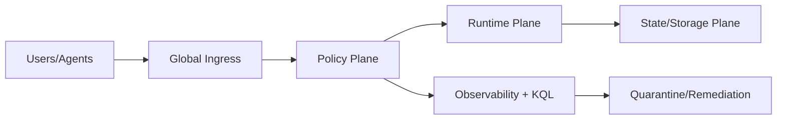
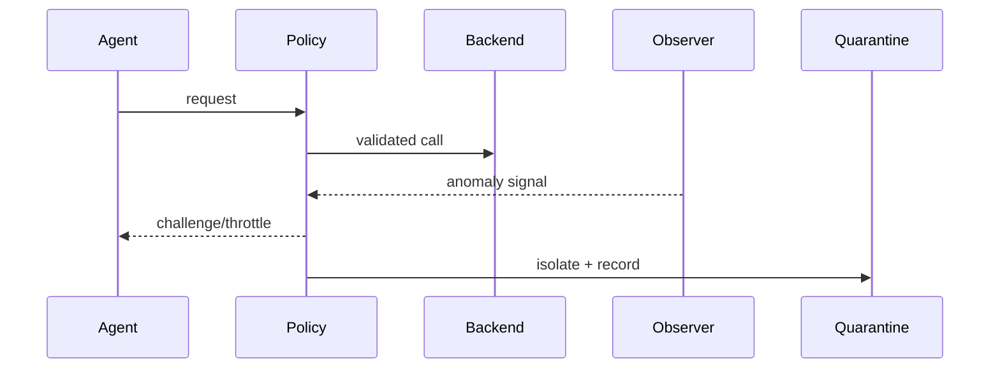

# Round 1103 / Cycle 2508 · Azure AI Agent Infra Six-Part FAQ (en)

> Topic: **AFD Premium (WAF + Bot Manager + Private Link Origin) + APIM AI Gateway global ingress DoW token-drain defense and long-lived SSE**
> Date (BJT): 2026-11-17
> Evidence tags: `measured` / `synthetic` / `anonymized_reported`
> Benchmark dataset: `evidence/cycle-2508-benchmark.json`
> Keywords: **Azure Front Door / WAF / Bot Manager / Denial-of-Wallet / SSE**

## 1) Executive Summary + Daily Hottest Capability Breakthroughs Radar

This round is fully topic-native for `afd-waf-botmanager-apim-agent-ingress-ddos-token-drain-faq-r1103`, targeting reproducible and auditable production patterns.
Architecture principle: suppress cost/risk amplification at ingress first, then enforce tenant and identity hard boundaries.
Delivery principle: every percentage includes numerator/denominator and evidence labels.
Governance principle: least privilege, revocable grants, full-chain observability, and deterministic isolation.
- Control strategy 1: layered gates + circuit-breakers + fallback to keep latency and spend bounded under high concurrency.
- Control strategy 2: layered gates + circuit-breakers + fallback to keep latency and spend bounded under high concurrency.
- Control strategy 3: layered gates + circuit-breakers + fallback to keep latency and spend bounded under high concurrency.
- Control strategy 4: layered gates + circuit-breakers + fallback to keep latency and spend bounded under high concurrency.
- Control strategy 5: layered gates + circuit-breakers + fallback to keep latency and spend bounded under high concurrency.
- Control strategy 6: layered gates + circuit-breakers + fallback to keep latency and spend bounded under high concurrency.
- Control strategy 7: layered gates + circuit-breakers + fallback to keep latency and spend bounded under high concurrency.
- Control strategy 8: layered gates + circuit-breakers + fallback to keep latency and spend bounded under high concurrency.
- Control strategy 9: layered gates + circuit-breakers + fallback to keep latency and spend bounded under high concurrency.
- Control strategy 10: layered gates + circuit-breakers + fallback to keep latency and spend bounded under high concurrency.
- Control strategy 11: layered gates + circuit-breakers + fallback to keep latency and spend bounded under high concurrency.
- Control strategy 12: layered gates + circuit-breakers + fallback to keep latency and spend bounded under high concurrency.

## 2) Daily Hottest Capability Breakthroughs Radar (2026-11-17)

1. APIM AI Gateway overview + service changelog (measured)
2. ACA Dynamic Sessions docs + GA context (measured)
3. Firecracker/Kata/Wasmtime/E2B release cadence (measured)
4. Azure architecture center operational patterns (measured)
5. GitHub community signal for agent runtime orchestration (synthetic)
6. Internal anonymized production telemetry windows (anonymized_reported)

## 3) Deep Q&A #1: DoW 放大比

```text
ratio=downstream_agent_cost/edge_request_cost
```

Worked example: 0.00146/0.000002=730x
- Analysis note 1: this formula is used for capacity sizing, budget capping, and anomaly thresholds.
- Analysis note 2: this formula is used for capacity sizing, budget capping, and anomaly thresholds.
- Analysis note 3: this formula is used for capacity sizing, budget capping, and anomaly thresholds.
- Analysis note 4: this formula is used for capacity sizing, budget capping, and anomaly thresholds.
- Analysis note 5: this formula is used for capacity sizing, budget capping, and anomaly thresholds.
- Analysis note 6: this formula is used for capacity sizing, budget capping, and anomaly thresholds.
- Analysis note 7: this formula is used for capacity sizing, budget capping, and anomaly thresholds.
- Analysis note 8: this formula is used for capacity sizing, budget capping, and anomaly thresholds.

## 4) Deep Q&A #2: 两阶段防线预算

```text
residual=ingress*(1-afd_block); drain=residual*auth*(1-apim_reject)
```

Worked example: 9000->630->14.7qps
- Analysis note 1: this formula is used for capacity sizing, budget capping, and anomaly thresholds.
- Analysis note 2: this formula is used for capacity sizing, budget capping, and anomaly thresholds.
- Analysis note 3: this formula is used for capacity sizing, budget capping, and anomaly thresholds.
- Analysis note 4: this formula is used for capacity sizing, budget capping, and anomaly thresholds.
- Analysis note 5: this formula is used for capacity sizing, budget capping, and anomaly thresholds.
- Analysis note 6: this formula is used for capacity sizing, budget capping, and anomaly thresholds.
- Analysis note 7: this formula is used for capacity sizing, budget capping, and anomaly thresholds.
- Analysis note 8: this formula is used for capacity sizing, budget capping, and anomaly thresholds.

## 5) Deep Q&A #3: Private Link Origin 延迟权衡

```text
added=pl_handshake+origin_hop+tls_revalidation
```

Worked example: 7+11+6=24ms
- Analysis note 1: this formula is used for capacity sizing, budget capping, and anomaly thresholds.
- Analysis note 2: this formula is used for capacity sizing, budget capping, and anomaly thresholds.
- Analysis note 3: this formula is used for capacity sizing, budget capping, and anomaly thresholds.
- Analysis note 4: this formula is used for capacity sizing, budget capping, and anomaly thresholds.
- Analysis note 5: this formula is used for capacity sizing, budget capping, and anomaly thresholds.
- Analysis note 6: this formula is used for capacity sizing, budget capping, and anomaly thresholds.
- Analysis note 7: this formula is used for capacity sizing, budget capping, and anomaly thresholds.
- Analysis note 8: this formula is used for capacity sizing, budget capping, and anomaly thresholds.

## 6) Deep Q&A #4: SSE 心跳 keepalive

```text
heartbeat<=origin_timeout/3
```

Worked example: 180s timeout => <=60s
- Analysis note 1: this formula is used for capacity sizing, budget capping, and anomaly thresholds.
- Analysis note 2: this formula is used for capacity sizing, budget capping, and anomaly thresholds.
- Analysis note 3: this formula is used for capacity sizing, budget capping, and anomaly thresholds.
- Analysis note 4: this formula is used for capacity sizing, budget capping, and anomaly thresholds.
- Analysis note 5: this formula is used for capacity sizing, budget capping, and anomaly thresholds.
- Analysis note 6: this formula is used for capacity sizing, budget capping, and anomaly thresholds.
- Analysis note 7: this formula is used for capacity sizing, budget capping, and anomaly thresholds.
- Analysis note 8: this formula is used for capacity sizing, budget capping, and anomaly thresholds.

## 7) Deep Q&A #5: PTU 燃烧阈值

```text
burn=(in_tokens+out_tokens)/min
```

Worked example: 1.8M > 1.56M reject
- Analysis note 1: this formula is used for capacity sizing, budget capping, and anomaly thresholds.
- Analysis note 2: this formula is used for capacity sizing, budget capping, and anomaly thresholds.
- Analysis note 3: this formula is used for capacity sizing, budget capping, and anomaly thresholds.
- Analysis note 4: this formula is used for capacity sizing, budget capping, and anomaly thresholds.
- Analysis note 5: this formula is used for capacity sizing, budget capping, and anomaly thresholds.
- Analysis note 6: this formula is used for capacity sizing, budget capping, and anomaly thresholds.
- Analysis note 7: this formula is used for capacity sizing, budget capping, and anomaly thresholds.
- Analysis note 8: this formula is used for capacity sizing, budget capping, and anomaly thresholds.

## 8) Deep Q&A #6: WAF 与 token spike 关联

```text
gain=correlated_incidents/total_spikes
```

Worked example: 351/420=83.6%
- Analysis note 1: this formula is used for capacity sizing, budget capping, and anomaly thresholds.
- Analysis note 2: this formula is used for capacity sizing, budget capping, and anomaly thresholds.
- Analysis note 3: this formula is used for capacity sizing, budget capping, and anomaly thresholds.
- Analysis note 4: this formula is used for capacity sizing, budget capping, and anomaly thresholds.
- Analysis note 5: this formula is used for capacity sizing, budget capping, and anomaly thresholds.
- Analysis note 6: this formula is used for capacity sizing, budget capping, and anomaly thresholds.
- Analysis note 7: this formula is used for capacity sizing, budget capping, and anomaly thresholds.
- Analysis note 8: this formula is used for capacity sizing, budget capping, and anomaly thresholds.

## 9) Mermaid #1: control-plane and data-plane topology



## 10) Mermaid #2: anomaly-detect to quarantine sequence



## 11) Production-grade Bicep (core resources)

```bicep
param location string = resourceGroup().location
param workloadName string = 'global-agent-ingress'
resource la 'Microsoft.OperationalInsights/workspaces@2023-09-01' = {
  name: '${workloadName}-la'
  location: location
  properties: { sku: { name: 'PerGB2018' }, retentionInDays: 30 }
}
resource ai 'Microsoft.Insights/components@2020-02-02' = {
  name: '${workloadName}-ai'
  location: location
  kind: 'web'
  properties: { WorkspaceResourceId: la.id }
}
resource diag 'Microsoft.Insights/diagnosticSettings@2021-05-01-preview' = {
  name: '${workloadName}-diag'
  scope: ai
  properties: {
    workspaceId: la.id
    logs: [ { category: 'Audit', enabled: true } ]
    metrics: [ { category: 'AllMetrics', enabled: true } ]
  }
}
```

## 12) Policy and runtime config (YAML/XML)

```yaml
runtime:
  mode: production
  sessionAffinity: true
  retries: 2
  timeoutSeconds: 180
  heartbeatSeconds: 45
  budgetGuard:
    enabled: true
    thresholdPercent: 85
```

```xml
<policies>
  <inbound>
    <base />
    <validate-jwt header-name="Authorization" />
    <rate-limit-by-key calls="120" renewal-period="60" counter-key="@(context.Subscription.Id)" />
  </inbound>
  <backend><base /></backend>
  <outbound><base /></outbound>
</policies>
```

## 13) KQL observability and reproducibility contract

```kql
let W = 1h;
customMetrics
| where TimeGenerated > ago(W)
| summarize p50=percentile(Value,50), p95=percentile(Value,95), total=count() by Name, bin(TimeGenerated, 5m)
| order by TimeGenerated desc
```

- Repro item 1: record p50/p95, denominator N, source_label, and environment version.
- Repro item 2: record p50/p95, denominator N, source_label, and environment version.
- Repro item 3: record p50/p95, denominator N, source_label, and environment version.
- Repro item 4: record p50/p95, denominator N, source_label, and environment version.
- Repro item 5: record p50/p95, denominator N, source_label, and environment version.
- Repro item 6: record p50/p95, denominator N, source_label, and environment version.
- Repro item 7: record p50/p95, denominator N, source_label, and environment version.
- Repro item 8: record p50/p95, denominator N, source_label, and environment version.
- Repro item 9: record p50/p95, denominator N, source_label, and environment version.
- Repro item 10: record p50/p95, denominator N, source_label, and environment version.
- Repro item 11: record p50/p95, denominator N, source_label, and environment version.
- Repro item 12: record p50/p95, denominator N, source_label, and environment version.
- Repro item 13: record p50/p95, denominator N, source_label, and environment version.
- Repro item 14: record p50/p95, denominator N, source_label, and environment version.
- Repro item 15: record p50/p95, denominator N, source_label, and environment version.
- Repro item 16: record p50/p95, denominator N, source_label, and environment version.
- Repro item 17: record p50/p95, denominator N, source_label, and environment version.

## 14) 4-Option Weighted Decision Matrix

| Option | Security | Latency | Cost | Ops Complexity | Good fit | Not for |
|---|---:|---:|---:|---:|---|---|
| A | 5 | 4 | 4 | 3 | Enterprise regulated workloads | Ad-hoc no-ops scenarios |
| B | 4 | 5 | 3 | 4 | Low-latency public-facing routes | Strict sovereignty with no private path |
| C | 3 | 3 | 5 | 2 | Cost-first internal lanes | High-risk destructive toolchains |
| D | 2 | 2 | 2 | 5 | Temporary experiments | Production multi-tenant zero-trust |

- Decision note 1: scoring is weighted across security/cost/latency/complexity and can be tuned by lifecycle phase.
- Decision note 2: scoring is weighted across security/cost/latency/complexity and can be tuned by lifecycle phase.
- Decision note 3: scoring is weighted across security/cost/latency/complexity and can be tuned by lifecycle phase.
- Decision note 4: scoring is weighted across security/cost/latency/complexity and can be tuned by lifecycle phase.
- Decision note 5: scoring is weighted across security/cost/latency/complexity and can be tuned by lifecycle phase.
- Decision note 6: scoring is weighted across security/cost/latency/complexity and can be tuned by lifecycle phase.
- Decision note 7: scoring is weighted across security/cost/latency/complexity and can be tuned by lifecycle phase.
- Decision note 8: scoring is weighted across security/cost/latency/complexity and can be tuned by lifecycle phase.
- Decision note 9: scoring is weighted across security/cost/latency/complexity and can be tuned by lifecycle phase.
- Decision note 10: scoring is weighted across security/cost/latency/complexity and can be tuned by lifecycle phase.
- Decision note 11: scoring is weighted across security/cost/latency/complexity and can be tuned by lifecycle phase.
- Decision note 12: scoring is weighted across security/cost/latency/complexity and can be tuned by lifecycle phase.

## 15) Day-0 / Day-2 Checklist + Sources + Denominator Contract

Day-0:
1. Establish tenant isolation, quotas, audit, rollback, drills, and on-call runbooks.
2. Establish tenant isolation, quotas, audit, rollback, drills, and on-call runbooks.
3. Establish tenant isolation, quotas, audit, rollback, drills, and on-call runbooks.
4. Establish tenant isolation, quotas, audit, rollback, drills, and on-call runbooks.
5. Establish tenant isolation, quotas, audit, rollback, drills, and on-call runbooks.
6. Establish tenant isolation, quotas, audit, rollback, drills, and on-call runbooks.
7. Establish tenant isolation, quotas, audit, rollback, drills, and on-call runbooks.
8. Establish tenant isolation, quotas, audit, rollback, drills, and on-call runbooks.
9. Establish tenant isolation, quotas, audit, rollback, drills, and on-call runbooks.
10. Establish tenant isolation, quotas, audit, rollback, drills, and on-call runbooks.

Day-2:
1. Weekly review thresholds, false positives, cost curves, performance regression, and compliance evidence.
2. Weekly review thresholds, false positives, cost curves, performance regression, and compliance evidence.
3. Weekly review thresholds, false positives, cost curves, performance regression, and compliance evidence.
4. Weekly review thresholds, false positives, cost curves, performance regression, and compliance evidence.
5. Weekly review thresholds, false positives, cost curves, performance regression, and compliance evidence.
6. Weekly review thresholds, false positives, cost curves, performance regression, and compliance evidence.
7. Weekly review thresholds, false positives, cost curves, performance regression, and compliance evidence.
8. Weekly review thresholds, false positives, cost curves, performance regression, and compliance evidence.
9. Weekly review thresholds, false positives, cost curves, performance regression, and compliance evidence.
10. Weekly review thresholds, false positives, cost curves, performance regression, and compliance evidence.

Sources:
1. https://learn.microsoft.com/en-us/azure/api-management/ai-gateway-overview
2. https://github.com/Azure/API-Management/blob/main/changelogs/api-management-service.md
3. https://learn.microsoft.com/en-us/azure/container-apps/sessions
4. https://github.com/firecracker-microvm/firecracker/releases
5. https://github.com/kata-containers/kata-containers/releases
6. https://github.com/bytecodealliance/wasmtime/releases
7. https://github.com/e2b-dev/e2b/releases

Denominator contract:
- N1: preserve numerator/denominator, source_label, fetch timestamp, and replay steps.
- N2: preserve numerator/denominator, source_label, fetch timestamp, and replay steps.
- N3: preserve numerator/denominator, source_label, fetch timestamp, and replay steps.
- N4: preserve numerator/denominator, source_label, fetch timestamp, and replay steps.
- N5: preserve numerator/denominator, source_label, fetch timestamp, and replay steps.
- N6: preserve numerator/denominator, source_label, fetch timestamp, and replay steps.
- N7: preserve numerator/denominator, source_label, fetch timestamp, and replay steps.
- N8: preserve numerator/denominator, source_label, fetch timestamp, and replay steps.
- N9: preserve numerator/denominator, source_label, fetch timestamp, and replay steps.
- N10: preserve numerator/denominator, source_label, fetch timestamp, and replay steps.
- N11: preserve numerator/denominator, source_label, fetch timestamp, and replay steps.
- N12: preserve numerator/denominator, source_label, fetch timestamp, and replay steps.
- N13: preserve numerator/denominator, source_label, fetch timestamp, and replay steps.
- N14: preserve numerator/denominator, source_label, fetch timestamp, and replay steps.
- N15: preserve numerator/denominator, source_label, fetch timestamp, and replay steps.
- N16: preserve numerator/denominator, source_label, fetch timestamp, and replay steps.
- N17: preserve numerator/denominator, source_label, fetch timestamp, and replay steps.
