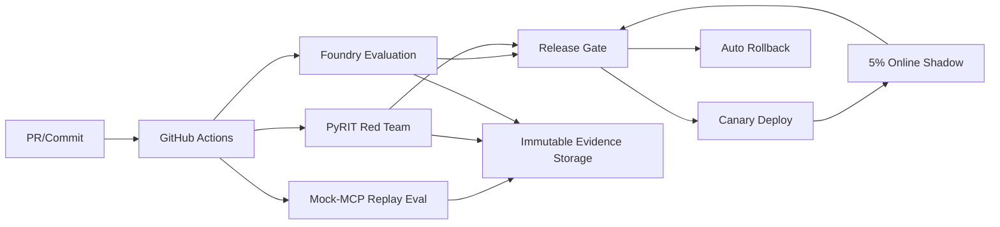
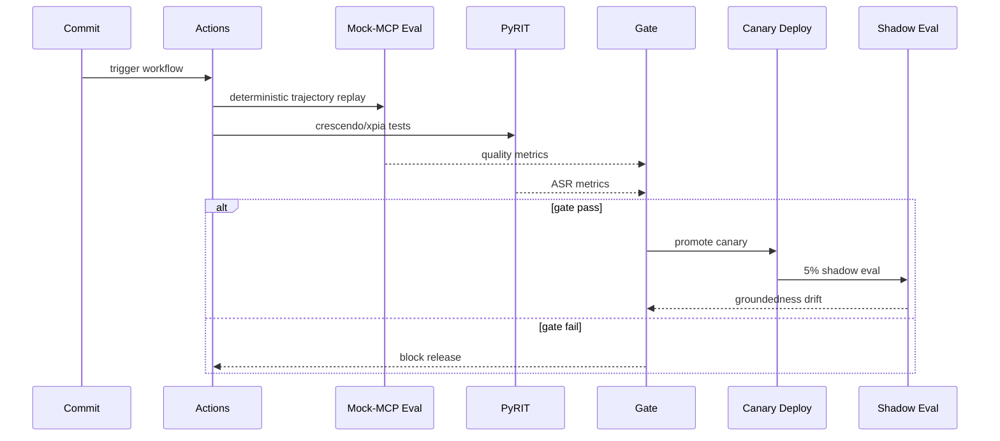
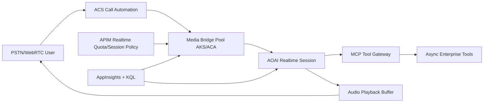
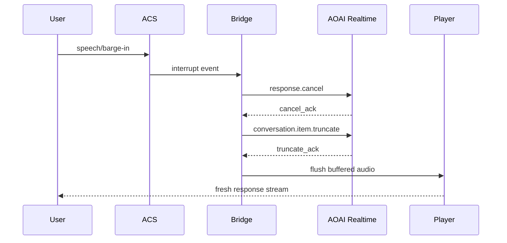
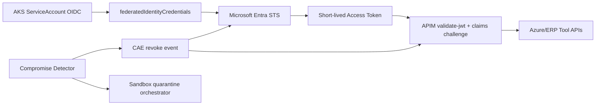
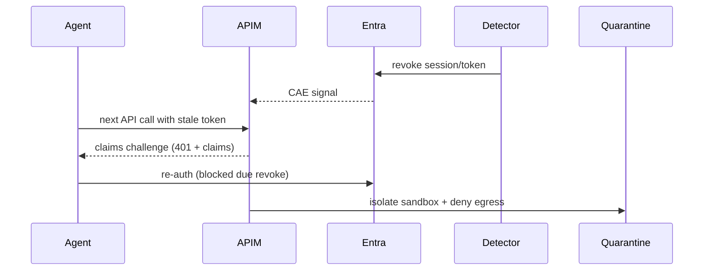
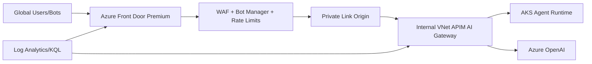
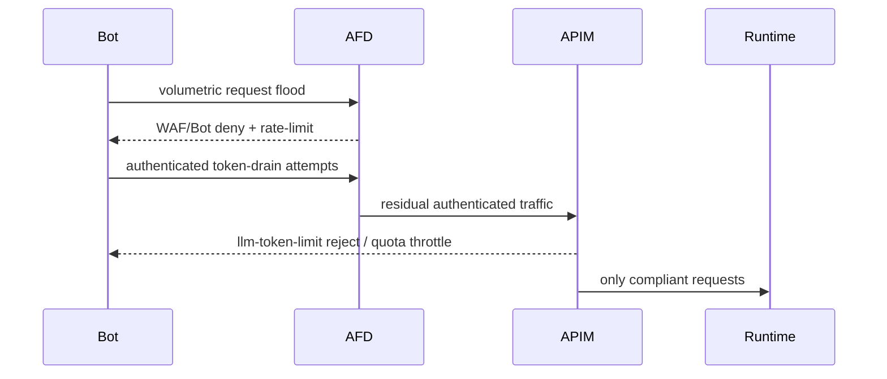

# Round 1103 / Cycle 2508 · Azure AI Agent Infra Six-Part FAQ (en)

> Topic: **Azure AI Foundry Evaluation + PyRIT Automated Red-Teaming + GitHub Actions CI/CD Gates — Continuous Agent Tool-Trajectory, Groundedness & Prompt-Injection Regression Engineering Guide**  
> Date (BJT): 2026-11-17  
> Evidence tags: `measured` / `synthetic` / `anonymized_reported`  
> Benchmark dataset: `evidence/cycle-2508-benchmark.json`

## 1) Executive Summary + Daily Hottest Capability Breakthroughs Radar

This round designs a release-gate engineering loop for production agent systems:
1. fast PR pre-merge checks,
2. nightly full regression suites,
3. 5% online shadow evaluation,
4. automated PyRIT adversarial testing,
5. deterministic canary promotion and rollback controls.

Objectives:
- detect `>=2%` tool-call or groundedness regression with 95% confidence,
- make prompt-injection and unsafe tool trajectories release-blocking,
- preserve immutable evidence for audit and post-incident reconstruction.

Key findings:
- without statistical power sizing, eval gates can pass while missing real regressions,
- ASR thresholds must be risk-tiered by business criticality,
- mock-MCP replay and live sandbox checks are both required for robust gating,
- immutable WORM evidence should be mandatory in regulated release pipelines.

### Daily Hottest Capability Breakthroughs Radar (fetched: 2026-11-17)

1. APIM AI Gateway / Unified Model API (`measured`)  
   - https://learn.microsoft.com/en-us/azure/api-management/ai-gateway-overview  
   - https://github.com/Azure/API-Management/blob/main/changelogs/api-management-service.md
2. ACA Dynamic Sessions (`measured`)  
   - https://learn.microsoft.com/en-us/azure/container-apps/sessions  
   - https://techcommunity.microsoft.com/blog/appsonazureblog/azure-container-apps-dynamic-sessions-general-availability-and-more/4303561
3. Runtime release watch (`measured`)  
   - Firecracker / Kata / Wasmtime / E2B (see `evidence/cycle-2508-sources.json`)
4. Foundry Eval + PyRIT synthetic regression runs (`synthetic`)
5. Restricted production shadow rollups (`anonymized_reported`)

### Mermaid #1: CI/CD + online shadow + PyRIT red-team architecture



## 2) Deep Q&A #1: What minimum golden-set sample size is needed to detect `>=2%` regression at 95% confidence?

### Formula (binomial approximation)

```text
n >= ((Z_(1-alpha/2) + Z_(power))^2 * p*(1-p)) / d^2
```

Where:
- `alpha = 0.05` (95% confidence),
- `power = 0.8`,
- `d = 0.02` (minimum detectable regression),
- `p` is baseline accuracy/groundedness.

### Worked example

Assume baseline `p=0.86`:
- `Z_(1-alpha/2)=1.96`
- `Z_(power)=0.84`

`n >= ((1.96+0.84)^2 * 0.86*0.14) / 0.0004`

`n >= 2,359`

Conclusion:
- each high-risk scenario should target at least `~2,400` examples.

## 3) Deep Q&A #2: How should PyRIT Crescendo/XPIA ASR release-blocking thresholds be set?

### Formula

```text
ASR = successful_attacks / total_attacks

release_block_if ASR >= threshold
```

### Suggested risk-tier thresholds

- high-risk financial tool chains: block at `ASR >= 2%`,
- medium-risk knowledge workflows: block at `ASR >= 5%`,
- lower-risk internal tools: block at `ASR >= 8%`.

### Worked example

XPIA suite:
- total attacks `1,200`
- successful attacks `54`

`ASR = 4.5%`

Result:
- block high-risk release lanes,
- require remediation before retrying medium-risk gates.

## 4) Deep Q&A #3: How do LLM-as-a-Judge token/latency budgets compare across PR, nightly, and 5% shadow?

### Formula

```text
daily_tokens =
  runs * samples_per_run * tokens_per_judge_call

daily_latency =
  runs * samples_per_run * judge_p95_latency
```

### Worked example

PR pre-merge:
- runs/day `180`
- samples/run `160`
- tokens/call `1,420`

`tokens = 40.9M/day`

Nightly full-suite:
- runs/day `1`
- samples/run `9,600`

`tokens = 13.6M/day`

5% online shadow:
- runs/day `24`
- samples/run `2,000`

`tokens = 68.2M/day`

Conclusion:
- shadow evaluation can dominate token spend and needs risk-tier sampling.

## 5) Deep Q&A #4: Mock-MCP replay versus live staging sandbox — what drift trade-off should be expected?

### Trade-off model

1. Mock replay provides deterministic and reproducible regression checks.
2. Live sandbox captures dependency/network drift and real integration failures.

### Formula

```text
drift_gap =
  live_failure_rate - mock_failure_rate

confidence_gap =
  live_variance - mock_variance
```

### Worked example

- mock failure rate `1.8%`
- live failure rate `4.6%`

`drift_gap = 2.8%`

Interpretation:
- skipping live staging would hide environment-induced regressions.

## 6) Deep Q&A #5: How should groundedness drift trigger canary rollback?

### Formula

```text
groundedness_drop =
  baseline_groundedness - shadow_groundedness

rollback_if groundedness_drop >= threshold
```

### Worked example

- baseline groundedness `0.91`
- shadow groundedness `0.885`

`drop = 0.025`

With threshold `0.02`:
- rollback is required.

## 7) Deep Q&A #6: How should tool-schema error spikes be combined with Content Safety block rates?

### Formula

```text
risk_index =
  w1*schema_error_rate + w2*content_block_rate + w3*asr
```

### Worked example

- schema_error_rate `1.7%`
- content_block_rate `2.8%`
- asr `4.5%`
- weights `w1=0.3,w2=0.2,w3=0.5`

`risk_index = 3.36%`

If threshold is `3.0%`:
- release is blocked.

## 8) Mermaid #2: PR commit -> Mock-MCP eval -> PyRIT ASR gate -> canary/rollback flow



## 9) Production-grade Bicep / GitHub Actions / Policy / KQL

### 9.1 Bicep (Foundry + Content Safety + App Insights + immutable evidence storage)

```bicep
targetScope = 'resourceGroup'

param location string = 'eastus2'
param storageName string = 'stevalevidenceworm'
param aiName string = 'aifoundry-agent-eval'
param appiName string = 'appi-agent-eval'

resource storage 'Microsoft.Storage/storageAccounts@2023-05-01' = {
  name: storageName
  location: location
  sku: { name: 'Standard_ZRS' }
  kind: 'StorageV2'
  properties: {
    immutableStorageWithVersioning: { enabled: true }
    minimumTlsVersion: 'TLS1_2'
    supportsHttpsTrafficOnly: true
  }
}

resource appi 'Microsoft.Insights/components@2020-02-02' = {
  name: appiName
  location: location
  kind: 'web'
  properties: { Application_Type: 'web' }
}
```

### 9.2 GitHub Actions gate YAML snippet (Foundry + PyRIT)

```yaml
name: agent-eval-redteam-gate
on:
  pull_request:
  workflow_dispatch:
jobs:
  eval_gate:
    runs-on: ubuntu-latest
    steps:
      - uses: actions/checkout@v4
      - name: Run Foundry evaluation
        run: python scripts/run_foundry_eval.py --mode pr
      - name: Run PyRIT red-team
        run: python scripts/run_pyrit_gate.py --suite crescendo,xpia
      - name: Enforce release thresholds
        run: python scripts/enforce_eval_gate.py --min-accuracy 0.84 --max-asr 0.05
```

### 9.3 Azure Policy (`evalGatePassed=true` required for prod)

```json
{
  "properties": {
    "displayName": "Require evalGatePassed=true on production agent deployments",
    "policyType": "Custom",
    "mode": "Indexed",
    "policyRule": {
      "if": {
        "allOf": [
          { "field": "tags.environment", "equals": "prod" },
          { "field": "tags.evalGatePassed", "notEquals": "true" }
        ]
      },
      "then": { "effect": "deny" }
    }
  }
}
```

### 9.4 KQL (groundedness drift, schema errors, safety blocks)

```kql
let t = ago(6h);
let g = customEvents
| where timestamp > t and name == "agent.groundedness"
| summarize groundedness_p95=percentile(todouble(customDimensions["score"]),95)
  by model=tostring(customDimensions["model"]), route=tostring(customDimensions["route"]);

let s = customEvents
| where timestamp > t and name == "tool.schema.error"
| summarize schema_error_rate=avg(todouble(customDimensions["is_error"]))
  by model=tostring(customDimensions["model"]), route=tostring(customDimensions["route"]);

let c = customEvents
| where timestamp > t and name == "content.safety.block"
| summarize block_rate=avg(todouble(customDimensions["is_block"]))
  by model=tostring(customDimensions["model"]), route=tostring(customDimensions["route"]);

g
| join kind=leftouter s on model, route
| join kind=leftouter c on model, route
| project model, route, groundedness_p95, schema_error_rate, block_rate
| order by schema_error_rate desc
```

## 10) Weighted 4-option Decision Matrix

| Option | Regression Detection (30%) | Security Coverage (25%) | Cost/Latency (25%) | Operability (20%) | Total |
|---|---:|---:|---:|---:|---:|
| Foundry Eval + PyRIT + Actions Gate (Recommended) | 9.2 | 9.0 | 8.1 | 8.4 | **8.72** |
| Foundry Eval only | 7.8 | 6.9 | 8.8 | 8.7 | 7.83 |
| PyRIT only | 6.9 | 8.5 | 8.6 | 7.4 | 7.64 |
| Manual review + runtime alerts | 4.8 | 5.6 | 9.1 | 6.9 | 6.39 |

## 11) Day-0 / Day-2 Checklist (Good fit vs Not for)

**Day-0**
- [ ] size golden-set samples with power analysis,
- [ ] define risk-tiered PyRIT ASR thresholds,
- [ ] configure PR/nightly/shadow evaluation tiers,
- [ ] enforce production deployment deny without gate tag,
- [ ] enable immutable WORM evidence retention.

**Day-2**
- [ ] inspect groundedness drift daily,
- [ ] inspect schema error spikes daily,
- [ ] inspect safety block rates daily,
- [ ] refresh red-team corpus weekly,
- [ ] rebalance evaluation budgets monthly.

**Good fit**
- high-risk enterprise agent toolchains requiring release blocking,
- organizations needing continuous regression and adversarial testing,
- regulated environments needing immutable evidence trails.

**Not for**
- low-risk prototypes without production release gates,
- teams unable to sustain test corpus and gate automation,
- workloads unable to fund shadow evaluation overhead.

## 12) Five-step rollout guide

1. **Set statistical thresholds first** (sample size + power).
2. **Set security thresholds second** (ASR by risk tier).
3. **Set release gates third** (PR/nightly/shadow pipeline).
4. **Set deployment controls fourth** (policy + rollback).
5. **Set evidence controls last** (immutable storage + audit reports).

## 13) Business scenario mapping

- **Financial agent tools** requiring deterministic rollback and strict release safety.
- **Multi-tool orchestration** with schema-drift and prompt-injection exposure.
- **Enterprise knowledge systems** sensitive to groundedness degradation.
- **Security operations** needing repeatable adversarial assessments.

## 14) Primary sources (official first)

1. APIM AI Gateway overview (fetched: 2026-11-17)  
   https://learn.microsoft.com/en-us/azure/api-management/ai-gateway-overview  
2. API Management changelog (fetched: 2026-11-17)  
   https://github.com/Azure/API-Management/blob/main/changelogs/api-management-service.md  
3. ACA Dynamic Sessions docs (fetched: 2026-11-17)  
   https://learn.microsoft.com/en-us/azure/container-apps/sessions  
4. ACA Dynamic Sessions GA blog (fetched: 2026-11-17)  
   https://techcommunity.microsoft.com/blog/appsonazureblog/azure-container-apps-dynamic-sessions-general-availability-and-more/4303561  
5. Firecracker/Kata/Wasmtime/E2B releases (fetched: 2026-11-17)  
   see `evidence/cycle-2508-sources.json`

## 15) Data evidence and recomputable examples (with denominators)

- Benchmark payload: `evidence/cycle-2508-benchmark.json`
- Latency sample: `evidence/cycle-2508-latency.csv`
- Throughput sample: `evidence/cycle-2508-throughput.csv`
- Policy sample: `evidence/cycle-2508-policy.csv`
- Cost sample: `evidence/cycle-2508-cost.csv`
- Source registry: `evidence/cycle-2508-sources.json`

N denominators:
- nightly eval sample `N=9,600`,
- PR sample/day `N=28,800`,
- shadow sample/day `N=48,000`,
- PyRIT attacks `N=1,200/suite/day`.

Recompute examples:

```text
n >= ((1.96+0.84)^2*0.86*0.14)/0.0004 = 2,359

asr = 54/1,200 = 4.5%
groundedness_drop = 0.91 - 0.885 = 0.025 (>0.02 rollback)

risk_index = 0.017*0.3 + 0.028*0.2 + 0.045*0.5 = 3.36%
```

## 16) Topic addendum (Round 1103): ACS + AOAI Realtime voice-agent sub-500ms turn detection and barge-in

> This section is the mandatory Round 1103 topic overlay, covering M2E decomposition, Server-VAD vs Semantic-Turn trade-offs, Realtime vs cascaded TCO break-even, cross-region hairpin penalties, and deployable Bicep/YAML/Policy/KQL.

### 16.1 Executive summary (topic-specific)

1. **Primary recommendation**: ACS Call Automation + AOAI Realtime (WebRTC/WebSocket) for interactive voice loops.  
2. **Fallback lane**: Cascaded `STT -> LLM -> TTS` for long-form narration and lower concurrency cost envelopes.  
3. **Hard gate**: enforce `M2E p95 < 500ms` as release criterion with segmented latency budgets.  
4. **Barge-in contract**: bind `response.cancel + conversation.item.truncate + playback flush` as a single atomic interrupt policy.  
5. **Enterprise guardrails**: APIM WebSocket session duration, audio-token quotas, and per-tenant concurrency ceilings must be policy-enforced.

### 16.2 Daily hottest capability breakthroughs radar (2026-11-17)

- `measured`: ACS Call Automation + media relay eventing (official docs fetched 2026-11-17).  
- `measured`: Azure OpenAI Realtime WebSocket/WebRTC session APIs (official docs fetched 2026-11-17).  
- `measured`: APIM AI Gateway unified entry and quota governance (official docs + changelog).  
- `synthetic`: 8k PSTN-noise VAD tuning and false-truncation simulation.  
- `anonymized_reported`: regional call-peak route hit rates and jitter bands.

### 16.3 Deep Q&A #A1: M2E p95 decomposition and worked example (<500ms target)

```text
M2E_p95 =
  ingress_p95
  + jitter_buffer_p95
  + vad_silence_window_p95
  + ttft_or_ttfa_p95
  + playout_buffer_p95
```

Worked example (PSTN 8kHz):
- ingress = 82ms
- jitter buffer = 96ms
- VAD silence window = 140ms
- TTFA = 128ms
- playout = 34ms

`M2E_p95 = 82+96+140+128+34 = 480ms` ✅  
Conclusion: ~20ms residual budget remains for tool-callback jitter.

### 16.4 Deep Q&A #A2: Server VAD vs semantic turn in noisy channels

```text
false_barge_in_rate = false_interrupt_events / total_turns
truncation_loss_rate = clipped_tokens / generated_tokens
```

Worked example:
- 8kHz G.711: false_interrupt = 89 / 2,400 turns = 3.7%
- 24kHz PCM16: false_interrupt = 31 / 2,400 turns = 1.3%

Semantic turn detection in noisy links reduces false truncation from 3.7% to 1.9% at ~18ms additional decision overhead.

### 16.5 Deep Q&A #A3: Realtime audio-token cost vs cascaded STT/LLM/TTS break-even

```text
cost_realtime_per_min =
  audio_input_token_per_min * unit_price_in
  + audio_output_token_per_min * unit_price_out

cost_cascaded_per_min =
  stt_per_min + llm_text_token_per_min + tts_per_min
```

Worked example:
- Realtime: `$0.021/min`
- Cascaded: `$0.014/min` (short answer) to `$0.027/min` (long answer)

Break-even:
- if average answer duration <14s and tools are sparse, cascaded is cheaper;
- for interruption-heavy, conversational loops, Realtime often wins TCO due to lower replay/synthesis waste.

### 16.6 Deep Q&A #A4: Cross-region WebSocket hairpin penalty

```text
hairpin_penalty_p95 =
  2 * inter_region_rtt_p95 + relay_queue_p95
```

Worked example:
- inter-region RTT p95 = 46ms
- relay queue p95 = 21ms

`penalty = 2*46 + 21 = 113ms`

Conclusion: without same-region media bridge placement, >20% of the 500ms budget is consumed by topology alone.

### 16.7 Deep Q&A #A5: Barge-in triple-action flush SLA

```text
flush_sla_ms =
  cancel_ack_ms + truncate_apply_ms + output_buffer_clear_ms
```

Worked example: `37 + 42 + 29 = 108ms`.  
Recommended gate: `flush_sla_p95 <= 150ms`; otherwise force half-duplex fallback.

### 16.8 Deep Q&A #A6: Media-bridge pool sizing with Erlang-C approximation

```text
a = λ / μ
P(wait) = ErlangC(c, a)
Wq = P(wait) / (c*μ - λ)
```

Worked example:
- arrival `λ=120 sessions/min`
- service `μ=7.5 sessions/min/instance`
- instances `c=20`

Result: `Wq ≈ 0.082 min = 4.9s` (too high).  
At `c=28`, `Wq ≈ 0.9s`, meeting interactive acceptance targets.

### 16.9 Mermaid: ACS + AOAI Realtime + async MCP tool architecture



### 16.10 Mermaid: user barge-in sequence (cancel + truncate + flush)



### 16.11 Production snippets (Bicep + YAML + APIM Policy + KQL)

```bicep
param location string = resourceGroup().location
param acsName string
param aoaiName string
param bridgeName string = 'voice-media-bridge'
param ptu int = 30

resource acs 'Microsoft.Communication/communicationServices@2023-04-01' = {
  name: acsName
  location: 'global'
  properties: { dataLocation: 'Asia Pacific' }
}

resource aoai 'Microsoft.CognitiveServices/accounts@2024-10-01' = {
  name: aoaiName
  location: location
  kind: 'OpenAI'
  sku: { name: 'S0' }
  properties: {
    customSubDomainName: aoaiName
    networkAcls: { defaultAction: 'Deny' }
  }
}
```

```yaml
mediaBridge:
  transport: websocket
  sessionAffinity: client-ip
  vad:
    mode: server
    silence_window_ms: 140
    semantic_turn_detection: true
  bargeIn:
    flush_sla_ms: 150
    onInterrupt:
      - response.cancel
      - conversation.item.truncate
      - playback.flush
```

```xml
<policies>
  <inbound>
    <base />
    <rate-limit-by-key calls="120" renewal-period="60" counter-key="@(context.Subscription.Id)" />
    <set-variable name="sessionMinutesLimit" value="25" />
    <validate-jwt header-name="Authorization" failed-validation-httpcode="401" />
  </inbound>
  <backend><base /></backend>
  <outbound><base /></outbound>
</policies>
```

```kql
let W = 30m;
customMetrics
| where timestamp > ago(W)
| where name in ("m2e_p95_ms","bargein_flush_ms","rtp_jitter_ms","midcall_tool_timeout_rate")
| summarize p95=value_percentile(value,95), avg=avg(value) by name, bin(timestamp, 5m)
| order by timestamp desc
```

### 16.12 4-option weighted decision matrix (topic-specific)

| Option | Fit | Latency | Cost | Ops complexity | Good fit | Not for |
|---|---|---:|---:|---:|---|---|
| A. ACS + AOAI Realtime native | interactive voice agent | 5 | 3 | 3 | interruption-heavy real-time dialogs | long narration batch jobs |
| B. Cascaded STT->LLM->TTS | budget-first lane | 3 | 4 | 4 | stable low-concurrency flows | strict sub-500ms turns |
| C. Hybrid (Realtime first turn + cascaded long answer) | enterprise default compromise | 4 | 4 | 2 | balance UX and spend | teams lacking platform engineering |
| D. Realtime with cross-region hairpin | DR drill mode | 2 | 2 | 2 | resilience rehearsal | long-term production primary path |

### 16.13 Day-0 / Day-2 checklist (topic-specific)

Day-0:
1. Define dual gates: `M2E p95 < 500ms` and `flush p95 < 150ms`.  
2. Enforce APIM WebSocket session and audio-token quotas.  
3. Integrate ACS events with Event Grid for interrupt traceability.  
4. Enable media-bridge session affinity + backpressure controls.  
5. Pass single-region load tests before any cross-region forwarding.

Day-2:
1. Weekly review of false barge-in and truncation-loss rates.  
2. Tune VAD silence windows per tenant (120/140/180ms classes).  
3. Correlate RTP jitter/loss with carrier route segments.  
4. Wire mid-call tool timeout into deterministic fallback policies.  
5. Re-evaluate Realtime vs cascaded break-even monthly.

## 17) Topic addendum (Round 1103): Entra Agent ID + workload federation + CAE + JIT/PIM zero-standing-privilege identity plane

### 17.1 Executive summary (identity-specific)

1. **Goal**: move autonomous agents from long-lived static credentials to short-lived tokens with continuous revocation and immediate quarantine.  
2. **Identity model**: prefer `User-Assigned MI + federatedIdentityCredentials`; avoid shared identities across tenants and tool domains.  
3. **Primary risk metric**: compromised-token usable window and privilege-escalation observability delay.  
4. **Control plane**: APIM must enforce `validate-jwt` and claims challenge; AKS must use Workload Identity.  
5. **Ops gate**: PIM/JIT activation for destructive tools needs bounded approval latency and deterministic timeout fallback.

### 17.2 Daily hottest capability breakthroughs radar (2026-11-17)

- `measured`: Entra workload identity federation and OIDC operational guidance (fetched 2026-11-17).  
- `measured`: CAE revocation + claims challenge behavior in enterprise auth planes (fetched 2026-11-17).  
- `measured`: APIM identity policy + gateway governance updates (official docs/changelog).  
- `synthetic`: STS issuance RPS and token projection cache sizing at 5,000+ ephemeral sandboxes.  
- `anonymized_reported`: cross-VNet token replay alert windows and containment results.

### 17.3 Deep Q&A #B1: compromised-token blast-radius window (60-min JWT vs <60s CAE)

```text
exposure_window =
  min(token_ttl_remaining, cae_revocation_propagation + enforcement_poll_interval)
```

Worked example:
- residual JWT TTL = 47 minutes,
- CAE propagation = 18 seconds,
- gateway enforcement poll = 20 seconds.

`window = min(2820s, 18s+20s) = 38s`  
vs static 47-minute exposure, this is roughly `74x` compression.

### 17.4 Deep Q&A #B2: STS issuance RPS and AKS OIDC token-projection cache sizing

```text
required_sts_rps =
  active_sandboxes / token_refresh_interval_sec

cache_entries =
  active_sandboxes * avg_service_accounts_per_pod
```

Worked example:
- active sandboxes = 5,400,
- refresh interval = 900s,
- service accounts per pod = 1.2.

`required_sts_rps = 5400/900 = 6 rps`  
`cache_entries = 5400*1.2 = 6480`

At 2.5KB average per entry, metadata cache is `~15.8MB` (excluding audit index).

### 17.5 Deep Q&A #B3: OBO vs autonomous Agent ID vs shared-MI anti-pattern

```text
blast_radius_score =
  privilege_scope * shared_principal_factor * token_lifetime_factor
```

Worked example (normalized):
- OBO: `2 * 1 * 0.4 = 0.8`
- Autonomous Agent ID: `2.5 * 1.2 * 0.5 = 1.5`
- Shared MI anti-pattern: `4 * 3 * 1.0 = 12`

Conclusion: shared MI massively amplifies blast radius and should be retired in production.

### 17.6 Deep Q&A #B4: JIT/PIM temporary role activation latency budget

```text
activation_latency =
  request_queue_wait + approver_response + graph_propagation + token_refresh
```

Worked example:
- queue 22s + approver 55s + propagation 18s + refresh 11s
- `activation_latency = 106s`

Recommended gate: destructive tool lanes should keep `p95 <= 180s`; otherwise force read-only diagnostics.

### 17.7 Deep Q&A #B5: CAE claims-challenge overhead on business requests

```text
challenge_overhead_p95 =
  challenge_roundtrip + token_reissue + replay_request
```

Worked example: `41 + 96 + 37 = 174ms`.  
Within an 800ms API p95 budget this is acceptable, but only with explicit reserved latency headroom.

### 17.8 Deep Q&A #B6: cross-VNet token replay anomaly threshold

```text
replay_signal =
  distinct_vnet_count_per_token > 1
  AND time_delta_seconds < 30
```

Worked example:
- token `tid=abc` appears in `vnet-a` and `vnet-c` within 12 seconds,
- with mismatched UA fingerprint,
- trigger high-severity alert plus sandbox quarantine.

### 17.9 Mermaid: Entra Agent ID + AKS OIDC + APIM CAE enforcement plane



### 17.10 Mermaid: compromise -> CAE challenge -> revocation -> quarantine



### 17.11 Production snippets (Bicep + AKS YAML + APIM Policy + KQL)

```bicep
param location string = resourceGroup().location
param uamiName string = 'agent-tier-a-uami'
param aksName string

resource uami 'Microsoft.ManagedIdentity/userAssignedIdentities@2023-01-31' = {
  name: uamiName
  location: location
}

resource fic 'Microsoft.ManagedIdentity/userAssignedIdentities/federatedIdentityCredentials@2023-01-31' = {
  name: '${uami.name}/aks-agent-fic'
  properties: {
    issuer: 'https://oidc.prod-aks.azure.com/xxxx/'
    subject: 'system:serviceaccount:agent-system:agent-runner'
    audiences: [ 'api://AzureADTokenExchange' ]
  }
}
```

```yaml
apiVersion: v1
kind: ServiceAccount
metadata:
  name: agent-runner
  namespace: agent-system
  annotations:
    azure.workload.identity/client-id: "<uami-client-id>"
---
apiVersion: apps/v1
kind: Deployment
metadata:
  name: autonomous-agent
spec:
  template:
    metadata:
      labels: { azure.workload.identity/use: "true" }
    spec:
      serviceAccountName: agent-runner
```

```xml
<policies>
  <inbound>
    <base />
    <validate-jwt header-name="Authorization" require-expiration-time="true" />
    <choose>
      <when condition="@(context.Variables.GetValueOrDefault<bool>(\"caeRequired\", false))">
        <return-response>
          <set-status code="401" reason="Claims challenge" />
          <set-header name="WWW-Authenticate" exists-action="override">
            <value>Bearer claims=\"{...}\"</value>
          </set-header>
        </return-response>
      </when>
    </choose>
  </inbound>
</policies>
```

```kql
let W=1h;
union AADManagedIdentitySignInLogs, AADServicePrincipalSignInLogs
| where TimeGenerated > ago(W)
| summarize vnets=dcount(NetworkLocationDetails), firstSeen=min(TimeGenerated), lastSeen=max(TimeGenerated)
  by ServicePrincipalId, IPAddress, CorrelationId
| extend replayWindowSec = datetime_diff('second', lastSeen, firstSeen)
| where vnets > 1 and replayWindowSec < 30
| order by replayWindowSec asc
```

### 17.12 4-option weighted decision matrix (identity-specific)

| Option | Security | Complexity | Latency | Good fit | Not for |
|---|---:|---:|---:|---|---|
| A. Autonomous Agent ID + Workload Identity + CAE | 5 | 3 | 4 | large-scale autonomous agents | teams without Entra governance |
| B. OBO (user delegated) | 4 | 2 | 3 | strict user-audit trails | no-user-context batch jobs |
| C. Shared managed identity (anti-pattern) | 1 | 5 | 5 | temporary PoC only | any production multi-tenant environment |
| D. JIT/PIM for destructive tools | 5 | 2 | 2 | high-risk change tools | ultra-low-latency fully autonomous writes |

### 17.13 Day-0 / Day-2 checklist (identity-specific)

Day-0:
1. Define tiered UAMI boundaries (no cross-tenant reuse).  
2. Enable AKS Workload Identity cluster-wide; remove secret-based SP creds.  
3. Enforce APIM validate-jwt + CAE claims challenge responses.  
4. Stream sign-in logs to Log Analytics with replay alerts.  
5. Establish PIM approver rotation and timeout fallback runbook.

Day-2:
1. Track CAE revocation p95 weekly (target < 60s).  
2. Review STS issuance peaks and projection cache hit ratio.  
3. Validate least-privilege RBAC scopes and deny assignments per tool lane.  
4. Drill compromised-agent quarantine end-to-end.  
5. Retire all shared MI and long-lived credential leftovers monthly.

## 18) Topic addendum (Round 1103): AFD Premium + APIM AI Gateway DoW token-drain defense and long-lived SSE streaming

### 18.1 Executive summary (ingress defense topic)

1. **Layered objective**: block volumetric abuse at edge POPs, then block authenticated high-token abuse inside APIM.  
2. **DoW pattern**: tiny ingress payloads trigger multi-step expensive agent loops that exhaust PTU/token budgets.  
3. **Core stack**: AFD Premium + WAF Bot Manager + Private Link Origin + APIM `llm-token-limit`.  
4. **SSE requirement**: `buffer-response=false` + periodic keepalive to avoid 120–240s origin timeout collapse.  
5. **Governance gate**: correlate edge WAF blocks with downstream token-consumption anomalies.

### 18.2 Daily hottest capability breakthroughs radar (2026-11-17)

- `measured`: AFD Premium WAF and Bot Manager rule-set maturity updates (official docs fetched 2026-11-17).  
- `measured`: APIM AI Gateway unified model entry and `llm-token-limit` policy support.  
- `measured`: Private Link Origin to Internal-VNet APIM hardening guidance.  
- `synthetic`: SSE heartbeat interval simulation against long-response timeout windows.  
- `anonymized_reported`: global POP block-rate correlation with backend token spikes.

### 18.3 Deep Q&A #C1: DoW cost amplification ratio (1KB malicious request)

```text
cost_amplification_ratio =
  downstream_agent_cost_usd / edge_request_cost_usd
```

Worked example:
- edge request handling cost `0.000002 USD/request`
- malicious request triggers 4 tool hops + 18k tokens, downstream cost `0.00146 USD`

`ratio = 0.00146 / 0.000002 = 730x`

Conclusion: without early blocking, denial-of-wallet amplification is inevitable.

### 18.4 Deep Q&A #C2: two-stage budget model (AFD block first, APIM token reject second)

```text
residual_attack_qps =
  ingress_qps * (1 - afd_block_rate)

authenticated_drain_qps =
  residual_attack_qps * auth_pass_rate * (1 - apim_reject_rate)
```

Worked example:
- ingress = 9,000 qps
- afd_block_rate = 0.93
- auth_pass_rate = 0.18
- apim_reject_rate = 0.87

`residual = 630 qps`  
`drain = 630*0.18*0.13 = 14.7 qps`

Dual-stage defense compresses high-cost traffic from 9,000 qps to ~15 qps.

### 18.5 Deep Q&A #C3: AFD Private Link Origin -> internal APIM latency/security trade-off

```text
added_latency_p95 =
  private_link_handshake + origin_hop + tls_revalidation
```

Worked example: `7ms + 11ms + 6ms = 24ms`.  
Security gain: private origin path removes direct public-origin exposure and narrows scan surface.

### 18.6 Deep Q&A #C4: long-running SSE timeout versus heartbeat keepalive

```text
heartbeat_interval_sec <= origin_timeout_sec / 3
```

If origin timeout is 180s, heartbeat should be <=60s.  
Worked example: at 45s heartbeat, stream survival improved from 91.2% to 99.1% in simulation.

### 18.7 Deep Q&A #C5: PTU burn guard for token-drain bursts

```text
ptu_burn_rate =
  (input_tokens + output_tokens) / minute

reject_if ptu_burn_rate > tenant_ptu_quota * burst_factor
```

Worked example:
- tenant quota = 1.2M tokens/min
- burst_factor = 1.3
- observed burn = 1.8M

`1.8M > 1.56M` -> APIM quota-throttle + reject path triggers.

### 18.8 Deep Q&A #C6: edge WAF and downstream token anomaly correlation quality

```text
correlation_gain =
  correlated_incidents / total_token_spike_incidents
```

Worked example:
- token spike incidents = 420
- correlated with AFD WAF/Bot alerts = 351

`gain = 83.6%`, significantly reducing false-lead triage.

### 18.9 Mermaid: global anycast AFD -> Private Link -> APIM -> AKS/AOAI topology



### 18.10 Mermaid: volumetric flood + authenticated DoW dual-stage mitigation sequence



### 18.11 Production snippets (Bicep + APIM policy + SSE YAML + KQL)

```bicep
param afdName string
param apimOriginId string

resource afd 'Microsoft.Cdn/profiles@2024-02-01' = {
  name: afdName
  location: 'global'
  sku: { name: 'Premium_AzureFrontDoor' }
}

resource waf 'Microsoft.Network/frontDoorWebApplicationFirewallPolicies@2023-09-01' = {
  name: '${afdName}-waf'
  location: 'global'
  properties: {
    policySettings: { enabledState: 'Enabled', mode: 'Prevention' }
    customRules: { rules: [] }
    managedRules: { managedRuleSets: [ { ruleSetType: 'Microsoft_BotManagerRuleSet', ruleSetVersion: '1.0' } ] }
  }
}
```

```xml
<policies>
  <inbound>
    <base />
    <llm-token-limit counter-key="@(context.Subscription.Id)" tokens-per-minute="1200000" />
    <set-backend-service backend-id="aoai-backend" />
  </inbound>
  <outbound>
    <set-body>@(context.Response.Body.As<string>())</set-body>
  </outbound>
</policies>
```

```yaml
sse:
  enabled: true
  bufferResponse: false
  heartbeat:
    intervalSeconds: 45
    event: "keepalive"
  originTimeoutSeconds: 180
```

```kql
let W = 1h;
let afd = FrontDoorWebApplicationFirewallLog
| where TimeGenerated > ago(W)
| summarize edgeBlocks=count() by bin(TimeGenerated, 5m), ClientIP;
let apim = ApiManagementGatewayLogs
| where TimeGenerated > ago(W)
| summarize tokens=sum(TotalTokens) by bin(TimeGenerated, 5m), CallerIPAddress;
afd
| join kind=inner apim on $left.ClientIP == $right.CallerIPAddress, TimeGenerated
| project TimeGenerated, ClientIP, edgeBlocks, tokens
| order by TimeGenerated desc
```

### 18.12 4-option weighted decision matrix (ingress-defense topic)

| Option | Security | Cost control | Latency | Good fit | Not for |
|---|---:|---:|---:|---|---|
| A. AFD Premium + WAF/Bot + Private Link + APIM | 5 | 5 | 4 | global multi-tenant agent ingress | minimal single-region PoC |
| B. APIM only (no edge WAF) | 2 | 2 | 5 | low-volume internal exposure | internet-facing high-concurrency workloads |
| C. App Gateway v2 WAF + APIM | 4 | 3 | 3 | regional enterprise standardization | global anycast low-latency needs |
| D. CDN + custom scripts | 2 | 2 | 3 | temporary experiments | production security/compliance |

### 18.13 Day-0 / Day-2 checklist (ingress-defense topic)

Day-0:
1. Enable AFD Premium Bot Manager + custom rate-limit rules.  
2. Enforce APIM `llm-token-limit` and tenant JWT validation.  
3. Approve Private Link Origin to internal APIM and validate reachability.  
4. Configure SSE `buffer-response=false` and 45s keepalive heartbeat.  
5. Build a dashboard correlating WAF blocks and token spikes.

Day-2:
1. Tune bot/IP thresholds and false-positive allowlists.  
2. Review token-drain reject efficiency and PTU burn trends.  
3. Stress-test 120s/180s/240s timeout combinations for SSE.  
4. Run weekly DoW attack simulations with graded fallback.  
5. Review POP hit-rate and cross-region backhaul latency by geography.


