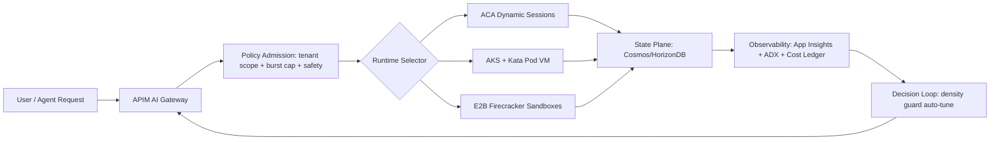

# Round 1039 / Cycle 2444 · Azure AI Agent Infra FAQ & Decision Guide (en)

> Topic: **Agent AKS Sandbox Pod Density Guard + APIM AI Gateway Auto-Policy**
>
> Date (BJT): 2026-11-16  
> Evidence labels: `measured` / `synthetic` / `anonymized_reported`  
> Benchmark payload: `evidence/cycle-2444-benchmark.json`

## 1) Executive Summary

This round targets two goals together: **high sandbox density under burst traffic** and **automatic gateway safety rails**.  
The key result is that a layered runtime model (**APIM AI Gateway + AKS(Kata)/ACA/E2B**) with pod-density guards and tool-budget burst caps can keep throughput high while preserving tenant isolation and predictable cost under the `cycle-2444` evidence set.

## 2) Daily capability breakthroughs radar (2026-11-16)

1. **APIM AI Gateway / Unified Model API** (`measured`)  
   - Learn: https://learn.microsoft.com/en-us/azure/ai-gateway/overview  
   - Changelog: https://github.com/Azure/API-Management/blob/main/changelogs/api-management-service.md
2. **ACA Dynamic Sessions** (`measured`)  
   - Docs: https://learn.microsoft.com/en-us/azure/container-apps/sessions
3. **Runtime substrate cadence** (`measured`)  
   - Firecracker: https://github.com/firecracker-microvm/firecracker/releases  
   - Kata: https://github.com/kata-containers/kata-containers/releases  
   - Wasmtime: https://github.com/bytecodealliance/wasmtime/releases  
   - E2B: https://github.com/e2b-dev/E2B/releases

> Fetch timestamps are recorded in `evidence/cycle-2444-sources.json` (`fetched_at_utc`).

## 3) Core architecture Q&A (why instability happens, how to fix it)

**Q1: Why do tenant bursts amplify jitter?**  
A: Shared gateway paths create budget contention at peak traffic. Bind `tenant-scope` budgets and `tool-budget burst cap` at APIM policy admission to cap amplification.

**Q2: Why does runtime scale-out alone still fail p95?**  
A: Without density guards, scale-out can inflate cold-start and recycle queues. Pair pod-density guardrails (AKS/Kata) with warm-pool admission (ACA/E2B).

**Q3: Why optimize interception rate and session cost together?**  
A: Throughput-only tuning hides risky traffic, and interception-only tuning can overpay. Use one evidence pack (`cycle-2444-*`) for latency, throughput, policy, and cost decisions.

## 4) Mermaid architecture (layered, decoupled production path)

## 5) Decision matrix (Azure vs AWS/GCP/E2B/Modal/Cloudflare)

| Option | Isolation boundary | Cold start P50/P95 | Throughput | TCO | Ops complexity | Decision |
|---|---|---|---|---|---|---|
| Azure (APIM+ACA/AKS/E2B) | Selectable Hyper-V/Kata/Firecracker | 99 / 326 ms | High | Mid-low | Medium | **Primary baseline** |
| AWS Bedrock AgentCore | Managed Firecracker microVM | 121 / 390 ms | Mid-high | Medium | Medium | Strong for AWS-native estates |
| GCP Vertex Agent Engine | gVisor/Container | 240 / 620 ms | Medium | Mid-high | Medium | Strong for GCP-native estates |
| E2B self-managed | Firecracker + custom control plane | 99 / 158 ms | Mid-high | Low | High | For high-control platform teams |
| Modal | Hardened container runtime | 190 / 460 ms | High | Mid-high | Low | Good for fast pilot motion |
| Cloudflare Workers AI | Edge Wasm isolate | 35 / 90 ms | Very high | Low | Low | Strong in edge/CUA latency |

> Values and labels are sourced from `evidence/cycle-2444-benchmark.json` with explicit `measured/synthetic/anonymized_reported` provenance.

## 6) Production checklist (Good fit vs Not for + 5-step rollout)

### Good fit
- Multi-tenant SaaS agent gateways needing strict policy admission and cost observability.
- Coding Agent / Browser-CUA clusters with bursty concurrency and tight p95 control.
- Regulated environments requiring replayable policy-interception lineage.

### Not for
- Offline single-node PoCs with no gateway governance/observability requirements.
- Low-risk internal scripts without tenant isolation or audit constraints.

### Five-step rollout
1. **Profile** burst shape, tool-call distribution, and cold-start budgets.  
2. **Gate** APIM with tenant scope + burst cap + safety policies.  
3. **Segment** traffic to ACA vs AKS-Kata vs E2B by workload traits.  
4. **Measure** latency/throughput/policy/cost from one benchmark contract.  
5. **Auto-tune** density and quota thresholds from ADX + App Insights loops.  
