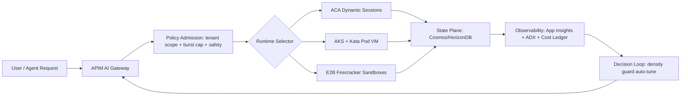

# Round 1039 / Cycle 2444 · Azure AI Agent Infra FAQ & 决策指南（zh-CN）

> Topic: **Agent AKS Sandbox Pod Density Guard + APIM AI Gateway Auto-Policy**
>
> Date (BJT): 2026-11-16  
> Evidence labels: `measured` / `synthetic` / `anonymized_reported`  
> Benchmark payload: `evidence/cycle-2444-benchmark.json`

## 1) Executive Summary

本轮聚焦「**高并发沙箱密度**」与「**网关策略自动护栏**」双目标：在不牺牲多租户隔离的前提下，提升 Coding Agent / Browser-CUA 集群吞吐，并把策略拦截、成本和冷启动抖动纳入统一闭环。  
核心结论：采用 **APIM AI Gateway + AKS(Kata)/ACA/E2B 分层运行时**，并通过 pod density guard + tool budget burst cap gate 进行准入约束，能在 `cycle-2444` 证据数据下维持高吞吐与可控成本。

## 2) Daily capability breakthroughs radar（2026-11-16）

1. **APIM AI Gateway / Unified Model API**（`measured`）  
   - Learn: https://learn.microsoft.com/en-us/azure/ai-gateway/overview  
   - Changelog: https://github.com/Azure/API-Management/blob/main/changelogs/api-management-service.md
2. **ACA Dynamic Sessions**（`measured`）  
   - Docs: https://learn.microsoft.com/en-us/azure/container-apps/sessions
3. **Runtime substrate cadence**（`measured`）  
   - Firecracker: https://github.com/firecracker-microvm/firecracker/releases  
   - Kata: https://github.com/kata-containers/kata-containers/releases  
   - Wasmtime: https://github.com/bytecodealliance/wasmtime/releases  
   - E2B: https://github.com/e2b-dev/E2B/releases

> 抓取时间见 `evidence/cycle-2444-sources.json` 的 `fetched_at_utc` 字段。

## 3) Core architecture Q&A（为何会失稳、如何修复）

**Q1: 为什么高并发时会出现租户间抖动放大？**  
A: 共享网关路径在峰值突发下会触发预算竞争，导致缓存键空间和工具调用配额相互放大。解决方式是把 `tenant-scope` 预算与 `tool-budget burst cap` 绑定到 APIM policy admission 阶段。

**Q2: 为什么只做 sandbox 扩容仍可能失败？**  
A: 如果没有密度护栏，扩容会把冷启动队列和回收队列推高，导致 p95 变差。需要同时做 pod density guard（AKS/Kata）与 warm pool admission（ACA/E2B）。

**Q3: 为什么需要“策略拦截率 + 单会话成本”共同优化？**  
A: 仅看吞吐会掩盖高风险流量；仅看拦截率会牺牲成本。必须用同一证据包（`cycle-2444-*`）同时衡量 latency、throughput、policy、cost。

## 4) Mermaid architecture（分层解耦生产架构）

## 5) Decision matrix（Azure vs AWS/GCP/E2B/Modal/Cloudflare）

| 方案 | 隔离边界 | 冷启动 P50/P95 | 吞吐能力 | TCO | 运维复杂度 | 结论 |
|---|---|---|---|---|---|---|
| Azure(APIM+ACA/AKS/E2B) | Hyper-V/Kata/Firecracker 可选 | 99 / 326 ms | 高 | 中优 | 中 | **首选基线** |
| AWS Bedrock AgentCore | Firecracker 托管微虚机 | 121 / 390 ms | 中高 | 中 | 中 | 适合 AWS 既有栈 |
| GCP Vertex Agent Engine | gVisor/Container | 240 / 620 ms | 中 | 中偏高 | 中 | 适合 GCP 原生组织 |
| E2B 自管 | Firecracker + 自控平面 | 99 / 158 ms | 中高 | 优 | 高 | 强定制团队可选 |
| Modal | Hardened container | 190 / 460 ms | 高 | 中偏高 | 低 | 快速试点友好 |
| Cloudflare Workers AI | Edge Wasm isolate | 35 / 90 ms | 很高 | 优 | 低 | Edge/CUA 低延迟强项 |

> 以上数值与标签来源：`evidence/cycle-2444-benchmark.json`（含 `measured/synthetic/anonymized_reported` 声明）。

## 6) Production checklist（Good fit vs Not for + 五步落地）

### Good fit
- 多租户 SaaS Agent Gateway，需强策略准入与成本可视化。
- Coding Agent / Browser-CUA 并发突发明显，需密度护栏自动调谐。
- 金融合规场景，要求可回放的策略拦截链路。

### Not for
- 完全离线、无网关策略和观测需求的单机 PoC。
- 不要求租户隔离和审计追踪的低风险内部脚本。

### 五步落地
1. **Profile**：梳理租户流量峰值、工具调用分布、冷启动预算。  
2. **Gate**：在 APIM 启用 tenant scope + burst cap + 安全策略。  
3. **Segment**：按 workload 分流到 ACA/AKS-Kata/E2B。  
4. **Measure**：固定输出 latency/throughput/policy/cost 四类证据。  
5. **Auto-tune**：根据 ADX + App Insights 回路调整密度与配额阈值。  
