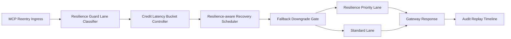

# APIM MCP Reentry Resilience Guard Lane Latency Bucket FAQ (Cycle 2154)

## 1) Three-minute decision
- **Core issue:** under reentry spikes and upstream oscillation, recovery paths show resilience gaps and fairness decay.
- **Recommendation:** implement a closed loop of resilience guard lanes, latency-bucket allocation, fallback downgrade gates, and replay audit.
- **Goal:** preserve tenant fairness while shrinking recovery tails and rollback amplification.

## 2) Q1 / Q2 / Q3
### Q1: Why add a resilience guard lane?
1) unified throttling lacks resilience tiering for bursty oscillation,
2) resilience lanes isolate degradable sessions and protect critical recovery queues,
3) with latency buckets, credit, validity, ordering, and rollback risk are jointly bounded.

### Q2: How should production layering work?
- **Resilience guard layer:** map tenant class + resilience state into recovery lanes,
- **Allocation layer:** issue lane-scoped bucket credit and renewal windows,
- **Reclaim layer:** reclaim overdraft leases with anti-propagation windows,
- **Downgrade layer:** trigger fallback downgrade and human replay at peak.

### Q3: What is the go-live bar?
- unfenced resilience drift keeps declining,
- resilience-lane variance remains stable and traceable,
- recovery gain (percentage points) stays reproducible across windows.

## 3) Reference architecture

## 4) Decision matrix
| Dimension | Unified latency bucket | Resilience Guard Lane + Latency Bucket (Recommended) |
|---|---:|---:|
| Resilience drift control | Medium | High |
| Cross-tenant propagation suppression | Medium | High |
| Replay explainability | Medium | High |
| Peak downgrade stability | Medium | High |
| Implementation complexity | Medium | Medium-High |

## 5) Evidence and reproducibility
- Evidence files:
  - `workshops/azure-agent-infra/evidence/cycle-2154-benchmark.json`
  - `workshops/azure-agent-infra/evidence/cycle-2154-latency.csv`
  - `workshops/azure-agent-infra/evidence/cycle-2154-throughput.csv`
  - `workshops/azure-agent-infra/evidence/cycle-2154-cost.csv`
- Contract keys:
  - `percentage_contract.unfenced_reentry_resilienceguardlane_drift_rate`
  - `percentage_contract.reentry_resilienceguardlane_variance_rate`
  - `percentage_contract.reentry_resilienceguardlane_recovery_gain_pts`
- Labels: `measured / synthetic / anonymized_reported`.

## 6) Production checklist
- [ ] Resilience-lane classification is tenant-class replayable.
- [ ] Bucket grant/renew/reclaim is resilience-lane consistent.
- [ ] Resilience-priority lanes stay starvation-free during peak downgrade.
- [ ] Audit trails bind policy version, resilience class, and recovery path.
- [ ] FAQ/H5/SVG/7-card/evidence stay cycle-topic consistent.
