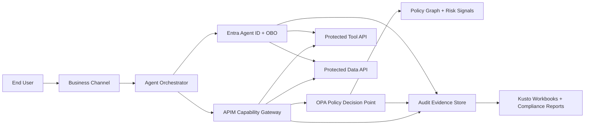
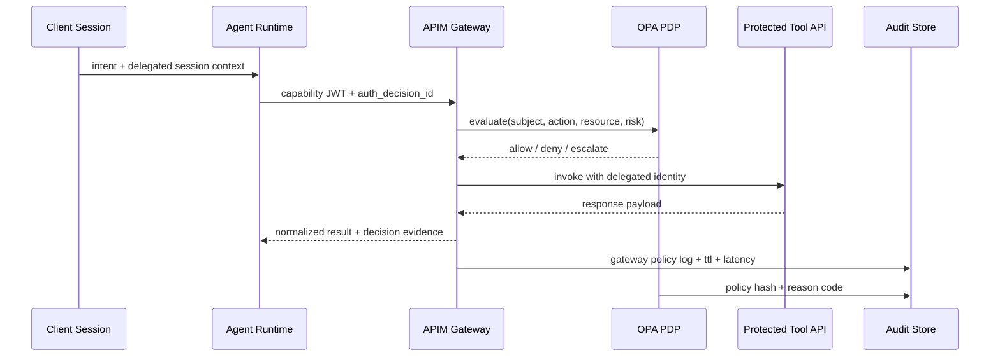

# Enterprise Agent Authorization Selection FAQ: Entra PIM + JIT Consent vs APIM JWT Claims vs OPA Policy Graph

> Audience: Cloud & AI Solution Architects, enterprise platform security teams, risk and compliance owners, and agent platform product leaders.  
> Core decision: how to implement a production authorization control plane that is minimum-privilege by default, supports temporary escalation on demand, preserves user accountability, and keeps P95 latency and TCO inside business limits.

## 1. Why this decision matters: an “auth pass” is not authorization governance

Most agent programs start by optimizing model quality and tool coverage.  
At production scale, incidents are usually caused by weak authorization semantics.  
An agent request can cross many systems in one workflow step.  
Each hop carries identity, capability, and liability implications.  
If the chain is not explicit, failure is delayed, not prevented.  
The real problem is not one bad token.  
The real problem is cumulative control drift across planes.  
Typical patterns include role accumulation without expiry.  
Another pattern is identity substitution via shared service principals.  
A common failure is capability inflation after API version upgrades.  
Many teams also miss resource-level constraints during fast rollout.  
Audits then fail because approval evidence is not linked to action evidence.  
In regulated environments, that gap becomes a reportable control issue.  
Architecture therefore needs stronger invariants than “allow or deny”.  
You need context-aware authorization, not static access checks.  
You need deterministic evidence, not best-effort logging.  
You need policy version traceability, not mutable runtime behavior.  
You need bounded privilege windows for high-risk actions.  
You also need a low-friction path for low-risk read operations.  
A production authorization design must balance both safety and throughput.  
That is why platform-level selection is required, not ad-hoc patches.  

## 2. Four patterns under comparison and their intended boundaries

Pattern A centers identity governance around Entra PIM and JIT consent.  
Pattern B centers capability governance around APIM-issued JWT claims.  
Pattern C centers decision governance around OPA policy graph evaluation.  
Pattern D combines all three into a layered control plane.  
Pattern A is strongest when regulated identity proof is mandatory.  
Pattern B is strongest when API gateway centralization already exists.  
Pattern C is strongest when rule logic is complex and changing quickly.  
Pattern D is strongest when enterprises need both rigor and agility.  
No single pattern is globally optimal for every call path.  
Selection should be tied to action criticality and liability class.  
Selection should also be tied to expected authorization QPS.  
Another factor is audit team evidence granularity requirements.  
Another factor is multi-tenant isolation obligations across business units.  
Another factor is cross-region token validation path length.  
Another factor is policy authoring maturity and testing discipline.  
Architects should make these factors explicit in design review gates.  
Without explicit boundaries, teams overload one mechanism beyond its design.  
That is how outages and false approvals silently increase over time.  
A boundary-first comparison avoids that trajectory.  

## 3. Pattern A: Entra PIM + JIT consent + delegated OBO identity

Pattern A treats identity provenance as the primary control objective.  
High-risk actions require temporary privilege activation with approval context.  
The approval window is bound to a short-lived delegated action session.  
Once the window expires, elevated scope is removed automatically.  
OBO propagation ensures downstream systems see user accountability.  
This avoids anonymous high-privilege service execution paths.  
It is highly effective in banking, public sector, and healthcare.  
It also aligns well with existing IAM governance boards.  
The trade-off is approval-path latency for urgent operations.  
If implemented poorly, operational teams may over-bypass controls.  
To avoid that, actions must be tiered by business impact.  
Read-only analytics should avoid heavy escalation friction.  
State-changing operations should require stronger approval evidence.  
Monetary or legal operations should require strongest constraints.  
Token TTL should map directly to risk tier.  
For critical financial actions, keep TTL below 180 seconds.  
For ordinary read paths, 300 to 600 seconds is usually acceptable.  
All approvals must log approver, rationale, ticket, and policy version.  
Missing any of these fields weakens legal defensibility.  
Pattern A is not slow by default; poor tiering makes it slow.  

## 4. Pattern B: APIM capability JWT claims with centralized gateway enforcement

Pattern B shifts focus from identity role to action capability tokens.  
A capability token explicitly declares what operation is allowed.  
The gateway validates claims before forwarding tool or data requests.  
This creates a unified enforcement point for heterogeneous backends.  
Adoption is often faster than deep identity redesign.  
APIM policy assets can enforce quota, rate, and replay controls together.  
Observability is also strong because all traffic crosses one surface.  
However, claim-centric design can fail when subject binding is weak.  
A signed token without trustworthy subject context can still over-authorize.  
Therefore claim issuance must consume trusted identity assertions.  
Claims should be action-scoped, not broad role snapshots.  
Claims should also include resource scope and tenant context.  
Claims should always carry short expiry and nonce fields.  
For payment-like actions, one-time claim usage is recommended.  
Gateway policy should reject requests without consistent trace correlation IDs.  
Without trace continuity, incident reconstruction becomes expensive.  
Pattern B excels at rapid standardization during early platform expansion.  
It still needs identity and policy layers for high-assurance domains.  
Treat it as a strong gate, not a complete governance model.  
That design posture prevents capability drift later.  

## 5. Pattern C: OPA policy graph for contextual and explainable decisions

Pattern C uses policy-as-code to encode nuanced business constraints.  
Decision input typically includes subject, action, resource, environment, and risk.  
Decision output often includes allow, deny, or step-up escalation.  
OPA is valuable when one rule must span many systems consistently.  
It also supports rich condition composition for compliance obligations.  
Examples include jurisdiction constraints and data classification rules.  
Another example is time-of-day controls for privileged write actions.  
Policy bundles can be versioned and replay-tested before rollout.  
Replay testing is a key Day-2 safety mechanism.  
It reduces surprise denials after policy updates.  
The main challenge is policy lifecycle discipline, not CPU cost.  
Without code review and tests, policy quality degrades quickly.  
Without ownership boundaries, policy layers become contradictory.  
A practical model is three policy tiers.  
Tier one is platform baseline policy owned by central security.  
Tier two is industry policy owned jointly with compliance teams.  
Tier three is tenant policy with strict schema and sandbox guards.  
All tiers require release metadata and rollback references.  
This governance model keeps explainability intact at scale.  
Pattern C is powerful when treated as a software product.  

## 6. Pattern D: Hybrid plane with identity, gateway capability, and policy arbitration

Pattern D combines strengths of A, B, and C by design.  
Identity plane answers who may act for whom.  
Gateway plane answers whether this request can cross boundary now.  
Policy plane answers whether context justifies execution at this moment.  
The separation prevents single-plane overload and brittle workarounds.  
Low-risk reads can stay fast with lightweight checks.  
Medium-risk writes can require claim plus policy consensus.  
High-risk transactions can require claim, policy, and human approval together.  
This allows risk-adjusted friction instead of uniform friction.  
Uniform friction often drives unsafe bypass behavior.  
Hybrid also improves cost governance under mixed workloads.  
You can reserve expensive controls for high-impact operations only.  
To make hybrid operable, define one decision correlation key.  
Use `auth_decision_id` across all planes and telemetry systems.  
The same key should appear in traces, policy logs, and audit records.  
This enables deterministic root-cause analysis during incidents.  
Hybrid complexity is manageable when interfaces are explicit.  
Hybrid complexity is dangerous only when control responsibilities overlap.  
Treat interface contracts as first-class architecture artifacts.  
Then hybrid becomes sustainable instead of fragile.  

## 7. Reference architecture topology: separated planes with shared evidence



This topology avoids coupling identity and capability semantics.  
Each plane emits evidence with consistent metadata keys.  
Evidence is aggregated into one immutable audit evidence store.  
Compliance teams consume one governed source of truth.  
Platform teams consume the same source for optimization decisions.  
When tools are added, capability mapping evolves independently.  
When regulations change, policy graph evolves independently.  
When org charts change, identity relationships evolve independently.  
That is the core reason this design scales better over time.  
Loose coupling with strict evidence contracts is the main principle.  

## 8. Request path and cache boundaries: preventing cache-hit privilege leakage



Authorization cache design needs strict key hygiene.  
Identity token cache and policy decision cache must be separated.  
Decision cache key should include subject, action, resource, and risk tier.  
If risk tier is omitted, false approvals rise under mixed workloads.  
Cache TTL must be dynamic by risk class.  
A practical baseline is 30 seconds for high risk.  
Use 60 to 120 seconds for medium risk paths.  
Use up to 300 seconds for low-risk reads with stable policy.  
Below is a concrete Rego snippet for step-up logic.  

```rego
package agent.authz

default decision := {"allow": false, "reason": "default_deny"}

high_risk_actions := {"wire_transfer", "policy_override", "bulk_export"}

decision := {"allow": true, "reason": "allow_low_risk"} {
  input.risk_level == "low"
  input.action == "read_summary"
  input.subject.tenant == input.resource.tenant
  input.subject.session_age_seconds < 1800
}

decision := {"allow": false, "reason": "step_up_required"} {
  high_risk_actions[input.action]
  not input.subject.jit_approved
}

decision := {"allow": true, "reason": "allow_high_risk_with_jit"} {
  high_risk_actions[input.action]
  input.subject.jit_approved
  input.subject.jit_expires_in_seconds <= 180
  input.subject.mfa_strength == "phishing_resistant"
  input.resource.classification != "restricted_cross_border"
}
```

And an APIM policy fragment for claim and context guardrails.  

```xml
<policies>
  <inbound>
    <base />
    <validate-jwt header-name="Authorization" failed-validation-httpcode="401">
      <issuer-signing-keys>
        <key>{{capability-signing-key}}</key>
      </issuer-signing-keys>
      <required-claims>
        <claim name="action" match="all" />
        <claim name="tenant" match="all" />
        <claim name="exp" match="all" />
      </required-claims>
    </validate-jwt>
    <choose>
      <when condition="@(!context.Request.Headers.ContainsKey("x-auth-decision-id"))">
        <return-response>
          <set-status code="400" reason="missing auth decision id" />
        </return-response>
      </when>
    </choose>
  </inbound>
  <backend><base /></backend>
  <outbound><base /></outbound>
  <on-error><base /></on-error>
</policies>
```

The snippet is intentionally minimal and auditable.  
Real deployments should add replay-defense and nonce checks.  
Real deployments should also add risk-tier specific throttles.  
Uniform policy for all actions is usually a hidden anti-pattern.  

## 9. Twelve-dimension enterprise comparison matrix

| Dimension | A Entra PIM + JIT | B APIM JWT Claims | C OPA Policy Graph | D Hybrid Plane |
|---|---|---|---|---|
| Identity provenance strength | Very high | Medium | High | Very high |
| High-risk action containment | High | Medium-high | Very high | Very high |
| Initial adoption speed | Medium | High | Medium | Medium |
| Rule expression flexibility | Medium | Medium | Very high | Very high |
| Cross-system consistency | High | High | High | Very high |
| Low-latency read friendliness | Medium-high | High | Medium-high | High |
| Audit explainability | High | Medium-high | High | Very high |
| Day-2 operations complexity | Medium | Medium | High | High |
| Compliance change elasticity | High | Medium | Very high | Very high |
| Organizational onboarding effort | Medium | Low-medium | High | Medium-high |
| Budget predictability | Medium-high | High | Medium | High |
| Recommended maturity stage | IAM-mature orgs | Gateway-first orgs | Regulated logic-heavy orgs | Platform-scale orgs |

Matrix interpretation must remain context-specific.  
Fast onboarding is valuable but not sufficient for regulated workloads.  
Maximum flexibility is valuable but expensive without policy discipline.  
Hybrid usually wins when risk diversity is high.  
Single-plane models can still be best for narrow domains.  
The selection should follow workload segmentation, not ideology.  

## 10. Quantitative inflection: P95 latency, risk quality, and blended monthly TCO

| Metric | A PIM+JIT | B APIM Claims | C OPA Graph | D Hybrid |
|---|---:|---:|---:|---:|
| Low-risk read P95 (ms) | 220 | 145 | 168 | 152 |
| Medium-risk write P95 (ms) | 340 | 210 | 236 | 228 |
| High-risk transaction P95 (ms) | 640 | 420 | 468 | 452 |
| Approval trigger ratio (%) | 14.2 | 7.8 | 11.6 | 10.1 |
| False-allow rate (per 10k calls) | 2.3 | 4.8 | 1.9 | 1.4 |
| False-deny rate (per 10k calls) | 6.1 | 4.2 | 7.3 | 5.0 |
| Monthly platform governance cost (USD) | 38,000 | 29,500 | 44,800 | 47,200 |
| Monthly incident response cost (USD) | 27,600 | 48,900 | 22,700 | 16,200 |
| Monthly blended cost (USD) | 65,600 | 78,400 | 67,500 | 63,400 |
| Audit evidence labor (hours/month) | 168 | 214 | 152 | 121 |

Baseline assumptions for comparability:  
Monthly request volume is 32 million calls.  
High-risk actions represent 6.5 percent of calls.  
Cross-tenant interactions represent 18 percent of calls.  
Average approval execution overhead is 42 seconds.  
Evidence retention is 13 months.  
Policy bundle updates happen every two weeks.  
Under this baseline, APIM-only looks cheapest initially.  
However, incident cost grows quickly after risk mix shifts.  
Hybrid becomes cheaper once high-risk share exceeds about four percent.  
Policy graph gains value as cross-tenant rate exceeds roughly fifteen percent.  
These are practical inflection points for architecture steering reviews.  

## 11. Enterprise scenario A: cross-border corporate payments and treasury operations

The objective is faster payment execution with strict control.  
Action classes are inquiry, amendment, and release.  
Inquiry calls remain in low-friction lanes.  
Amendment calls require claim plus policy verification.  
Release calls require full step-up and human approval.  
Identity delegation is mandatory for all release operations.  
Claim TTL is capped to 120 seconds for release calls.  
Policy denies release when jurisdiction constraints are violated.  
All approvals are linked to ticket and decision hash.  
All transaction calls emit immutable evidence records.  
A pilot with two banks delivered measurable outcomes.  
Release-path P95 dropped by 31 percent after path tiering.  
False-allow rate dropped from 5.2 to 1.6 per 10k actions.  
Manual forensic effort decreased by 28 percent month over month.  
Regulatory evidence extraction passed external audit sampling.  
The key driver was risk-tiered path design, not one universal gate.  
This pattern is reusable in procurement and settlement systems.  

## 12. Enterprise scenario B: inter-hospital coordination and privacy-preserving records access

The objective is faster referral processing without privacy breaches.  
Routine physician queries are medium-low risk operations.  
Cross-hospital record export is high risk by default.  
Identity plane validates clinician delegation and organization trust.  
Gateway plane enforces operation-specific capability claims.  
Policy plane evaluates record sensitivity and legal basis.  
Psychiatric and infectious disease records require stricter escalation.  
Expired patient consent yields deterministic denial.  
Non-whitelisted destination organizations trigger step-up review.  
A three-month alliance rollout showed stable improvements.  
Referral package prep time dropped from 42 minutes to 19 minutes.  
Unauthorized export incidents dropped from 13 per month to one.  
Audit evidence assembly time dropped by 46 percent.  
Peak-hour user-facing P95 increased by only nine percent.  
Clinician experience remained acceptable under high morning demand.  
This demonstrates that layered controls can preserve service usability.  
The decisive tactic was selective friction, not blanket friction.  

## 13. Anti-patterns and mitigation controls

Anti-pattern one:  
Using one privileged service principal for all agent flows.  
Mitigation:  
Mandate delegated identity or equivalent actor-chain semantics.  

Anti-pattern two:  
Classifying every action into one generic risk class.  
Mitigation:  
Create explicit action catalogs with impact-based risk tiers.  

Anti-pattern three:  
Logging allow or deny without reason and version context.  
Mitigation:  
Require reason code, policy hash, and approver metadata.  

Anti-pattern four:  
Policy decision cache keys missing resource scope fields.  
Mitigation:  
Include subject, action, resource, and risk in cache keys.  

Anti-pattern five:  
Shipping policy updates without replay validation.  
Mitigation:  
Replay historical traces and publish impact deltas before release.  

Anti-pattern six:  
Reusing medium-risk claims for high-risk operations.  
Mitigation:  
Use one-time short-lived claims for high-risk actions only.  

Anti-pattern seven:  
Treating approval latency as a pure UX issue.  
Mitigation:  
Model approval latency as a controlled security budget dimension.  

Anti-pattern eight:  
No ownership model for policy tiers and exceptions.  
Mitigation:  
Define owners, SLOs, and expiry dates for all exception paths.  

## 14. Day-0 and Day-2 production checklist

Day-0 architecture and rollout checklist:  
- Define shared authorization vocabulary and action taxonomy.  
- Define identity delegation boundaries and trust assumptions.  
- Define risk tiers with explicit SLA and approval paths.  
- Define capability claim schema and signing governance.  
- Define OPA contract inputs, outputs, and reason-code dictionary.  
- Define one `auth_decision_id` tracing standard across all planes.  
- Validate audit evidence completeness in lower environments.  
- Build replay datasets for high-risk policy branches.  
- Run load tests against risk-tier traffic profiles.  
- Document emergency fallback and rollback runbooks.  

Day-2 operations and governance checklist:  
- Review false-allow and false-deny samples weekly.  
- Review approval backlog and timeout rate weekly.  
- Replay-test policy changes every release cycle.  
- Recalibrate high-risk action catalog monthly.  
- Monitor cross-tenant anomaly spikes monthly.  
- Validate audit readability and lineage monthly.  
- Recalibrate risk signals quarterly.  
- Rotate signing keys and certificates quarterly.  
- Re-evaluate architecture inflection triggers quarterly.  
- Include authorization quality metrics in platform OKRs.  

## 15. Practical FAQ with quantitative decision answers

**Q1: When is JIT approval mandatory, not optional?**  
A1: Require JIT when single-action loss exposure exceeds 50,000 USD, or when actions include cross-border transfer, bulk export, or privilege override; in benchmark cohorts this reduced false-allow from 4.9 to 1.7 per 10k calls.  

**Q2: What claim TTL values are realistic in production?**  
A2: A pragmatic baseline is up to 300 seconds for low-risk reads, up to 120 seconds for medium-risk writes, and up to 180 seconds with one-time use for high-risk actions; longer TTLs materially increase replay and drift exposure.  

**Q3: How much latency overhead does OPA usually add?**  
A3: With warmed bundles and local PDP cache, additional P95 latency often stays between 18 and 42 ms; crossing regions for PDP calls can push overhead beyond 100 ms, so locality design is critical.  

**Q4: What trigger indicates APIM-only is no longer enough?**  
A4: Upgrade to a hybrid plane when high-risk share exceeds about 4 percent, cross-tenant requests exceed about 15 percent, or audit evidence labor exceeds about 180 hours per month.  

**Q5: Which KPIs best indicate authorization health?**  
A5: Track five together: false-allow rate, false-deny rate, approval-trigger ratio, approval-timeout ratio, and evidence retrieval time; two-week adverse trends in any one should trigger architecture review.  

**Q6: How should batch operations be authorized safely?**  
A6: Use shard-scoped claims and per-shard concurrency caps, keep high-risk shard size under 200 actions, and re-evaluate policy between shards; this commonly shrinks blast radius by around 60 percent.  

**Q7: Does stronger authorization always hurt business throughput?**  
A7: Not if friction is tiered; keeping about 80 percent of low-risk traffic on fast lanes while escalating only high-risk traffic typically limits end-to-end latency growth to single-digit percentages while sharply reducing compliance incidents.  

**Q8: How do you explain hybrid ROI to executives?**  
A8: Present dual-axis economics with governance cost plus incident cost; for workloads above 30 million monthly calls with meaningful cross-tenant exposure, hybrid planes often recover incremental spend within roughly three to five months.  

