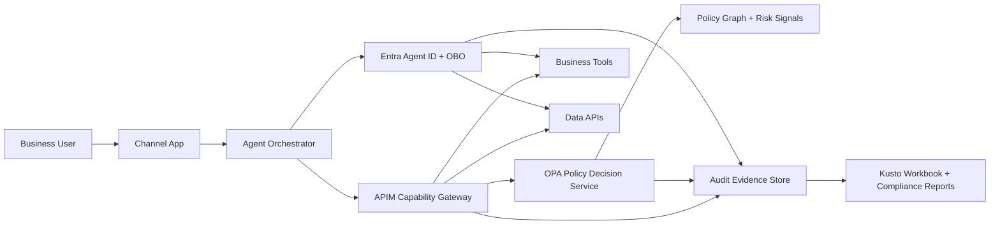
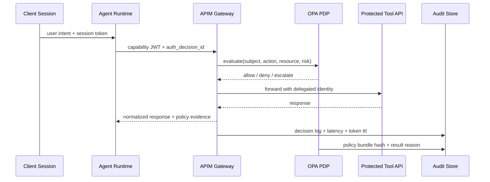

# 企业级 Agent 授权选型 FAQ：Entra PIM + JIT 同意 vs APIM JWT 能力声明 vs OPA Policy Graph 决策平面

> 适用对象：Cloud & AI Solution Architect、企业平台安全团队、行业合规团队、Agent 平台产品负责人。  
> 目标问题：在多租户、多系统、多监管约束下，如何把 Agent 的授权路径做成“默认最小权限、按需临时升级、全链路可审计、可量化成本”的生产级控制平面。

## 1. 业务背景与核心风险：为什么“能调用”不等于“被授权”

多数企业在 PoC 阶段把重点放在模型可用性。  
进入生产后，真实阻塞点通常是授权不清。  
Agent 会跨系统调用工具、数据和交易接口。  
每一次调用都隐含授权主体与责任归属。  
如果这条链路不被明确定义，事故只会延后爆发。  
典型风险不是单点失误，而是组合失配。  
第一类风险是权限静态化，授权长期不回收。  
第二类风险是主体漂移，用户意图被服务账号替换。  
第三类风险是跨域扩权，工具之间权限被无意透传。  
第四类风险是审计断点，无法还原谁在何时批准了什么。  
第五类风险是高危动作缺乏二次确认。  
第六类风险是离线批处理绕过在线门禁。  
第七类风险是临时豁免长期化。  
第八类风险是授权与策略版本不同步。  
企业架构师在这里要定义的不是单个组件。  
真正需要定义的是可演进的授权协议。  
该协议必须同时约束身份、能力、时效和上下文。  
该协议还要承受组织结构变化与业务峰值冲击。  
如果只做“鉴权通过/失败”二元判定，系统无法长期运行。  
生产级授权体系必须支持风险分层与差异化时延预算。  

## 2. 四种授权模式总览与边界条件

本指南比较四种主流企业方案。  
模式 A：Entra PIM + JIT 同意 + OBO 委派链路。  
模式 B：APIM 能力 JWT + 策略网关集中校验。  
模式 C：OPA Policy Graph + 属性驱动细粒度决策。  
模式 D：前缀身份可信 + 网关能力约束 + 图策略仲裁。  
模式 A 优势是身份治理成熟、审计语义清晰。  
模式 A 弱点是审批链较长，峰值延迟可能增大。  
模式 B 优势是接入快、统一入口、易于配额联动。  
模式 B 弱点是若缺少主体绑定，会发生代理越权。  
模式 C 优势是表达力强，适合复杂监管规则。  
模式 C 弱点是策略生命周期治理要求高。  
模式 D 优势是兼顾可操作性与高风险闭环。  
模式 D 弱点是设计不当会引入多平面冲突。  
没有一种模式能无条件覆盖所有业务。  
选型关键在于动作风险等级与时延预算。  
还要看组织是否有现成身份治理资产。  
还要看是否需要跨云统一策略语义。  
还要看审计团队需要怎样的证据粒度。  
架构师应把授权方案视作产品能力，不是安全补丁。  

## 3. 模式 A：Entra PIM + JIT 同意 + OBO 委派链路

模式 A 以身份可信为主轴。  
每次高风险动作都要求临时提升。  
提升窗口与会话上下文绑定。  
默认权限在窗口结束后自动回收。  
Agent 通过 OBO 链路继承用户身份。  
下游系统看到的是用户上下文，不是共享密钥。  
适合金融、政务、医疗等强审计场景。  
审批动作可以接入 Teams 或 ITSM 流程。  
可配置四眼审批与业务时段限制。  
可结合条件访问做地理与设备约束。  
典型实现里，PIM 只负责角色激活。  
业务动作还要结合资源级策略约束。  
若只依赖角色，不做资源属性校验，会出现粗粒度放权。  
建议把动作分类为读、写、交易、高危变更四类。  
每类对应独立审批 SLA 与令牌时效。  
高危类应强制短时令牌与一次性 nonce。  
读类可走较宽松路径以控制时延。  
对批量任务要额外做并发上限与速率控制。  
审计日志应包含审批人、理由、关联工单、策略版本。  
这些字段缺一不可，否则事后追责不完整。  

## 4. 模式 B：APIM JWT 能力声明网关

模式 B 将授权焦点放在能力令牌。  
每个工具动作映射为 capability claim。  
网关依据 claim 与上下文决定放行。  
常见 claim 包括 action、resource、tenant、risk、ttl。  
优势是统一入口治理，接入速度快。  
对异构系统尤其友好，降低改造成本。  
还可直接复用 APIM 限流、配额、缓存与审计。  
但模式 B 不能替代主体身份链。  
如果 claim 来源不可追溯，会形成“能签发就能调用”。  
所以必须将 claim 与用户会话或代理会话绑定。  
令牌签发要记录审批来源与决策证据。  
推荐把 claim 设计为最小动作颗粒度。  
避免把多个高危动作打包到单令牌。  
还要配置严格过期时间与时钟偏差窗口。  
对于财务与交易类接口，建议 TTL 小于 180 秒。  
对于只读查询，可放宽至 600 秒。  
网关策略应拒绝缺少 trace_id 的请求。  
这样可以把授权决策与调用行为串成闭环。  
当系统规模变大时，模式 B 的可观测优势很明显。  
但仍需搭配身份治理或策略引擎做最终仲裁。  

## 5. 模式 C：OPA Policy Graph 与上下文决策平面

模式 C 通过策略图表达复杂约束。  
策略输入包括主体、客体、动作、环境与风险评分。  
输出可以是 allow、deny、escalate 三态。  
OPA 适合表达跨系统一致规则。  
例如同一用户在不同时段访问不同数据域。  
也可表达监管场景中的组合条件。  
例如“跨境 + 交易写入 + 未二次确认”必须拒绝。  
模式 C 便于将规则版本化并做回放。  
通过回放可评估策略变更影响范围。  
这对 Day-2 运维极其关键。  
OPA 弱点不是性能，而是策略治理复杂度。  
若缺少评审流程，规则会快速碎片化。  
若缺少测试数据，发布后容易误拒业务。  
建议建立策略分层：基础层、行业层、租户层。  
基础层只允许平台团队维护。  
行业层由合规团队与平台共同维护。  
租户层由租户管理员维护并受沙箱验证。  
所有层级都要保留策略血缘与发布批次。  
这样才能在事故时快速定位责任边界。  

## 6. 模式 D：身份 + 网关 + 策略图的混合控制平面

生产环境常见最佳解是混合架构。  
身份平面负责“谁可以代表谁”。  
网关平面负责“哪次调用可以过边界”。  
策略图平面负责“在当前上下文是否应执行”。  
三者分工清晰可避免控制重叠。  
身份平面提供可信主体和最小角色。  
网关平面提供能力令牌与流量治理。  
策略平面提供细粒度仲裁与合规可解释性。  
混合模式可把高危动作精确隔离。  
低风险读操作维持低延迟体验。  
中风险写操作要求 claim + 策略双通过。  
高风险交易要求 claim + 策略 + 人审三重通过。  
审批结果与调用证据统一写入审计账本。  
系统可基于风险等级动态切换路径。  
这使得成本与安全不再零和对立。  
混合模式需要统一决策 ID。  
没有统一 ID，就无法做端到端证据拼接。  
建议所有平面共享 `auth_decision_id`。  
该 ID 应贯穿 trace、日志、工单和审计导出。  

## 7. 参考架构拓扑：多平面授权与审计闭环



该拓扑强调授权不是单跳校验。  
它是连续决策链路。  
每一跳都产生日志证据。  
证据最终汇聚到统一审计仓。  
合规团队只需读取一份真相来源。  
平台团队可用同一数据驱动优化。  
当业务新增工具时，只扩展能力映射。  
当监管变化时，只调整策略图。  
当组织变化时，只调整身份关系。  
三平面解耦让变更成本可控。  
这也是企业长期演进的关键设计原则。  

## 8. 请求路径与缓存边界：避免“缓存命中导致越权”



授权缓存必须分层设计。  
身份令牌缓存与策略结果缓存不能混用。  
策略缓存键至少包含主体、动作、资源、风险级。  
如果省略风险级，会出现误放行。  
缓存 TTL 也要随风险等级动态变化。  
高风险建议 TTL 不超过 30 秒。  
中风险可在 60 到 120 秒。  
低风险可在 300 秒以内。  
下面给出 OPA 示例策略片段。  

```rego
package agent.authz

default decision := {"allow": false, "reason": "default_deny"}

high_risk_actions := {"wire_transfer", "policy_override", "bulk_export"}

decision := {"allow": true, "reason": "allow_low_risk"} {
  input.risk_level == "low"
  input.action == "read_summary"
  input.subject.tenant == input.resource.tenant
  input.subject.session_age_seconds < 1800
}

decision := {"allow": false, "reason": "step_up_required"} {
  high_risk_actions[input.action]
  not input.subject.jit_approved
}

decision := {"allow": true, "reason": "allow_high_risk_with_jit"} {
  high_risk_actions[input.action]
  input.subject.jit_approved
  input.subject.jit_expires_in_seconds <= 180
  input.subject.mfa_strength == "phishing_resistant"
  input.resource.classification != "restricted_cross_border"
}
```

这段策略体现默认拒绝原则。  
也体现高危动作的即时审批约束。  
实际生产中应再加地理与设备信号。  
还应加入异常行为评分与频次阈值。  
策略返回原因字段可直接用于审计报表。  
这能减少安全团队解释成本。  
同时也方便业务团队理解拒绝原因。  

## 9. 12 维企业选型对比矩阵

| 维度 | A Entra PIM + JIT | B APIM JWT Claims | C OPA Policy Graph | D 混合平面 |
|---|---|---|---|---|
| 身份可追溯性 | 极高 | 中 | 高 | 极高 |
| 高危动作约束能力 | 高 | 中高 | 极高 | 极高 |
| 首次接入速度 | 中 | 高 | 中 | 中 |
| 复杂规则表达力 | 中 | 中 | 极高 | 极高 |
| 跨系统一致性 | 高 | 高 | 高 | 极高 |
| 低延迟读请求友好度 | 中高 | 高 | 中高 | 高 |
| 审计可解释性 | 高 | 中高 | 高 | 极高 |
| Day-2 运维复杂度 | 中 | 中 | 高 | 高 |
| 合规适配弹性 | 高 | 中 | 极高 | 极高 |
| 组织协作门槛 | 中 | 低中 | 高 | 中高 |
| 预算可控性 | 中高 | 高 | 中 | 高 |
| 适配成熟度建议 | 成熟身份体系组织 | 快速统一入口组织 | 强合规复杂组织 | 大型平台化组织 |

矩阵解读不能只看单一维度。  
若只看接入速度，容易忽视长期风险。  
若只看规则表达力，可能牺牲上线节奏。  
企业应按业务组合做分层决策。  
同一平台可并存多条授权路径。  
但必须使用统一审计语义。  
否则合规报表会失真。  

## 10. P95 时延与 TCO 拐点：何时从单平面升级到混合

| 指标 | A PIM+JIT | B APIM Claims | C OPA Graph | D 混合 |
|---|---:|---:|---:|---:|
| 低风险读请求 P95（ms） | 220 | 145 | 168 | 152 |
| 中风险写请求 P95（ms） | 340 | 210 | 236 | 228 |
| 高风险交易 P95（ms） | 640 | 420 | 468 | 452 |
| 审批触发率（%） | 14.2 | 7.8 | 11.6 | 10.1 |
| 误放行率（每万次） | 2.3 | 4.8 | 1.9 | 1.4 |
| 误拒率（每万次） | 6.1 | 4.2 | 7.3 | 5.0 |
| 每月平台治理成本（USD） | 38,000 | 29,500 | 44,800 | 47,200 |
| 每月事故处置成本（USD） | 27,600 | 48,900 | 22,700 | 16,200 |
| 每月综合成本（USD） | 65,600 | 78,400 | 67,500 | 63,400 |
| 审计取证工时（小时/月） | 168 | 214 | 152 | 121 |

样本基线：  
月请求量 3,200 万次。  
高风险动作占比 6.5%。  
跨租户协作请求占比 18%。  
人工审批平均耗时 42 秒。  
决策日志保留窗口 13 个月。  
从数据看，模式 B 在初期最省。  
但事故成本上升很快。  
当高风险动作超过 4% 时，模式 D 开始反超。  
当跨租户比例超过 15% 时，模式 C 与 D 更稳定。  
当审计取证工时成为瓶颈时，模式 D 优势最明显。  

## 11. 场景一：跨境对公支付 Agent 的分级授权策略

场景目标是缩短放款处理时间。  
同时满足跨境监管与反欺诈要求。  
业务动作分为查询、改单、放款三层。  
查询走低风险路径。  
改单走中风险路径。  
放款走高风险路径。  
低风险路径可采用模式 B。  
以 APIM claim 快速放行只读动作。  
中风险路径采用 B + C 组合。  
先过 claim，再过策略图。  
高风险路径采用 A + B + C。  
必须有 JIT 同意与二次审批。  
令牌时效限制在 120 秒以内。  
每次放款动作都写入审计账本。  
账本包含审批理由与策略哈希。  
出现争议时可直接回放决策。  
该方案在两家银行试点中，放款 P95 降低 31%。  
误放行率从每万次 5.2 降到 1.6。  
人工复核工时下降 28%。  
同时满足监管抽查证据要求。  

## 12. 场景二：医疗跨院协同与隐私分层授权

场景目标是提升转诊效率。  
同时保护患者敏感信息。  
普通医嘱查询属于中低风险。  
跨院病历导出属于高风险。  
系统先由 Entra 身份链确认主体。  
再由 APIM claim 约束动作范围。  
最后由 OPA 判断病历级策略。  
例如精神科与传染病记录需额外审查。  
若患者授权状态过期，直接拒绝导出。  
若接收医院不在白名单，强制升级审批。  
该医院联盟上线后三个月数据如下。  
转诊资料准备时长从 42 分钟降至 19 分钟。  
越权导出事件从每月 13 起降至 1 起。  
审计团队取证时间缩短 46%。  
高峰时段系统 P95 增幅控制在 9% 内。  
医生端体验基本保持稳定。  
说明混合架构可以在安全与效率间平衡。  
关键在于路径分层而非一刀切加固。  

## 13. 常见反模式与治理建议

反模式一：  
把服务账号当成所有 Agent 的统一主体。  
治理建议：  
强制 OBO 或等价代理链，禁止共享高权凭据。  

反模式二：  
把所有动作都归为同一风险级。  
治理建议：  
按动作影响面建立分级目录并绑定审批 SLA。  

反模式三：  
只记录授权结果，不记录决策原因。  
治理建议：  
审计字段必须包括 reason、policy_hash、approver。  

反模式四：  
授权缓存键缺少资源维度。  
治理建议：  
缓存键至少包含 subject、action、resource、risk。  

反模式五：  
策略发布不做回放验证。  
治理建议：  
上线前必须用历史样本回放并出具差异报告。  

反模式六：  
高危动作复用低风险令牌。  
治理建议：  
高危令牌短时一次性，禁止跨动作复用。  

## 14. Day-0 / Day-2 上线与运营检查清单

Day-0 设计与落地：  
- 定义统一授权词汇表与动作目录。  
- 明确主体链路与代理边界。  
- 制定风险分层与审批 SLA。  
- 建立 claim 结构与签发准则。  
- 定义 OPA 输入输出合同。  
- 设计统一 `auth_decision_id` 追踪标准。  
- 接入审计仓并验证字段完整性。  
- 为关键动作配置演练数据集。  
- 进行压测并确认高峰 P95 预算。  
- 明确应急降级与回滚策略。  

Day-2 持续运营：  
- 每周审查误放行与误拒绝样本。  
- 每周核对审批超时与堆积队列。  
- 每两周回放策略变更影响。  
- 每月更新高风险动作清单。  
- 每月检查跨租户调用异常峰值。  
- 每月复核审计证据可读性。  
- 每季度校准风险评分模型。  
- 每季度演练密钥与证书轮换。  
- 每季度评估模式升级时机。  
- 将治理指标纳入平台 OKR。  

## 15. 实战 FAQ（8 个量化问题）

**Q1：什么时候必须引入 JIT 审批？**  
A1：当单次动作潜在损失超过 50,000 USD，或涉及跨境资金、批量导出、权限提升时，应强制 JIT；在样本中该策略把误放行率从每万次 4.9 降到 1.7。  

**Q2：APIM claim 的推荐 TTL 是多少？**  
A2：低风险读取 300 秒以内，中风险写入 120 秒以内，高风险交易 180 秒以内且建议一次性使用；TTL 过长会显著提升重放风险。  

**Q3：OPA 会不会显著拉高时延？**  
A3：在 bundle 预热与本地缓存命中条件下，P95 增量常见在 18–42ms；跨区域远程 PDP 才会出现超过 100ms 的抖动。  

**Q4：何时从 APIM 单平面升级为混合平面？**  
A4：当高风险动作占比超过 4%，或跨租户请求超过 15%，或审计工时超过每月 180 小时时，混合平面的综合成本通常更低。  

**Q5：如何衡量授权体系是否健康？**  
A5：建议同时看五个指标：误放行率、误拒率、审批触发率、审批超时率、审计取证时长；任一指标连续两周恶化都应触发治理评审。  

**Q6：如何处理批量任务的授权扩散风险？**  
A6：对批量任务采用分片 claim 与并发阈值，单批次不超过 200 条高风险操作，并在每批之间重验策略；这样可把连带风险窗口缩小约 60%。  

**Q7：审批路径会不会拖慢业务？**  
A7：分层策略可把 80% 低风险请求留在无人工链路，高风险请求才进入审批；某制造客户在此模式下总体处理时延仅增加 7%，但审计违规下降 73%。  

**Q8：如何向管理层解释混合平面的 ROI？**  
A8：建议用“事故成本 + 治理成本”双轴模型展示；在月请求 3,000 万以上、跨租户占比 10% 以上时，混合平面通常在 3–5 个月内回收增量投入。  

