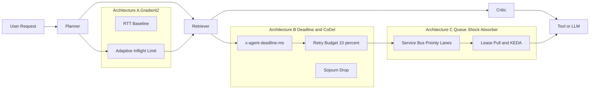
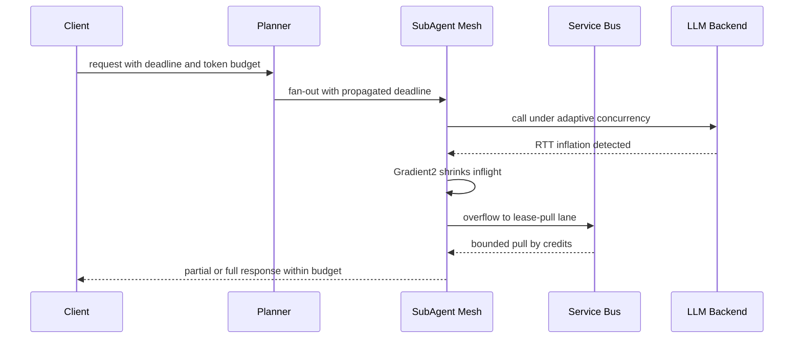
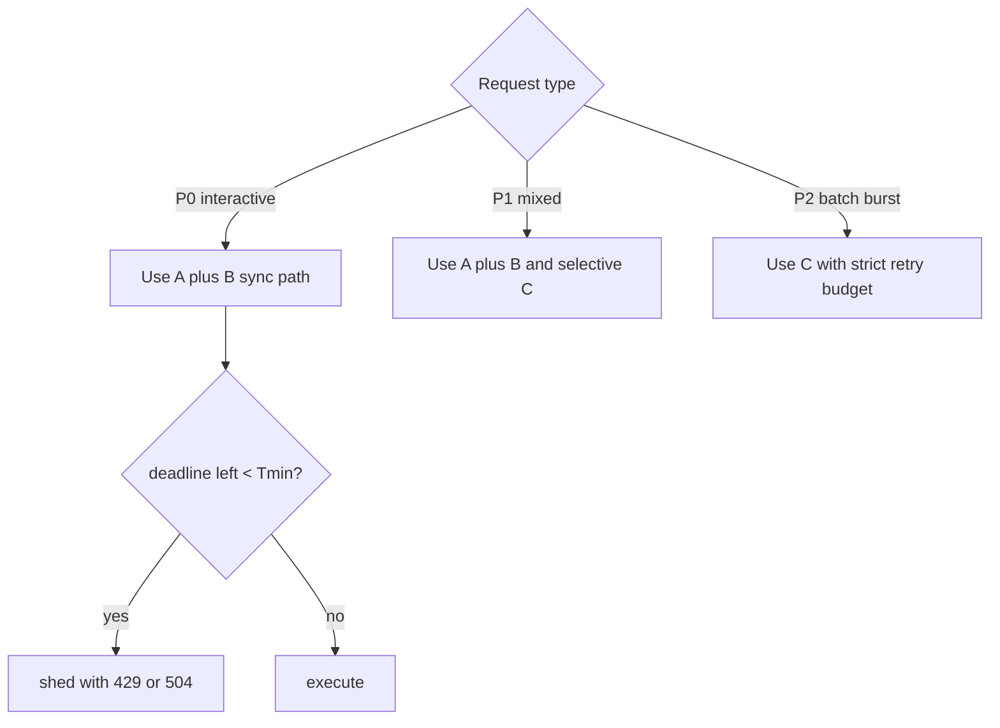

# Enterprise Multi-Hop Agent Backpressure and Retry-Storm Defense Selection FAQ: Gradient2 Concurrency vs Deadline+CoDel vs ServiceBus Pull vs Unbounded Fan-Out
> **Applies to**: enterprise multi-hop agent meshes (`Planner -> Retriever -> Critic -> Tool`) under sustained and bursty load.
> **Decision pressure**: preserve interactive business quality while suppressing retry amplification, queue collapse, and token burn.
> **Core objective**: establish an observable, throttle-safe, fallback-ready, auditable control architecture for metastable failure prevention.

## 1. Executive summary
In multi-hop agent systems, the first failure mode is rarely a single slow model endpoint.
The dominant failure mode is metastable collapse where retries dominate useful work.
When each hop retries blindly, load scales multiplicatively with hop depth.
Parent timeout plus child continuation is the canonical high-utilization zero-goodput trap.
Architecture A shrinks in-flight capacity early using RTT-gradient control.
Architecture B propagates end-to-end deadline and retry budget to stop zombie work.
Architecture C converts spike waves into bounded lease-pull throughput lanes.
Architecture D is the anti-pattern of unbounded `asyncio.gather` plus per-hop exponential retry.
Recommended baseline is A plus B for synchronous paths and C for asynchronous shock absorption.
Architecture D should be explicitly prohibited in platform engineering standards.
Operationally, goodput, sojourn time, and retry-budget saturation should be first-class SLO signals.
Governance should enforce that every retry is measurable, bounded, and attributable.
Routing should isolate interactive (`P0`) lanes from deferred burst (`P2`) lanes.
Audit logs should retain deadline values, shed reasons, fallback actions, and takeover events.
This guide provides formulas, a 12-dimension comparison matrix, and three-tier TCO assumptions.

## 2. Failure anatomy and metastable behavior
Metastable failure occurs when the system remains unhealthy even after external input load falls.
A typical trigger is queueing delay inflation causing timeout growth and retry cascades.
In multi-hop graphs, local retry logic compounds globally across branches.
Leading symptoms include TTFT spikes, rising sojourn time, alternating 429/503, and pinned GPU with collapsing success.
Retriever and tool lanes often saturate before core model capacity is visibly exhausted.
Without global deadline propagation, expired parent requests continue consuming expensive downstream capacity.
Without priority isolation, background flood can starve interactive demand in seconds.
Therefore backpressure must coordinate concurrency, time budget, retry budget, queue behavior, and lane priority.

## 3. Four candidate architectures
Architecture A: Little's Law `Gradient2` or Vegas-style RTT-aware adaptive concurrency control.
Architecture B: End-to-end deadline propagation plus CoDel shedding plus retry-budget governance.
Architecture C: Credit-based asynchronous lease-pull via Service Bus premium lanes and KEDA scaling.
Architecture D: Unbounded fan-out with blind per-hop retries.
A targets pre-congestion contraction.
B targets semantic budget enforcement and waste elimination.
C targets spike absorption and isolation.
D produces multiplicative amplification and prolonged instability.

## 4. Architecture A mechanics: RTT-gradient concurrency control
The control loop updates in-flight limits from no-load and measured RTT ratio.
As queue latency inflates, allowed in-flight concurrency contracts before hard backend failure.
A representative control update is:
`L_{n+1} = L_n * clamp(RTT_noLoad / RTT_measured, 0.5, 1.0) + beta`
The approach is proactive relative to pure status-code-based throttling.
It is effective when low-noise latency baselines exist.
It can overreact if measurement jitter is unfiltered.
In LLM paths, TTFT and TPOT should be monitored separately and weighted by route profile.
Token-aware weighting avoids small interactive turns being crowded out by large context calls.
Per-route caps should complement global caps to contain hot-key concentration effects.

## 5. Architecture B mechanics: deadline propagation, CoDel, and retry budget
Each hop receives and decrements remaining wall-clock budget and token budget.
If remaining budget is below minimum-hop execution threshold, the hop should reject immediately.
This eliminates post-timeout child work that cannot produce user value.
CoDel shedding drops requests by sojourn-time policy instead of queue-length-only policy.
Retry budget should be computed over a sliding window and capped, commonly at 10 percent.
When budget is exhausted, responses should emit explicit budget-denied reasons for traceability.
Strength is strong semantic control and auditable intent.
Tradeoff is contract discipline and cross-service rollout effort.

## 6. Architecture C mechanics: lease-pull asynchronous shock absorber
Ingress burst waves are queued in Service Bus premium with priority lanes.
Workers pull with bounded leases and prefetch credits tied to effective downstream capacity.
KEDA scales workers based on lag and processing velocity to reduce oscillation.
Poison messages move to DLQ and avoid repeated impact on healthy lanes.
This model is ideal for webhook storms, batch claims processing, and security incident fan-in.
Strength is robust spike handling and isolation.
Tradeoff is increased end-to-end latency and asynchronous semantics.
Therefore it should complement, not replace, synchronous interactive control paths.

## 7. Architecture D anti-pattern
Each hop can recursively create more concurrent branches.
With retry factor `3` across `4` hops, synthetic load can reach `3^4 = 81` expansion.
Retry traffic dominates base traffic and suppresses useful completion.
Autoscaling often chases the wrong signal because invalid work consumes new capacity.
Result is near-zero goodput with near-maximum resource utilization.
This anti-pattern should be blocked by design review and runtime policy.

## 8. Retry amplification and goodput model
Retry amplification can be modeled as:
`A_retry = Π_{i=1..k}(1 + p_fail_i * r_i)`
`k` denotes hop depth, `p_fail_i` hop-level fail probability, `r_i` retry count.
Goodput can be approximated as:
`Goodput = Success_RPS / Total_RPS`
When `A_retry` rises, Total_RPS typically grows faster than Success_RPS.
Control success means reducing `A_retry` while stabilizing Success_RPS under burst and failure.

## 9. Three workload tiers and control targets
Tier 1: `50 RPS` interactive copilot path with strict latency consistency.
Tier 2: `500 RPS` mixed multi-agent mesh with shared model pools.
Tier 3: `5,000 RPS` event-driven burst processing for claims and SecOps.
Tier 1 typically benefits from A+B.
Tier 2 typically requires A+B+C on selected paths.
Tier 3 requires strict A+B+C and explicit prohibition of D.

## 10. Twelve-dimension comparison matrix
| Dimension | Architecture A | Architecture B | Architecture C | Architecture D |
|---|---|---|---|---|
| Pre-congestion suppression | High | Medium | Medium | Low |
| Expired-work elimination | Medium | Highest | High | Low |
| Spike absorption | Medium | Medium | Highest | Low |
| Interactive latency stability | High | High | Medium | Low |
| Implementation complexity | Medium | Medium-high | Medium-high | Low |
| Auditability | High | High | High | Low |
| Retry-amplification defense | High | Highest | High | Very low |
| Elasticity quality | Medium-high | Medium | High | Superficial |
| Failure isolation | Medium | High | Highest | Low |
| Cost-per-success stability | High | High | Medium-high | Low |
| Team maturity requirement | Medium | Medium-high | Medium-high | Low |
| Recommendation | Required | Required | Scenario-driven | Prohibited |

## 11. Four-architecture control-loop topology


## 12. Metastable collapse versus controlled recovery sequence


## 13. Interactive versus asynchronous burst decision tree


### Q1. Why multi-hop agent systems drift into metastable failure
Hop depth compounds local failure probability into system-level instability.
Each queueing delay consumes upstream request budget and increases timeout likelihood.
Timeout-driven retries then increase downstream load, creating positive feedback.
When retry logic is decentralized, no single layer can enforce a global brake.
Average latency metrics hide early tail collapse signals.
Metastable collapse is dangerous because health does not recover automatically with traffic reduction.
Pre-congestion intervention is more effective than post-error reactive scaling.
System goals should prioritize failure controllability over theoretical burst throughput.
This is especially true where token and GPU costs are high and user trust is sensitive.

### Q2. What Gradient2 adds in LLM-heavy chains
Gradient2 transforms latency inflation into immediate concurrency contraction.
Compared with static caps, it adapts to dynamic backend behavior.
Compared with pure status-code throttling, it acts earlier than 429 storms.
Route-level tuning allows independent control for heterogeneous backend classes.
Token-aware weighting preserves fairness between short and long prompts.
Regional or AZ-level bucketing improves control locality and avoids global oscillation.
Reliable baseline measurement is mandatory for stable behavior.
Noise filtering and floor limits should be configured to prevent overcorrection.
In practice, deploy it with deadline controls instead of as a standalone fix.

### Q3. Why deadline propagation and CoDel must be combined
Deadline propagation alone removes expired work but cannot fully control queue dwell inflation.
CoDel alone controls queue behavior but lacks business-time semantics.
Combined controls align business validity and queue fairness.
Deadline budget enforces user relevance; CoDel enforces queue health.
Retry budget enforces amplification bounds.
Together they prevent technical success with business timeout failure.
Cross-hop contract consistency is required for meaningful control.
Drop and reject reasons must be observable and attributable for governance.
This combination is the minimum viable pattern for resilient multi-hop execution.

### Q4. Why Service Bus lease-pull is effective for burst waves
Burst arrival rates can exceed service rates by an order of magnitude in seconds.
Synchronous expansion cannot always react within required control windows.
Lease-pull transforms unmanaged bursts into bounded, inspectable backlog.
Priority lanes protect interactive quality while batch waves drain predictably.
DLQ handling prevents repeated poison-message impact on hot lanes.
KEDA scaling tied to lag and velocity is more stable than naive CPU-triggered scaling.
The pattern fits claims, fraud review, and SecOps incident fan-in workloads.
Tradeoff is asynchronous latency semantics that must be explicit to business owners.
Therefore it should augment synchronous controls instead of replacing them entirely.

### Q5. How to quantify amplification, goodput, and TCO by tier
Start with `A_retry`, then evaluate `Goodput`, then compute cost per successful request.
When `A_retry` rises and `Goodput` falls, the system is entering unstable economics.
Governance target is bounded retries, not zero retries.
Illustrative tiers:
| Tier | Base demand | Goodput target | Retry-budget cap | Recommended pattern |
|---|---:|---:|---:|---|
| 50 RPS Interactive Copilot | 50 | >= 98% | <= 6% | A+B |
| 500 RPS Mixed Multi-Agent Mesh | 500 | >= 95% | <= 8% | A+B+C |
| 5,000 RPS Event Burst | 5,000 | >= 90% | <= 10% | A+B+C with strict policy |
Three-tier TCO should include model spend, queue service spend, operations spend, and incident-loss spend.
The largest savings usually come from reducing incident-loss and wasted token burn.
Architecture D often appears cheaper until outage and trust-loss costs are included.

### Q6. Deployment checklist, anti-patterns, and five-step rollout
Anti-pattern one is blind exponential retry at every hop.
Anti-pattern two is missing parent-to-child deadline propagation.
Anti-pattern three is sharing one queue class for interactive and batch traffic.
Anti-pattern four is optimizing resource utilization while ignoring goodput.
Anti-pattern five is scaling only by adding capacity without fixing control logic.
Five-step rollout:
Step 1: standardize contract fields for deadline, budget, and priority.
Step 2: deploy Architecture A with shadow calibration before production enforcement.
Step 3: deploy Architecture B for deadline propagation, CoDel, and retry budget policy.
Step 4: deploy Architecture C for burst-heavy domains and lane isolation.
Step 5: institutionalize replay drills and control-threshold tuning loops.
Good fit includes high-concurrency multi-hop systems with strict SLA requirements.
Not for single-hop, low-concurrency paths without tight latency obligations.

### Operational SLO and on-call runbook addendum
To make A+B+C reliable in production, platform teams must observe semantic-request health alongside infrastructure health instead of treating CPU or GPU utilization as sufficient truth.
The minimum control dashboard should include at least nine time-series groups: end-to-end success rate, interactive goodput, retry-budget saturation, per-hop sojourn percentiles, P0/P1/P2 queue lag, deadline-exhausted ratio, CoDel shed ratio, DLQ growth rate, and brownout fallback hit rate.
Every signal needs an executable threshold and a bound action, for example: if goodput stays below 92 percent for five minutes while retry-budget usage exceeds 0.10, open the metastability incident path immediately and block Architecture D behaviors.
Runbooks should explicitly separate capacity saturation from control-plane drift, otherwise teams often keep adding nodes while retry amplification remains the dominant root cause.
At governance level, a quarterly multi-hop replay drill is recommended: run the same business flow under A-only, A+B, and A+B+C controls, archive the delta curves, and attach them to architecture review evidence.
For regulated workloads, retain audit fields such as `shed_reason`, `retry_denied_reason`, and `deadline_remaining_ms` so each denied call can be reconstructed with business justification.
A recurring blind spot is budget misalignment: engineering teams focus on token ceilings while business owners focus on cost per successful request and successful work per minute; both views must be visible on one decision surface.
Under stress windows, preserve recoverability before peak throughput optics; if retry ratio can be returned below policy threshold within fifteen minutes, the control strategy is behaving as designed.
If not, execute controlled brownout in deterministic order: reduce reflective multi-agent loops, switch to deterministic tool fast paths, then scale out regionally only after queue and budget slopes improve.
This discipline converts backpressure from tribal operational art into a measurable engineering system and materially reduces key-person risk in enterprise operations.

## 14. Implementation snippets
```yaml
static_resources:
  clusters:
    - name: llm_backend
      connect_timeout: 0.5s
      lb_policy: ROUND_ROBIN
  listeners:
    - name: ingress_listener
      filter_chains:
        - filters:
            - name: envoy.filters.network.http_connection_manager
              typed_config:
                "@type": type.googleapis.com/envoy.extensions.filters.network.http_connection_manager.v3.HttpConnectionManager
                http_filters:
                  - name: envoy.filters.http.adaptive_concurrency
                    typed_config:
                      "@type": type.googleapis.com/envoy.extensions.filters.http.adaptive_concurrency.v3.AdaptiveConcurrency
                      gradient_controller_config:
                        sample_aggregate_percentile:
                          value: 50
                        concurrency_limit_params:
                          max_concurrency_limit: 512
                          min_concurrency_limit: 16
                        min_rtt_calc_params:
                          interval: 10s
                          request_count: 32
```

```xml
<policies>
  <inbound>
    <base />
    <set-header name="x-agent-deadline-ms" exists-action="override">
      <value>@(context.Request.Headers.GetValueOrDefault("x-agent-deadline-ms","0"))</value>
    </set-header>
    <set-header name="x-retry-budget-ratio" exists-action="override">
      <value>0.10</value>
    </set-header>
    <choose>
      <when condition="@(long.Parse(context.Request.Headers.GetValueOrDefault(\"x-agent-deadline-ms\",\"0\")) &lt; 150)">
        <return-response>
          <set-status code="504" reason="deadline_exhausted" />
        </return-response>
      </when>
    </choose>
  </inbound>
  <backend><base /></backend>
  <outbound><base /></outbound>
  <on-error><base /></on-error>
</policies>
```

```python
from dataclasses import dataclass
from functools import reduce
from operator import mul

@dataclass
class Hop:
    p_fail: float
    retries: int

def retry_amplification(hops):
    factors = [(1 + h.p_fail * h.retries) for h in hops]
    return reduce(mul, factors, 1.0)

def goodput(success_rps, total_rps):
    if total_rps <= 0:
        return 0.0
    return success_rps / total_rps

if __name__ == "__main__":
    hops = [Hop(0.2, 2), Hop(0.25, 2), Hop(0.3, 2), Hop(0.15, 2)]
    amp = retry_amplification(hops)
    print("retry_amp", round(amp, 3))
    print("goodput", round(goodput(420, 700), 3))
```

## 15. Conclusion
Backpressure control is not an optimization accessory in multi-hop agent platforms.
Architecture A gives pre-congestion contraction, Architecture B gives semantic stop-loss, and Architecture C gives burst shock absorption.
Architecture D should be disallowed through policy and review gates.
With A+B+C in combination, systems can remain recoverable, cost-controlled, and auditable under real production stress.
This is the operational boundary between an agent platform that merely runs and one that can sustainably operate at enterprise scale.
