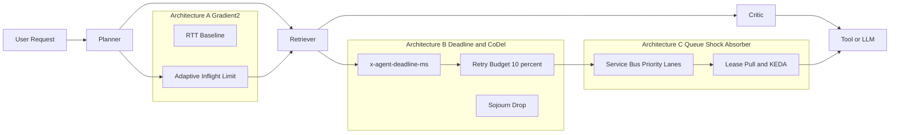
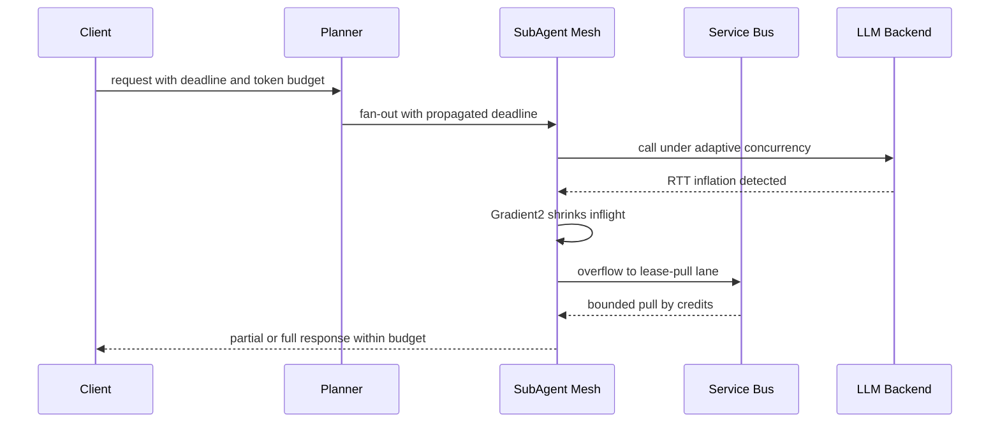
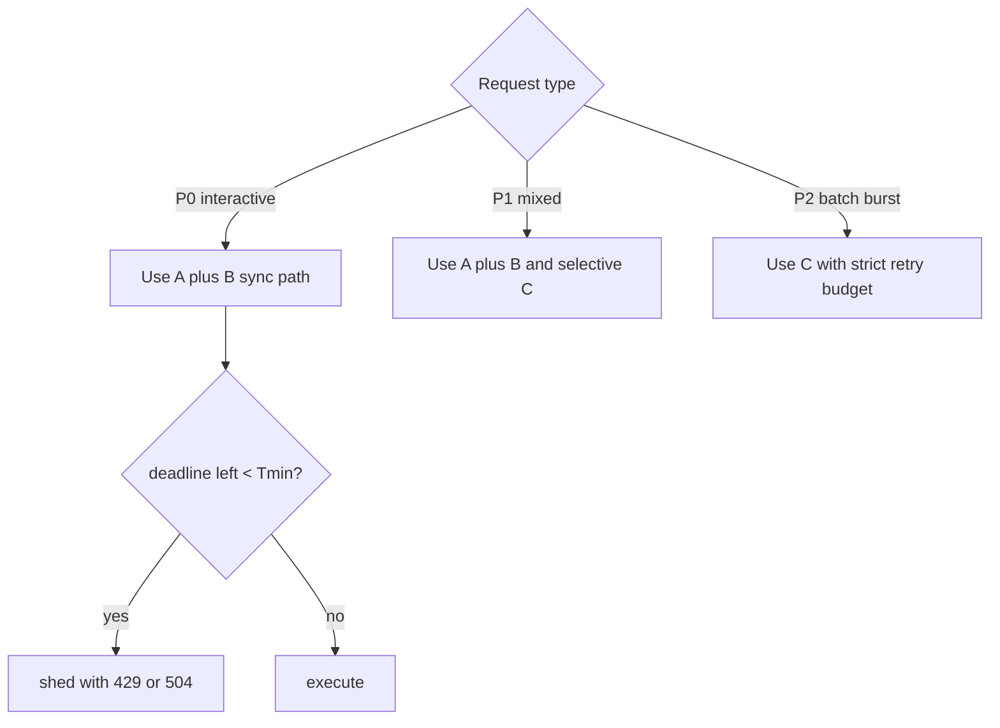

# 企业多跳智能体背压与重试风暴防御选型 FAQ：Gradient2 Concurrency vs Deadline+CoDel vs ServiceBus Pull vs Unbounded Fan-Out
> **适用场景**：多跳企业 Agent 网格（Planner -> Retriever -> Critic -> Tool）在高并发与突发流量下的稳定性治理。
> **决策压力**：在不牺牲关键交互体验的前提下抑制重试放大、队列雪崩与 Token 空烧。
> **核心目标**：构建可观测、可节流、可回退、可审计的多跳背压控制参考架构。

## 1. 执行摘要
多跳智能体系统的首要风险并不是“单个模型慢”，而是“系统进入亚稳态失败后无法自恢复”。
当每一跳都盲目指数重试时，负载会按照 `R^k` 级数膨胀。
父请求超时后，子请求继续消耗 PTU/GPU 会形成典型零 goodput 高利用率陷阱。
架构 A 在链路早期通过 RTT 梯度收敛并发，重点抑制进入拥塞区。
架构 B 在请求上下文传播截止时间和重试预算，重点抑制无效工作。
架构 C 通过异步租约拉取将峰值突发变成可控吞吐，重点抑制冲击波。
架构 D 为反模式，常见于无边界 `asyncio.gather` 与每跳盲目重试组合。
推荐路径是 A+B 作为同步主路径，C 作为异步吸震层，显式禁用 D。
治理上应以 goodput、队列停留时长、重试预算命中率作为核心 SLO 指标。
设计上应让任何重试都遵循“可计量、可限制、可归责”的统一规则。
运行上应把交互类与批处理类请求分层，避免 P0 被 P2 挤压。
审计上应保留请求链路预算、丢弃原因、回退动作与人工接管证据。

## 2. 失效机理与亚稳态特征
亚稳态失败指系统进入高负载坏平衡后，即使外部流量回落也无法立即恢复。
其根因通常是排队延迟放大导致更多超时，更多超时诱发更多重试。
当重试链跨越多个 hop，放大量远大于单点限流能力。
典型症状包括 TTFT 激增、队列停留飙升、429/503 交替、GPU 利用率满载但业务成功率接近零。
在智能体网格中，工具层和检索层往往比模型层先进入拥塞。
若缺乏统一截止时间，过期请求会继续占用资源并阻塞新请求。
若缺乏优先级隔离，批处理冲击可在秒级拖垮交互路径。
因此背压必须同时覆盖并发、时间、重试、队列和优先级五条控制面。

## 3. 四类候选架构
架构 A：Little's Law `Gradient2` / Vegas RTT 感知自适应并发控制。
架构 B：端到端截止时间传播 + CoDel 负载削峰 + 重试预算治理。
架构 C：Service Bus 租约拉取异步吸震与优先级车道。
架构 D：无边界并发扇出 + 每跳盲重试反模式。
A 的目标是“拥塞前收缩”，B 的目标是“过期即止损”。
C 的目标是“突发变平滑”，D 的结果是“放大并锁死”。

## 4. 架构 A 机制：RTT 梯度并发控制
核心思想是以无负载 RTT 与当前 RTT 比值驱动 in-flight 并发上限。
当队列延迟开始膨胀时，并发上限自动收缩，避免打穿下游。
示意更新公式：
`L_{n+1} = L_n * clamp(RTT_noLoad / RTT_measured, 0.5, 1.0) + beta`
该机制优点是响应快、控制连续、可在 429 之前行动。
缺点是需要稳定的延迟基线，否则会出现过度收敛。
在 LLM 场景下建议分离 TTFT 与 TPOT 监控，分别驱动并发调节。
实践中应配合 per-route 限制，避免单一热点路由挤占全局额度。
对于长上下文请求，建议引入 token-aware 权重，防止大请求淹没小请求。

## 5. 架构 B 机制：截止时间传播与 CoDel 削峰
每一跳接收并更新剩余墙钟预算与 token 预算。
若剩余预算低于最小可执行窗口，直接拒绝继续扇出。
这样可避免“父请求已超时，子请求还在烧 GPU”现象。
CoDel 用于按队列停留时长判断何时主动丢弃，避免长队列锁死。
重试预算以滑动窗口计算，建议上限不超过 10%。
预算耗尽时返回明确拒绝码，并记录拒绝原因供审计复盘。
该机制优点是可解释、可量化、可跨语言实现。
缺点是对链路契约一致性要求高，改造成本高于单点限流。

## 6. 架构 C 机制：租约拉取异步吸震
将上游突发请求写入 Service Bus Premium，并按优先级分车道。
消费者按租约和 Prefetch 限制拉取，吞吐随可用容量渐进扩展。
KEDA 根据队列滞后和处理速率扩缩容，控制扩缩容振荡。
失败消息进入 DLQ，避免毒消息反复占用主通道。
该机制适合事件波峰大、处理时长分布长尾的业务域。
优点是峰值削平明显，平台弹性空间更大。
缺点是交互链路不宜完全异步化，需要与同步主路径协同。

## 7. 架构 D 反模式：无边界 gather + 每跳盲重试
在该模式下，每个 hop 都可能创建新一轮并发扇出。
若每跳重试次数为 3，4 跳链路最坏放大量可达 `3^4 = 81`。
当系统达到临界点，重试流量会主导总体流量结构。
此时新增容量也可能被无效重试吞噬，恢复速度异常缓慢。
结果是业务成功率接近零而资源使用率接近满载。
该模式应作为明确禁用条款写入工程规范。

## 8. 多跳重试放大与 goodput 模型
重试放大可表示为：
`A_retry = Π_{i=1..k}(1 + p_fail_i * r_i)`
其中 `k` 为 hop 数，`p_fail_i` 为第 i 跳失败概率，`r_i` 为重试次数。
系统 goodput 可近似为：
`Goodput = Success_RPS / Total_RPS`
当 `A_retry` 上升时，Total_RPS 的增长通常快于 Success_RPS。
治理目标应是降低 `A_retry` 的同时稳定 Success_RPS。

## 9. 三档业务规模与控制目标
场景一：`50 RPS` 交互 Copilot，目标是低尾延迟与高响应一致性。
场景二：`500 RPS` 混合网格，目标是交互优先级保护与成本稳定。
场景三：`5,000 RPS` 事件突发，目标是吸震、隔离与可恢复性。
在三档场景中，A/B/C 的组合策略应不同。
小规模优先 A+B；中规模引入 A+B+C；大规模必须强制 A+B+C 并禁用 D。

## 10. 十二维横向对比矩阵
| 维度 | 架构 A | 架构 B | 架构 C | 架构 D |
|---|---|---|---|---|
| 拥塞前抑制能力 | 高 | 中 | 中 | 低 |
| 过期请求止损能力 | 中 | 最高 | 高 | 低 |
| 峰值突发吸震能力 | 中 | 中 | 最高 | 低 |
| 交互延迟稳定性 | 高 | 高 | 中 | 低 |
| 实施复杂度 | 中 | 中高 | 中高 | 低 |
| 可审计性 | 高 | 高 | 高 | 低 |
| 重试放大抑制 | 高 | 最高 | 高 | 极低 |
| 扩展弹性 | 中高 | 中 | 高 | 表面高 |
| 失败隔离 | 中 | 高 | 最高 | 低 |
| 单位请求成本稳定性 | 高 | 高 | 中高 | 低 |
| 对组织能力要求 | 中 | 中高 | 中高 | 低 |
| 总体推荐 | 必选 | 必选 | 场景选 | 禁用 |

## 11. 四架构控制拓扑


## 12. 亚稳态崩溃与恢复时序


## 13. 同步与异步路径选择树


### Q1. 为什么多跳智能体容易进入亚稳态失败
多跳链路把局部失败概率叠加为系统失败概率。
每一跳的排队延迟都会消耗父请求预算。
预算耗尽后继续执行会制造无效负载。
无效负载又会抬高排队延迟，形成正反馈。
当重试策略分散在各 hop，系统缺少统一刹车点。
延迟指标若只看均值，会掩盖尾部崩溃早期信号。
亚稳态失败的危险在于其“流量回落后仍持续”。
因此必须在拥塞前干预，而非在错误码爆发后补救。
系统设计应把“失败可控”优先于“理论峰值吞吐”。

### Q2. Gradient2 并发控制在 LLM 链路中的价值是什么
Gradient2 的核心价值是把延迟膨胀转化为并发收缩信号。
与固定并发相比，它能在负载变化时快速自适应。
与纯错误码限流相比，它能提前在 429 前行动。
在多模型路由场景中，可按路由分桶独立调节。
在长上下文场景中，可按 token 成本加权调节。
在双活区域场景中，可结合区域 RTT 进行局部收敛。
其前提是稳定的基线测量和准确的观测口径。
若观测噪声大，应加最小变化门限避免抖动。
实践上建议与 deadline 机制联动，而非单独部署。

### Q3. 截止时间传播与 CoDel 为什么必须同时存在
仅有截止时间传播可止损，但不能控制队列驻留恶化。
仅有 CoDel 可削峰，但无法识别业务级预算语义。
二者结合才能同时解决“排队过久”和“预算过期”。
截止时间提供业务语义，CoDel 提供队列语义。
重试预算提供流量语义，三者构成完整控制闭环。
这样可避免出现“技术上成功，业务上超时”的伪成功。
治理上应统一请求头与返回码语义，保证跨 hop 一致。
审计上应保留每次丢弃和拒绝的可解释原因。
这也是跨团队协作可持续的前提。

### Q4. 为什么 Service Bus 租约拉取适合突发场景
突发负载的本质是到达速率短时远超服务速率。
同步链路难以在毫秒级完成容量扩展。
租约拉取把瞬时压力转为可排队、可分层、可重放任务。
优先级车道让交互与批处理互不抢占。
DLQ 让毒消息隔离，避免主队列污染。
KEDA 让扩缩容基于积压事实而非猜测。
这套机制特别适合理赔批处理、安全告警风暴等场景。
缺点是端到端时延上限提高，需要业务接受异步语义。
因此它应与同步主路径协同，而非替代全部链路。

### Q5. 如何量化重试放大、goodput 与三档 TCO
核心先看 `A_retry`，再看 `Goodput`，最后看单位成功成本。
当 `A_retry` 上升而 `Goodput` 下滑，说明系统正在失控。
治理目标不是零重试，而是可预算内重试。
下表给出示例三档量化：
| 场景 | 基线请求 | 目标 goodput | 允许重试预算 | 推荐架构 |
|---|---:|---:|---:|---|
| 50 RPS 交互 | 50 | >= 98% | <= 6% | A+B |
| 500 RPS 混合 | 500 | >= 95% | <= 8% | A+B+C |
| 5,000 RPS 突发 | 5,000 | >= 90% | <= 10% | A+B+C 严格门禁 |
三档 TCO 应包含模型成本、队列成本、运维成本、故障损失成本。
当引入 A/B/C 后，故障损失成本通常是最大下降项。
若继续使用 D，故障损失与声誉损失会吞噬表面节省。

### Q6. 落地清单、反模式与五步实施指南
反模式一：在每一跳都默认指数重试且无全局预算。
反模式二：缺少截止时间传播，子请求脱离父上下文。
反模式三：交互与批处理共用同一无优先级队列。
反模式四：只看 CPU/GPU 利用率，不看 goodput。
反模式五：故障后仅扩容，不修正控制策略。
五步实施指南如下。
第一步：统一请求契约，定义 deadline、budget、priority 字段。
第二步：上线 A 的自适应并发，先在影子流量验证参数。
第三步：上线 B 的截止时间传播、CoDel 与重试预算。
第四步：对批处理与突发业务引入 C 的租约拉取吸震层。
第五步：建立治理看板与演练机制，持续校准阈值。
Good fit：高并发多跳智能体、强 SLA 交互、突发混合流量组织。
Not for：单跳低并发且无严格 SLA 的轻量系统。

### 运行态 SLO 与值班手册补充
为了让 A+B+C 真正落地，平台团队需要把“请求语义健康”与“基础设施健康”并列监控，而不是只看 CPU、GPU 与节点数。
最小可执行看板建议至少包含九类时间序列：端到端成功率、交互 goodput、分层重试预算占用、各跳 sojourn 分位、P0/P1/P2 队列滞后、deadline_exhausted 比例、CoDel 主动丢弃率、DLQ 增长率、降级命中率。
每个指标都必须与可操作阈值绑定，例如“连续 5 分钟 goodput 低于 92% 且 retry_budget_ratio 超过 0.1”直接触发架构 D 反模式排查流程，而不是等待人工经验判断。
值班 Runbook 也应显式区分“容量问题”与“控制面参数漂移问题”，避免在控制策略失效时盲目扩容，把故障成本从分钟级扩大到小时级。
在组织治理层面，建议建立季度级“多跳压测+演练”制度：同一业务流在 A-only、A+B、A+B+C 三种策略下复现实测曲线，并将差异写入架构审计记录。
对于合规敏感行业，还应将 shed_reason、retry_denied_reason、deadline_remaining_ms 作为审计字段保留，确保事后可以逐单追溯“为何拒绝、何时拒绝、拒绝后是否触发替代路径”。
另一个容易被忽略的关键点是“预算对齐”：工程侧通常只讨论 token 预算，但业务侧更关心单成功请求成本与单位分钟成功处理量，二者必须在同一仪表盘同屏呈现。
当系统进入高压窗口时，平台应优先保护“可恢复性”而非“瞬时吞吐峰值”；如果仍能在 15 分钟内把 retry_ratio 拉回阈值以内，说明治理设计有效。
如果不能，则应立即执行受控 Brownout：先收缩多智能体反思环，再切换确定性工具路径，最后才考虑跨区域扩容，保持每一步都有可验证收益。
通过这组操作规程，团队可以把“背压是经验活”转变为“背压是可验证工程系统”，从而降低对少数专家个人经验的依赖。
在财务治理方面，建议把每次故障窗口拆解为三段成本：无效 token 成本、恢复期间补偿成本、业务延迟导致的机会损失，并与控制策略版本关联。
例如同一批理赔高峰，若 D 反模式下平均恢复时间是 48 分钟，而 A+B+C 仅需 11 分钟，则不仅模型费用下降，更关键是人工介入与客户流失成本显著降低。
平台产品经理可将“恢复时间斜率”纳入季度 OKR：不是只看全年平均可用性，而是要求每次异常在固定时间窗内可预测收敛。
从组织协作看，应用团队、平台团队与 SRE 团队应共享一套语义：什么叫“可接受降级”、什么叫“必须拒绝”，避免跨团队口径不一致导致执行迟滞。
对于跨区域容灾体系，还要预先定义“何时跨区、跨区后回切条件、回切期间是否保留 C 的缓冲队列”，并在演练中验证不会引入二次放大。
若企业采用多云补位策略，应把 deadline 与 retry-budget 契约做成跨云一致标准，确保切换路径不会因为头字段缺失而失控。
最终目标不是让所有请求都成功，而是在受限资源下让“最有业务价值的请求优先成功”，并且让失败具备可解释、可审计、可复盘属性。
因此在验收阶段，建议明确四个硬门槛：高压 30 分钟内 goodput 不低于目标线、retry_ratio 不超过预算上限、deadline_exhausted 占比可控且可解释、Brownout 触发后能在约定窗口内自动回稳。
当这四个门槛都通过时，架构评审才能认定系统具备“生产可运行”而不是“实验室可运行”，并进入后续规模化发布。
这也是把平台风险前移到设计期的核心价值。
并为后续规模化扩展奠定可验证基础。

## 14. 示例实现片段
```yaml
static_resources:
  clusters:
    - name: llm_backend
      connect_timeout: 0.5s
      lb_policy: ROUND_ROBIN
  listeners:
    - name: ingress_listener
      filter_chains:
        - filters:
            - name: envoy.filters.network.http_connection_manager
              typed_config:
                "@type": type.googleapis.com/envoy.extensions.filters.network.http_connection_manager.v3.HttpConnectionManager
                http_filters:
                  - name: envoy.filters.http.adaptive_concurrency
                    typed_config:
                      "@type": type.googleapis.com/envoy.extensions.filters.http.adaptive_concurrency.v3.AdaptiveConcurrency
                      gradient_controller_config:
                        sample_aggregate_percentile:
                          value: 50
                        concurrency_limit_params:
                          max_concurrency_limit: 512
                          min_concurrency_limit: 16
                        min_rtt_calc_params:
                          interval: 10s
                          request_count: 32
```

```xml
<policies>
  <inbound>
    <base />
    <set-header name="x-agent-deadline-ms" exists-action="override">
      <value>@(context.Request.Headers.GetValueOrDefault("x-agent-deadline-ms","0"))</value>
    </set-header>
    <set-header name="x-retry-budget-ratio" exists-action="override">
      <value>0.10</value>
    </set-header>
    <choose>
      <when condition="@(long.Parse(context.Request.Headers.GetValueOrDefault(\"x-agent-deadline-ms\",\"0\")) &lt; 150)">
        <return-response>
          <set-status code="504" reason="deadline_exhausted" />
        </return-response>
      </when>
    </choose>
  </inbound>
  <backend><base /></backend>
  <outbound><base /></outbound>
  <on-error><base /></on-error>
</policies>
```

```python
from dataclasses import dataclass
from functools import reduce
from operator import mul

@dataclass
class Hop:
    p_fail: float
    retries: int

def retry_amplification(hops):
    factors = [(1 + h.p_fail * h.retries) for h in hops]
    return reduce(mul, factors, 1.0)

def goodput(success_rps, total_rps):
    if total_rps <= 0:
        return 0.0
    return success_rps / total_rps

if __name__ == "__main__":
    hops = [Hop(0.2, 2), Hop(0.25, 2), Hop(0.3, 2), Hop(0.15, 2)]
    amp = retry_amplification(hops)
    print("retry_amp", round(amp, 3))
    print("goodput", round(goodput(420, 700), 3))
```

## 15. 结论
多跳智能体系统必须把背压控制视作核心架构能力而非优化项。
A 负责提前收敛，B 负责语义止损，C 负责突发吸震。
D 反模式必须通过工程规范与评审流程明确禁用。
当三层控制协同时，系统可在高压场景下保持可恢复与可解释。
这也是企业级智能体从“能跑”迈向“可持续运行”的关键分界线。
