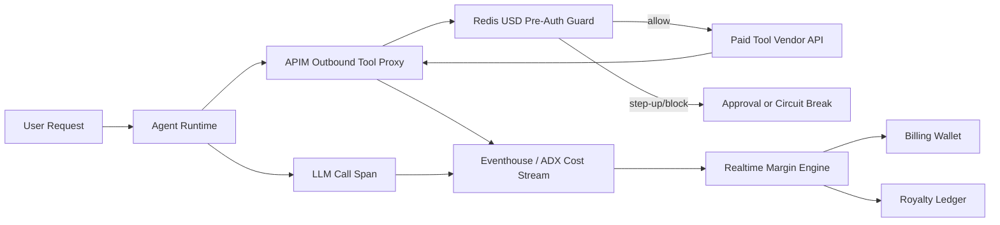
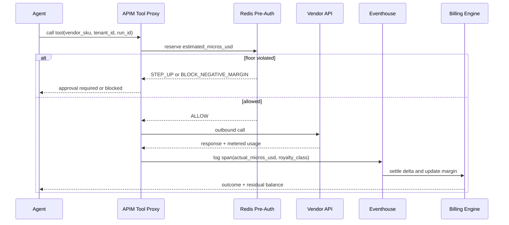

# Enterprise agent composite COGS and paid-tool royalty FinOps selection FAQ
> Topic ID: #480  
> Section: 3.7 LLMOps evaluation, release engineering, FinOps, and SaaS monetization  
> Audience: enterprise AI platform architects, FinOps leads, billing and commercialization teams  
> Goal: upgrade task economics from token-only accounting to real-time composite COGS control with negative-margin prevention

## 1 Production problem: token-only FinOps creates a gross-margin blindspot
Many teams still model agent cost as LLM token spend only.
That approximation survives in PoC but collapses in production.
Real workloads invoke paid external tools per turn.
Common paid categories include market data, credit APIs, legal/KYB APIs, OCR, SERP, PSTN, and ephemeral sandbox runtime seconds.
Per-call pricing can range from `$0.005` to `$2.50`.
Multi-hop tool chains magnify this quickly.
A run can show `$0.03` LLM spend while hiding `$1.45` in external tool and royalty COGS.
For seat-based SaaS plans (`$49-$99/month`), heavy users can drive negative gross margin.
When left ungoverned, this pattern scales with success.
Token-only FinOps is therefore an anti-pattern for enterprise agent monetization.

## 2 Failure mechanics: lagged settlement plus fragmented observability
The first failure mode is fragmented metering.
LLM, gateway, vendor invoices, sandbox runtime, and royalty systems often live in separate ledgers.
The second failure mode is settlement latency.
Vendors may settle on `T+1` to `T+3`.
Without pre-execution reservation, runaway spend cannot be blocked intraday.
The third failure mode is unit mismatch.
Some systems meter token, some call, some second, and some contractual tier.
The fourth failure mode is missing identity join keys.
If spans do not carry `tenant/run/plan/vendor_sku`, cost attribution becomes ambiguous.
Production FinOps requires a unified runtime economics plane, not post-hoc spreadsheets.

## 3 Four architecture patterns
Pattern A provides real-time span-level composite COGS and royalty governance.
It combines `OpenTelemetry`, APIM metered tool proxying, Redis pre-authorization, and Eventhouse margin computation.
Pattern B provides `T+1` vendor invoice and FOCUS lakehouse reconciliation.
Pattern C adds product packaging controls with seat plus included wallet and high-royalty step-up confirmation.
Pattern D is the prohibited anti-pattern: token-only accounting with uncapped flat-seat access to paid external tools.

## 4 Twelve-dimension quantified comparison matrix
| Dimension | Pattern A realtime composite ledger | Pattern B T+1 reconciliation | Pattern C packaging layer | Pattern D anti-pattern |
|---|---|---|---|---|
| Real-time negative-margin blocking | high | low | medium-high | low |
| Cost granularity | span-level | daily batch | order/wallet | token-only |
| Royalty auditability | high | high | medium | low |
| Settlement lag tolerance | high | medium | high | low |
| Pre-call risk control | high | none | medium | none |
| Implementation complexity | medium-high | medium | medium | low |
| Financial close fitness | high | very high | medium | low |
| Commercial flexibility | medium | low | very high | low |
| Margin inversion exposure | low | medium-high | medium | very high |
| Explainability | high | medium | medium | low |
| Three-year TCO | best-balanced | medium | medium-high | incident-heavy |
| Recommendation | production default | accounting companion | product enhancement | prohibit |

## 5 Pattern A primary path: realtime composite COGS control plane
Pattern A requires deterministic span tagging on every paid call.
Required fields include `tenant_id`, `run_id`, `vendor_sku`, `rate_card_version`, and `royalty_pass_through_class`.
Before outbound execution, the system computes estimated spend in micros USD.
A pre-auth guard checks wallet and margin floor.
If policy fails, the request returns `STEP_UP_APPROVAL` or `BLOCK_NEGATIVE_MARGIN`.
If policy passes, the call proceeds and emits actual metered usage.
Post-call settlement computes delta between reserved and actual cost.
Idempotency keys are mandatory for retry-safe reconciliation.
Royalty class must be immutable in the audit stream.
That allows finance to separate pass-through cost from platform-borne cost.
For multi-tenant SaaS, task-level pre-auth is usually the default.
For high-risk tenants, tool-call-level pre-auth can be enabled.
This layered policy keeps risk bounded while preserving throughput.

## 6 Pattern B: T+1 invoice and FOCUS reconciliation companion
Pattern B is essential for accounting truth and contractual reporting.
It joins vendor invoices, gateway telemetry, recognized revenue, and royalty contracts.
Fabric Lakehouse plus Eventhouse is a common implementation path.
Batch reconciliation identifies reserve-versus-settle drift.
It also supports GAAP close packages and audit evidence.
However, B alone cannot stop intraday runaway tool loops.
Pattern B should complement Pattern A, not replace it.

## 7 Pattern C: seat plus composite-credit wallet with step-up for expensive tools
Pattern C translates economics policy into product behavior.
Each seat includes a wallet of composite credits.
High-cost calls, for example `>= $0.25/call`, require explicit confirmation or wallet availability.
This reduces accidental expensive fan-out.
Customers gain immediate cost visibility at decision time.
Enterprise buyers can also apply departmental budget envelopes.
Pattern C should be treated as a policy UX layer over Pattern A controls.

## 8 Pattern D anti-pattern: token-only accounting with flat unlimited external tools
Pattern D appears simple and growth-friendly.
In reality it converts paid external APIs into hidden subsidy.
As power users scale, margin inversion deepens.
Operators see high success rates but worsening economics.
Backfilling monetization rules later usually triggers contract friction.
Architecture review should reject this pattern upfront.

## 9 Mermaid: end-to-end composite COGS plane


## 10 Mermaid: pre-call reservation and negative-margin interception


## 11 Quantitative Q1-Q6 worked formulas
Q1 composite task COGS formula.  
`COGS_task = C_llm + ΣC_paid_api + C_royalty + C_sandbox + C_docintel + C_rerank`.  
Example: `0.03 + 0.92 + 0.21 + 0.14 + 0.09 + 0.06 = 1.45 USD`.  
Q2 gross margin.  
`GM = (R - COGS) / R`.  
If per-task recognized revenue is `R=0.85`, then `GM=(0.85-1.45)/0.85=-70.6%`.  
Q3 heavy-seat inversion breakpoint.  
Inversion occurs when `P95(C_paid_api_calls * avg_call_cost)` exceeds per-task net revenue.  
Q4 reservation-versus-settlement drift.  
`Drift = |reserved - settled| / settled`.  
A common production target is `Drift < 0.5%`.  
Q5 pass-through royalty audit math.  
`PassThrough = Σ(class in contractual_pass)` while non-pass classes remain platform COGS.  
Q6 three-year margin recovery.  
`Recovery = Loss_token_only - Loss_composite_guard`, evaluated across plan mix and tool traffic growth.

## 12 Code block one: Python CompositeCogsGuard
```python
from __future__ import annotations
from dataclasses import dataclass
from decimal import Decimal, ROUND_HALF_UP

Decision = str  # ALLOW | STEP_UP_APPROVAL | BLOCK_NEGATIVE_MARGIN

@dataclass(frozen=True)
class ToolRate:
    vendor_sku: str
    rate_card_version: str
    unit_cost_micros_usd: int
    royalty_pass_through_class: str

class CompositeCogsGuard:
    def __init__(self, margin_floor: Decimal, min_wallet_usd: Decimal = Decimal("0.00")):
        self.margin_floor = margin_floor
        self.min_wallet_usd = min_wallet_usd
        self.rate_cards: dict[str, ToolRate] = {}
        self.reserved: dict[str, Decimal] = {}

    def register_rate(self, rate: ToolRate) -> None:
        self.rate_cards[rate.vendor_sku] = rate

    def reserve(self, run_id: str, vendor_sku: str, expected_units: int, revenue_usd: Decimal, llm_cost_usd: Decimal, wallet_usd: Decimal) -> Decision:
        rate = self.rate_cards[vendor_sku]
        est_tool = (Decimal(rate.unit_cost_micros_usd) * Decimal(expected_units)) / Decimal(1_000_000)
        cogs_est = llm_cost_usd + est_tool
        gm = (revenue_usd - cogs_est) / revenue_usd if revenue_usd > 0 else Decimal("-1")
        if wallet_usd < self.min_wallet_usd:
            return "STEP_UP_APPROVAL"
        if gm < self.margin_floor:
            return "BLOCK_NEGATIVE_MARGIN"
        self.reserved[run_id] = est_tool.quantize(Decimal("0.000001"), rounding=ROUND_HALF_UP)
        return "ALLOW"

    def settle(self, run_id: str, actual_units: int, vendor_sku: str) -> Decimal:
        rate = self.rate_cards[vendor_sku]
        actual = (Decimal(rate.unit_cost_micros_usd) * Decimal(actual_units)) / Decimal(1_000_000)
        reserved = self.reserved.pop(run_id, Decimal("0"))
        return (actual - reserved).quantize(Decimal("0.000001"), rounding=ROUND_HALF_UP)
```

## 13 Code block two: APIM outbound metering policy XML
```xml
<policies>
  <inbound>
    <base />
    <set-variable name="tenantId" value="@(context.Request.Headers.GetValueOrDefault("x-tenant-id","unknown"))" />
    <set-variable name="runId" value="@(context.Request.Headers.GetValueOrDefault("x-run-id", Guid.NewGuid().ToString()))" />
    <set-variable name="vendorSku" value="@(context.Request.Headers.GetValueOrDefault("x-vendor-sku","unknown"))" />
    <set-variable name="unitCostMicrosUsd" value="@(int.Parse(context.Request.Headers.GetValueOrDefault("x-unit-cost-micros-usd","0")))" />
    <set-variable name="expectedUnits" value="@(int.Parse(context.Request.Headers.GetValueOrDefault("x-expected-units","1")))" />
  </inbound>
  <backend>
    <base />
  </backend>
  <outbound>
    <base />
    <set-variable name="costMicrosUsd" value="@(((int)context.Variables["unitCostMicrosUsd"]) * ((int)context.Variables["expectedUnits"]))" />
    <set-header name="x-cost-micros-usd" exists-action="override">
      <value>@(context.Variables["costMicrosUsd"].ToString())</value>
    </set-header>
    <emit-metric name="paid_tool_cost_micros_usd" value="@((double)(int)context.Variables["costMicrosUsd"])" />
    <log-to-eventhub logger-id="finops-eventhub-logger">
      @{
        return "{"
          + "\"tenant_id\":\"" + context.Variables["tenantId"] + "\","
          + "\"run_id\":\"" + context.Variables["runId"] + "\","
          + "\"vendor_sku\":\"" + context.Variables["vendorSku"] + "\","
          + "\"cost_micros_usd\":" + context.Variables["costMicrosUsd"]
          + "}";
      }
    </log-to-eventhub>
  </outbound>
  <on-error>
    <base />
  </on-error>
</policies>
```

## 14 Code block three: KQL realtime gross-margin monitor
```kql
let Llm = AgentLlmSpans
| summarize llm_cost_usd = sum(todouble(cost_usd)) by tenant_id, run_id, bin(timestamp, 5m);
let Paid = AgentPaidToolSpans
| summarize paid_tool_cost_usd = sum(todouble(cost_usd)), royalty_cost_usd = sum(todouble(royalty_usd))
  by tenant_id, run_id, bin(timestamp, 5m);
let Revenue = TenantPlanRevenue
| summarize revenue_usd = sum(todouble(recognized_revenue_usd))
  by tenant_id, run_id, bin(timestamp, 5m);
Llm
| join kind=fullouter Paid on tenant_id, run_id, timestamp
| join kind=leftouter Revenue on tenant_id, run_id, timestamp
| extend llm_cost_usd = coalesce(llm_cost_usd, 0.0),
         paid_tool_cost_usd = coalesce(paid_tool_cost_usd, 0.0),
         royalty_cost_usd = coalesce(royalty_cost_usd, 0.0),
         revenue_usd = coalesce(revenue_usd, 0.0)
| extend cogs_usd = llm_cost_usd + paid_tool_cost_usd + royalty_cost_usd
| extend gross_margin_pct = iff(revenue_usd > 0, (revenue_usd - cogs_usd) / revenue_usd * 100.0, real(-100))
| where gross_margin_pct < 0
| project timestamp, tenant_id, run_id, revenue_usd, cogs_usd, gross_margin_pct
| order by gross_margin_pct asc
```

## 15 Enterprise scenarios, 3-year TCO, and D0/D1/D2 runbook
### 15.1 Scenario A: institutional research and credit SaaS (`4,200` seats)
This workload executes licensed market and bureau APIs at high frequency.
Before composite controls, telemetry showed healthy token spend but unstable margin.
After Pattern A, negative-margin runs were intercepted before expensive fan-out.
High-royalty tools moved behind step-up approval and wallet checks.
Cost attribution became deterministic at `vendor_sku` and `run_id` levels.
Product and finance teams redesigned plan tiers with evidence instead of estimates.
Gross-margin volatility narrowed in the power-user segment.

### 15.2 Scenario B: KYB and commercial underwriting agent (`600K` cases/month)
This workflow chains registry, sanctions, KYC, and OCR providers per case.
Without pre-auth, multi-hop retries created invisible intraday exposure.
Pattern A introduced pre-call budget enforcement and real-time margin guards.
Pattern B delivered month-end truth with invoice reconciliation.
Pattern C reduced accidental expensive calls through wallet and confirmation UX.
Operations teams could pinpoint outlier tenants and runaway runs quickly.
Platform SLOs evolved from success-only to success-plus-margin health.

### 15.3 Three-tier 3-year TCO and margin recovery guidance
Base tier: Pattern A realtime composite ledger for immediate margin protection.
Enhanced tier: A+B combination for finance close and contractual audit traceability.
Premium tier: A+B+C integrated for dynamic packaging and controlled premium-tool usage.
Business case must include engineering cost, runtime overhead, churn risk, and recovered margin.
Engineering spend alone understates total return.
In high-call industries, recovered margin often outweighs control-plane cost.
Quarterly governance should recalibrate thresholds and contract mappings.

### 15.4 D0 D1 D2 eighteen-step runbook
- **D0-1** Inventory all paid tools and royalty clauses.
- **D0-2** Build versioned `vendor_sku` rate-card catalog.
- **D0-3** Standardize `tenant/run/plan` identity keys.
- **D0-4** Define margin floor and expensive-call thresholds.
- **D0-5** Define step-up flows for pre-auth failures.
- **D0-6** Define RACI across finance, legal, and platform.
- **D1-1** Add APIM outbound metering tags.
- **D1-2** Add Redis reservation and idempotent debit keys.
- **D1-3** Stand up Eventhouse realtime cost stream.
- **D1-4** Publish negative-margin alerts and tenant dashboard.
- **D1-5** Build T+1 invoice reconciliation pipeline.
- **D1-6** Implement pass-through versus platform-borne royalty splits.
- **D2-1** Review weekly negative-margin interception precision.
- **D2-2** Review weekly reservation-versus-settlement drift.
- **D2-3** Review monthly expensive-call threshold effectiveness.
- **D2-4** Review monthly contract-version mapping integrity.
- **D2-5** Review quarterly pricing tiers and wallet quotas.
- **D2-6** Review quarterly margin recovery versus UX impact.

Sources retrieved on 2026-11-27  
OpenTelemetry specification  
https://opentelemetry.io/docs/specs/  
Azure API Management policy reference  
https://learn.microsoft.com/azure/api-management/api-management-policies  
Azure API Management log-to-eventhub policy  
https://learn.microsoft.com/azure/api-management/log-to-eventhub-policy  
Azure Data Explorer query language overview  
https://learn.microsoft.com/azure/data-explorer/kusto/query/  
Microsoft Fabric Eventhouse overview  
https://learn.microsoft.com/fabric/real-time-intelligence/eventhouse-overview  
FinOps FOCUS specification overview  
https://focus.finops.org/  
