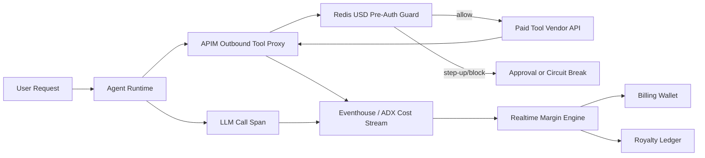
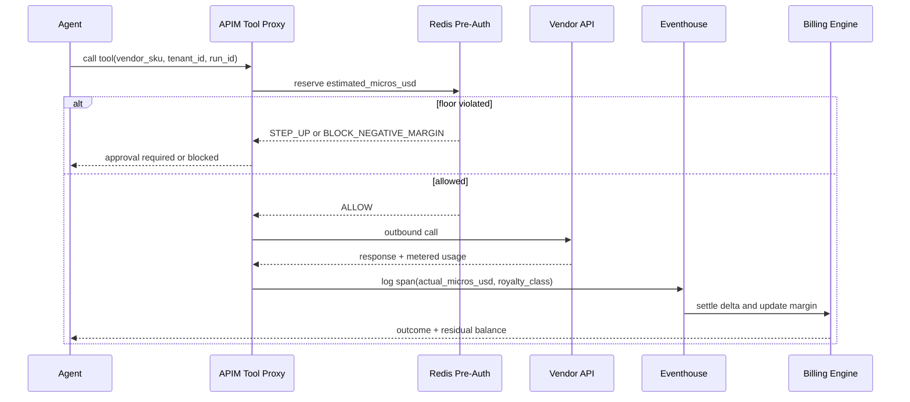

# 企业智能体复合 COGS 与付费工具版税 FinOps 选型 FAQ
> Topic ID: #480  
> Section: 3.7 LLMOps 评测、发布工程、FinOps 降本与 SaaS 商业化  
> Audience: 企业 AI 平台架构师、FinOps 负责人、商业化与计费平台团队  
> Goal: 将智能体任务级成本从“只看 token”升级为“可阻断负毛利的复合成本平面”

## 1 生产问题：只看 LLM token 为什么会导致毛利黑洞
很多团队把智能体成本近似为模型 token 费用。
这个模型在 PoC 阶段看似可用。
进入生产后，外部付费工具调用会快速成为主成本项。
常见费用来自市场数据、征信、法务、KYB、搜索、OCR、PSTN、沙箱秒级计费。
这些费用往往按调用计费且单次价格跨度大。
例如单次工具调用可能从 `$0.005` 到 `$2.50` 不等。
当一个任务触发多次链式调用时，真实 COGS 会远高于 token。
表面上任务显示 `$0.03` token 成本。
账面上却可能出现 `$1.45` 外部工具与版税成本。
对于 `49-99` 美元月费席位，这会直接冲击毛利。
在重度用户群体中，负毛利会被迅速放大。
因此“token-only FinOps”在企业智能体商业化中是高风险反模式。

## 2 盲区机理：复合成本滞后结算与运行时失控
盲区一是成本来源分散。
LLM、工具网关、第三方发票、沙箱计费、版税台账通常分属不同系统。
盲区二是结算时延。
很多厂商账单是 `T+1` 或 `T+3` 到账。
如果没有实时预授权，系统无法在调用前阻断负毛利任务。
盲区三是口径不一致。
有的系统按 token 记账，有的按 call，有的按秒，有的按合同阶梯。
盲区四是业务映射缺失。
若 span 没有绑定 `tenant/run/plan/vendor_sku`，就无法完成责任归因。
因此必须把复合成本能力下沉到执行链路。

## 3 四种架构路径总览
Pattern A：实时 span 级复合 COGS 与版税账本。
它以 `OpenTelemetry + APIM Tool Proxy + Redis 预授权 + Eventhouse` 为核心。
Pattern B：`T+1` 发票与 FOCUS 湖仓对账伴随层。
它适合财务结账与审计，不适合实时阻断。
Pattern C：商业包装层。
它提供席位费 + 复合积分钱包 + 高版税工具二次确认。
Pattern D：反模式。
只做 token 计费，且对外部付费 API 提供无限平价席位。

## 4 十二维量化对比矩阵
| 维度 | Pattern A 实时复合账本 | Pattern B T+1 对账 | Pattern C 商业包装层 | Pattern D 反模式 |
|---|---|---|---|---|
| 实时负毛利阻断能力 | 高 | 低 | 中高 | 低 |
| 成本颗粒度 | span 级 | 日批级 | 订单/钱包级 | token 级 |
| 版税追踪可审计性 | 高 | 高 | 中 | 低 |
| 计费延迟容忍 | 高 | 中 | 高 | 低 |
| 调用前风控能力 | 高 | 无 | 中 | 无 |
| 实施复杂度 | 中高 | 中 | 中 | 低 |
| 财务结账友好度 | 高 | 很高 | 中 | 低 |
| 商业策略弹性 | 中 | 低 | 很高 | 低 |
| 负毛利暴露风险 | 低 | 中高 | 中 | 很高 |
| 观测可解释性 | 高 | 中 | 中 | 低 |
| 三年 TCO | 最优平衡 | 中 | 中高 | 事故型高成本 |
| 推荐结论 | 生产首选 | 结账伴随 | 商业增强 | 禁用 |

## 5 Pattern A 主路径：实时复合 COGS 与版税控制平面
Pattern A 要求每个外部调用都生成可归因 span。
span 必须带上 `tenant_id`、`run_id`、`vendor_sku`、`rate_card_version`。
并在调用前计算预估成本 `estimated_micros_usd`。
系统先执行预授权扣减。
若剩余预算或毛利下限不满足，则直接触发 `STEP_UP` 或 `BLOCK`。
调用成功后写入实际成本 `actual_micros_usd`。
再进行差额结算与钱包返还。
该链路要兼容失败重试与幂等键。
否则重试会造成重复扣费。
同时要把版税类别 `royalty_pass_through_class` 固化到审计日志。
这样财务能区分“可转嫁成本”和“平台自担成本”。
对多租户 SaaS，建议将预授权粒度落在任务级。
对高风险租户，可切到工具级逐次预授权。
通过这种分层策略可平衡风险与吞吐。
在高并发窗口，平台还应引入租户级令牌桶与美元桶双维度闸门，防止单一租户通过并行分叉在秒级放大外部付费 API 支出。
对于存在合同最低消费与阶梯返利的供应商，建议将价格卡拆分为基础价、阶梯修正因子与合同返利项，避免运行时把平均价误当边际价。
若工具链存在依赖关系，预授权应支持链路级父子预算继承，确保下游节点无法绕过上游已判定的毛利约束条件。
对需要跨法域计费的场景，建议在成本标签中固化币种、税区和汇率版本号，保证后续审计可以还原当时结算口径。

## 6 Pattern B：T+1 发票与 FOCUS 湖仓对账
Pattern B 用于财务结账与税务合规。
它聚合供应商发票、网关日志、平台收入与合同版税条款。
常见实现是 Fabric Lakehouse 与 Eventhouse 联动。
批处理对账可生成正式财务凭证。
并识别“预授权与结算偏差”。
但 B 无法阻断盘中失控调用。
因此它应与 A 组合使用。
A 负责实时守门。
B 负责财务真值与月结校正。
在治理实践中，批处理对账还应输出“价卡漂移告警”，当供应商实结单价偏离预授权价卡超过阈值时自动触发法务与采购复核流程。
建议在湖仓层保留原始发票明细与归一化事实表双轨存储，以同时满足监管留痕与分析查询性能要求。
对于存在数据分发版税的业务，财务对账作业必须按 `royalty_pass_through_class` 输出可转嫁与不可转嫁拆分报表，避免月末利润解释失真。

## 7 Pattern C：席位费 + 复合积分钱包 + 高版税二次确认
Pattern C 解决商业化可持续性。
基础席位包含固定额度的复合积分。
高成本工具会消耗更多积分。
当单次成本超过阈值，如 `$0.25/call`，系统触发二次确认。
这避免误触发昂贵工具链。
同时让客户对成本有即时感知。
对企业采购流程，C 还能支持部门级预算配额。
它不是替代 A 的财务控制层。
而是把成本策略前移到产品体验层。
为降低误操作带来的客户体验损伤，建议将 step-up 触发信息以“预估成本、毛利影响、可替代低价路径”三段式呈现，帮助业务用户在秒级完成选择。
在多角色协作场景中，可将高版税工具权限绑定到审批角色而非普通执行角色，从源头减少越权调用概率。
对外部供应商经常变更价格的行业，应在策略层启用“价卡生效时间窗”与“灰度生效租户集”，先小范围验证再全量切换。
当一个任务需要并行调用多个同类供应商时，平台应优先执行“最低边际成本优选 + 可用性回退”，而不是固定顺序轮询。

## 8 Pattern D 反模式：Token-only + Flat Seat
该模式在增长初期看似有吸引力。
但它把外部工具成本当成隐形补贴。
当重度用户占比升高，毛利会快速翻负。
运营团队很难解释为何“调用成功越多亏损越大”。
出现亏损后再补计费规则，通常伴随客户争议。
因此 D 应在架构评审阶段直接否决。

## 9 Mermaid：复合 COGS 控制平面端到端拓扑


## 10 Mermaid：调用前预授权与负毛利阻断时序


## 11 量化推导 Q1 到 Q6
Q1 任务复合成本公式。  
`COGS_task = C_llm + ΣC_paid_api + C_royalty + C_sandbox + C_docintel + C_rerank`。  
示例：`0.03 + 0.92 + 0.21 + 0.14 + 0.09 + 0.06 = 1.45 USD`。  
Q2 毛利率。  
`GM = (R - COGS) / R`。  
若席位单任务分摊收入 `R=0.85`，则 `GM=(0.85-1.45)/0.85=-70.6%`。  
Q3 重度席位翻负拐点。  
当 `P95(C_paid_api_calls * avg_call_cost)` 超过每任务收入净额即翻负。  
Q4 预授权与结算偏差。  
`Drift = |reserved - settled| / settled`。  
生产目标通常要求 `Drift < 0.5%`。  
Q5 版税可转嫁核算。  
`PassThrough = Σ(class in contractual_pass)`。  
可转嫁部分进入客户账单，不可转嫁部分计入平台自担 COGS。  
Q6 三年收益回收。  
`Recovery = Loss_token_only - Loss_composite_guard`。  
对高调用行业，恢复毛利往往高于新增平台治理成本。  
在运营复盘中，建议把 `Recovery` 拆分为“阻断损失恢复、套餐重定价恢复、误调用减少恢复”三条贡献曲线，避免只看总量掩盖结构性问题。
若租户存在明显季节性高峰，应将公式中的收入与成本改为滚动窗口分位统计，确保阈值在旺季和淡季都具备稳定解释力。

## 12 代码块一：Python CompositeCogsGuard（预授权 + 结算）
```python
from __future__ import annotations
from dataclasses import dataclass
from decimal import Decimal, ROUND_HALF_UP

Decision = str  # ALLOW | STEP_UP_APPROVAL | BLOCK_NEGATIVE_MARGIN

@dataclass(frozen=True)
class ToolRate:
    vendor_sku: str
    rate_card_version: str
    unit_cost_micros_usd: int
    royalty_pass_through_class: str

class CompositeCogsGuard:
    def __init__(self, margin_floor: Decimal, min_wallet_usd: Decimal = Decimal("0.00")):
        self.margin_floor = margin_floor
        self.min_wallet_usd = min_wallet_usd
        self.rate_cards: dict[str, ToolRate] = {}
        self.reserved: dict[str, Decimal] = {}

    def register_rate(self, rate: ToolRate) -> None:
        self.rate_cards[rate.vendor_sku] = rate

    def reserve(self, run_id: str, vendor_sku: str, expected_units: int, revenue_usd: Decimal, llm_cost_usd: Decimal, wallet_usd: Decimal) -> Decision:
        rate = self.rate_cards[vendor_sku]
        est_tool = (Decimal(rate.unit_cost_micros_usd) * Decimal(expected_units)) / Decimal(1_000_000)
        cogs_est = llm_cost_usd + est_tool
        gm = (revenue_usd - cogs_est) / revenue_usd if revenue_usd > 0 else Decimal("-1")
        if wallet_usd < self.min_wallet_usd:
            return "STEP_UP_APPROVAL"
        if gm < self.margin_floor:
            return "BLOCK_NEGATIVE_MARGIN"
        self.reserved[run_id] = est_tool.quantize(Decimal("0.000001"), rounding=ROUND_HALF_UP)
        return "ALLOW"

    def settle(self, run_id: str, actual_units: int, vendor_sku: str) -> Decimal:
        rate = self.rate_cards[vendor_sku]
        actual = (Decimal(rate.unit_cost_micros_usd) * Decimal(actual_units)) / Decimal(1_000_000)
        reserved = self.reserved.pop(run_id, Decimal("0"))
        return (actual - reserved).quantize(Decimal("0.000001"), rounding=ROUND_HALF_UP)
```

## 13 代码块二：APIM Outbound Tool Proxy 计费策略 XML
```xml
<policies>
  <inbound>
    <base />
    <set-variable name="tenantId" value="@(context.Request.Headers.GetValueOrDefault("x-tenant-id","unknown"))" />
    <set-variable name="runId" value="@(context.Request.Headers.GetValueOrDefault("x-run-id", Guid.NewGuid().ToString()))" />
    <set-variable name="vendorSku" value="@(context.Request.Headers.GetValueOrDefault("x-vendor-sku","unknown"))" />
    <set-variable name="unitCostMicrosUsd" value="@(int.Parse(context.Request.Headers.GetValueOrDefault("x-unit-cost-micros-usd","0")))" />
    <set-variable name="expectedUnits" value="@(int.Parse(context.Request.Headers.GetValueOrDefault("x-expected-units","1")))" />
  </inbound>
  <backend>
    <base />
  </backend>
  <outbound>
    <base />
    <set-variable name="costMicrosUsd" value="@(((int)context.Variables["unitCostMicrosUsd"]) * ((int)context.Variables["expectedUnits"]))" />
    <set-header name="x-cost-micros-usd" exists-action="override">
      <value>@(context.Variables["costMicrosUsd"].ToString())</value>
    </set-header>
    <emit-metric name="paid_tool_cost_micros_usd" value="@((double)(int)context.Variables["costMicrosUsd"])" />
    <log-to-eventhub logger-id="finops-eventhub-logger">
      @{
        return "{"
          + "\"tenant_id\":\"" + context.Variables["tenantId"] + "\","
          + "\"run_id\":\"" + context.Variables["runId"] + "\","
          + "\"vendor_sku\":\"" + context.Variables["vendorSku"] + "\","
          + "\"cost_micros_usd\":" + context.Variables["costMicrosUsd"]
          + "}";
      }
    </log-to-eventhub>
  </outbound>
  <on-error>
    <base />
  </on-error>
</policies>
```

## 14 代码块三：KQL 实时毛利监控（Eventhouse / ADX）
```kql
let Llm = AgentLlmSpans
| summarize llm_cost_usd = sum(todouble(cost_usd)) by tenant_id, run_id, bin(timestamp, 5m);
let Paid = AgentPaidToolSpans
| summarize paid_tool_cost_usd = sum(todouble(cost_usd)), royalty_cost_usd = sum(todouble(royalty_usd))
  by tenant_id, run_id, bin(timestamp, 5m);
let Revenue = TenantPlanRevenue
| summarize revenue_usd = sum(todouble(recognized_revenue_usd))
  by tenant_id, run_id, bin(timestamp, 5m);
Llm
| join kind=fullouter Paid on tenant_id, run_id, timestamp
| join kind=leftouter Revenue on tenant_id, run_id, timestamp
| extend llm_cost_usd = coalesce(llm_cost_usd, 0.0),
         paid_tool_cost_usd = coalesce(paid_tool_cost_usd, 0.0),
         royalty_cost_usd = coalesce(royalty_cost_usd, 0.0),
         revenue_usd = coalesce(revenue_usd, 0.0)
| extend cogs_usd = llm_cost_usd + paid_tool_cost_usd + royalty_cost_usd
| extend gross_margin_pct = iff(revenue_usd > 0, (revenue_usd - cogs_usd) / revenue_usd * 100.0, real(-100))
| where gross_margin_pct < 0
| project timestamp, tenant_id, run_id, revenue_usd, cogs_usd, gross_margin_pct
| order by gross_margin_pct asc
```

## 15 企业场景、三年 TCO 与 D0/D1/D2 落地动作
### 15.1 场景 A：机构金融与征信研究 SaaS（4,200 席位）
客户每天触发大量市场与征信工具调用。
历史系统只追踪 token 成本。
上线复合 COGS 控制后，负毛利任务可在调用前拦截。
高版税工具改为二次确认与钱包扣减。
三个月后重度租户的毛利波动显著收敛。
财务可按 `vendor_sku` 追溯成本来源。
商业团队据此重构套餐结构。
客户侧也获得了透明的成本可解释性。

### 15.2 场景 B：KYB 与商业授信智能体（60 万案件/月）
该场景同时调用工商注册、制裁名单、KYC 与 OCR 服务。
平均每案存在多跳外部付费调用。
未治理前，系统在高峰期间出现批量负毛利。
引入 Pattern A 后，调用前预算守门生效。
Pattern B 对账层用于月结真值校准。
Pattern C 钱包策略减少了误触发高价 API。
运营团队可快速定位异常租户与异常 run。
平台把“调用成功率”与“毛利健康度”同时纳入 SLO。

### 15.3 三档三年 TCO 与毛利恢复建议
基础档：Pattern A 实时复合账本，优先解决负毛利外溢。
增强档：A+B 组合，满足财务结账与审计穿透要求。
旗舰档：A+B+C 协同，兼顾实时风控与商业包装弹性。
成本模型应同时纳入平台研发投入、运行成本与流失风险。
若只看工程投入，会低估毛利恢复收益。
对高调用行业，恢复毛利通常覆盖治理成本并产生净增益。
建议季度复核阈值策略与合同条款映射准确性。
同时应持续评估客户体验与风控强度的平衡点，防止策略过严导致价值流失。
对于跨产品线复用同一智能体底座的企业，建议将复合 COGS 结果向产品维度二次分摊，以支撑不同 SKU 的精细化定价与停售决策。
当出现持续性负毛利租户时，运营策略应优先执行“降级到低价工具路径 + 调整钱包额度 + 增加人工确认”三步组合，而非仅靠封禁策略。
若业务要求强 SLA，可将毛利底线策略设计为分级动作：先降级模型与工具，再触发确认，最后才执行阻断，避免不必要的服务中断。
对于监管要求极高的金融与医疗场景，还应把每次阻断决策写入不可篡改审计链，并保留当时价卡版本、阈值快照与调用证据以支持外部审计。
在组织治理层面，建议建立“产品、财务、法务、平台”联合评审节奏，按月复核负毛利案例并反推策略参数，持续压缩隐性补贴空间。
当平台进入新市场时，需同步评估当地数据授权规则与版税义务，把合同约束转化为可执行策略字段，避免上线后再补齐导致的经营风险。

### 15.4 D0 D1 D2 十八项执行清单
- **D0-1** 盘点所有付费工具与版税合同条款。
- **D0-2** 建立 `vendor_sku` 与价格卡版本字典。
- **D0-3** 统一任务级 `tenant/run/plan` 身份键。
- **D0-4** 定义毛利底线与高价工具阈值。
- **D0-5** 设计预授权失败的 step-up 交互流程。
- **D0-6** 明确财务、法务、平台三方责任边界。
- **D1-1** 在 APIM 工具代理接入成本标签。
- **D1-2** 接入 Redis 预授权与幂等扣减键。
- **D1-3** 落地 Eventhouse 实时成本流表。
- **D1-4** 发布负毛利告警与租户看板。
- **D1-5** 建立 T+1 发票对账批处理作业。
- **D1-6** 建立版税可转嫁与自担分流规则。
- **D2-1** 每周复核负毛利拦截准确率。
- **D2-2** 每周复核预授权与结算偏差。
- **D2-3** 每月复核高价工具确认阈值。
- **D2-4** 每月复核合同条款版本一致性。
- **D2-5** 每季度复核套餐价格与钱包配额。
- **D2-6** 每季度复核毛利恢复与客户体验平衡。

来源抓取日期 2026-11-27  
OpenTelemetry specification  
https://opentelemetry.io/docs/specs/  
Azure API Management policy reference  
https://learn.microsoft.com/azure/api-management/api-management-policies  
Azure API Management log-to-eventhub policy  
https://learn.microsoft.com/azure/api-management/log-to-eventhub-policy  
Azure Data Explorer query language overview  
https://learn.microsoft.com/azure/data-explorer/kusto/query/  
Microsoft Fabric Eventhouse overview  
https://learn.microsoft.com/fabric/real-time-intelligence/eventhouse-overview  
FinOps FOCUS specification overview  
https://focus.finops.org/  
