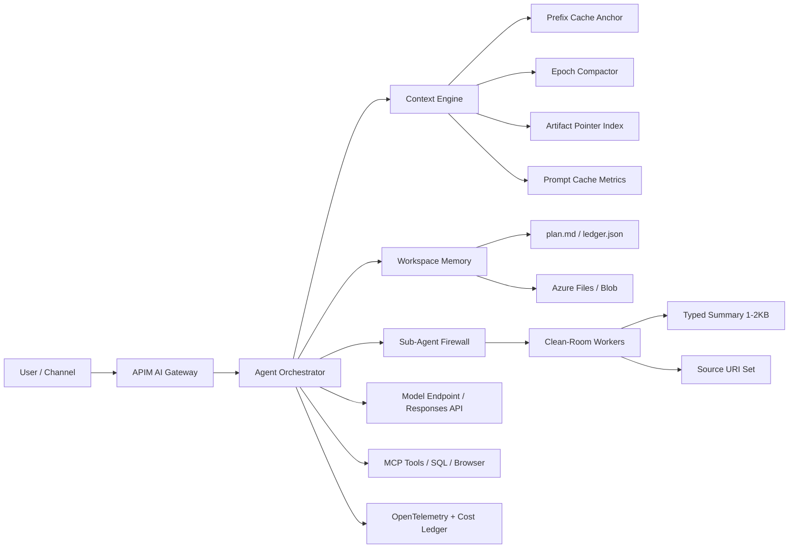
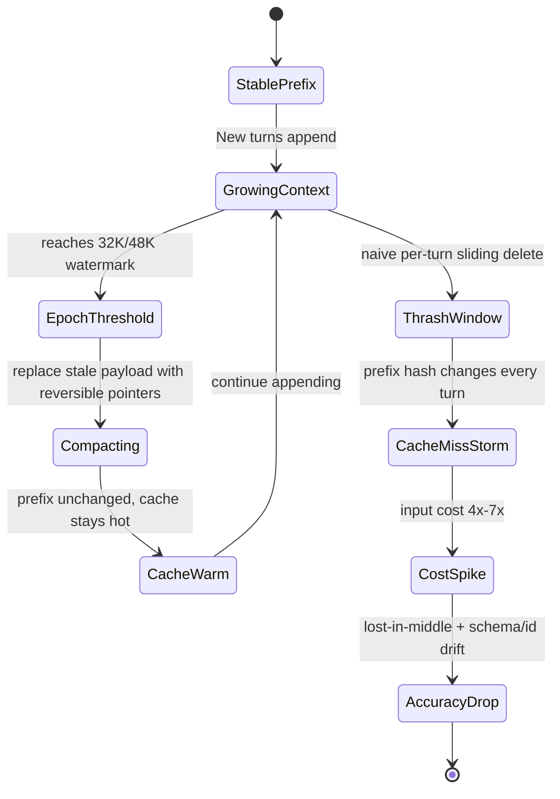

# Enterprise Agent Context Engineering Selection FAQ: Cache-Aligned Epoch Compaction vs Reversible Blob Scratchpad vs Sub-Agent Context Firewall vs Responses API Managed State

> 🌐 **Language Switch**: [中文](./agent-context-engineering-compaction-cache-aligned-epoch-vs-reversible-blob-scratchpad-vs-subagent-firewall-vs-responses-api-selection-faq.md) | **English (current)**
> **Audience**: Cloud & AI Solution Architects, platform engineering leads, LLMOps/FinOps teams, enterprise governance and audit stakeholders, and modernization delivery teams.
> **Scope**: Production context engineering for 50–300 turn enterprise agents, focusing on prompt-cache stability, anti-context-rot memory design, exact `tool_call_id` integrity, reversible compaction, and cross-subagent contamination control.

## 1. Problem framing: why long-running agents fail on both cost and accuracy after turn 40–80
Most enterprise agent deployments are initially functionally correct but economically unstable.  
The failure mode is not one expensive request, but repeated replay of growing history that drives cumulative input tokens toward quadratic growth.  

The second failure mode is cache misuse.  
Teams often trim a sliding window every turn, which appears efficient, yet continuously changes the prefix hash and destroys Azure OpenAI prompt-cache hit rate.  

The third failure mode is irreversible information loss.  
When a 30KB tool payload is replaced by a one-line summary, exact IDs and schema fields disappear, making downstream mutation steps unsafe and hard to audit.  

The fourth failure mode is contamination from noisy intermediate traces.  
Parallel sub-tasks inject logs, DOM dumps, SQL traces, and crawler payloads into the orchestrator context, pushing critical constraints into the middle where recall quality decays.  

Therefore, enterprise context handling must be treated as a governed data plane.  
The design objective is not merely shorter prompts, but reversible, auditable, cache-safe, and replayable prompt reduction.  

## 2. Four architecture patterns (A/B/C/D): complementarity instead of exclusivity
Architecture A provides the baseline for cache and cost control.  
It combines stable prefix anchoring with discrete epoch compaction so cache retention and compression discipline remain aligned.  

Architecture B externalizes mutable working memory.  
It stores plans, intermediate tables, and state ledgers in durable workspace storage while keeping only high-attention checkpoints inside the model context tail.  

Architecture C isolates noise-heavy work into clean-room workers.  
Sub-agents process token-heavy traces and return only typed summaries plus verifiable source URIs to the orchestrator.  

Architecture D uses server-side managed conversation state via Responses API / Foundry Agent Service.  
It reduces app complexity but trades away deterministic eviction control and some portability options.  

The practical enterprise path is layered adoption.  
A is the non-negotiable base, B stabilizes long workflows, C protects orchestrator clarity, and D is optional acceleration for teams prioritizing implementation speed.  

## 3. End-to-end reference architecture: separate context control plane, memory plane, and execution plane


This architecture removes prompt assembly from ad-hoc business code.  
Context handling becomes a first-class governed component with policy versioning, hit-rate telemetry, compaction watermarks, and replay controls.  

When compaction policy changes, only the context engine changes.  
Workflow logic and business adapters remain stable, which reduces long-term operational risk.  

## 4. Architecture A: cache-aligned epoch compaction with reversible tool-output stubbing
The first principle is prefix freezing.  
System instructions, policy constraints, tool contracts, and stable thread headers are assembled into a 1,024-token-aligned immutable prefix for 12–20 turns.  

The second principle is discrete compaction, not per-turn micro-pruning.  
Compaction triggers only when watermark thresholds such as 32K or 48K are crossed, preserving cache stability between checkpoints.  

The third principle is reversible replacement rather than irreversible summarization.  
A 30KB payload is replaced with `ref://blob/sha256:...`, schema preview metadata, and `reload_artifact` parameters, not discarded content.  

The fourth principle is strict `tool_call_id -> tool` pairing invariance.  
Compaction may replace tool payload bytes but must never reorder or mutate the logical call/response chain.  

In production, A typically restores high cache-hit behavior.  
It also shifts spend growth from unstable quasi-quadratic behavior to a controllable near-linear profile.  

## 5. Architecture B: file-system/workspace scratchpad as external virtual memory
Architecture B applies virtual-memory ideas to agent state.  
Large mutable artifacts live in workspace files such as `plan.md`, `facts.jsonl`, `tables/*.csv`, and `entities/*.json`, while prompts carry compact indexes and step-critical checkpoints.  

A key technique is tail recitation.  
Each turn appends a short high-signal progress block to the context tail so active constraints remain in high-attention positions.  

This design directly reduces context-rot risk.  
Core objectives are no longer buried among verbose historical traces and therefore remain more consistently recalled across long runs.  

B also improves human observability and debugging quality.  
Engineers can inspect and diff concrete artifacts, replay intermediate state, and validate transitions without relying on opaque model memory.  

For long-lived enterprise tasks, B pairs naturally with A.  
A enforces cache and compaction discipline, while B provides durable, inspectable working memory semantics.  

## 6. Architecture C: sub-agent context firewall with clean-room worker isolation
Architecture C is optimized for high-noise workloads.  
Typical examples include deep log forensics, DOM exploration, multi-hop retrieval, and exploratory SQL iterations.  

The firewall contract is minimal input, typed output, and source-verifiable evidence.  
Sub-agents receive tightly scoped context and return 1–2KB Pydantic summaries plus source URI sets, instead of full raw traces.  

This isolates 60K–100K intermediate payloads from the orchestrator.  
The primary thread remains decision-focused and preserves business constraints in the high-attention zone.  

C also enables policy segmentation by role and risk tier.  
Different worker classes can enforce different tool allowlists, output schemas, and sensitivity handling rules under audit.  

For security and compliance teams, this model is materially more governable than shared all-thread context pools.  
Isolation boundaries become explicit and evidence-friendly for formal review.  

## 7. Architecture D: Responses API managed context and server-side truncation
Architecture D optimizes implementation speed.  
Applications continue a thread by referencing `previous_response_id` and avoid large client-side conversation assembly logic.  

It also reduces common implementation defects.  
Client-side orchestration frequently introduces role-order drift, missing tool attachments, or duplicate message fragments during retries.  

The trade-off is reduced deterministic control.  
If strict residency, explicit eviction semantics, multi-model portability, or customer-managed cryptographic controls are mandatory, server-managed context may be insufficient.  

Therefore D is generally strongest for moderate governance environments with aggressive delivery timelines.  
As requirements mature, organizations often introduce A/B/C capabilities for stronger determinism and lifecycle control.  

## 8. Context-rot and cache-thrashing state machine: from unstable sliding windows to stable epoch compaction


The key operational insight is full-chain observability of the bad path.  
Cache-miss storms, cost spikes, and accuracy drops must be correlated as one causal sequence rather than isolated dashboards.  

When instability appears, replay the latest prefix hashes and compaction events over the previous 20 turns.  
In practice this quickly reveals whether the issue is over-eager compaction cadence, threshold misconfiguration, or missing reversible stubs.  

## 9. 12-dimension comparison matrix: capability boundaries for A/B/C/D
| Dimension | Architecture A Cache-Aligned Epoch Compaction | Architecture B Workspace Scratchpad | Architecture C Sub-Agent Firewall | Architecture D Responses Managed Context |
|---|---|---|---|---|
| Prompt-cache stability | Very high | High | High | Medium |
| Cost linearity control | Very high | High | High | Medium |
| Reversible replay fidelity | High | Very high | Medium-high | Medium |
| Context-rot suppression | High | High | Very high | Medium |
| Implementation complexity | Medium-high | Medium | High | Low |
| Multi-model portability | Very high | Very high | High | Medium-low |
| Compliance explainability | High | High | Very high | Medium |
| Delivery speed | Medium | Medium-high | Medium | Very high |
| Noise isolation strength | Medium | Medium | Very high | Low |
| Tool-pair integrity control | High | High | Medium-high | Medium |
| Operational observability depth | High | High | High | Medium |
| Recommended adoption priority | Mandatory base | Mandatory for long-running tasks | Mandatory for noisy tasks | Optional acceleration layer |

The matrix indicates a layered strategy.  
A secures economic and cache behavior, B secures long-run memory durability, C secures context hygiene at scale, and D secures rapid first delivery.  

## 10. Quantitative model: 60-turn token growth, cache effects, and epoch-stable economics
Assume `Δ=1,500` effective new tokens per turn and `N=60` turns.  
Without compaction, cumulative input approximates `Σ(i=1..N) i*Δ = Δ*N*(N+1)/2 = 2,745,000` tokens.  

With per-turn sliding truncation that breaks cache alignment, window size may remain capped but cache discounts collapse because prefix hashes change each turn.  
Under comparable workload, billing can still be 4x–7x above a cache-stable design.  

With cache-aligned epoch compaction every 12 turns, stable prefixes preserve cache effectiveness and keep growth near linear.  
The result is predictable input cost envelopes without losing forensic replay capability.  

### Recall / task-success degradation by context length and noise ratio (illustrative benchmark frame)
| Pattern | Effective context length | Noise ratio | Recall@critical-entities | Task success rate |
|---|---:|---:|---:|---:|
| No compaction, full accumulation | 96K | 62% | 71% | 64% |
| Sliding-window thrash | 32K | 48% | 68% | 61% |
| Epoch compaction + reversible pointers | 32K | 19% | 89% | 83% |
| Epoch + scratchpad + sub-agent firewall | 24K | 12% | 92% | 87% |

The practical lesson is that bigger windows alone do not guarantee better outcomes.  
When noise ratio rises, longer contexts can reduce decision quality by burying critical constraints.  

## 11. Quantitative review Q&A (Q1–Q6): frequent architecture-board questions
### Q1: Why can deleting 2K tokens every turn become more expensive
Because prompt cache value depends on stable prefixes.  
Frequent window mutation changes prefix hashes and invalidates cache reuse.  
Across a 60-turn session, this can cost several multiples of a stable-prefix design.  

### Q2: What is the impact of replacing a 30KB payload with a ~180B pointer
One replacement removes roughly 29.8KB prompt payload while preserving recoverability.  
If reused multiple times in long sessions, cumulative savings quickly reach hundreds of KB per thread.  
This reduces spend while keeping exact replay paths available.  

### Q3: Why must `tool_call_id` mappings remain immutable during compaction
Subsequent turns rely on stable call/response pairing for protocol consistency.  
Reordering or mutating mappings creates orphaned tool responses and thread corruption.  
These failures are often harder to diagnose than ordinary model hallucination errors.  

### Q4: Where does success-rate improvement come from in architecture C
The primary gain is noise isolation rather than raw model size.  
By keeping high-volume traces out of the orchestrator context, critical constraints stay visible at decision time.  
In noisy workloads, this frequently outperforms simply expanding context windows.  

### Q5: When should architecture D be preferred first
When delivery timelines are tight, governance constraints are moderate, and immediate multi-model portability is not required.  
D can accelerate launch by reducing client orchestration complexity.  
As governance rigor grows, organizations should plan migration paths toward A/B/C controls.  

### Q6: Which KPIs are mandatory for context-engineering governance
At minimum: prompt-cache hit rate, per-task input cost, critical-entity recall, and task success rate.  
Cost-only monitoring hides quality regressions, while success-only monitoring hides economic drift.  
All four KPIs should be version-correlated and replayable in one operational timeline.  

## 12. Production code sample (Python): `CacheAlignedContextCompactor` and reversible artifact reload
```python
from __future__ import annotations

from dataclasses import dataclass
from hashlib import sha256
from typing import Any, Dict, List
import json


@dataclass
class ArtifactPointer:
    uri: str
    digest: str
    bytes_size: int
    schema_preview: Dict[str, Any]


class CacheAlignedContextCompactor:
    def __init__(self, blob_store, epoch_turns: int = 12, max_context_tokens: int = 32000):
        self.blob_store = blob_store
        self.epoch_turns = epoch_turns
        self.max_context_tokens = max_context_tokens

    def should_compact(self, turn_index: int, current_tokens: int) -> bool:
        return current_tokens >= self.max_context_tokens and turn_index % self.epoch_turns == 0

    def freeze_prefix(self, messages: List[Dict[str, Any]], frozen_token_budget: int = 1024) -> List[Dict[str, Any]]:
        frozen: List[Dict[str, Any]] = []
        acc = 0
        for m in messages:
            token_est = max(1, len(m.get("content", "")) // 4)
            if acc + token_est > frozen_token_budget:
                break
            frozen.append(m)
            acc += token_est
        return frozen

    def stub_tool_payload(self, tool_msg: Dict[str, Any]) -> Dict[str, Any]:
        raw = tool_msg.get("content", "")
        digest = sha256(raw.encode("utf-8")).hexdigest()
        uri = f"ref://blob/sha256:{digest}"
        self.blob_store.put_text(uri, raw)
        pointer = ArtifactPointer(
            uri=uri,
            digest=digest,
            bytes_size=len(raw.encode("utf-8")),
            schema_preview={"keys": self._preview_keys(raw)},
        )
        tool_msg["content"] = json.dumps(
            {
                "artifact_ref": pointer.uri,
                "digest": pointer.digest,
                "bytes": pointer.bytes_size,
                "schema_preview": pointer.schema_preview,
                "reload_tool": "reload_artifact",
            }
        )
        return tool_msg

    def compact_epoch(self, messages: List[Dict[str, Any]]) -> List[Dict[str, Any]]:
        compacted: List[Dict[str, Any]] = []
        for msg in messages:
            if msg.get("role") == "tool":
                content = msg.get("content", "")
                if len(content.encode("utf-8")) > 2048:
                    compacted.append(self.stub_tool_payload(msg.copy()))
                else:
                    compacted.append(msg)
            else:
                compacted.append(msg)
        return compacted

    def reload_artifact(self, artifact_ref: str, expected_digest: str) -> str:
        payload = self.blob_store.get_text(artifact_ref)
        actual = sha256(payload.encode("utf-8")).hexdigest()
        if actual != expected_digest:
            raise ValueError("artifact digest mismatch")
        return payload

    @staticmethod
    def _preview_keys(raw: str) -> List[str]:
        try:
            obj = json.loads(raw)
            if isinstance(obj, dict):
                return list(obj.keys())[:12]
        except Exception:
            pass
        return ["text_blob"]
```

The implementation preserves structure while reducing payload weight.  
Role order, timestamps, and `tool_call_id` pairing remain intact; only large tool payload bytes are replaced with reversible pointers.  

## 13. Production policy sample (APIM + sub-agent firewall): bounded input noise and typed output guarantees
```xml
<policies>
  <inbound>
    <base />
    <set-variable name="x-agent-role" value="@(context.Request.Headers.GetValueOrDefault("x-agent-role","orchestrator"))" />
    <choose>
      <when condition="@(context.Variables.GetValueOrDefault<string>("x-agent-role") == "subagent")">
        <validate-content max-size="8192" size-exceeded-action="prevent" unspecified-content-type-action="prevent" />
      </when>
      <otherwise>
        <validate-content max-size="32768" size-exceeded-action="prevent" unspecified-content-type-action="prevent" />
      </otherwise>
    </choose>
  </inbound>
  <backend>
    <base />
  </backend>
  <outbound>
    <base />
    <choose>
      <when condition="@(context.Response.StatusCode == 200 && context.Request.Headers.GetValueOrDefault("x-agent-role","orchestrator") == "subagent")">
        <set-body>@{
          var body = context.Response.Body.As<string>(preserveContent:true);
          if (!body.Contains("\"summary\"") || !body.Contains("\"source_uris\"")) {
            throw new Exception("subagent response must include typed summary and source_uris");
          }
          return body;
        }</set-body>
      </when>
    </choose>
  </outbound>
</policies>
```

```yaml
subagent_firewall:
  allow_tools:
    - web_search
    - sql_readonly
    - browser_snapshot
  deny_tools:
    - write_crm_record
    - execute_payment
    - mutate_identity_policy
  max_input_tokens: 12000
  max_output_tokens: 2000
  required_output_schema:
    type: object
    required: ["summary", "evidence", "source_uris", "confidence"]
    properties:
      summary: { type: string, maxLength: 4000 }
      evidence: { type: array, items: { type: string } }
      source_uris: { type: array, items: { type: string } }
      confidence: { type: number, minimum: 0, maximum: 1 }
```

This pattern does not reduce capability; it reduces contamination.  
Sub-agents perform heavy exploratory work, while the orchestrator preserves decision integrity and governance traceability.  

## 14. Enterprise scenarios and 3-year TCO: two practical rollout patterns
### Scenario A: autonomous coding-agent platform (review, regression, release explanation)
This workload generates large volumes of logs, diffs, and tool traces.  
Without A+B+C, orchestrator context quickly saturates and cache stability collapses.  

After A+B+C rollout, cache consistency recovers and context contamination drops.  
Teams can replay exact historical artifacts for incident forensics without sacrificing runtime efficiency.  

### Scenario B: multi-tenant SaaS agent gateway (support, ticketing, reconciliation mix)
This workload combines concurrency spikes with long-tail complex threads.  
A+D can deliver fast initial launch, then B+C can be introduced incrementally to harden long-run governance.  

As tenant scale increases, C becomes increasingly valuable.  
Isolating noisy sub-tasks keeps orchestrator contexts focused and improves both SLA stability and unit economics.  

### Three-year TCO comparison (same 95% availability objective and workload envelope)
| Pattern | Year 1 platform cost | Year 2 platform cost | Year 3 platform cost | 3-year total | Primary cost drivers |
|---|---:|---:|---:|---:|---|
| No context governance (baseline) | $1.22M | $1.48M | $1.81M | $4.51M | Low cache reuse, repeated input replay, expensive incident triage |
| D only (managed context) | $1.03M | $1.25M | $1.50M | $3.78M | Fast delivery with limited deterministic control |
| A+B | $0.86M | $1.04M | $1.23M | $3.13M | Strong input-cost reduction and better operational transparency |
| A+B+C (recommended) | $0.80M | $0.96M | $1.12M | $2.88M | Noise isolation, reversible replay, and stable cache behavior |

The long-term pattern is consistent across enterprises.  
Year 1 rewards delivery speed, Year 2 rewards governance maturity, and Year 3 rewards architectural resilience and marginal-cost discipline.  

## 15. Day-0 / Day-2 checklist: turning context engineering into an operating capability
### Day-0 (before production cutover)
- Define immutable prefix template covering policy constraints, identity boundaries, tool contracts, and output format standards.  
- Define epoch watermarks, for example compact at 32K and run compaction every 12 turns.  
- Build reversible artifact storage with blob pointers, digest validation, and schema previews.  
- Enforce immutable `tool_call_id` mapping rules during all compaction operations.  
- Deploy sub-agent firewall policy with token budgets, output schema contracts, and tool allowlists.  

### Day-2 (after go-live)
- Operate one shared dashboard for cache-hit rate, input cost per task, recall quality, and task success.  
- Sample long sessions weekly to verify replayability and detect schema/ID drift early.  
- Replay cache-miss storms to identify policy-threshold regressions and rollout-induced instability.  
- Audit sub-agent output quality for summary fidelity, evidence completeness, and source URI validity.  
- Rebalance A/B/C/D adoption quarterly to maintain delivery velocity without sacrificing governance depth.  

Recommended rollout order is straightforward.  
Start with A to stop cache and spend instability, then add B for long-run memory durability, then add C for noisy-workload isolation, and treat D as an acceleration layer rather than the sole control strategy.  

At multi-region and high-compliance scale, context engineering should be governed at the same tier as identity, billing, and audit controls.  
Only then can a platform sustain 300-turn enterprise workloads while preserving quality, explainability, and economic health.  

