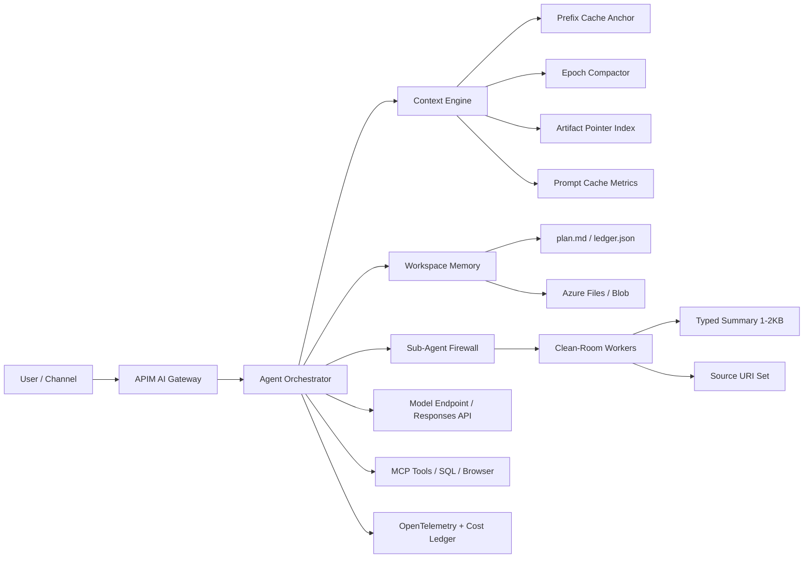
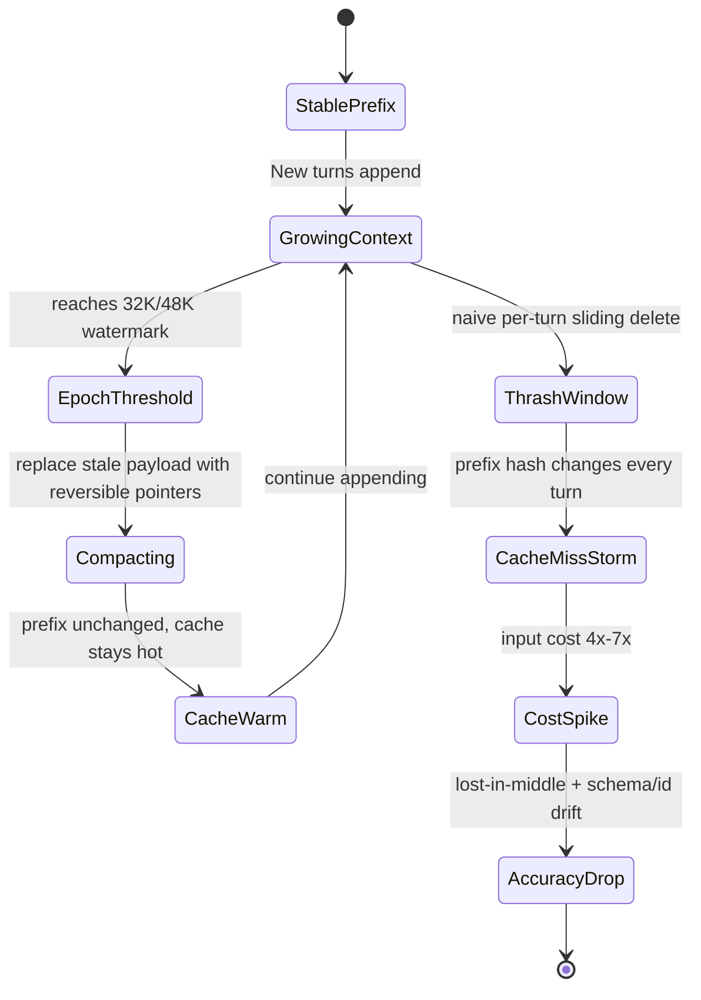

# 企业 Agent 上下文工程选型 FAQ：缓存对齐 Epoch 压缩 vs 可逆 Blob 暂存页 vs 子 Agent 上下文防火墙 vs Responses API 托管上下文

> 🌐 **Language Switch**：**中文（当前）** | [English](./agent-context-engineering-compaction-cache-aligned-epoch-vs-reversible-blob-scratchpad-vs-subagent-firewall-vs-responses-api-selection-faq.en.md)
> **受众**：Cloud & AI Solution Architect、平台工程负责人、LLMOps/FinOps 团队、企业治理与审计团队、应用现代化交付团队。
> **范围**：聚焦 50–300 轮企业级长对话 Agent 的上下文工程，解决 Prompt Cache 抖动、上下文腐化（Context Rot）、`tool_call_id` 对齐丢失、记忆不可逆压缩、以及跨子 Agent 污染问题。

## 1. 问题定义：为什么长轮次 Agent 会在第 40–80 轮后同时出现成本爆炸与准确率塌陷
企业级 Agent 在第一个版本往往“功能可用但成本失控”。  
根因不是单次请求过贵，而是每轮把历史上下文整段重复发送，导致累计输入 token 呈近似二次增长。  

第二个根因是缓存误用。  
很多实现每轮都做滑窗裁剪，看似减少 token，实则让前缀不断变化，直接把 Azure OpenAI Prompt Cache 命中率从高位打到接近零。  

第三个根因是信息不可逆丢失。  
当团队把 30KB 工具输出简单“摘要成一句话”后，后续排障无法回放原始字段，`schema` 与实体 ID 发生漂移，最终导致执行层写错对象。  

第四个根因是中间噪声污染。  
多 Agent 并行时，调试日志、DOM 片段、SQL 原文、抓取结果会挤压主编排上下文，使关键业务约束掉入“中间位置”，触发典型的 lost-in-the-middle 准确率下滑。  

因此，企业需要把上下文当作可治理的数据平面。  
核心目标不是“压短 prompt”，而是“在可逆、可审计、可缓存、可恢复前提下压短 prompt”。  

## 2. 四种架构模式总览：A/B/C/D 如何组合而非互斥
Architecture A 解决缓存与成本基础盘。  
它通过冻结前缀和离散 Epoch 压缩，把缓存收益和可控压缩放在同一控制面。  

Architecture B 解决工作记忆外置化。  
它把可变状态移出模型上下文，转为工作区文件与结构化账本，并在提示尾部仅保留高注意力摘要。  

Architecture C 解决噪声隔离。  
它让高 token 工作由短命子 Agent 在清洁室执行，主编排器只接收强类型摘要与可验证来源句柄。  

Architecture D 解决托管简化。  
它利用 Responses API / Foundry Agent Service 的服务端状态保留能力降低应用复杂度，但要权衡可移植性和显式淘汰控制权。  

推荐实践并非四选一。  
大多数生产系统采用 A 作为基座，B 作为长任务支撑，C 作为高噪声场景隔离，D 用于低复杂度团队快速交付。  

## 3. 端到端参考架构：上下文控制平面、工作记忆平面与执行平面分离


该架构把“提示构造”从业务代码中抽离。  
上下文工程成为独立可观测组件，具备版本化策略、命中率看板、压缩水位阈值和回放能力。  

当团队需要改压缩策略时，只变更 Context Engine 即可。  
业务编排逻辑无需同步重写，显著降低长周期维护成本。  

## 4. Architecture A：缓存对齐 Epoch 压缩与可逆工具输出桩
Architecture A 的第一原则是前缀冻结。  
将系统提示、企业策略、工具合同与稳定少变的会话基线拼成 1,024 token 对齐前缀，在 12–20 轮内保持字节级不变。  

第二原则是离散压缩，不做逐轮微裁。  
当上下文达到 32K 或 48K 水位时才触发 Epoch Compaction，将过时大块工具输出替换为可逆句柄。  

第三原则是可逆替换而非不可逆摘要。  
例如把 30KB SQL 结果替换为 `ref://blob/sha256:...`、字段摘要与 `reload_artifact` 调用参数，而不是直接丢弃原数据。  

第四原则是 `tool_call_id -> tool` 严格配对保真。  
压缩过程中只能替换 `tool` 内容，不可改写调用序列与配对关系，否则下轮会出现线程损坏与协议错误。  

在真实项目中，A 能把缓存命中从 0% 回升至高位。  
同时把输入成本控制在线性可增长轨道，而不是继续被 `O(N^2)` 拖垮。  

## 5. Architecture B：文件系统/工作区暂存页作为外置工作记忆
Architecture B 借鉴操作系统虚拟内存思想。  
将高体积中间状态放到 `workspace`：`plan.md`、`facts.jsonl`、`tables/*.csv`、`entities/*.json`，只把当前步骤所需索引与摘要放入 prompt。  

关键做法是“尾部复述计划（tail recitation）”。  
每轮在上下文末尾写入 8–15 行高价值进度与下一步约束，让模型在高注意力区读取最新控制信息。  

该模式显著降低上下文腐化。  
因为计划状态不再被大量历史噪声挤压到中间位置，任务目标、验收标准和风险边界保持高可见。  

B 还提升了人机协作可见性。  
工程师可直接查看暂存文件、回放关键中间态、审阅差异，而不是只依赖模型内部记忆。  

对于长任务，B 与 A 组合效果最好。  
A 负责缓存与压缩纪律，B 负责状态外置与可检视性，两者共同抑制成本和准确率衰减。  

## 6. Architecture C：子 Agent 上下文防火墙与清洁室隔离
Architecture C 用于高噪声任务。  
如日志取证、DOM 抓取、多跳检索、批量 SQL 探查等，统一派发到短命子 Agent。  

防火墙规则是“输入最小化、输出类型化、来源可验证”。  
主编排器向子 Agent 下发最小必要上下文，子 Agent 返回 1–2KB Pydantic 结构化摘要和来源 URI 集，不回传原始噪声。  

该模式把 `60K–100K` 中间轨迹隔离在清洁室。  
主线程上下文保持干净，核心业务约束与决策链不再被调试噪声淹没。  

在治理层面，C 还能做分级策略。  
不同子 Agent 可绑定不同工具白名单、输出模式和数据敏感级别，形成可审计的上下文边界。  

对企业安全团队而言，这比“所有线程共享同一上下文池”更可控。  
隔离边界明确后，审计、脱敏与最小披露策略可按角色精确落地。  

## 7. Architecture D：Responses API 托管上下文与服务端截断
Architecture D 的优势是工程简化。  
应用侧不必自己维护完整历史串，使用 `previous_response_id` 进行服务端续写即可快速落地。  

它也减少了客户端拼接错误。  
许多团队在本地上下文拼接时容易出现角色错序、工具结果漏挂接或重复注入，托管上下文可降低这类实现风险。  

但 D 的代价是可控性下降。  
当企业要求严格数据驻留、可迁移到多模型路由、或需要完全确定的淘汰策略时，服务端托管可能不满足治理约束。  

因此 D 更适合中低复杂度项目。  
当进入跨区域合规、高敏审计或多模型可移植阶段，通常要回归 A+B+C 主导的自管策略。  

## 8. 上下文腐化与缓存抖动状态机：从“滑窗误裁”到“Epoch 稳态压缩”


该状态机强调“错误路径同样可观测”。  
团队需要把 cache miss storm、成本飙升、准确率下降串成一条因果链，而不是分散在三个孤立看板。  

当出现抖动时，回放最近 20 轮 prefix hash 与 compaction 事件。  
通常可快速定位是策略阈值过低、压缩节奏过密，还是工具输出未做可逆桩替换。  

## 9. 12 维度对比矩阵：A/B/C/D 的能力边界与适配区间
| 维度 | Architecture A 缓存对齐 Epoch 压缩 | Architecture B 工作区暂存页 | Architecture C 子 Agent 防火墙 | Architecture D Responses API 托管 |
|---|---|---|---|---|
| Prompt Cache 命中稳定性 | 极高 | 高 | 高 | 中 |
| 成本线性可控性 | 极高 | 高 | 高 | 中 |
| 可逆回放能力 | 高 | 极高 | 中高 | 中 |
| 上下文腐化抑制 | 高 | 高 | 极高 | 中 |
| 实现复杂度 | 中高 | 中 | 高 | 低 |
| 多模型可移植性 | 极高 | 极高 | 高 | 中低 |
| 合规可证明性 | 高 | 高 | 极高 | 中 |
| 研发迭代速度 | 中 | 中高 | 中 | 极高 |
| 噪声隔离能力 | 中 | 中 | 极高 | 低 |
| 工具配对保真控制 | 高 | 高 | 中高 | 中 |
| 运营可观测性深度 | 高 | 高 | 高 | 中 |
| 推荐优先级 | 基座必做 | 长任务必做 | 高噪场景必做 | 快速交付可选 |

矩阵结论：A 决定成本与缓存底线。  
B 决定长任务稳定性与可检视性。  
C 决定噪声隔离与治理上限。  
D 决定首版交付速度但需谨慎评估后续治理成本。  

## 10. 数学模型：60 轮会话的 `O(N^2)`、滑窗抖动与 Epoch 稳态成本
设每轮新增有效上下文为 `Δ=1,500` tokens，轮次为 `N=60`。  
若完全不压缩且每轮重发历史，总输入近似：`Σ(i=1..N) i*Δ = Δ*N*(N+1)/2 = 2,745,000` tokens。  

若逐轮滑窗并导致缓存命中趋近零，虽然窗口限制在 32K，仍因每轮 prefix 变化失去缓存折扣。  
在同等业务负载下，账单可比缓存稳定方案高出 4x–7x。  

若采用 Epoch 对齐压缩，每 12 轮触发一次并维持前缀稳定。  
可把等价输入成本降到近似线性区间，并保持高缓存命中。  

### Recall / Task Success 随上下文长度与噪声占比的退化曲线（示例）
| 场景 | 有效上下文长度 | 噪声占比 | Recall@关键实体 | 任务成功率 |
|---|---:|---:|---:|---:|
| 无压缩、全量堆叠 | 96K | 62% | 71% | 64% |
| 滑窗误裁、缓存抖动 | 32K | 48% | 68% | 61% |
| Epoch 压缩 + 可逆句柄 | 32K | 19% | 89% | 83% |
| Epoch + 暂存页 + 子 Agent 防火墙 | 24K | 12% | 92% | 87% |

该表说明关键不是“绝对上下文越大越好”。  
当噪声比例失控时，更长上下文反而降低关键事实召回。  

## 11. 定量问答（Q1–Q6）：评审会最常见的上下文工程数字题
### Q1：为什么滑窗每轮删 2K token 反而更贵
因为缓存按前缀稳定性工作。  
每轮删改导致前缀哈希变化，缓存命中断裂，折扣消失。  
在 60 轮会话里，总成本可超过稳定前缀策略数倍。  

### Q2：30KB 工具输出换成 180B 句柄能省多少
单次替换节省约 29.8KB 文本注入。  
若此类输出在 40 轮内复用 8 次，累计节省可达数百 KB 级输入。  
同时保留 `reload_artifact` 可逆读取路径，不丢审计能力。  

### Q3：为什么必须保留 `tool_call_id` 映射
因为下一轮工具结果回挂依赖稳定配对。  
若压缩时改写或重排映射，系统会出现 orphaned tool response 或上下文损坏。  
这类错误通常比普通模型幻觉更难排查。  

### Q4：子 Agent 防火墙对成功率提升来自哪里
核心收益来自噪声隔离。  
主线程不再承载大体积中间轨迹，关键业务约束保持在高注意力区。  
在高噪声任务里，成功率提升通常高于单纯增大上下文窗口。  

### Q5：什么时候应优先选 D（托管上下文）
当团队上线窗口极短、治理要求中等、且无需跨模型迁移时。  
D 可快速交付并减少应用代码复杂度。  
但若进入严格合规与多模型路由阶段，应尽早评估 A/B/C 迁移路径。  

### Q6：上下文工程 KPI 应看哪些
至少要看四组：缓存命中率、单位任务输入成本、关键实体 Recall、任务成功率。  
若只看 token 成本容易牺牲准确率，只看成功率又容易掩盖经营风险。  
四组指标需要同屏联动观察并绑定版本回放。  

## 12. 生产代码示例（Python）：`CacheAlignedContextCompactor` 与可逆工件回载
```python
from __future__ import annotations

from dataclasses import dataclass
from hashlib import sha256
from typing import Any, Dict, List
import json


@dataclass
class ArtifactPointer:
    uri: str
    digest: str
    bytes_size: int
    schema_preview: Dict[str, Any]


class CacheAlignedContextCompactor:
    def __init__(self, blob_store, epoch_turns: int = 12, max_context_tokens: int = 32000):
        self.blob_store = blob_store
        self.epoch_turns = epoch_turns
        self.max_context_tokens = max_context_tokens

    def should_compact(self, turn_index: int, current_tokens: int) -> bool:
        return current_tokens >= self.max_context_tokens and turn_index % self.epoch_turns == 0

    def freeze_prefix(self, messages: List[Dict[str, Any]], frozen_token_budget: int = 1024) -> List[Dict[str, Any]]:
        frozen: List[Dict[str, Any]] = []
        acc = 0
        for m in messages:
            token_est = max(1, len(m.get("content", "")) // 4)
            if acc + token_est > frozen_token_budget:
                break
            frozen.append(m)
            acc += token_est
        return frozen

    def stub_tool_payload(self, tool_msg: Dict[str, Any]) -> Dict[str, Any]:
        raw = tool_msg.get("content", "")
        digest = sha256(raw.encode("utf-8")).hexdigest()
        uri = f"ref://blob/sha256:{digest}"
        self.blob_store.put_text(uri, raw)
        pointer = ArtifactPointer(
            uri=uri,
            digest=digest,
            bytes_size=len(raw.encode("utf-8")),
            schema_preview={"keys": self._preview_keys(raw)},
        )
        tool_msg["content"] = json.dumps(
            {
                "artifact_ref": pointer.uri,
                "digest": pointer.digest,
                "bytes": pointer.bytes_size,
                "schema_preview": pointer.schema_preview,
                "reload_tool": "reload_artifact",
            },
            ensure_ascii=False,
        )
        return tool_msg

    def compact_epoch(self, messages: List[Dict[str, Any]]) -> List[Dict[str, Any]]:
        compacted: List[Dict[str, Any]] = []
        for msg in messages:
            if msg.get("role") == "tool":
                content = msg.get("content", "")
                if len(content.encode("utf-8")) > 2048:
                    compacted.append(self.stub_tool_payload(msg.copy()))
                else:
                    compacted.append(msg)
            else:
                compacted.append(msg)
        return compacted

    def reload_artifact(self, artifact_ref: str, expected_digest: str) -> str:
        payload = self.blob_store.get_text(artifact_ref)
        actual = sha256(payload.encode("utf-8")).hexdigest()
        if actual != expected_digest:
            raise ValueError("artifact digest mismatch")
        return payload

    @staticmethod
    def _preview_keys(raw: str) -> List[str]:
        try:
            obj = json.loads(raw)
            if isinstance(obj, dict):
                return list(obj.keys())[:12]
        except Exception:
            pass
        return ["text_blob"]
```

该实现点在于“替换而不破坏结构关系”。  
`tool_call_id`、角色序列、时间顺序全部保留，仅替换大体积内容体。  

## 13. 生产策略示例（APIM + 子 Agent 防火墙）：限制污染输入与强制类型化输出
```xml
<policies>
  <inbound>
    <base />
    <set-variable name="x-agent-role" value="@(context.Request.Headers.GetValueOrDefault("x-agent-role","orchestrator"))" />
    <choose>
      <when condition="@(context.Variables.GetValueOrDefault<string>("x-agent-role") == "subagent")">
        <validate-content max-size="8192" size-exceeded-action="prevent" unspecified-content-type-action="prevent" />
      </when>
      <otherwise>
        <validate-content max-size="32768" size-exceeded-action="prevent" unspecified-content-type-action="prevent" />
      </otherwise>
    </choose>
  </inbound>
  <backend>
    <base />
  </backend>
  <outbound>
    <base />
    <choose>
      <when condition="@(context.Response.StatusCode == 200 && context.Request.Headers.GetValueOrDefault("x-agent-role","orchestrator") == "subagent")">
        <set-body>@{
          var body = context.Response.Body.As<string>(preserveContent:true);
          if (!body.Contains("\"summary\"") || !body.Contains("\"source_uris\"")) {
            throw new Exception("subagent response must include typed summary and source_uris");
          }
          return body;
        }</set-body>
      </when>
    </choose>
  </outbound>
</policies>
```

```yaml
subagent_firewall:
  allow_tools:
    - web_search
    - sql_readonly
    - browser_snapshot
  deny_tools:
    - write_crm_record
    - execute_payment
    - mutate_identity_policy
  max_input_tokens: 12000
  max_output_tokens: 2000
  required_output_schema:
    type: object
    required: ["summary", "evidence", "source_uris", "confidence"]
    properties:
      summary: { type: string, maxLength: 4000 }
      evidence: { type: array, items: { type: string } }
      source_uris: { type: array, items: { type: string } }
      confidence: { type: number, minimum: 0, maximum: 1 }
```

策略目标不是阻断能力，而是维持主线程上下文清洁。  
子线程负责重活，主线程负责决策与收敛。  

## 14. 企业场景与三年 TCO：两类典型部署路径
### 场景 A：自治 Coding Agent 平台（代码审查、回归验证、发布前变更解释）
该场景会产生大量测试日志、diff 与工具回执。  
若无 A+B+C，主线程很快被中间噪声淹没并触发缓存抖动。  

上线 A+B+C 后，团队保持高缓存命中并减少上下文污染。  
工程师能通过可逆工件回放追踪任意历史决策，故障定位效率明显提升。  

### 场景 B：多租户 SaaS Agent Gateway（客服、工单、财务对账混合负载）
该场景具有高并发与长尾复杂请求。  
采用 A+D 先快速上线，再逐步引入 B+C，能在不打断业务的情况下完成治理升级。  

随着租户增长，C 的价值逐步放大。  
将重噪声子任务隔离后，主线程保持稳定，整体 SLA 与单位成本同步改善。  

### 三年 TCO 对比（同等 95% 可用性目标、同等业务量）
| 方案 | 年化平台成本（Year 1） | 年化平台成本（Year 2） | 年化平台成本（Year 3） | 三年总计 | 关键成本驱动 |
|---|---:|---:|---:|---:|---|
| 无上下文治理（基线） | $1.22M | $1.48M | $1.81M | $4.51M | 缓存命中低、重复输入高、排障成本高 |
| 仅 D（托管上下文） | $1.03M | $1.25M | $1.50M | $3.78M | 开发成本低但可控性受限 |
| A+B（缓存与暂存页） | $0.86M | $1.04M | $1.23M | $3.13M | 输入成本显著下降，运维可视化增强 |
| A+B+C（推荐） | $0.80M | $0.96M | $1.12M | $2.88M | 噪声隔离 + 可逆回放 + 稳态缓存 |

该表反映长期经营规律。  
第一年看交付速度，第二年看治理成熟度，第三年看平台韧性与边际成本。  

## 15. Day-0 / Day-2 落地清单：把上下文工程变成可持续能力
### Day-0（上线前）
- 设定统一前缀模板：系统约束、身份边界、工具合同、输出模式。  
- 定义 Epoch 水位：例如 32K 触发压缩、每 12 轮执行一次。  
- 完成可逆工件仓：Blob/Redis 句柄索引、摘要模板、校验哈希。  
- 规定 `tool_call_id` 不可变规则：压缩不得改写配对链路。  
- 为子 Agent 建立防火墙：输入上限、输出 schema、工具白名单。  

### Day-2（运行后）
- 建立同屏指标：缓存命中率、输入成本、Recall、任务成功率。  
- 每周抽查 20 条长会话：验证是否可逆回放、是否存在映射漂移。  
- 回放 cache miss storm：定位抖动轮次和策略变更根因。  
- 审核子 Agent 输出质量：摘要可信度与来源 URI 完整性。  
- 按季度重估 A/B/C/D 比例：保持交付速度与治理深度平衡。  

推荐实施顺序：先做 A，立刻止住缓存和成本恶化。  
随后补 B，建立长任务稳定性。  
再加 C，隔离高噪工作负载。  
最后按团队成熟度选 D 作为托管加速层而非唯一依赖。  

当企业进入多区域与高合规阶段，上下文工程应与身份、计费、审计同级治理。  
只有把上下文视作一等控制面，才能在 300 轮级别的长任务中同时守住准确率、可解释性与经营可持续性。  

在治理实践中，建议把上下文策略版本号与发布流水线绑定，并在每次发布后自动输出“前缀稳定度、压缩触发次数、回载失败率、关键实体召回率、任务成功率”五项对照快照，确保技术决策与经营指标始终可以被同一批次证据回放与复核。  
如果组织采用多团队并行开发，应要求所有团队使用统一的消息信封规范与工件句柄规范，避免不同团队在序列化细节上各自实现导致后续跨团队排障成本激增，尤其要避免同一 `tool_call_id` 在不同服务层被二次映射或字符串重写的隐藏风险。  
建议在季度架构评审中加入“上下文债务”概念，将未回收的大体积历史片段、不可逆摘要条目、缺失来源 URI 的子 Agent 输出和无法回放的临时日志计入技术债务看板，并设置可量化清理目标，防止系统在可见功能正常时持续累积不可见风险。  
当业务要求跨地域多活时，应将工件句柄解析服务部署为区域内优先读取并支持跨区只读回退，同时把回退链路延迟和一致性差异纳入演练脚本，确保在区域故障或网络抖动条件下依然可以恢复关键上下文，不把可恢复能力建立在单区域假设之上。  
对于涉金融、医疗、公共行业等高合规场景，建议把上下文压缩策略纳入变更审批门禁，任何会影响证据完整性和回放完整性的改动都需要同时得到平台架构负责人、数据合规负责人和审计负责人共同批准，形成跨职能共同责任闭环。  
在模型升级窗口，应先在影子流量环境中验证“同任务、同工具、同证据”条件下的新旧模型对压缩摘要读取行为是否一致，若出现召回分歧超过阈值则应回滚升级并重新校准摘要模板，避免模型迁移期间把上下文误读问题带入生产。  
对于复杂业务链路，建议将“决策摘要层”和“执行证据层”分离存储，前者用于模型快速理解和下一步规划，后者用于审计与争议处置，二者通过不可变主键关联，既保证运行效率也保证追责可达，避免把两个目标混在同一段文本里互相牵制。  
当团队引入自动修复或自动重试机制时，必须把重试链路写入上下文策略，以免同一失败在多个子 Agent 间重复放大并反复注入主线程，导致上下文被“失败噪声”快速占满；理想做法是将失败明细沉淀到工件并只回传聚合结论与下一步建议。  
平台治理看板应提供按租户、按业务线、按模型路由策略三维切片的上下文指标，帮助架构师识别“某些租户因提示风格导致缓存抖动”或“某类任务因工具输出格式异常导致回载频繁失败”等模式化问题，以支持策略层精准修正而不是全局粗暴调参。  
在跨组织协同场景中，建议对外部合作方输出的上下文片段建立来源可信等级与签名校验策略，低可信输入默认只允许进入子 Agent 清洁室，不允许直接进入主编排线程，从流程上降低供应链输入污染对核心决策链的影响范围和持续时间。  
若平台同时支持文本、图像、表格、音视频元数据等多模态输入，应为每种模态定义独立的压缩与回放策略，并通过统一索引层实现跨模态关联，避免将多模态证据强行平铺到单一文本上下文造成语义损耗、定位困难与缓存效率下降。  
建议将上下文策略与成本分摊系统打通，把每次压缩、回载、子 Agent 分流带来的成本变化映射到租户账本和平台总账，使产品、财务、销售团队在同一指标体系下讨论“体验—成本—风险”三方平衡，而不是各自维护互不兼容的解释口径。  
对高价值任务可采用“双阶段上下文确认”机制，即先由模型基于压缩摘要给出执行计划，再在执行前按需回载关键证据完成一致性核对，以较小的增量时延换取显著更低的误执行概率，这一机制在存在高罚责写操作时尤其值得默认开启。  
在故障复盘中，建议固定输出“上下文时间线”作为首要证据，按时间顺序展示前缀版本、压缩事件、句柄生成、回载动作、子 Agent 摘要注入和最终决策，避免复盘过程只讨论模型输出表象而忽略导致错误的上下文演化路径。  
对于研发管理层，建议把上下文工程能力纳入团队工程成熟度评估，将是否具备策略版本化、回放可验证、跨团队协议统一、子 Agent 防火墙落地、成本与质量联动看板等能力作为晋级门槛，从组织机制上确保该能力不会在业务压力下被长期忽视。  
在大型企业集团多子公司场景，平台应支持按子公司合规策略差异动态选择压缩与回放规则，例如某些子公司要求更长证据保留周期、某些子公司要求更严格的数据最小化披露，统一平台需通过策略模板化满足差异而不牺牲整体运维效率。  
当面对突发监管要求变更时，建议优先调整上下文策略而非直接冻结业务流程，因为上下文策略通常可在不改动业务核心逻辑的情况下快速降低风险敞口，且更容易通过灰度发布验证影响范围，避免大范围停机带来的次生经营损失。  
对外提供可审计报告时，应同时输出“可读摘要”和“机器可验包”两种形态，前者帮助业务与管理层理解关键结论，后者支持审计系统自动校验哈希、主键与事件顺序，二者相互印证可显著减少跨团队沟通误差和人工核对成本。  
最终，成熟的上下文工程体系应当像身份与网络控制面一样被持续演练、持续度量、持续改进，只有将其纳入平台基本盘并形成长期制度化运营，企业 Agent 才能在规模增长、模型演进与合规升级并行发生时保持稳定、可信和可持续。  
建议平台每月组织一次“上下文混沌演练”，主动注入缓存失效、句柄失配、回载延迟、子 Agent 摘要缺字段等故障，检验监控、告警、回滚、人工接管与审计证据导出链路是否在同一小时内闭环，确保体系在真实高压窗口仍具备可恢复性。  
对于服务目录较大的平台，推荐按业务域维护上下文策略模板库，并为每个模板维护适配的水位阈值、摘要样式、来源证据最低字段集和回放保留周期，使新业务接入可以复用成熟治理模式，而不是每次从零设计并重复踩坑。  
在商业协同层面，建议把上下文治理成效指标直接纳入客户成功周报，例如缓存命中改善带来的成本下降、回放可验证带来的争议处理时长下降、子 Agent 隔离带来的任务成功率提升，让客户清晰看到平台治理投入对业务结果的可量化价值。  
如果企业需要对外进行合规披露，应提前定义“可公开披露字段”与“受限审计字段”双视图导出策略，保证在满足监管问询时既能证明决策路径可追溯，也不会暴露不必要的内部实现细节或敏感经营数据，从而平衡透明度与安全性。  
通过以上机制，平台可以把上下文工程从一次性优化动作升级为持续经营能力，既支持研发团队快速迭代新能力，也能让财务、审计、法务与客户成功团队基于统一证据体系协同决策，形成真正可规模化复制的企业级 Agent 交付方法论。  

