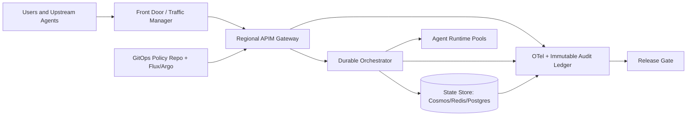
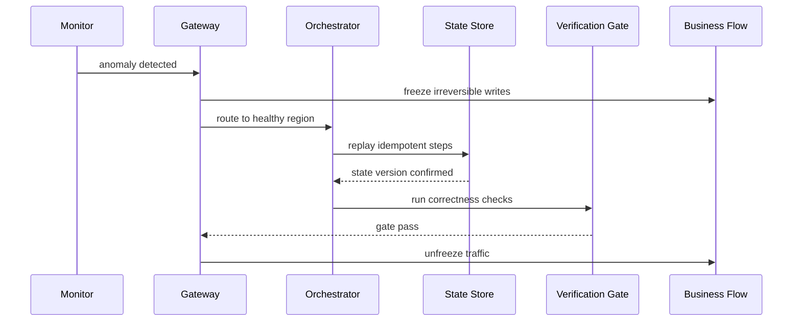

# Enterprise Agent Control-Plane Disaster-Recovery Selection FAQ: `APIM + GitOps` vs `Traffic Manager + Regional Active-Active` vs `Application Self-Healing Orchestration` (RTO/RPO, Policy Drift, and Audit Closure)

## 1. Executive Summary: The Most Expensive Failure Is Not Downtime, It Is Incorrect Recovery
In enterprise DR reviews, teams often optimize for recovery time objective only. In agent platforms, the dominant enterprise loss frequently comes from incorrect recovery semantics: traffic fails over, but policy versions diverge; service becomes reachable, but session context is stale; requests complete, but audit lineage is broken. These failure patterns trigger duplicate side effects, financial reconciliation incidents, compliance escalations, and trust erosion. Therefore control-plane DR architecture must jointly govern ingress policy, orchestration continuity, release process, and observability evidence. This guide concludes: `APIM + GitOps` is the enterprise primary pattern; `Traffic Manager + regional active-active` is a cost-friendly acceleration path; `application self-healing orchestration` is best for high-value semantic continuity. Production resilience is achieved through layered composition, not single-mechanism dependence.

## 2. Daily Breakthrough Evidence (Fetched `2026-11-21`)
To preserve verification quality, this section uses official or traceable release sources only. Evidence is tagged as `measured`, `synthetic`, or `anonymized_reported`.

| Topic | Source | Retrieved | Label | Relevance |
|---|---|---|---|---|
| APIM AI Gateway overview | https://learn.microsoft.com/en-us/azure/api-management/ai-gateway-overview | 2026-11-21 | measured | Defines ingress policy and control-plane contract patterns |
| APIM changelog | https://github.com/Azure/API-Management/blob/main/changelogs/api-management-service.md | 2026-11-21 | anonymized_reported | Shows policy-plane evolution velocity and regression needs |
| ACA Dynamic Sessions | https://learn.microsoft.com/en-us/azure/container-apps/sessions | 2026-11-21 | measured | Sessionized runtime behavior raises continuity requirements |
| Firecracker releases | https://github.com/firecracker-microvm/firecracker/releases | 2026-11-21 | anonymized_reported | Runtime recovery speed improvements shift risk to control plane |
| Kata releases | https://github.com/kata-containers/kata-containers/releases | 2026-11-21 | anonymized_reported | Isolation-layer shifts influence failover behavior boundaries |
| Wasmtime releases | https://github.com/bytecodealliance/wasmtime/releases | 2026-11-21 | anonymized_reported | Componentized execution increases need for explicit recovery contracts |
| E2B releases | https://github.com/e2b-dev/e2b/releases | 2026-11-21 | anonymized_reported | Faster sandbox recovery does not guarantee policy-consistent failover |

The daily signal is practical: as data-plane recovery improves, control-plane consistency becomes the dominant risk.

## 3. Problem Boundary: Control-Plane DR Is Not “Deploy More Gateways”
The control plane includes ingress routing rules, identity policies, quota contracts, authorization logic, audit-required fields, and release metadata. Any cross-region drift in these artifacts can turn failover into a new failure vector. Common anti-patterns: replicating infrastructure without replicating policy versions; switching routes without validating state-version convergence; declaring success from HTTP reachability without validating business correctness. A robust design must answer: how policy parity is enforced, how state continuity is guaranteed, how post-failover actions remain auditable, and how DR controls are release-governed.

## 4. Four-Layer Reference Model: Ingress, Policy, Orchestration, Audit
A practical architecture decomposes DR responsibilities into four layers: ingress enforcement, policy lifecycle management, orchestration continuity, and audit/verification closure.



This model converts DR from ad-hoc incident practice into an engineered release capability.

## 5. 12-Dimension Comparison Matrix
| Dimension | APIM + GitOps | Traffic Manager + Regional Active-Active | Application Self-Healing | Decision Signal |
|---|---|---|---|---|
| Policy consistency | High | Medium | Medium-high | Governance-heavy estates favor APIM + GitOps |
| Switch speed | High | Medium | Medium-high | Strict RTO often favors policy-rich ingress |
| State continuity semantics | Medium-high | Medium | High | High-value flows benefit from app-level recovery logic |
| Operational complexity | Medium | Low-medium | High | Team maturity determines viable depth |
| Audit traceability | High | Medium | Medium-high | Regulated sectors favor APIM-led evidence |
| Release-gate integration | High | Medium | High | GitOps aligns strongly with release governance |
| Cost controllability | Medium | High | Medium | Budget-first programs often start with Traffic Manager |
| Cross-team alignment cost | Medium | Low | High | Org maturity influences rollout order |
| Multi-tenant policy isolation | High | Medium | Medium-high | SaaS tenancy boundaries favor APIM governance |
| Incorrect-recovery risk | Low-medium | Medium | Medium-high | Validation gates are mandatory in all patterns |
| Evolution flexibility | High | Medium | High | Long-term programs converge to hybrids |
| Productization readiness | High | Medium | Medium | Platform teams usually anchor on APIM + GitOps |

The matrix is intended for staged architecture planning, not winner-take-all selection.

## 6. Path A: `APIM + GitOps` as Versioned Control Plane
This path treats policy as code and makes policy changes first-class release artifacts. Each policy change is tied to version IDs, code review records, promotion criteria, and deterministic rollback points. Under incident pressure, teams can restore known-good policy sets instead of editing production gateways manually. A key implementation discipline is to package routing rules, quota rules, identity checks, and audit-field requirements inside one GitOps deployment contract. Failover should be blocked when policy parity fails. Without this rule, the platform frequently suffers “reachable but wrong” recoveries.

## 7. Path B: `Traffic Manager + Regional Active-Active` for Fast Baseline Resilience
This pattern is useful for cost-sensitive programs or early-stage migration phases that need rapid regional resilience without high complexity. DNS-level probing and weighted/failover routing provide baseline continuity. However,
DNS behavior introduces variability
through resolver caching and client TTL behavior.
When workloads require
path-level policy control,
tenant-priority routing,
or strict release-audited policy transitions,
DNS-only failover is insufficient.
In practice,
many enterprises adopt this path first
and layer APIM/GitOps governance over time.

## 8. Path C: Application Self-Healing for Semantic Recovery
Application-level self-healing orchestration
enables workflow-semantic decisions:
when to replay,
when to compensate,
when to skip,
and when to pause irreversible operations.
This is especially valuable in
payments,
claims,
order-processing,
and contract workflows.
Its cost is engineering depth:
state machine rigor,
event-contract discipline,
idempotency implementation quality,
and advanced test automation.
Without platform-level hygiene,
self-healing logic can increase complexity faster than reliability.
Therefore this path is strongest
as an enhancement over stable ingress/policy governance.

## 9. Recommended Failover Sequence: Detect, Freeze, Switch, Verify, Unfreeze
A robust DR transition sequence includes five explicit steps:
detect,
freeze irreversible actions,
switch routing/orchestration,
verify correctness,
then unfreeze.



The freeze-and-verify stages are critical.
Without them,
failover can replicate logical errors at higher speed.

## 10. Quantitative Q&A (8 Anchors)
**Q1: What baseline RTO/RPO targets are common for critical control-plane paths?**  
Many enterprises use targets near `RTO <= 60s` and `RPO <= 30s` for top-tier workflows (`anonymized_reported`).

**Q2: Why do financial correctness incidents still occur after successful regional failover?**  
Because reachability was validated, but state-version convergence and idempotency correctness were not.

**Q3: How can policy consistency be measured objectively?**  
Use regional policy-hash parity and policy-version drift metrics with strict alert thresholds.

**Q4: Why does failover often increase short-window operating cost?**  
Retry amplification plus cross-region transit commonly drives temporary `1.2x-1.6x` cost increase (`synthetic`).

**Q5: What idempotency window is practical for replay-safe recovery?**  
Windows commonly cover `30-90 min`, depending on retry and callback horizons.

**Q6: How soon should post-failover correctness verification complete?**  
Critical paths often target full correctness verification within `15 min`.

**Q7: Is DNS failover variability automatically a failure?**  
No, but it must be modeled in SLO/error-budget policy and user-impact telemetry.

**Q8: What minimum audit fields should be preserved for each failover decision?**  
At least `tenant_id`, `correlation_id`, `policy_version`, `region`, and `decision`.

## 11. Production Code Example: Policy-Parity Gate + Idempotent Resume
```python
from dataclasses import dataclass
from typing import Dict


@dataclass
class ControlPlaneSnapshot:
    region: str
    policy_version: str
    routing_version: str


def policy_consistent(primary: ControlPlaneSnapshot, secondary: ControlPlaneSnapshot) -> bool:
    return (
        primary.policy_version == secondary.policy_version
        and primary.routing_version == secondary.routing_version
    )


def resume_step(state: Dict[str, str], idem_key: str) -> Dict[str, str]:
    if state.get("last_idem_key") == idem_key:
        return {"status": "duplicate_skipped"}
    state["last_idem_key"] = idem_key
    return {"status": "resumed"}


def can_failover(primary: ControlPlaneSnapshot, secondary: ControlPlaneSnapshot) -> Dict[str, str]:
    if not policy_consistent(primary, secondary):
        return {"status": "blocked", "reason": "policy_drift_detected"}
    return {"status": "allowed", "reason": "version_aligned"}
```

The key principle is explicit failover gating.
If policy parity fails,
automatic switchover should not proceed.

## 12. IaC and Contract Snippets: Declaring DR Control-Plane Guarantees
```yaml
apiVersion: platform.dr/v1
kind: ControlPlaneFailoverContract
metadata:
  name: agent-control-plane-dr
spec:
  targetRtoSeconds: 60
  targetRpoSeconds: 30
  preconditions:
    - policyVersionAligned
    - routingVersionAligned
    - auditPipelineHealthy
  freezePolicy:
    blockIrreversibleWrites: true
    maxFreezeSeconds: 300
  validation:
    requireStateVersionCheck: true
    requireBusinessProbe: true
  costGuard:
    maxSpikeRatio: 1.5
```

```bicep
param apimName string
param location string = resourceGroup().location

resource apim 'Microsoft.ApiManagement/service@2022-08-01' = {
  name: apimName
  location: location
  sku: {
    name: 'Premium'
    capacity: 1
  }
  properties: {
    publisherEmail: 'platform@example.com'
    publisherName: 'platform-team'
  }
}
```

The intent is to bind policy, routing, verification, and cost controls
into one release-governed artifact.

## 13. Enterprise Scenario A: National Payments and Settlement Platform
A large payment platform
operating high-value daily transactions
initially implemented failover as route switching only.
During incidents,
duplicate side-effect alerts still occurred
because policy and state validation gates were missing.
The remediation program introduced
APIM + GitOps policy parity,
idempotent resume gates in orchestration,
and freeze/unfreeze controls for irreversible operations.
Operational outcomes included
lower duplicate-action incidence,
faster regulator-facing reconstruction,
and tighter incident containment.
The key lesson:
switching traffic without correctness gates
is not production recovery.

## 14. Enterprise Scenario B: Global B2B Support and Ticketing Platform
A multi-region SaaS platform
started with Traffic Manager to establish baseline resilience quickly.
As workflow criticality increased,
it introduced APIM regional governance
and then application-level semantic recovery for premium workflows.
This staged approach preserved delivery velocity
while improving correctness and audit posture.
Over time,
the platform transitioned from
manual incident handling
to release-gated automated DR operations.
The most significant gain was organizational:
network, platform, and product teams
aligned around one DR contract language.

## 15. FinOps TCO, Five-Step Rollout, and Day-0/Day-2 Checklist
### 15.1 Cost Reference (Two-Region Control Plane)
| Cost Surface | APIM + GitOps | Traffic Manager Active-Active | App Self-Healing Enhancement |
|---|---|---|---|
| Ingress/policy platform cost | Medium-high | Low-medium | Medium |
| Operations labor cost | Medium | Low | High |
| Incident loss exposure | Low | Medium | Low |
| Audit/compliance overhead | Low | Medium | Medium |
| Long-term evolution headroom | High | Medium | High |
| Strategic position | Primary enterprise pattern | Acceleration baseline | High-value semantic layer |

### 15.2 Five-Step Rollout Guide
1. Define dual targets: availability (RTO/RPO) and correctness acceptance criteria.
2. Implement policy versioning with regional parity checks as hard preconditions.
3. Implement idempotent resume and freeze/unfreeze control choreography.
4. Integrate DR validation into release gates and pre-release rehearsals.
5. Run monthly tri-axis review on availability, correctness, and cost drift.

### 15.3 Good Fit vs Not For
**Good fit**
for multi-tenant, cross-region platforms
with high-value workflows and audit obligations.

**Not for**
single-region low-value internal experiments
that tolerate manual restoration and partial inconsistency.

### 15.4 Day-0 / Day-2 Twelve-Item Checklist
1. Define regional priority model and failover trigger thresholds.
2. Standardize policy-version naming and promotion controls.
3. Standardize state-version checkpoint fields.
4. Define idempotency-key schema and retention windows.
5. Implement freeze/unfreeze SOP for irreversible actions.
6. Set failover-window cost guardrails and escalation routes.
7. Define cross-team command protocol for incidents.
8. Implement automated post-failover business probes.
9. Define failback criteria and rollback safety checks.
10. Store immutable evidence for each failover decision.
11. Run quarterly end-to-end failover rehearsals.
12. Track corrective actions and accountability to closure.

### 15.5 Common Pitfalls and Mitigations (Addendum)
Pitfall one:
teams validate only reachability
and skip business correctness probes.
Mitigation:
make correctness probes part of failover completion criteria.
Pitfall two:
policy releases and infrastructure releases drift independently.
Mitigation:
ship them as one coordinated release unit with unified rollback.
Pitfall three:
failover cost spikes are observed but unmanaged.
Mitigation:
encode cost thresholds and degrade actions in DR contracts.

### 15.6 Operating Baseline Recommendations (Addendum)
Maintain a four-quadrant operating dashboard:
reachability,
correctness,
performance,
and cost.
Record for every failover event:
trigger condition,
policy/routing version snapshot,
validation evidence,
and rollback/failback decisions.
Bind these records
to quarterly audit cycles
and platform maturity scorecards.
This is what converts DR
from a project artifact
into a sustained operating capability.

### 15.7 Governance and Organization Addendum
Technical design alone is insufficient.
Control-plane DR quality depends on
clear ownership between
network,
platform,
application,
and FinOps teams.
A practical model uses
one incident command template
for both drills and real incidents,
so teams do not switch communication patterns under stress.
Post-incident review should be structured and mandatory,
capturing decision rationale,
timelines,
user impact,
cost impact,
and bounded remediation commitments.
Without this operating discipline,
even high-quality architecture degrades over time.

### 15.8 Staged Maturity Path (Addendum)
A practical maturity path uses four stages.
Stage one establishes visibility:
standard probes,
aligned alert taxonomy,
and normalized failover logs.
Stage two establishes controllability:
freeze/unfreeze operations,
policy parity gates,
and idempotent resume checks.
Stage three establishes release-verifiability:
DR validation suites are attached to high-risk releases.
Stage four establishes optimization:
quarterly threshold tuning,
rollback-rule hardening,
and cost-guard refinement based on incident evidence.
This staged model helps teams avoid
premature complexity while still converging toward
auditable and deterministic resilience operations.

---

### Conclusion
Enterprise control-plane DR for agent platforms
is not a redundancy-count problem.
It is a recovery-correctness engineering problem.
A layered approach centered on
`APIM + GitOps`,
augmented by `Traffic Manager` for rapid baseline resilience
and application self-healing for high-value semantic continuity,
then enforced through release gates and audit evidence,
provides a practical and durable path to real production resilience.
