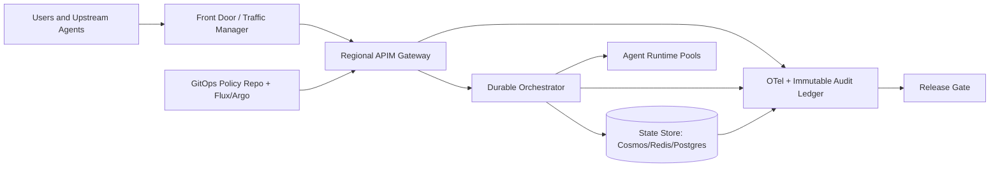
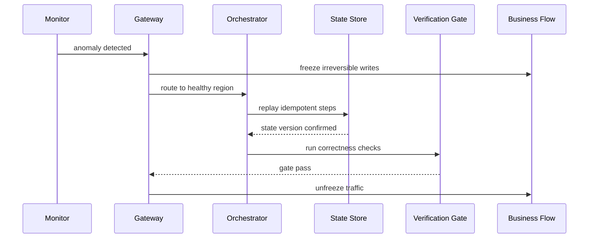

# 企业 Agent 控制平面容灾选型 FAQ：`APIM + GitOps` vs `Traffic Manager + 区域双活` vs `应用自愈编排`（RTO/RPO、策略漂移与审计闭环）

## 1. 执行摘要：生产故障里最昂贵的不是“宕机”，而是“错误恢复”
企业在讨论容灾时， 通常只看 恢复时间（RTO）。 但在 Agent 平台里， 更高代价往往来自 错误恢复。 例如： 流量切到备区了， 但策略版本不同； 请求恢复了， 但会话状态错位； 服务可用了， 但审计证据断链。 这类问题会导致 重复执行、 错账、 误判、 合规风险 与客户信任损失。 因此控制平面容灾选型 必须同时覆盖 入口策略、 编排状态、 发布流程、 观测审计。 本指南给出的结论是： `APIM + GitOps` 是企业主路径； `Traffic Manager + 区域双活` 适合成本友好型快速落地； `应用自愈编排` 用于高价值业务链路的语义级恢复增强。 三者组合优于单栈押注。

## 2. 今日热点与可验证来源（抓取日 `2026-11-21`）
本轮仅采纳官方或可追溯发布源。

| 主题 | 来源 | 抓取日 | 标签 | 作用 |
|---|---|---|---|---|
| APIM AI Gateway 概览 | https://learn.microsoft.com/en-us/azure/api-management/ai-gateway-overview | 2026-11-21 | measured | 入口控制平面与策略治理基座 |
| APIM Changelog | https://github.com/Azure/API-Management/blob/main/changelogs/api-management-service.md | 2026-11-21 | anonymized_reported | 策略能力演进证据，指导回归门禁 |
| ACA Sessions | https://learn.microsoft.com/en-us/azure/container-apps/sessions | 2026-11-21 | measured | 会话化运行时要求恢复期上下文连续 |
| Firecracker Releases | https://github.com/firecracker-microvm/firecracker/releases | 2026-11-21 | anonymized_reported | 运行时恢复变快，控制平面更需跟上 |
| Kata Releases | https://github.com/kata-containers/kata-containers/releases | 2026-11-21 | anonymized_reported | 隔离层演进影响故障切换行为 |
| Wasmtime Releases | https://github.com/bytecodealliance/wasmtime/releases | 2026-11-21 | anonymized_reported | 组件化执行要求更强契约化恢复 |
| E2B Releases | https://github.com/e2b-dev/e2b/releases | 2026-11-21 | anonymized_reported | 沙箱恢复快不等于入口策略可恢复 |

核心结论： 数据面恢复速度提升后， 控制平面一致性 成为下一主风险面。

## 3. 问题边界：控制平面容灾不等于“多部署几个网关”
控制平面包含 入口策略、 路由规则、 配额合同、 身份信任、 审计字段、 发布版本元数据。 任一维度漂移， 都会让“恢复”变成“新事故入口”。 典型反模式包括： 只复制实例， 不复制策略版本； 只切路由， 不校验状态版本； 只恢复可达， 不验证业务正确性。 因此本题必须回答： 如何保证策略一致； 如何保证状态续接； 如何保证恢复后可审计； 如何把恢复动作纳入发布治理。

## 4. 四层解耦参考架构：入口、策略、编排、审计
推荐采用四层模型： 入口层做流量与身份门禁， 策略层做版本化与分发， 编排层做幂等续接， 审计层做证据链封存。



该模型把恢复动作 从“人工临场”转为“可发布的工程能力”。

## 5. 12 维对比矩阵：三条容灾路径的适配差异
| 维度 | APIM + GitOps | Traffic Manager + 区域双活 | 应用自愈编排 | 架构信号 |
|---|---|---|---|---|
| 策略一致性 | 高 | 中 | 中高 | 强治理优先 APIM+GitOps |
| 切换速度 | 高 | 中 | 中高 | 秒级切换偏 APIM 主平面 |
| 状态续接语义 | 中高 | 中 | 高 | 高价值会话偏应用自愈 |
| 运维复杂度 | 中 | 低到中 | 高 | 团队成熟度决定上限 |
| 审计追溯能力 | 高 | 中 | 中高 | 监管行业偏 APIM 路线 |
| 发布门禁联动 | 高 | 中 | 高 | 发布治理重视 GitOps |
| 成本可控性 | 中 | 高 | 中 | 快速起步偏 Traffic Manager |
| 跨团队协作成本 | 中 | 低 | 高 | 组织协同弱时先简后繁 |
| 多租户策略隔离 | 高 | 中 | 中高 | SaaS 平台偏 APIM |
| 误恢复风险 | 低到中 | 中 | 中高 | 需靠验证门禁压降 |
| 演进弹性 | 高 | 中 | 高 | 长期一般走组合 |
| 可产品化程度 | 高 | 中 | 中 | 平台化优先 APIM+GitOps |

## 6. 路线 A：`APIM + GitOps` 的版本化控制平面
该路线核心价值是 将策略当作代码管理。 每次策略变更都有 版本号、 评审记录、 发布窗口、 回滚方案。 故障期间， 可以快速回滚到已知稳定策略集， 而不是临场手改配置。 建议将 配额策略、 路由策略、 鉴权策略、 审计字段策略 统一纳入同一 GitOps 工件。 并把策略一致性校验 作为切换前置条件。 这样才能避免 “流量切过去了， 策略没对齐”的典型事故。

## 7. 路线 B：`Traffic Manager + 区域双活` 的轻量容灾起步
对预算敏感或迁移早期团队， 该路线可快速获得基础容灾能力。 它以 DNS 级探测与分流为主， 实施门槛低， 可作为第一阶段。 但 DNS 缓存与客户端行为 会带来切换不确定性。 若业务需要细粒度路径治理、 租户分层降级、 策略级审计， 则需叠加入口网关与发布门禁。 因此此路线适合作为起步层， 不适合作为终态。

## 8. 路线 C：应用自愈编排的语义级恢复
应用自愈编排 可按业务语义决定 何时重放、 何时跳过、 何时补偿。 对高价值交易流程 尤其有效。 例如支付、理赔、工单升级链路， 可以基于幂等键和状态版本 做精确恢复。 但这一路线对工程能力要求高： 需要完整状态机设计、 严格事件契约、 强测试覆盖。 若平台基础治理薄弱， 先上复杂自愈逻辑 往往会增加故障面。

## 9. 切换流程建议：检测、冻结、切换、验证、解冻
生产推荐采用 五步切换法： 检测异常； 冻结高风险写操作； 切换入口与编排； 验证正确性； 解冻业务流量。



关键在“冻结与验证”。 没有这两步， 切换只是把错误传播到备区。

## 10. 定量 Q&A（8 组）
**Q1：RTO 与 RPO 建议值？** 核心链路常见目标为 `RTO <= 60s`、`RPO <= 30s`（`anonymized_reported`）。

**Q2：为什么切换成功仍会产生账务问题？** 因为恢复只验证了可达， 没有验证状态版本一致性。

**Q3：策略一致性如何量化？** 可用“区域策略哈希一致率”指标， 目标接近 `100%`。

**Q4：切换期间成本为何上升？** 重试叠加跨区流量， 短时成本可放大 `1.2x-1.6x`（`synthetic`）。

**Q5：幂等键窗口建议？** 应覆盖最长重试与回补窗口， 常见 `30-90 min`。

**Q6：恢复后多久应完成正确性校验？** 关键链路建议 `15 min` 内完成。

**Q7：DNS 切换慢是否等于失败？** 不一定， 但必须纳入 SLO 与用户感知监控。

**Q8：最小审计字段集是什么？** `tenant_id`、`correlation_id`、`policy_version`、`region`、`decision`。

## 11. 生产代码示例：策略版本校验与幂等恢复
```python
from dataclasses import dataclass
from typing import Dict


@dataclass
class ControlPlaneSnapshot:
    region: str
    policy_version: str
    routing_version: str


def policy_consistent(primary: ControlPlaneSnapshot, secondary: ControlPlaneSnapshot) -> bool:
    return (
        primary.policy_version == secondary.policy_version
        and primary.routing_version == secondary.routing_version
    )


def resume_step(state: Dict[str, str], idem_key: str) -> Dict[str, str]:
    if state.get("last_idem_key") == idem_key:
        return {"status": "duplicate_skipped"}
    state["last_idem_key"] = idem_key
    return {"status": "resumed"}


def can_failover(primary: ControlPlaneSnapshot, secondary: ControlPlaneSnapshot) -> Dict[str, str]:
    if not policy_consistent(primary, secondary):
        return {"status": "blocked", "reason": "policy_drift_detected"}
    return {"status": "allowed", "reason": "version_aligned"}
```

这段代码强调： 无策略一致性， 不应允许自动切换。

## 12. IaC 与策略片段：容灾合同声明化
```yaml
apiVersion: platform.dr/v1
kind: ControlPlaneFailoverContract
metadata:
  name: agent-control-plane-dr
spec:
  targetRtoSeconds: 60
  targetRpoSeconds: 30
  preconditions:
    - policyVersionAligned
    - routingVersionAligned
    - auditPipelineHealthy
  freezePolicy:
    blockIrreversibleWrites: true
    maxFreezeSeconds: 300
  validation:
    requireStateVersionCheck: true
    requireBusinessProbe: true
  costGuard:
    maxSpikeRatio: 1.5
```

```bicep
param apimName string
param location string = resourceGroup().location

resource apim 'Microsoft.ApiManagement/service@2022-08-01' = {
  name: apimName
  location: location
  sku: {
    name: 'Premium'
    capacity: 1
  }
  properties: {
    publisherEmail: 'platform@example.com'
    publisherName: 'platform-team'
  }
}
```

## 13. 企业场景一：全国支付与清结算
某支付平台 主备双区域部署，
日均高价值交易超千万级。
初期方案只做流量切换，
多次出现恢复后重复扣款告警。
改造后采用
APIM + GitOps 统一策略版本，
并在编排层增加幂等恢复门禁。
同时在切换流程中增加
冻结不可逆写操作与业务探针验证。
结果是
重大故障期间
业务连续性提升，
重复副作用显著下降，
监管审计查询响应时间缩短。

## 14. 企业场景二：全球 B2B 工单与客服平台
某全球 SaaS 平台
覆盖多地区租户。
他们先使用 Traffic Manager
快速建立区域双活，
后续逐步引入 APIM 策略治理。
针对高价值租户链路，
再叠加应用自愈编排。
这种分阶段路线
让团队在控制复杂度的同时
持续提高恢复正确性。
上线一年后，
其故障恢复从“人工操作主导”
转向“自动化门禁主导”。

## 15. FinOps TCO、五步落地与 Day-0/Day-2 清单
### 15.1 成本参考（双区域控制平面）
| 成本项 | APIM + GitOps | Traffic Manager 双活 | 应用自愈增强 |
|---|---|---|---|
| 入口与策略成本 | 中高 | 低到中 | 中 |
| 运维人力成本 | 中 | 低 | 高 |
| 故障损失风险 | 低 | 中 | 低 |
| 审计成本 | 低 | 中 | 中 |
| 长期演进弹性 | 高 | 中 | 高 |
| 适配结论 | 主路径 | 起步路径 | 高价值增强 |

### 15.2 五步落地指南
1. 定义 RTO/RPO 与业务正确性双目标。
2. 建立策略版本化与区域一致性校验。
3. 建立幂等恢复与冻结解冻流程。
4. 将切换验证纳入发布门禁。
5. 按月复盘可用性、正确性、成本三指标。

### 15.3 Good fit vs Not for
**Good fit：**
多租户、
跨区域、
高价值业务流程、
且有审计要求的平台。

**Not for：**
单区域实验环境、
低价值内部自动化、
且可接受人工恢复的场景。

### 15.4 Day-0 / Day-2 十二项清单
1. 定义区域优先级与切换触发阈值。
2. 定义策略版本命名与发布流程。
3. 定义状态版本字段与检查点规则。
4. 定义幂等键范围与保留窗口。
5. 建立冻结/解冻标准操作流程。
6. 建立故障期间成本护栏。
7. 建立跨团队战情协同机制。
8. 建立自动化业务探针验证。
9. 建立回滚与回切准入条件。
10. 建立审计证据不可篡改链。
11. 建立季度全链路切换演练。
12. 建立复盘整改闭环与责任追踪。

### 15.5 常见误区与修正建议（补充）
误区一：
只做路由切换演练，
不做业务正确性演练。
修正：
把业务探针设为切换完成条件。
误区二：
策略变更与基础设施变更分开发布。
修正：
统一变更包与统一回滚。
误区三：
忽略故障期成本治理。
修正：
在容灾合同内内置成本阈值与降级策略。

### 15.6 运营基线建议（补充）
建议维持四象限看板：
可达性、
正确性、
性能、
成本。
同时记录每次切换的
触发条件、
策略版本、
验证结果、
回滚动作。
这些记录应和季度审计
以及平台成熟度评估绑定。
只有这样，
控制平面容灾才能从“项目能力”
升级为“长期运营能力”。

### 15.7 阶段化演进路线（补充）
建议将控制平面容灾建设
划分为四个阶段。
阶段一是
可见性建立：
统一健康探测、
统一告警分级、
统一切换日志格式。
这一阶段的核心目标
不是自动化，
而是让团队看见
“发生了什么、在哪里发生、影响多大”。
阶段二是
可控切换：
引入冻结与解冻机制，
引入策略一致性硬门禁，
引入幂等恢复检查。
此阶段目标是
把“人为经验”变成“流程约束”。
阶段三是
可验证发布：
将切换验证并入发布流程，
让每次重大变更都经过最小容灾验证集。
阶段四是
可持续优化：
按季度基于事件复盘
调整阈值、
更新回滚条件、
压缩恢复窗口、
优化成本护栏。
在多数企业里，
真正的韧性提升
往往发生在第三、四阶段，
因为组织协同与自动化开始形成正反馈。

### 15.8 关键角色职责边界（补充）
网络团队负责
探测路径可达性、
入口链路容量、
DNS/边缘路由策略。
平台团队负责
策略发布一致性、
编排引擎稳定性、
状态存储复制健康。
应用团队负责
业务探针定义、
幂等语义实现、
异常补偿正确性。
FinOps 团队负责
故障窗口成本监控、
预算阈值建议、
异常成本复盘。
安全与合规团队负责
审计证据完整性、
访问策略合理性、
监管响应材料。
把职责边界写入 runbook，
并在演练中验证，
可以显著降低真实故障中的决策摩擦。

### 15.9 复盘模板建议（补充）
每次切换后建议输出统一复盘模板：
第一部分是时间线，
记录从告警触发到业务恢复全过程。
第二部分是决策点，
记录每次关键决策依据和批准者。
第三部分是指标变化，
记录可达性、正确性、性能、成本四象限曲线。
第四部分是用户影响，
记录受影响租户数量、
关键业务失败率、
恢复后补偿情况。
第五部分是整改计划，
记录任务、负责人、截止时间与验收标准。
统一模板的价值在于
让跨团队复盘可对比、
可累积、
可形成知识资产，
而不是每次从零开始总结。

### 15.10 指标口径统一与审计映射（补充）
在大型企业中，容灾建设常见的失败点不是“技术做不到”，而是“指标口径不一致导致跨团队无法对齐结论”。建议把控制平面容灾指标分为四层：链路层（DNS 解析成功率、入口握手失败率、跨区重试时延）、平台层（配置分发一致性、策略生效延迟、状态复制滞后）、应用层（关键事务成功率、幂等冲突率、补偿完成率）、业务层（订单/工单恢复时间、受影响租户比例、人工介入占比），并为每一层建立统一采集窗口、统一聚合函数、统一阈值分级。进一步地，应将上述指标直接映射到审计条款：例如将“策略生效延迟 P95”映射至变更可控性证据，将“幂等冲突率”映射至恢复正确性证据，将“补偿完成率”映射至客户影响收敛证据，确保架构评审、运维复盘、合规审计使用同一套事实基线。这样在季度治理会上，团队不需要再争论“数据是否可比”，而是可以直接讨论“哪一类风险仍未被收敛、下个季度优先改哪里”，从而把容灾治理从被动救火升级为可计划、可度量、可持续优化的工程体系。
同时建议把“恢复正确性”纳入平台级 KPI，而不是只跟踪“恢复速度”：恢复速度可以通过频繁切流快速变好，但如果缺少业务幂等与补偿一致性验证，短时间内会放大后续数据修复成本。把“切换后 24 小时账务对齐通过率”“关键队列重复消费率”“跨区域策略差异条目数”纳入例会看板，能够更早发现控制平面设计中的结构性短板，并把容灾建设目标从“快切换”升级为“快且正确地恢复”，并形成长期治理基线。

---

### 结论
企业 Agent 控制平面容灾
不是“多部署”问题，
而是“恢复正确性”问题。
以 `APIM + GitOps` 为主线，
结合 `Traffic Manager` 的成本友好起步能力，
并在关键链路引入应用自愈编排，
再配合发布门禁与审计闭环，
才能实现真正可持续的多区域韧性。
