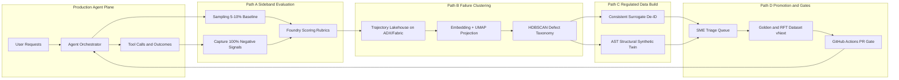
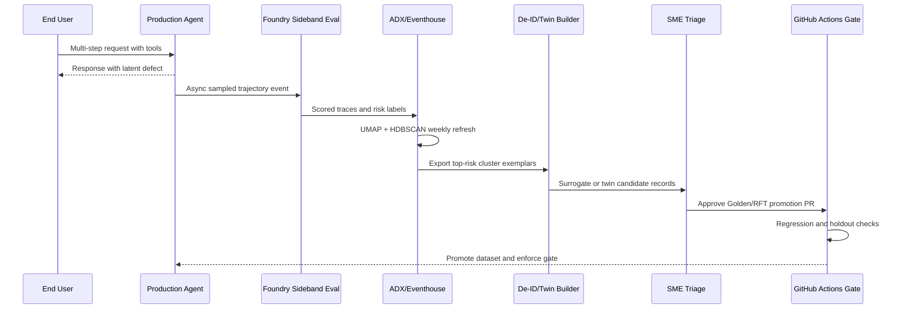

# Enterprise Agent Data Flywheel FAQ: Foundry Online Sideband Evaluation vs ADX HDBSCAN Failure Clustering vs Synthetic Twin Reconstruction vs GitOps Golden/RFT Promotion
> 🌐 **Language Switch**: [中文](agent-data-flywheel-failure-clustering-foundry-online-eval-vs-adx-hdbscan-vs-synthetic-twin-selection-faq.md) | **English (current)**  
> Audience: Principal Cloud & AI Solution Architects, LLMOps platform owners, data governance leads, security/compliance officers, and FinOps stakeholders.  
> Scope: Closed-loop production failure-to-eval and RFT data flywheel architecture with regulated trace processing and automated promotion into CI gates.  
> Out-of-scope: This guide does not repeat base telemetry ingestion patterns from #146 or pre-release synthetic red-team patterns from #152.  
## 1. Executive outcome: without a production data flywheel, quality improvement plateaus
Many organizations already collect runtime telemetry.  
Telemetry alone does not create learning loops.  
Alert streams identify incidents but not durable quality improvements.  
Agent failures in production are usually trajectory failures, not single-turn misses.  
They involve multiple tool calls, retries, and context transitions.  
If these trajectories are not converted into reusable evaluation assets, fixes stay local.  
Engineering then repeats the same postmortems with limited long-term gain.  
A production data flywheel solves that structural gap.  
The flywheel starts with low-latency sideband scoring.  
The flywheel continues with failure taxonomy discovery.  
The flywheel enforces compliance through controlled de-identification or twin generation.  
The flywheel ends in gated Golden and RFT promotion workflows.  
This guide defines four architecture paths for that lifecycle.  
Path A provides continuous online sideband evaluation.  
Path B provides scalable failure clustering and prioritization.  
Path C provides regulated data transformation into reusable artifacts.  
Path D provides SME adjudication and GitOps CI promotion.  
When all paths are connected, incident response becomes systematic learning.  
When any path is missing, quality gains decay over time.  
The target state is repeatable, auditable, and economically efficient improvement.  
## 2. Business boundaries and measurable success criteria
A flywheel architecture must answer three governance questions.  
Which production traces should enter evaluation pipelines.  
How sensitive context is transformed while preserving defect semantics.  
How curated outputs become enforced release gates and training inputs.  
Define measurable criteria at four layers.  
Sampling layer metrics track coverage and signal quality.  
Clustering layer metrics track root-cause concentration.  
Governance layer metrics track privacy safety and semantic integrity.  
Promotion layer metrics track defect escape and cycle-time reduction.  
A practical sampling baseline is `5%–10%` random traffic.  
Add `100%` capture for negative signals.  
Negative signals should include explicit thumbs-down events.  
They should also include user re-asks, HITL escalation events, and tool `4xx/5xx` retries.  
Clustering priorities should rank by `frequency x business_severity`.  
A strong near-term target is top-3 clusters covering `65%+` defects.  
Governance targets should include coreference preservation rate.  
For example, account aliases should remain stable across `8` tool steps.  
Promotion targets should include reproducible Golden regression checks.  
Every accepted fix should be provably validated before merge.  
Without measurable criteria, flywheel work degrades into dashboard theater.  
With measurable criteria, decisions become deterministic and accountable.  
## 3. Four-path architecture positioning for enterprise delivery
Path A solves continuous low-latency signal collection.  
Path B solves scalable and explainable root-cause grouping.  
Path C solves regulated transformation into reusable evaluation/training assets.  
Path D solves enforceable release gating and institutional memory.  
Path A is strongest for broad coverage with minimal user-impact risk.  
Path B is strongest for engineering prioritization under high trace volume.  
Path C is strongest for privacy-constrained sectors with strict data boundaries.  
Path D is strongest for sustained quality gains across releases.  
A frequent anti-pattern is running only Path A.  
That yields many scores but weak remediation focus.  
Another anti-pattern is running only Path B.  
That yields taxonomies but no compliant dataset promotion path.  
A third anti-pattern is running only Path D.  
That yields strict gates but stale or biased inputs.  
The robust model uses all four paths in sequence.  
A captures rich and representative failure traces.  
B condenses traces into actionable defect families.  
C turns those families into compliant reusable artifacts.  
D enforces regression and promotion policies in CI.  
This sequence transforms operational pain into reusable quality capital.  
It also enables transparent trade-offs between risk, cost, and velocity.  
## 4. Twelve-dimension comparison matrix
| Dimension | A: Foundry Online Sideband Eval | B: ADX/Fabric + UMAP/HDBSCAN | C: Surrogate De-ID vs Synthetic Twin | D: SME Queue + GitOps Promotion |
|---|---|---|---|---|
| Initial rollout speed | Very high | Medium | Medium | Medium-high |
| User latency impact | Minimal | None | None | None |
| Failure discovery coverage | High | Very high | Medium-high | High |
| Root-cause explainability | Medium | Very high | High | High |
| Regulatory usability | Medium-high | High | Very high | High |
| Cross-turn coreference preservation | Medium | Medium | Very high (surrogate mode) | High |
| Training/eval reusability | Medium | High | Very high | Very high |
| Release gate automation | Low | Medium | Medium | Very high |
| Operational complexity | Low | Medium-high | Medium-high | Medium |
| Human review burden | Low | Medium | Medium-high | Medium |
| Defect escape reduction potential | Medium | High | High | Very high |
| Three-year ROI convergence | Medium | High | High | Very high |
The matrix should be weighted per regulatory profile and business model.  
Financial and healthcare programs usually weight compliance and coreference retention higher.  
SaaS support programs usually weight coverage and automation throughput higher.  
Global organizations usually weight data-boundary governance higher.  
Keep one shared matrix template and vary weights transparently.  
That practice improves architecture review consistency across teams.  
## 5. Path A deep dive: Foundry continuous online evaluation with stratified triggers
Path A establishes durable signal intake without user-latency penalties.  
Evaluation is executed asynchronously on sideband pipelines.  
This allows production traffic to remain unaffected by scoring workloads.  
Use a dual-trigger strategy from day one.  
Trigger lane one captures baseline random samples at `5%–10%`.  
Trigger lane two captures all high-risk negative signals.  
Negative signals include explicit negative feedback events.  
They also include implicit dissatisfaction proxies.  
Repeated user re-asks are a strong implicit proxy.  
HITL escalation requests are another high-value proxy.  
Consecutive tool retries with `4xx/5xx` outcomes are also essential.  
Path A is fast to deploy and easy to iterate.  
It creates immediate visibility into production behavior drift.  
It also creates sufficient volume for downstream clustering quality.  
A known risk is cost inflation from indiscriminate scoring.  
To avoid this, stratify upstream with App Insights attributes.  
For example, prioritize sessions with tool-error density spikes.  
Also prioritize sessions with intent-shift signatures across turns.  
Treat Path A as a signal engine, not a standalone remediation system.  
## 6. Path B deep dive: ADX/Eventhouse trajectory lakehouse with UMAP + HDBSCAN
Path B converts noisy failure streams into actionable defect families.  
Single incidents are poor optimization targets at scale.  
Clustered defect signatures reveal where fixes produce highest leverage.  
A typical pipeline has four stages.  
Stage one normalizes trajectory events into a canonical schema.  
Stage two embeds trajectory segments into vector space.  
Stage three applies dimensional projection for visual diagnostics.  
Stage four runs HDBSCAN to detect dense failure families and outliers.  
Each cluster is then scored by business impact and frequency.  
A practical ranking key is `frequency x business_severity`.  
Common labels include `stale_rag_chunk` patterns.  
Other labels include `ambiguous_tool_schema` signatures.  
You also often see `premature_stop` and `hallucinated_filter_arg` clusters.  
Mature teams run weekly cluster sprints with fixed cadence.  
Top clusters are mapped directly to engineering backlogs.  
This focuses effort where user pain is concentrated.  
A realistic target is top-3 clusters covering `65%+` defects.  
Without clustering, teams frequently optimize low-impact edge cases first.  
With clustering, defect reduction becomes measurable and strategic.  
## 7. Path C deep dive: consistent surrogate de-identification vs synthetic twins
Path C determines whether production traces can be reused safely.  
Naive `[REDACTED]` masking often destroys trajectory semantics.  
Cross-turn references become inconsistent and unrecoverable.  
This is especially harmful in tool-argument workflows.  
Format-preserving surrogate de-identification solves part of this issue.  
A keyed strategy can keep alias stability across turns.  
For example, `ACCT_91B2` can remain consistent across `8` tool calls.  
That preserves dependency structure for evaluation and preference learning.  
In high-regulation contexts, surrogate text may still be disallowed.  
Then synthetic twin generation becomes the primary path.  
Synthetic twins preserve trajectory structure and failure mechanics.  
They intentionally avoid copying production wording.  
Twin quality must be measured, not assumed.  
Track failure reproducibility between original and twin sets.  
Track semantic drift on holdout defect families.  
If twin fidelity degrades, rollback generation policies.  
Path C should be treated as a controlled data engineering product.  
It is not a one-time script or compliance checkbox.  
It requires versioning, audits, and quality gates like any core platform.  
## 8. Path D deep dive: SME adjudication queue and automated GitOps promotion
Path D turns insight into enforceable engineering behavior.  
Cluster outputs require domain confirmation before promotion.  
A lightweight SME queue keeps human effort focused and tractable.  
Each adjudication should answer a small fixed set of fields.  
Confirm root-cause tag and severity interpretation.  
Confirm expected behavior and acceptance criteria.  
Confirm promotion target: Golden regression or RFT preference pair.  
Approved records become versioned JSONL artifacts.  
Artifacts are submitted through PR-based GitOps workflows.  
GitHub Actions then enforces regression and holdout checks.  
Failed gates block merge by default.  
Successful gates publish dataset vNext candidates.  
RFT promotion should include anti-overfitting guardrails.  
Maintain temporally separated holdout cohorts.  
Maintain cluster-disjoint validation splits where possible.  
Monitor for “online gain, holdout loss” divergence patterns.  
Path D is where organizational memory becomes executable policy.  
Without D, flywheel output rarely survives release pressure.  
With D, quality learning becomes structural and cumulative.  
## 9. Reference architecture diagram: production-failure-to-promotion flywheel

The diagram emphasizes one end-to-end learning loop.  
Each path has explicit responsibilities and ownership boundaries.  
Each path can scale independently based on demand patterns.  
Each path can be audited with path-specific controls and metrics.  
This modularity supports evolution without major re-platforming events.  
It also improves blast-radius control during change windows.  
## 10. Sequence model: from clustered failure to CI-gated promotion

This sequence captures both automation and human adjudication.  
It also shows where compliance processing is inserted before CI.  
The cadence can be weekly for high-volume environments.  
The same pattern works in daily cadence for mission-critical stacks.  
Stable cadence is more important than ad-hoc heroics.  
## 11. Quantitative Q&A for architecture and governance reviews
**Q1: Explicit thumbs-down rates are often below `2%`; is that enough for evaluation sampling?**  
A1: No; explicit signals have low recall in most enterprise support journeys, so implicit dissatisfaction signals are needed to raise coverage.  
**Q2: Why does naive `[REDACTED]` masking break multi-turn tool argument consistency?**  
A2: Because entity references become unstable across turns, destroying cross-turn dependencies that graders and models require for trajectory reasoning.  
**Q3: How can surrogate de-identification preservation be measured?**  
A3: Track `coreference_preservation_rate` and tool-argument replay success; strong programs often target >90% preservation under controlled keys.  
**Q4: How can cycle time drop from `21 days` to `36 hours` in mature flywheels?**  
A4: Automation of sampling, clustering, compliant transformation, and PR gating removes queue waits and reduces SME effort to high-value adjudication only.  
**Q5: How should contamination and overfitting risk be controlled in Golden/RFT promotion?**  
A5: Use temporally separated holdout sets, cluster-disjoint validation cohorts, and fail merges when holdout trends diverge from in-sample gains.  
**Q6: Is top-3 cluster coverage above `65%` realistic?**  
A6: Yes in many long-tail defect distributions, provided trajectory features include tool outcomes, retry context, and user-intent drift markers.  
**Q7: Does synthetic twin generation always preserve failure mechanics?**  
A7: Not automatically; fidelity must be measured continuously with replay-based defect reproduction metrics and rollback thresholds.  
**Q8: What is the clearest ROI lens for flywheel investment?**  
A8: Combine defect-escape reduction, escalation-volume reduction, and cycle-time reduction with business-loss avoidance per escaped incident.  
These questions should be embedded in recurring architecture board templates.  
They reduce subjective debates and improve decision reproducibility.  
They also align engineering and compliance teams on shared evidence.  
## 12. Production query sample: ADX KQL for implicit frustration and tool retries
```kql
let Window = 7d;
let FrustrationSessions =
    AppTraces
    | where Timestamp > ago(Window)
    | where isnotempty(SessionId)
    | summarize
        ReAskCount = countif(EventName == "user.reask"),
        EscalationCount = countif(EventName == "hitl.escalation"),
        ToolRetry4xx5xx = countif(EventName == "tool.retry" and toint(StatusCode) between (400 .. 599)),
        ExplicitThumbsDown = countif(EventName == "feedback.explicit" and FeedbackValue == "down")
      by SessionId, TenantId, AgentVersion
    | where ReAskCount > 0 or EscalationCount > 0 or ToolRetry4xx5xx >= 2 or ExplicitThumbsDown > 0;
let JoinedTrajectories =
    AgentTrajectoryEvents
    | where Timestamp > ago(Window)
    | where SessionId in (FrustrationSessions | project SessionId)
    | summarize
        Steps = make_list(pack("step", StepIndex, "tool", ToolName, "status", StatusCode, "obs", Observation), 256),
        ToolErrorDensity = todouble(countif(toint(StatusCode) between (400 .. 599))) / todouble(max_of(count(), 1))
      by SessionId, TenantId, AgentVersion;
JoinedTrajectories
| join kind=inner FrustrationSessions on SessionId
| extend PriorityScore = (ReAskCount + EscalationCount * 2 + ToolRetry4xx5xx * 1.5 + ExplicitThumbsDown * 3) * (1 + ToolErrorDensity)
| project TenantId, SessionId, AgentVersion, PriorityScore, ReAskCount, EscalationCount, ToolRetry4xx5xx, ExplicitThumbsDown, Steps
| order by PriorityScore desc
```
This query is designed for high-value trajectory extraction.  
Its output can feed clustering and SME queues directly.  
It can also feed weekly defect concentration dashboards.  
Tune thresholds by product line and support SLA profile.  
Store query versions alongside release metadata for auditability.  
## 13. Production code sample: AST-preserving synthetic twin generator
```python
from __future__ import annotations

import hashlib
import hmac
import json
from dataclasses import dataclass
from typing import Dict, List, Any


@dataclass
class TwinConfig:
    tenant_key: bytes
    preserve_roles: bool = True


def stable_surrogate(token: str, key: bytes, prefix: str) -> str:
    digest = hmac.new(key, token.encode("utf-8"), hashlib.sha256).hexdigest()[:8].upper()
    return f"{prefix}_{digest}"


def map_entities(text: str, key: bytes) -> Dict[str, str]:
    entities: Dict[str, str] = {}
    for raw in text.split():
        if raw.startswith("ACCT") or raw.startswith("CUST") or raw.startswith("ORD"):
            prefix = raw.split("_")[0] if "_" in raw else "ENT"
            entities[raw] = stable_surrogate(raw, key, prefix)
    return entities


def replace_with_mapping(text: str, mapping: Dict[str, str]) -> str:
    output = text
    for src, dst in mapping.items():
        output = output.replace(src, dst)
    return output


def generate_synthetic_twin(trajectory: Dict[str, Any], cfg: TwinConfig) -> Dict[str, Any]:
    mapping: Dict[str, str] = {}
    steps: List[Dict[str, Any]] = []
    for step in trajectory.get("steps", []):
        role = step.get("role", "tool") if cfg.preserve_roles else "step"
        content = step.get("content", "")
        local_mapping = map_entities(content, cfg.tenant_key)
        mapping.update(local_mapping)
        safe_content = replace_with_mapping(content, mapping)
        safe_args = json.loads(json.dumps(step.get("tool_args", {})))
        for key, value in list(safe_args.items()):
            if isinstance(value, str):
                safe_args[key] = replace_with_mapping(value, mapping)
        steps.append(
            {
                "role": role,
                "tool": step.get("tool"),
                "tool_args": safe_args,
                "content": safe_content,
                "failure_tag": step.get("failure_tag"),
            }
        )
    return {
        "session_meta": {
            "trace_id": stable_surrogate(trajectory.get("trace_id", "TRACE"), cfg.tenant_key, "TRACE"),
            "agent_version": trajectory.get("agent_version"),
        },
        "entity_mapping_stats": {"count": len(mapping)},
        "steps": steps,
    }
```
This implementation highlights stable surrogate mapping across turns.  
It also preserves trajectory structure required for regression reproducibility.  
No raw production wording is required in output artifacts.  
Integrate this generator with policy checks and dataset signatures.  
Track twin fidelity metrics on every promotion cycle.  
## 14. Enterprise scenarios and ROI model
### Scenario A: retail and commercial banking servicing agent under PCI-DSS/GLBA
The platform receives roughly `14,000` escalations per week.  
Previous remediation relied on manual sampling and long review queues.  
The team implemented all four flywheel paths end-to-end.  
Path A captured sideband risk signals continuously.  
Path B produced weekly defect cluster priorities.  
Path C generated zero-PII synthetic twin records for CI and RFT.  
Path D enforced Golden/RFT promotion via PR gates.  
Within one quarter, repeated escalation defects declined materially.  
Audit teams approved the zero-production-text CI policy posture.  
Engineering triage shifted from reactive tickets to cluster sprints.  
### Scenario B: global SaaS technical support copilot
The product spans multiple tool backends and support tiers.  
Prior quality work was dominated by anecdotal issue triage.  
The team introduced weekly HDBSCAN defect clustering rituals.  
SME adjudication was constrained to top-impact clusters only.  
Approved cases flowed directly into Golden and preference datasets.  
Release gates blocked regressions before production deployment.  
Repeat escalation defect rate dropped by `58%` over six months.  
Rollback frequency declined alongside defect-escape reduction.  
Support lead time and escalation load both improved.  
### FinOps and defect-escape ROI table
| Metric | Before flywheel | After flywheel | Delta |
|---|---:|---:|---:|
| Weekly production escalations | 14,000 | 8,900 | -36% |
| Repeat-defect share | 41% | 17% | -24pp |
| Mean remediation cycle time | 21 days | 36 hours | -93% |
| Post-release defect escape rate | 9.8% | 3.1% | -6.7pp |
| Eval sample unit cost index | 1.00 baseline | 0.62 | -38% |
| Estimated annual loss avoidance | - | \$3.4M | Positive |
These numbers are illustrative for architecture planning discussions.  
Real programs should recalculate using sector-specific risk models.  
Include compliance-control overhead in all TCO and ROI scenarios.  
Recompute quarterly to keep route defaults economically accurate.  
## 15. Day-0 and Day-2 twelve-item implementation checklist
- Define production sampling policy with baseline random and negative-signal full capture lanes.  
- Standardize implicit dissatisfaction event schemas in App Insights instrumentation.  
- Build canonical trajectory lakehouse schemas in ADX/Fabric with lineage metadata.  
- Establish failure taxonomy labels and cluster quality review criteria.  
- Codify `frequency x severity` ranking formulas with owner sign-off.  
- Deploy consistent surrogate de-id service with key-rotation controls.  
- Implement synthetic twin generation for zero-PII CI/training boundaries.  
- Build SME adjudication queues with minimal mandatory annotation fields.  
- Version and sign Golden/RFT JSONL artifacts before promotion.  
- Enforce PR gates with holdout and contamination checks in GitHub Actions.  
- Run weekly cluster sprints and track top-3 coverage and closure metrics.  
- Review monthly ROI, defect-escape, and overfitting-risk trend dashboards.  
Split ownership across platform engineering, data science, compliance, and release teams.  
Programs can start with the first six controls in phase one.  
Phase two should industrialize promotion gates and ROI governance loops.  
The goal is not one perfect dashboard.  
The goal is an auditable, compounding quality-learning system.  
