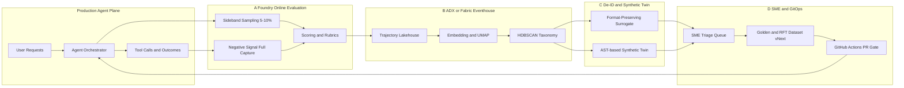
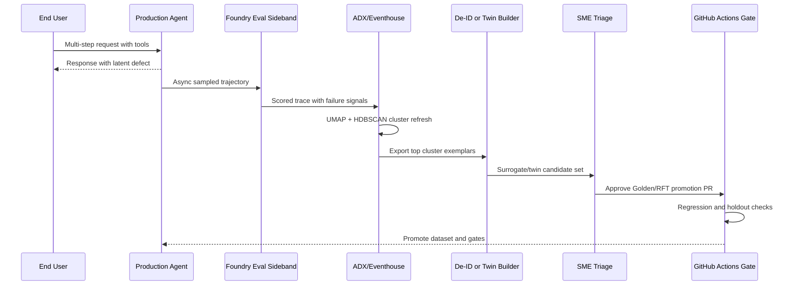

# 企业 Agent 生产数据飞轮选型 FAQ：Foundry 在线评测旁路 vs ADX+HDBSCAN 故障聚类 vs 脱敏替身轨迹 vs GitOps Golden/RFT 晋升
> 🌐 **Language Switch**: **中文（当前）** | [English](agent-data-flywheel-failure-clustering-foundry-online-eval-vs-adx-hdbscan-vs-synthetic-twin-selection-faq.en.md)  
> 目标读者：Principal Cloud & AI Solution Architect、LLMOps 平台负责人、数据治理负责人、安全合规与 FinOps 团队。  
> 主题边界：本文聚焦“生产失败 -> 评测样本 -> 训练/回归门禁”的闭环飞轮，不重复 #146 的 OTel 采集基础与 #152 的发布前合成红队。  
## 1. 执行摘要：失败样本不进入飞轮，Agent 质量永远停留在静态基线
很多企业已经有线上监控。  
但监控并不等于可学习的评测数据。  
故障告警只能告诉你“哪里坏了”。  
它不能自动告诉你“下次如何不再坏”。  
生产 Agent 的真实挑战在于多步轨迹。  
失败往往不是单轮模型失误。  
而是跨工具、跨回合、跨身份上下文的连锁偏差。  
如果这些偏差不能被结构化提炼，修复效率会越来越低。  
因此需要生产数据飞轮。  
飞轮入口是线上旁路评测。  
飞轮中段是失败聚类与根因优先级。  
飞轮合规层是可复用且受监管的数据加工。  
飞轮出口是 Golden 套件与 RFT 偏好样本晋升。  
本指南给出四条组合路径。  
路径 A 提供低侵入线上评分。  
路径 B 提供可解释失败族谱。  
路径 C 提供合规可复训数据。  
路径 D 提供自动化发布门禁闭环。  
四条路径合并后，企业可把“事故响应”升级成“系统性学习”。  
## 2. 业务边界与成功判据：把飞轮从“概念”变成“可审计产线”
飞轮架构必须回答三个问题。  
第一，哪些生产轨迹要进入评测池。  
第二，如何在合规前提下保留语义可用性。  
第三，如何把结果持续注入工程与训练。  
建议定义四层指标。  
采样层指标关注覆盖率与偏差。  
聚类层指标关注缺陷归因集中度。  
治理层指标关注脱敏可追溯性。  
发布层指标关注缺陷逃逸率变化。  
采样层可从 `5%–10%` 基线流量起步。  
再叠加 `100%` 负向信号轨迹。  
负向信号包括显式差评。  
也包括用户重问、人工升级、4xx/5xx 工具重试。  
聚类层可按 `frequency x business_severity` 排序。  
目标是 Top-3 聚类覆盖 `65%+` 线上缺陷。  
治理层要求实体代称跨回合一致。  
如 `ACCT_91B2` 在 `8` 次工具调用中保持同一指代。  
发布层要求失败修复可证伪。  
即每次修复都能在 Golden 回归中复现并通过。  
## 3. 四路径架构定位：在线评分、失败聚类、合规重构、门禁晋升
路径 A 的核心价值是“不中断业务”。  
评测在旁路异步执行，不增加用户延迟。  
路径 B 的核心价值是“从海量轨迹中找共性”。  
避免工程团队被零散个案淹没。  
路径 C 的核心价值是“在合规内保留训练信号”。  
使生产数据能进入评测与偏好学习。  
路径 D 的核心价值是“把洞察变成强制质量门禁”。  
避免修复结论停留在 PPT。  
常见反模式是只做 A。  
结果是报表丰富但缺少修复优先级。  
也有团队只做 B。  
结果是聚类漂亮但样本无法进入 CI。  
还有团队只做 D。  
结果是门禁执行但输入样本持续老化。  
正确做法是四路径串联。  
A 负责稳定采样输入。  
B 负责高价值缺陷提纯。  
C 负责合规可复用数据准备。  
D 负责工程化落地与发布守门。  
## 4. 12 维比较矩阵（Failure-to-Eval & RFT Flywheel 专用）
| 维度 | A Foundry 在线旁路评测 | B ADX/Fabric + UMAP/HDBSCAN | C 代称脱敏 vs Synthetic Twin | D SME 队列 + GitOps 晋升 |
|---|---|---|---|---|
| 上线速度 | 极高 | 中 | 中 | 中高 |
| 对线上延迟影响 | 极低 | 无 | 无 | 无 |
| 缺陷发现覆盖率 | 高 | 极高 | 中高 | 高 |
| 根因可解释性 | 中 | 极高 | 高 | 高 |
| 合规可用性 | 中高 | 高 | 极高 | 高 |
| 跨回合指代保持 | 中 | 中 | 极高（代称策略） | 高 |
| 训练可复用性 | 中 | 高 | 极高 | 极高 |
| 发布门禁自动化 | 低 | 中 | 中 | 极高 |
| 运维复杂度 | 低 | 中高 | 中高 | 中 |
| 人工审核负担 | 低 | 中 | 中高 | 中 |
| 缺陷逃逸压降潜力 | 中 | 高 | 高 | 极高 |
| 三年 ROI 收敛性 | 中 | 高 | 高 | 极高 |
矩阵应按监管等级加权。  
金融和医疗通常提高合规与指代保持权重。  
互联网 SaaS 通常提高覆盖率与自动化权重。  
跨国组织通常提高多区域数据边界权重。  
统一模板有助于架构评审一致性。  
## 5. 路径 A：Foundry 在线持续评测 + App Insights 分层触发
路径 A 解决“怎么持续采样”。  
其关键是旁路异步，不阻塞主链路。  
推荐采样策略为双通道。  
通道一是基线随机采样 `5%–10%`。  
通道二是负向事件全量采样。  
负向事件需明确枚举。  
包括显式差评与低分反馈。  
包括会话内重问同题。  
包括 HITL 升级请求。  
包括工具 `4xx/5xx` 连续重试。  
路径 A 的收益是最小侵入上线。  
团队可先获得稳定周报。  
并为后续聚类提供充足样本。  
路径 A 的风险是噪声过高。  
若没有分层触发，评测成本会失控。  
因此需在 App Insights 中先做粗筛。  
如按工具错误密度、会话长度、用户意图漂移打标签。  
再将高价值轨迹送入 Foundry Eval。  
## 6. 路径 B：ADX/Fabric Eventhouse + UMAP/HDBSCAN 失败族谱
路径 B 解决“怎么排优先级”。  
单条失败日志不具代表性。  
聚类可把零散失败压缩成可修复主题。  
流程通常分四步。  
先把轨迹转成结构化事件。  
再把事件嵌入向量空间。  
然后降维用于可视诊断。  
最后通过 HDBSCAN 自动发现簇与噪声点。  
每个簇再计算业务严重度。  
严重度可由投诉、升级、损失金额组合。  
排序可用 `frequency x business_severity`。  
常见输出包括 `stale_rag_chunk`。  
也包括 `ambiguous_tool_schema`。  
还包括 `premature_stop` 与 `hallucinated_filter_arg`。  
成熟团队会每周固定做 cluster sprint。  
目标是 Top-3 覆盖 `65%+` 缺陷。  
路径 B 的价值是把修复资源投入最痛点。  
## 7. 路径 C：一致代称脱敏 vs 零 PII Synthetic Twin 重构
路径 C 解决“数据能否进 CI 和训练”。  
直接 `[REDACTED]` 常会破坏语义链。  
尤其在跨回合实体共指场景。  
例如账号、订单、设备编号。  
若每次替换不一致，模型无法学习工具参数依赖。  
一致代称策略可保留结构。  
如用 HMAC 键控映射稳定生成 `ACCT_xxxx`。  
这样可保留 `ACCT_91B2 == ACCT_91B2` 的约束。  
在中等监管场景，这通常已可满足评测需求。  
但高敏行业要求零生产文本外流。  
此时需 Synthetic Twin。  
Synthetic Twin 不复制原文。  
而是基于轨迹 AST 与执行约束重建同构样本。  
它保留失败机制，不保留原始敏感语句。  
路径 C 的挑战是重构质量评估。  
应比较 twin 与原轨迹的失败可复现率。  
并持续监控语义偏移。  
## 8. 路径 D：SME 队列裁决 + GitOps Golden/RFT 自动晋升
路径 D 解决“如何真正闭环”。  
聚类发现后需要业务专家裁决。  
建议建立轻量注释工作台。  
SME 只做三类动作。  
确认根因标签。  
确认期望答案或动作。  
确认是否可晋升到 Golden 或 RFT。  
通过后生成版本化 JSONL。  
再由 GitHub Actions PR gate 自动回归。  
通过门禁后才允许合并。  
RFT 样本需做防过拟合分层。  
至少保留稳定 holdout 集。  
并对同类簇做时间切片分割。  
避免模型只记住近期模式。  
路径 D 的关键是“人机分工边界清晰”。  
机器负责筛选与批处理。  
专家负责语义与业务判断。  
工程流水线负责强制执行。  
## 9. 参考拓扑：生产轨迹到 Golden/RFT 的闭环架构

该拓扑强调四路径是同一条流水线。  
每段都有清晰责任边界。  
每段都可独立扩缩容。  
## 10. 时序：从失败簇到 PR 门禁晋升

时序展示了闭环周期。  
核心是自动化与人工裁决协同。  
并保证每次晋升都可审计。  
## 11. 定量问答：采样、共指、周期、污染与收益
**Q1：显式差评占比常低于 `2%`，仅靠它够吗？**  
A1：不够。  
显式反馈召回通常偏低。  
应联合隐式信号提高覆盖。  
如重问、升级、重试可显著补全失败样本。  
**Q2：为什么简单 `[REDACTED]` 会破坏多回合一致性？**  
A2：因为同一实体会被替换成不同空洞标记。  
模型失去跨步参数引用关系。  
键控代称能保持同一实体稳定映射。  
**Q3：如何量化一致代称的保持收益？**  
A3：可统计 `coreference_preservation_rate`。  
如从 `42%` 提升到 `96%`。  
同时验证工具参数重放成功率。  
**Q4：飞轮周期为何能从 `21` 天缩短到 `36` 小时？**  
A4：关键在自动化链路。  
采样、聚类、脱敏、门禁连成批处理流水。  
SME 只处理高价值簇，减少等待与返工。  
**Q5：如何防止 Golden 套件被污染导致过拟合？**  
A5：采用时间切片 holdout。  
并保持跨簇独立验证集。  
同时监控“线上提升但 holdout 下降”的反常信号。  
**Q6：Top-3 聚类覆盖 `65%+` 缺陷是否现实？**  
A6：在缺陷分布长尾明显的企业场景常见。  
前提是特征工程包含工具链路与业务上下文。  
**Q7：Synthetic Twin 会不会丢失真实失败机制？**  
A7：会有风险。  
应持续比较 twin 与原簇的失败复现率。  
若复现率下降，应回滚生成策略。  
**Q8：如何评估飞轮投资回报？**  
A8：同时看缺陷逃逸率、升级工单量、修复周期。  
再叠加每次故障的业务损失避免值。  
## 12. 生产查询示例：ADX KQL 提取隐式不满与工具重试轨迹
```kql
let Window = 7d;
let FrustrationSessions =
    AppTraces
    | where Timestamp > ago(Window)
    | where isnotempty(SessionId)
    | summarize
        ReAskCount = countif(EventName == "user.reask"),
        EscalationCount = countif(EventName == "hitl.escalation"),
        ToolRetry4xx5xx = countif(EventName == "tool.retry" and toint(StatusCode) between (400 .. 599)),
        ExplicitThumbsDown = countif(EventName == "feedback.explicit" and FeedbackValue == "down")
      by SessionId, TenantId, AgentVersion
    | where ReAskCount > 0 or EscalationCount > 0 or ToolRetry4xx5xx >= 2 or ExplicitThumbsDown > 0;
let JoinedTrajectories =
    AgentTrajectoryEvents
    | where Timestamp > ago(Window)
    | where SessionId in (FrustrationSessions | project SessionId)
    | summarize
        Steps = make_list(pack("step", StepIndex, "tool", ToolName, "status", StatusCode, "obs", Observation), 256),
        ToolErrorDensity = todouble(countif(toint(StatusCode) between (400 .. 599))) / todouble(max_of(count(), 1))
      by SessionId, TenantId, AgentVersion;
JoinedTrajectories
| join kind=inner FrustrationSessions on SessionId
| extend PriorityScore = (ReAskCount + EscalationCount * 2 + ToolRetry4xx5xx * 1.5 + ExplicitThumbsDown * 3) * (1 + ToolErrorDensity)
| project TenantId, SessionId, AgentVersion, PriorityScore, ReAskCount, EscalationCount, ToolRetry4xx5xx, ExplicitThumbsDown, Steps
| order by PriorityScore desc
```
该查询用于抽取高价值失败轨迹。  
可直接喂给聚类与标注队列。  
也可用于周度缺陷热榜。  
## 13. 生产代码示例：AST 结构保持的 Synthetic Twin 生成器
```python
from __future__ import annotations

import hashlib
import hmac
import json
from dataclasses import dataclass
from typing import Dict, List, Any


@dataclass
class TwinConfig:
    tenant_key: bytes
    preserve_roles: bool = True


def stable_surrogate(token: str, key: bytes, prefix: str) -> str:
    digest = hmac.new(key, token.encode("utf-8"), hashlib.sha256).hexdigest()[:8].upper()
    return f"{prefix}_{digest}"


def map_entities(text: str, key: bytes) -> Dict[str, str]:
    # Simplified entity extraction placeholder.
    entities = {}
    for raw in text.split():
        if raw.startswith("ACCT") or raw.startswith("CUST") or raw.startswith("ORD"):
            entities[raw] = stable_surrogate(raw, key, raw.split("_")[0] if "_" in raw else "ENT")
    return entities


def replace_with_mapping(text: str, mapping: Dict[str, str]) -> str:
    out = text
    for src, dst in mapping.items():
        out = out.replace(src, dst)
    return out


def generate_synthetic_twin(trajectory: Dict[str, Any], cfg: TwinConfig) -> Dict[str, Any]:
    mapping: Dict[str, str] = {}
    steps: List[Dict[str, Any]] = []
    for step in trajectory.get("steps", []):
        role = step.get("role", "tool") if cfg.preserve_roles else "step"
        content = step.get("content", "")
        local_map = map_entities(content, cfg.tenant_key)
        mapping.update(local_map)
        safe_content = replace_with_mapping(content, mapping)
        safe_tool_args = json.loads(json.dumps(step.get("tool_args", {})))
        for k, v in list(safe_tool_args.items()):
            if isinstance(v, str):
                safe_tool_args[k] = replace_with_mapping(v, mapping)
        steps.append(
            {
                "role": role,
                "tool": step.get("tool"),
                "tool_args": safe_tool_args,
                "content": safe_content,
                "failure_tag": step.get("failure_tag"),
            }
        )
    return {
        "session_meta": {
            "trace_id": stable_surrogate(trajectory.get("trace_id", "TRACE"), cfg.tenant_key, "TRACE"),
            "agent_version": trajectory.get("agent_version"),
        },
        "entity_mapping_stats": {"count": len(mapping)},
        "steps": steps,
    }
```
上例展示了两点。  
一是实体代称稳定映射。  
二是轨迹 AST 结构保持。  
这样可在零原文外流前提下保留失败机制。  
## 14. 企业场景与 ROI：银行与 SaaS 双样本
### 场景 A：零售与对公银行客服 Agent（PCI-DSS / GLBA）
该平台每周约 `14,000` 次升级工单。  
历史做法依赖人工抽样复盘。  
周期长且一致性差。  
他们引入 A+B+C+D 全链路。  
A 采样旁路评分。  
B 每周输出失败聚类热榜。  
C 在严格零 PII 策略下生成 twin。  
D 将高价值样本晋升为 CI Golden 门禁。  
三个月后重复升级缺陷明显下降。  
并满足内部审计对数据最小化要求。  
### 场景 B：全球 SaaS 技术支持 Copilot
该平台跨多产品线和多工具系统。  
过去缺陷修复依赖个案追踪。  
工程团队长期处于被动救火。  
他们建立每周 HDBSCAN cluster sprint。  
并把 Top 聚类直接转成修复 backlog。  
再经 SME 审核自动晋升测试集。  
半年内重复升级缺陷下降 `58%`。  
且发布回滚率同步下降。  
### FinOps 与缺陷逃逸 ROI 表
| 指标 | 飞轮前 | 飞轮后 | 变化 |
|---|---:|---:|---:|
| 每周生产升级工单 | 14,000 | 8,900 | -36% |
| 重复缺陷占比 | 41% | 17% | -24pp |
| 平均修复周期 | 21 天 | 36 小时 | -93% |
| 缺陷逃逸率（发布后） | 9.8% | 3.1% | -6.7pp |
| 评测样本单位成本 | \$1.00 基线 | \$0.62 | -38% |
| 估算年度损失避免值 | - | \$3.4M | 正向 |
表中值用于架构收益测算示例。  
实际落地需结合行业损失模型重算。  
## 15. Day-0 / Day-2 十二项落地清单
- 定义生产轨迹采样策略：基线抽样 + 负向全量。  
- 在 App Insights 标准化隐式不满事件字典。  
- 建立 ADX/Fabric 统一轨迹湖仓模型。  
- 为聚类输出制定根因标签分类法。  
- 明确 `frequency x severity` 排序口径并固化。  
- 建立一致代称脱敏服务与密钥轮换策略。  
- 为高敏场景建立 Synthetic Twin 生成与验证流水线。  
- 设计 SME 裁决界面并约束最小必填字段。  
- 将 Golden/RFT 数据集版本化并签名存证。  
- 在 GitHub Actions 配置 PR 门禁与 holdout 校验。  
- 每周执行 cluster sprint 并追踪 Top-3 覆盖率。  
- 每月复盘 ROI、逃逸率与过拟合风险指标。  
建议把清单分配到平台、数据、合规、工程四类角色。  
首阶段可先完成前六项。  
第二阶段推进自动晋升与 ROI 治理。  
最终目标是让每次失败都转化为可复用质量资产。  
