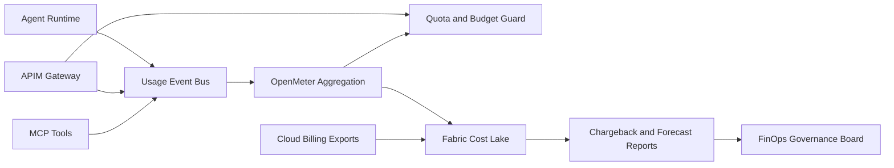
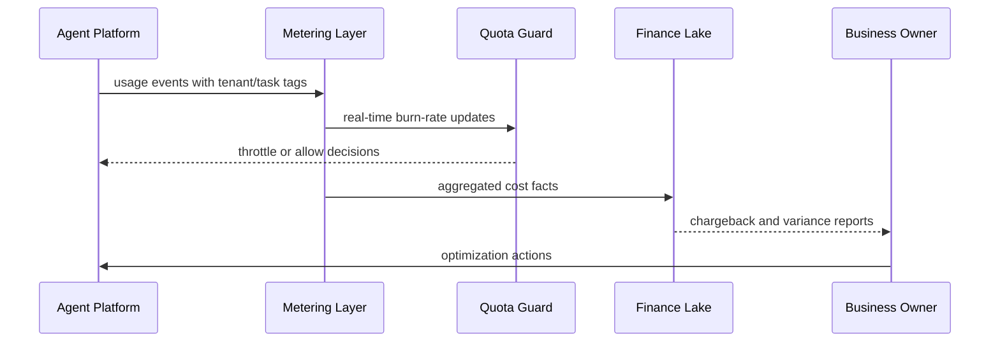

# Enterprise agent FinOps chargeback selection FAQ: OpenMeter event metering vs APIM usage ledger vs Fabric Cost Lake

> **Audience**: Enterprise Cloud & AI Solution Architects, FinOps teams, platform operations teams, and business finance partners.  
> **Core question**: In multi-tenant agent platforms, how do you build accountable metering and chargeback that is auditable, actionable, and aligned to unit economics.

## 1. Problem framing: without explainable metering, cost optimization stalls

Many enterprises deploy agent platforms,
then watch total spend rise
without explaining the cost drivers.

Typical pain patterns:

- Cost visibility stops at subscription level.
- Tool calls, model inference, and human review are disconnected.
- Budget overruns are discovered too late.
- Teams dispute inconsistent allocation logic.

FinOps architecture selection is fundamentally
about building a trusted shared ledger.

## 2. Objective model: accuracy, timeliness, actionability

A mature agent FinOps system should provide:

- Accuracy down to tenant, workflow, and task.
- Timeliness at hourly or minute granularity.
- Actionability that drives controls and optimization.

Recommended baseline metrics:

- Cost per 1,000 tasks.
- Tenant budget burn rate.
- Share of high-cost tools.
- Cost-anomaly alert precision.

## 3. Pattern A: OpenMeter event-centric metering hub

Pattern A aggregates cost through event streams.

Core mechanics:

- Every platform layer emits standardized usage events.
- Events carry tenant, task, and model tags.
- Real-time aggregations feed allocation views.
- Metering output drives budget policy engines.

Strengths:

- Finest granularity.
- Strong cross-system normalization.
- Best fit for complex cost landscapes.

Limitations:

- Higher event-governance overhead.
- Larger implementation footprint.
- Requires strict idempotency and replay discipline.

## 4. Pattern B: APIM usage ledger at gateway boundary

Pattern B uses APIM
as the primary metering boundary.

Typical implementation:

- Unified ingress-egress usage capture.
- Tenant and tool-level usage reports.
- Quota and budget guardrail integration.
- Policy versioning tied to billing tags.

Strengths:

- Fast rollout and low disruption.
- Native fit with gateway governance.
- Works well for centralized ingress models.

Limitations:

- Covers only traffic that passes gateway.
- Limited visibility into in-session internal costs.
- Coarser allocation resolution.

## 5. Pattern C: Fabric Cost Lake for accounting and forecasting

Pattern C builds a lakehouse cost backbone.

Core design:

- Merge billing exports, usage streams, and business dimensions.
- Define shared semantic cost models.
- Output chargeback and forecast datasets.
- Support quarterly planning and ROI reviews.

Strengths:

- Strong historical and predictive analytics.
- Excellent for cross-org finance alignment.
- Integrates with enterprise reporting governance.

Limitations:

- Real-time visibility is weaker than event streams.
- Modeling and governance skill requirement is higher.
- Initial setup cost is higher.

## 6. Pattern D: layered closed loop (recommended)

Enterprise best practice often combines:

- OpenMeter for real-time fine-grained metering.
- APIM for policy-coupled budget guardrails.
- Fabric Cost Lake for accounting and forecasting.

This produces an end-to-end loop:
observe, constrain, verify, optimize.

## 7. Reference architecture: agent FinOps metering plane

Architecture implications:

- Event taxonomy must be versioned and governed.
- Budget controls should read real-time and historical signals.
- Reports must remain traceable to source events.

## 8. Flow lifecycle: metering, allocation, alerting, correction

Flow governance essentials:

- Alert thresholds should align to risk tiers.
- Allocation logic changes must be versioned.
- Optimization actions should be measured for outcomes.

## 9. 12-dimension enterprise comparison matrix

| Dimension | A OpenMeter | B APIM Ledger | C Cost Lake | D Layered Loop |
|---|---|---|---|---|
| Granularity | Very high | Medium-high | High | Very high |
| Real-time visibility | Very high | High | Medium | High |
| Time to adopt | Medium | High | Medium-low | Medium |
| Historical analytics | Medium | Medium | Very high | Very high |
| Budget guardrail linkage | High | High | Medium | Very high |
| Cross-org collaboration fit | Medium | High | High | High |
| Data governance complexity | High | Medium | High | High |
| Integration effort | High | Low-medium | Medium | High |
| Allocation trustworthiness | High | Medium | High | Very high |
| Forecast capability | Medium | Low | High | High |
| Audit accountability | High | High | High | Very high |
| Recommended maturity stage | Platform refinement | Fast baseline | Finance depth | Enterprise scale |

## 10. Quantitative break-even: unit economics and variance

| Metric | A OpenMeter | B APIM | C Cost Lake | D Layered |
|---|---:|---:|---:|---:|
| Cost visibility per 1k tasks | 98.9% | 86.4% | 95.1% | 99.4% |
| Cost anomaly detection lag | 6m | 11m | 2.4h | 8m |
| Budget variance ratio | 3.2% | 6.1% | 3.8% | 2.5% |
| High-cost tool recall | 97.1% | 84.7% | 92.3% | 98.2% |
| Governance cost per 1k tasks | $2.9 | $1.8 | $2.5 | $3.1 |
| Recoverable annual savings | 11.8% | 7.2% | 10.4% | 13.1% |

Assumptions:

- Monthly volume around 28M tasks.
- 14 business-domain tenant groups.
- Tool calls represent 37% of total spend.
- Budget cadence monthly with weekly variance reviews.
- Critical-tenant alerts trigger early at 70% budget burn.
- Standard-tenant alerts trigger at 85% budget burn.
- 18% of workflows include human-review cost components.
- Inference unit pricing baselines refresh quarterly.
- Historical cost retention horizon is 24 months.
- Anomaly-detection thresholds recalibrate biweekly.

Interpretation:

- A is strongest for real-time precision.
- B is strongest for rapid governance baseline.
- C is strongest for accounting depth and forecasting.
- D is strongest for full enterprise outcomes.
During cost-tightening cycles, prioritize real-time alerting and guardrails first.
When tenant expansion accelerates, stabilize tag governance before wider onboarding.
Rapid model evolution requires synchronized unit-cost baseline updates.
Cross-region operations benefit from region-level allocation dashboards.
Volatile vendor pricing requires higher forecast-refresh cadence.

## 11. Decision tree: choose by maturity and timing needs

Question 1:
Do you need minute-level anomaly detection?

- Yes: prioritize A or D.
- No: continue to Question 2.

Question 2:
Do you lack a unified ingress governance boundary?

- Yes: start with B.
- No: continue to Question 3.

Question 3:
Do finance teams require annual forecasting models?

- Yes: prioritize C or D.
- No: continue to Question 4.

Question 4:
Can teams sustain cross-system event governance?

- Yes: adopt A or D.
- No: phase from B/C.

## 12. Anti-patterns and correction paths

Anti-pattern 1:
Only total invoice is tracked, no task-level unit economics.

Correction:
Mandate cost-per-1,000-task reporting.

Anti-pattern 2:
Budget alerts trigger only at month end.

Mitigation:
Use rolling burn-rate thresholds.

Anti-pattern 3:
Allocation logic changes are undocumented.

Action:
Version allocation logic with effective dates.

Anti-pattern 4:
Optimization actions are never outcome-validated.

Fix:
Run before-after cost A/B checks on optimization steps.

## 13. Governance model: roles and review cadence

Recommended role split:

- Platform team owns usage-event model and tag dictionary.
- FinOps team owns budget controls and allocation rules.
- Finance team owns accounting semantics and report standards.
- Business teams own cost responsibility boundaries.

Review cadence:

- Weekly: anomaly trend and optimization execution.
- Monthly: budget variance and chargeback disputes.
- Quarterly: unit economics and ROI trajectory.

## 14. Five-step rollout guide (Good fit vs Not for)

Step 1:
Define a unified usage-event schema and tagging contract.

Step 2:
Deploy quota guardrails and tiered alert thresholds.

Step 3:
Connect real-time metering with historical accounting.

Step 4:
Publish tenant-level chargeback views.

Step 5:
Institutionalize optimization and outcome validation loops.

Good fit:

- Multi-tenant shared agent platforms.
- Rapidly growing spend with unclear ownership boundaries.
- Need for finance-engineering co-governance.

Not for:

- Small single-team internal experiments.
- Scenarios with no budget accountability requirements.
- Teams lacking basic data governance capability.

## 15. Practical FAQ (8 questions)

**Q1: Must OpenMeter be implemented first?**  
A1: Not always; many teams establish APIM baseline first, then add event-level precision.

**Q2: Why is APIM-only granularity often insufficient?**  
A2: It observes gateway traffic well but misses deep in-session cost structure.

**Q3: Is Cost Lake too heavy for most teams?**  
A3: It can be heavy for small teams, but is valuable for enterprise accounting depth.

**Q4: How can allocation disputes be reduced?**  
A4: Standardized tags, versioned allocation logic, and traceable audit trails are essential.

**Q5: How should budget alert thresholds be configured?**  
A5: Configure tiered burn thresholds aligned to tenant criticality and risk appetite.

**Q6: How should optimization gains be measured?**  
A6: Measure unit cost, success rate, and latency jointly before and after each change.

**Q7: When should teams move to layered closed-loop FinOps?**  
A7: Move when real-time control and financial forecasting are both required.

**Q8: What governance gap is most commonly overlooked?**  
A8: Poor tag governance quietly invalidates reports, alerts, and optimization decisions.
Teams also underestimate the impact of metering-lag blind spots on budget control.
Maintain a dedicated cost-health score per critical tenant segment.
Set explicit spend ceilings for high-risk or high-cost tools.
Review major chargeback disputes with root-cause taxonomy every quarter.
Connect anomaly alerts directly to operations duty workflows.
Run dual-track reconciliation windows after allocation-rule changes.
Stress-test cost controls ahead of major seasonal demand events.
Maintain rollback runbooks for every major FinOps policy change.
Expose optimization gains on shared business KPI dashboards.
Standardize failure-reason taxonomy for better cross-team coordination.

