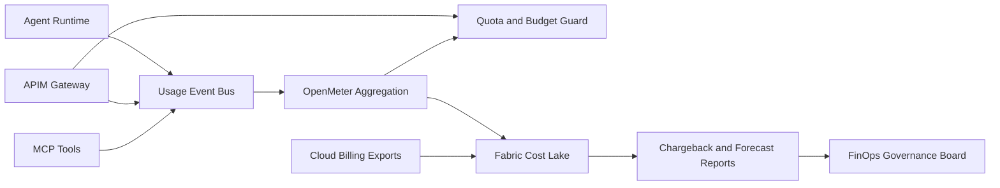
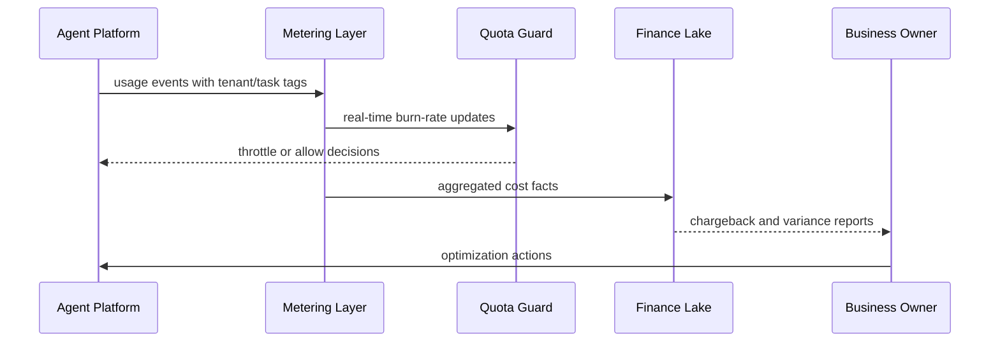

# 企业 Agent FinOps 分摊选型 FAQ：OpenMeter 事件计量 vs APIM 用量网关账本 vs Fabric Cost Lake 成本湖仓

> **适用角色**：企业 Cloud & AI SA、FinOps 团队、平台运营团队、业务财务伙伴。  
> **核心问题**：在多租户 Agent 平台中，如何构建可追责、可核对、可优化的计量与分摊体系，让每个团队都看见真实单位经济成本。

## 1. 问题定义：没有可解释计量，就没有可执行降本

很多企业部署 Agent 后，
总账单持续上涨，
却无法解释成本来源。

典型痛点包括：

- 成本只到订阅级，无法到业务线。
- 工具调用、模型推理、人工复核未统一计量。
- 预算超支后只能事后追责。
- 各团队口径不一致导致争议。

FinOps 选型本质是建立一致可信账本体系。

## 2. 目标框架：准确性、时效性、可行动性

成熟 Agent FinOps 体系要满足：

- 准确性：账单可追到会话与任务。
- 时效性：小时级乃至分钟级可见。
- 可行动性：能直接驱动限流和优化。

推荐统一指标：

- 每千任务综合成本。
- 每租户预算燃尽速率。
- 高成本工具占比。
- 成本异常告警命中率。

## 3. 模式 A：OpenMeter 事件计量中心

模式 A 用事件流聚合计量。

关键机制：

- 平台各层写入统一计量事件。
- 事件带租户、任务、模型标签。
- 实时聚合生成分摊视图。
- 对接计费与预算策略引擎。

优点：

- 计量粒度最细。
- 跨系统可统一口径。
- 适合复杂多源成本场景。

限制：

- 事件治理要求高。
- 接入改造工作量较大。
- 需要严格幂等与重放策略。

## 4. 模式 B：APIM 用量网关账本

模式 B 利用 APIM 网关天然采样。

常见做法：

- 统一经网关出入站计量。
- 按 API/工具/租户生成报表。
- 结合配额策略做预算护栏。
- 账单标签与策略版本联动。

优点：

- 落地快，改造轻量。
- 与治理策略天然一体。
- 适合入口集中型架构。

限制：

- 仅覆盖过网关流量。
- 会话内部成本可见性有限。
- 深层任务分摊粒度不足。

## 5. 模式 C：Fabric Cost Lake 湖仓核算

模式 C 走“成本数据湖仓”路径。

核心思路：

- 汇聚账单、用量、业务维度。
- 建立统一语义口径模型。
- 输出分摊报表与预测模型。
- 支撑季度预算与 ROI 复盘。

优点：

- 历史分析与预测能力强。
- 适合多组织统一财务治理。
- 与管理报表体系易整合。

限制：

- 实时性通常弱于事件流。
- 建模与治理门槛较高。
- 初期建设投入较大。

## 6. 模式 D：分层闭环（推荐）

企业常见最佳实践：

- OpenMeter 做实时细粒度计量。
- APIM 提供入口策略护栏与快照。
- Fabric 承担财务核算与预测。

三者组合形成“观测-约束-复盘”闭环。

## 7. 参考架构：Agent FinOps 计量控制平面

架构要点：

- 计量事件需统一字典与版本。
- 预算护栏要读取实时与历史两类信号。
- 报表输出必须可追溯到原始事件。

## 8. 流程链路：计量、分摊、告警、纠偏

流程治理重点：

- 告警阈值需按业务等级分层。
- 分摊口径变更必须版本化。
- 优化动作要能回写验证效果。

## 9. 12 维企业选型对比矩阵

| 维度 | A OpenMeter | B APIM 账本 | C Cost Lake | D 分层闭环 |
|---|---|---|---|---|
| 粒度精细度 | 极高 | 中高 | 高 | 极高 |
| 实时可见性 | 极高 | 高 | 中 | 高 |
| 落地速度 | 中 | 高 | 中低 | 中 |
| 历史分析能力 | 中 | 中 | 极高 | 极高 |
| 预算护栏联动 | 高 | 高 | 中 | 极高 |
| 组织协同友好 | 中 | 高 | 高 | 高 |
| 数据治理复杂度 | 高 | 中 | 高 | 高 |
| 事件改造成本 | 高 | 低中 | 中 | 高 |
| 分摊可信度 | 高 | 中 | 高 | 极高 |
| 预测能力 | 中 | 低 | 高 | 高 |
| 审计可追责 | 高 | 高 | 高 | 极高 |
| 推荐成熟阶段 | 平台精细化 | 快速起步 | 财务治理深化 | 企业规模化 |

## 10. 量化拐点：单位经济与预算偏差

| 指标 | A OpenMeter | B APIM | C Cost Lake | D 分层 |
|---|---:|---:|---:|---:|
| 每千任务成本可见率 | 98.9% | 86.4% | 95.1% | 99.4% |
| 成本异常发现时延 | 6m | 11m | 2.4h | 8m |
| 预算偏差率 | 3.2% | 6.1% | 3.8% | 2.5% |
| 高成本工具识别召回 | 97.1% | 84.7% | 92.3% | 98.2% |
| 每千任务治理成本 | $2.9 | $1.8 | $2.5 | $3.1 |
| 年化可回收节省率 | 11.8% | 7.2% | 10.4% | 13.1% |

测算前提：

- 月任务量 2,800 万。
- 跨 14 个业务域租户。
- 工具调用占总成本 37%。
- 预算周期按月，复盘按周。
- 关键租户预算告警阈值设为 70% 预警。
- 非关键租户预算告警阈值设为 85% 预警。
- 18% 任务包含人工复核环节成本。
- 模型推理单价按季度滚动更新。
- 历史数据保留窗口为 24 个月。
- 异常检测策略每两周校准一次。

结论摘要：

- A 适合精细化实时治理。
- B 适合快速起步统一口径。
- C 适合财务深度分析与预测。
- D 在综合目标下最优。
若组织处于预算收紧周期，建议优先强化实时告警链路。
若业务线扩张迅速，建议先固化标签字典再扩面接入。
若模型迭代频繁，需同步更新单位成本基线模型。
若跨区域运营复杂，应建立区域维度分摊看板。
若供应商定价波动大，需提高预测模型更新频率。

## 11. 决策树：按组织成熟度与时效要求选择

问题 1：
是否要求分钟级异常发现？

- 是：优先 A 或 D。
- 否：进入问题 2。

问题 2：
是否缺乏统一入口治理平面？

- 是：先落地 B。
- 否：进入问题 3。

问题 3：
财务侧是否要求年度预测模型？

- 是：优先 C 或 D。
- 否：进入问题 4。

问题 4：
是否有能力做跨系统事件治理？

- 是：可推进 A 或 D。
- 否：从 B/C 渐进。

## 12. 反模式与纠偏路径

反模式一：
仅看总账单，不看任务级单位成本。

纠偏：
强制输出每千任务成本指标。

反模式二：
预算告警仅在月末触发。

纠偏：
改为滚动燃尽速率预警。

反模式三：
分摊口径变更不留版本。

纠偏：
建立口径版本与生效时间管理。

反模式四：
优化动作无效果回验。

改进：
建立优化前后 A/B 成本对比回路。

## 13. 平台治理：职责分工与评审节奏

建议职责：

- 平台团队：维护计量事件与标签字典。
- FinOps 团队：维护预算与分摊规则。
- 财务团队：维护核算口径与报表准则。
- 业务团队：维护成本责任边界。

评审节奏：

- 周度看异常与优化执行。
- 月度看预算偏差与分摊争议。
- 季度看单位经济与 ROI 趋势。

## 14. 五步落地指南（Good fit vs Not for）

步骤 1：
定义统一计量事件模型与标签规范。

步骤 2：
建立入口配额护栏与告警分层。

步骤 3：
打通实时计量与历史核算数据。

步骤 4：
输出租户级 chargeback 报表。

步骤 5：
固化优化动作与效果验证机制。

Good fit：

- 多租户共享 Agent 平台。
- 成本增速快且责任边界复杂。
- 需要财务与技术协同治理。

Not for：

- 单团队小规模内部试验。
- 无预算考核与分摊需求场景。
- 缺少基础数据治理能力团队。

## 15. 实战 FAQ（8 问）

**Q1：OpenMeter 是否一定要先上？**  
A1：不一定，可先用 APIM 统一入口口径，再逐步细化事件计量。

**Q2：APIM 账本为什么粒度不够？**  
A2：它更擅长入口视角，难覆盖会话内部成本细节。

**Q3：Cost Lake 是否会太重？**  
A3：小团队可能偏重，但跨组织核算场景价值很高。

**Q4：如何减少分摊争议？**  
A4：统一标签字典、口径版本与审计链路是关键。

**Q5：预算告警阈值如何设置？**  
A5：建议按租户等级设置多档燃尽阈值。

**Q6：如何量化优化动作收益？**  
A6：用单位成本、成功率与时延联动评估。

**Q7：何时从单模式升级到分层闭环？**  
A7：当实时治理与财务预测需求同时出现时应升级。

**Q8：最容易忽略的治理点是什么？**  
A8：忽视标签治理会导致后续所有报表与优化失真。
同时要关注计量事件延迟带来的预算盲区。
建议为关键租户建立独立成本健康评分。
建议为高风险工具建立单独成本上限。
建议在季度评审中复核分摊争议根因。
建议将异常告警与运营值班流程打通。
建议建立口径变更前后的双轨对账窗口。
建议在重大促销前进行成本压测演练。
建议对治理动作配置回滚与复原手册。
建议将优化收益纳入业务 KPI 看板。
建议统一失败原因码以提升跨团队协作效率。

