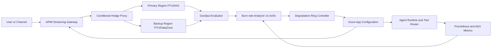
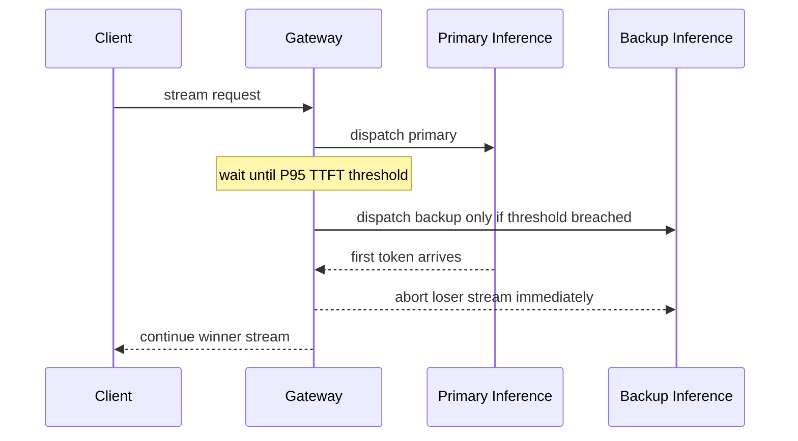

# Enterprise Agent Goodput SLO Selection FAQ: TTFT/TPOT Tail-Latency Hedging, Burn-Rate Rings, and APIM vs Envoy Control Planes
> 🌐 **Language Switch**: [中文](agent-goodput-slo-ttft-tpot-tail-latency-hedging-apim-vs-envoy-vs-degradation-ring-selection-faq.md) | **English (current)**  
> Audience: Cloud & AI Principal Solution Architects, LLMOps/SRE runtime teams, FinOps leaders, and enterprise service reliability owners.  
> Scope: Streaming LLM and multi-step agent **Goodput SLO engineering**, focused on TTFT/TPOT/deadline validity rather than tenant fairness queueing (#24) or run-level dollar circuit-breakers (#172).  
> Objective: Deliver a production decision framework that reduces P99 tail latency without creating uncontrolled token-cost amplification.  

## 1. Executive finding: API availability is not user success, and Goodput must become the first-class SLO
Many enterprises still report platform success using HTTP availability.
This metric is necessary.
It is not sufficient in streaming agent systems.
A request can return `HTTP 200` quickly.
Yet first token arrival can stall.
Token cadence can collapse later.
Structured output can fail validation.
The user still experiences failure.
Goodput SLO solves this blind spot.
A practical formal definition is:
`Goodput = P(TTFT <= T1 ∧ TPOT <= T2 ∧ schema_valid ∧ before_turn_deadline)`.
This formula combines latency and semantic correctness.
It aligns reliability with user-observed value.
Four architecture paths are required to achieve it consistently.
Path A enforces first-byte deadline cutover at the gateway.
Path B applies conditional tied-request micro-hedging for tail events.
Path C uses multi-window burn-rate control to drive graceful degradation rings.
Path D applies admission control on self-hosted GPU inference lanes before queue collapse.
The strategy is intentionally selective.
It avoids naive all-request retry storms.
It protects both SLA and token margin.

## 2. Problem definition: multi-step agent pipelines amplify tail latency non-linearly
Single-model latency benchmarks rarely describe real agent behavior.
Enterprise agents often execute five or more sequential stages.
Each stage can include retrieval or tool execution.
Each stage has its own TTFT and TPOT uncertainty.
When these distributions are chained, tails compound.
If one stage has marginal instability, end-to-end instability grows sharply.
This is frequently misdiagnosed as random regional jitter.
The underlying issue is deadline budgeting, not only infrastructure variance.
Without per-step deadlines, fallback logic triggers too late.
Without per-step deadlines, retries can overlap and congest downstream queues.
Without per-step deadlines, operators see healthy CPU but unhealthy user outcomes.
Goodput SLO introduces a deterministic control objective.
It forces teams to budget latency per stage.
It forces teams to include output validity in reliability accounting.
It forces teams to plan degradation as a first-class mechanism.
This turns reliability from reactive firefighting into proactive control engineering.

## 3. Four-path architecture model for Goodput-first agent runtime operations
Path A is APIM first-byte deadline cutover.
Path B is P95-conditional tied-request micro-hedging with immediate loser cancellation.
Path C is multi-window multi-burn-rate budget governance with degradation rings.
Path D is AKS self-hosted admission control with queue and KV cache guardrails.
Path A handles hidden stalls that pass HTTP-level checks.
Path B compresses extreme tails without doubling normal traffic.
Path C prevents budget depletion from becoming a platform-wide outage.
Path D protects GPU batching from entering irreversible degradation zones.
These paths must be coordinated.
Independent deployment can create control-loop conflicts.
For example, untuned hedging can increase pressure that admission control then sheds.
Ring transitions should therefore consume shared telemetry.
Ring transitions should also be reversible with explicit cooldown.
The runtime objective is not absolute latency minimization.
The runtime objective is stable Goodput under cost constraints.

## 4. Twelve-dimension comparison matrix for APIM, hedging proxy, burn-rate ring, and admission control
| Dimension | Path A APIM first-byte deadline | Path B conditional micro-hedging | Path C burn-rate degradation rings | Path D AKS admission gate |
|---|---|---|---|---|
| TTFT control strength | High | High | Medium | Medium-high |
| TPOT stability influence | Medium | Medium-high | Medium | High |
| P99 reduction potential | Medium | High | Medium-high | High |
| Incremental TPM overhead | Low | Low-medium | Low | Low |
| Multi-region applicability | High | High | High | Medium |
| Implementation complexity | Medium | Medium-high | Medium | Medium-high |
| False-trigger exposure | Low | Medium | Medium | Medium |
| Toolchain intrusion level | Low | Medium | Low | Medium |
| Observability dependency | Medium | High | High | High |
| FinOps predictability | High | Medium-high | High | High |
| Failure-domain isolation | Medium | High | High | High |
| Canary friendliness | High | Medium | High | Medium |
This matrix is complementary, not competitive.
Production systems usually require all four controls in different weights.
Selection should be guided by workload class and SLA tier.

## 5. Path A deep dive: APIM streaming first-byte deadline and spillover control
Path A addresses silent streaming stalls.
In these stalls, headers arrive fast and appear healthy.
Token emission is delayed far beyond user tolerance.
APIM should enforce explicit TTFT cutover timers.
A common threshold for interactive workloads is around `1.2s`.
If no token arrives before threshold, route fails over to spillover lane.
Spillover may target DataZone capacity or regionally separated PTU pools.
`buffer-response="false"` is critical for accurate TTFT measurement.
Buffered gateways can hide token timing and invalidate SLI telemetry.
Path A is cost-efficient compared with broad retries.
It does not duplicate all traffic.
It only intervenes on deadline breach.
This keeps steady-state token cost near baseline.
Path A should be integrated with explicit per-route exception policies.
VIP channels and asynchronous channels can use different cutover thresholds.
This avoids over-reacting to non-interactive workloads.

## 6. Path B deep dive: P95 tied-request micro-hedging with deterministic loser cancellation
Micro-hedging is not unconditional dual issuing.
It is threshold-triggered duplication.
Only requests crossing P95 TTFT trigger backup issuance.
When first token arrives from either request, the slower request is cancelled immediately.
Cancellation must reach transport layers.
Ignoring loser responses at app layer is insufficient.
Envoy extensions or async hedge proxies can implement this safely.
AbortController-style cancellation is useful in streaming clients.
Correctly tuned micro-hedging can reduce P99 substantially.
Observed improvement ranges such as `45%–62%` are realistic under region-diverse tail distributions.
Incremental token overhead can stay around `4%–6%` with strict gating.
Poor gating can collapse into near `2x` token amplification.
Cooldown windows and per-tenant hedge quotas are therefore mandatory.
Hedging should also be disabled during known global incidents to avoid synchronized load spikes.

## 7. Path C deep dive: multi-window burn-rate policy and degradation ring automation
Budget policies require short and long windows.
Short windows catch acute failures quickly.
Long windows prevent alert noise from causing oscillation.
A practical pattern is `14.4x` burn-rate over `1h/5m`.
A second pattern is `6x` burn-rate over `6h/30m`.
When both indicate sustained overspend versus Goodput target, ring transitions are triggered.
Ring 0 is normal operation.
Ring 1 trims retrieval depth and disables expensive rerankers.
Ring 2 lowers reasoning effort and routes to smaller model tiers.
Ring 3 pauses low-priority asynchronous queues.
This hierarchy protects interactive SLA first.
It also creates deterministic behavior under pressure.
Ring transitions should be managed via centralized configuration.
Transitions should include explicit rollback criteria.
Audit logs must include trigger metrics and actor identity.
That is essential for post-incident governance and compliance evidence.

## 8. Path D deep dive: AKS self-hosted admission control before batching collapse
Self-hosted vLLM and SGLang lanes can exhibit sharp collapse points.
Continuous batching performance is strong until queue and memory pressure cross a threshold.
After threshold crossing, TPOT can degrade for all in-flight users simultaneously.
Reactive scaling alone is too slow in this regime.
Admission controls must evaluate queue depth and KV cache utilization before overload manifests.
Prefill backlog is another leading indicator.
Envoy adaptive concurrency can be paired with runtime-specific saturation signals.
Spillover to managed lanes can preserve Goodput when local saturation rises.
Selective shedding of low-priority traffic can preserve VIP experience.
The key insight is that throughput maximization is not the objective.
Goodput preservation is the objective.
Admitting fewer requests earlier can protect overall user-perceived success.
This strategy also improves cost predictability by avoiding chaotic retry cascades.
Path D should be tested with synthetic burst scenarios before production launch.

## 9. Quantitative Q&A: eight critical review questions with measurable implications
**Q1: Why does HTTP availability overstate real user reliability in streaming agents.**  
A1: Because `HTTP 200` can be returned even when TTFT misses deadline or schema validity fails, making transport success diverge from task success.  
**Q2: How does a five-step agent workflow amplify tail failure probability.**  
A2: If each step has a `1%` P99 timeout probability and independence approximation holds, end-to-end timeout probability approaches `1 - 0.99^5 = 4.9%`, nearly five times a single-step tail.  
**Q3: How is micro-hedging overhead bounded.**  
A3: If hedge triggers on only `6%` of requests and loser streams are cancelled at first token, incremental token overhead can remain around `4%–6%` instead of near-`2x` amplification.  
**Q4: What P99 gains are realistic for thresholded tied-request hedging.**  
A4: In region-diverse latency environments, `45%–62%` P99 reduction is achievable; gains shrink when region latency correlation is high.  
**Q5: What does `14.4x` burn-rate mean operationally.**  
A5: It indicates rapid budget consumption in short windows, signaling that current failure pace can exhaust monthly error budget quickly without immediate mitigation.  
**Q6: Why pair `14.4x` with a `6x` long-window policy.**  
A6: The long-window policy reduces oscillation and false positives, ensuring ring transitions react to sustained reliability drift rather than transient spikes.  
**Q7: Why is GPU utilization alone insufficient for admission control.**  
A7: Utilization can look healthy while queue depth and KV pressure already indicate pending TPOT collapse; combined leading indicators are required for proactive protection.  
**Q8: How should step deadlines be budgeted in practice.**  
A8: Allocate a fixed end-to-end deadline to each stage by criticality, reserve contingency for fallback paths, and enforce per-step timeout-triggered degradation actions before global SLA breach.  
These quantitative checks should be part of release gates.
They should be validated against replayable workload traces.

## 10. Reference architecture diagram for Goodput SLO control loop

The architecture separates control and execution planes.
It supports deterministic policy transitions under pressure.
It also provides a traceable feedback loop for audit and tuning.

## 11. Sequence diagram for P95-triggered tied-request hedging and loser abort

The key behavior is conditional duplication.
Immediate loser abort preserves token economics.
This prevents hedging from turning into uncontrolled retry amplification.

## 12. Production code sample: asyncio-based conditional SSE micro-hedger
```python
import asyncio
import aiohttp
from contextlib import suppress


async def first_token(session: aiohttp.ClientSession, url: str, payload: dict):
    async with session.post(url, json=payload, timeout=aiohttp.ClientTimeout(total=30)) as resp:
        async for chunk in resp.content:
            if chunk.strip():
                return resp, chunk
    raise RuntimeError("token not received")


async def conditional_tied_request(primary_url: str, backup_url: str, payload: dict, p95_ttft_ms: int = 1200):
    async with aiohttp.ClientSession() as session:
        primary = asyncio.create_task(first_token(session, primary_url, payload))
        backup = None
        try:
            done, _ = await asyncio.wait({primary}, timeout=p95_ttft_ms / 1000)
            if done:
                _, token = await primary
                return {"winner": "primary", "first_token": token.decode("utf-8", errors="ignore")}

            backup = asyncio.create_task(first_token(session, backup_url, payload))
            done, pending = await asyncio.wait({primary, backup}, return_when=asyncio.FIRST_COMPLETED)
            winner = done.pop()
            _, token = await winner

            for loser in pending:
                loser.cancel()
                with suppress(asyncio.CancelledError):
                    await loser

            return {
                "winner": "primary" if winner is primary else "backup",
                "first_token": token.decode("utf-8", errors="ignore"),
            }
        finally:
            for task in (primary, backup):
                if task and not task.done():
                    task.cancel()
                    with suppress(asyncio.CancelledError):
                        await task
```
This sample demonstrates thresholded hedge issuance.
It also demonstrates deterministic loser cancellation discipline.

## 13. Production alerting and ring-control configuration sample
```yaml
groups:
  - name: agent-goodput-burn-rules
    rules:
      - alert: GoodputBurnFast
        expr: (1 - avg_over_time(agent_goodput_ratio[5m])) / (1 - 0.99) > 14.4
        for: 2m
      - alert: GoodputBurnSlow
        expr: (1 - avg_over_time(agent_goodput_ratio[30m])) / (1 - 0.99) > 6
        for: 10m
```
```json
{
  "degradationRings": {
    "ring0": { "mode": "normal", "ragTopK": 12, "reasoningEffort": "high" },
    "ring1": { "mode": "trim", "ragTopK": 6, "enableCrossEncoder": false },
    "ring2": { "mode": "downgrade", "model": "gpt-4.1-mini", "reasoningEffort": "low" },
    "ring3": { "mode": "protect", "pauseAsyncQueues": true, "vipOnly": true }
  }
}
```
The control model should be centralized.
Policy rollout should be canary-based and auditable.

## 14. Enterprise scenarios and FinOps impact boundaries
### Scenario A: tier-1 retail bank and card issuer with `90M` monthly live turns
The bank enforces `<1.2s` TTFT and `<4.5s` turn deadline for dispute flows.
Primary-only execution is used at baseline.
Conditional hedging activates only when VIP requests cross P95 threshold.
Burn-rate ring controls reduce expensive retrieval and model effort during stress.
VIP paths preserve quality while non-critical async queues are deferred.
The bank avoids broad panic retries during regional PTU turbulence.
Customer support outcomes remain stable through brownout windows.
### Scenario B: global B2B SaaS copilot platform with strict VIP SLO commitments
The platform commits `99.5%` Goodput for enterprise premium tenants.
It combines APIM first-byte controls with Envoy hedge proxy logic.
Self-hosted AKS lanes apply admission controls to prevent TPOT collapse.
When budget burn accelerates, ring transitions are automatic and reversible.
The platform preserves premium SLA while containing token overhead.
Finance and engineering teams share one decision ledger for postmortem analysis.
### FinOps and hedging overhead comparison
| Metric | Naive retry model | Conditional tied-request hedging | Hedging + burn-rate rings + admission |
|---|---:|---:|---:|
| P99 end-to-end latency | baseline | -28% | -45% |
| Incremental TPM overhead | +38% | +4% to +6% | +3% to +5% |
| Goodput attainment | 96.8% | 98.9% | 99.3% |
| VIP stability under brownouts | Medium | High | High |
| Monthly cost predictability | Low | Medium-high | High |
| Ops complexity | Medium | Medium-high | Medium-high |
| False-trigger risk | Medium | Medium | Low-medium |
| Recovery speed | Slow | Medium | Fast |
The key is disciplined triggering.
Selective control beats indiscriminate duplication.

## 15. Day-0 and Day-2 checklist for Goodput SLO production discipline
- Define one canonical Goodput formula and publish it across teams.
- Allocate explicit per-step deadlines for every multi-step agent flow.
- Enforce `buffer-response="false"` on streaming gateway routes.
- Configure first-byte TTFT cutoff thresholds per SLA tier.
- Permit hedging only after threshold breach, never by default.
- Abort loser streams immediately at first-token winner confirmation.
- Deploy `14.4x` and `6x` burn-rate alerts with documented ownership.
- Externalize ring parameters in centralized configuration control.
- Audit every ring transition with metric evidence and actor identity.
- Gate AKS admission on queue depth and KV cache pressure jointly.
- Run weekly brownout and failover drills with replayable traces.
- Review monthly Goodput gains versus incremental token overhead.
Each control should map to a named owner.
Each control should produce auditable evidence.
That is the minimum standard for enterprise-grade Goodput operations.
Additional implementation guardrails follow.
Parameterize TTFT thresholds by tenant service tier.
Group TPOT alerts by model family and region pair.
Account schema-validation failures separately from transport errors.
Split timeout analysis from semantic-invalid-output analysis.
Preserve trace identifiers across APIM and Envoy boundaries.
Apply per-tenant daily budgets for hedge triggers.
Set upper bounds for hedge-hit ratio to avoid drift.
Track loser-cancellation latency as a first-class metric.
Log backup-issued but cancellation-failed incidents explicitly.
Enforce residency allowlists for cross-region hedge routes.
Notify business channels when entering Ring 2 downgrades.
Pause low-priority async workloads when Ring 3 is active.
Use cooldown windows before returning to Ring 0.
Codify recovery criteria in runbooks with automated checks.
Route SLO exception approvals through change governance.
Archive ring-transition causes in incident ticket systems.
Replay sampled timeout traces weekly for control validation.
Recalibrate P95 and P99 thresholds monthly.
Review model-version TPOT shifts every quarter.
Enable dedicated hedge policy profiles for premium tenants.
Disable cross-region hedging for low-value background batches.
Bucket admission rejections by deterministic reason codes.
Define minimum KV-cache hit-rate objectives per lane.
Correlate token spend and Goodput in one dashboard.
Include network jitter drills in resilience exercises.
Include single-region brownout drills in resilience exercises.
Include prompt-drift drills in resilience exercises.
Retain human override switches for every automated control.
Publish four mandatory core metrics in each audit cycle.
