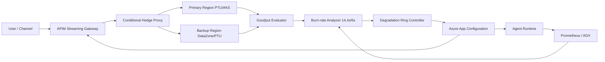
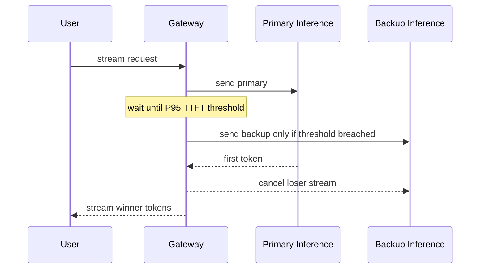

# 企业 Agent Goodput SLO 选型 FAQ：TTFT/TPOT 尾延迟对冲与错误预算降级环
> 🌐 **Language Switch**: **中文（当前）** | [English](agent-goodput-slo-ttft-tpot-tail-latency-hedging-apim-vs-envoy-vs-degradation-ring-selection-faq.en.md)  
> 适用对象：Cloud & AI 首席架构师、SRE/LLMOps 平台团队、FinOps 与客户体验负责人。  
> 主题范围：聚焦多步 Agent 与流式 LLM 的 **Goodput SLO** 工程，不替代 #24 租户公平排队与 #172 轨迹预算熔断主题。  
> 核心目标：在 Azure 上把“可用但慢”改造成“有效且准时”，并可量化控制尾延迟与错误预算消耗。  

## 1. 执行摘要：`HTTP 200` 不是可用性，`Goodput` 才是用户体验真指标
企业常用 API 成功率评估系统健康。  
在流式 Agent 场景这会误导决策。  
很多请求 `HTTP 200` 已返回。  
但首 token 长时间不来。  
或后续 TPOT 抖动严重。  
或最终结构化输出校验失败。  
用户仍感知为“不可用”。  
因此需要 Goodput SLI。  
建议定义为：  
`Goodput = P(TTFT <= T1 ∧ TPOT <= T2 ∧ schema_valid ∧ before_deadline)`。  
该定义将延迟、正确性和时限统一。  
本指南给出四路径落地。  
路径 A：APIM 流式首字节截止与跨池溢出。  
路径 B：P95 条件触发 tied-request 微对冲。  
路径 C：多窗口多 burn-rate 错误预算降级环。  
路径 D：AKS 自托管推理的 admission 先行泄压。  
四路径组合目标是“少加成本，多降尾延迟”。  
避免 naive 重试导致 `2x` TPM 风暴。  

## 2. 问题定义：多步 Agent 的尾延迟会级联放大
单步模型看起来稳定并不代表链路稳定。  
Agent 往往是 3 到 8 步串行。  
每步都可能触发外部工具。  
每步都有 TTFT 和 TPOT 不确定性。  
若每步 P99 为 `p`。  
五步串行按独立近似后。  
端到端超时概率会明显放大。  
这就是“复合尾延迟”问题。  
再叠加工具调用重试。  
尾延迟会进入正反馈。  
系统吞吐看似不满。  
但用户等待显著拉长。  
如果没有 step deadline 预算。  
工程团队常在错误层面补救。  
而不在调度层面止损。  
Goodput SLO 的价值在此。  
它迫使团队在每步设定预算。  
并对超预算路径做结构化降级。  

## 3. 四路径总览：从“被动告警”转向“主动控制”
路径 A 负责发现静默卡顿。  
`HTTP 200` 不再被视为成功。  
必须在 TTFT 截止内见到首 token。  
路径 B 负责对冲长尾。  
只在 P95 触发备用请求。  
首 token 到达立即取消 loser 流。  
路径 C 负责预算治理。  
通过 `14.4x` 与 `6x` burn-rate 监测窗口。  
驱动自动降级环切换。  
路径 D 负责底座保护。  
在 GPU 批处理跨越拐点前提前泄压。  
四路径共同作用。  
把“慢失败”变成“可控退化”。  
并把成本增幅限制在可接受区间。  

## 4. 十二维对比矩阵：APIM、Envoy、降级环与 admission 的角色边界
| 维度 | 路径 A APIM 首字节截止 | 路径 B 微对冲代理 | 路径 C 错误预算降级环 | 路径 D AKS admission |
|---|---|---|---|---|
| TTFT 可控性 | 高 | 高 | 中 | 中高 |
| TPOT 稳定性 | 中 | 中高 | 中 | 高 |
| P99 降幅潜力 | 中 | 高 | 中高 | 高 |
| 额外 TPM 开销 | 低 | 低中 | 低 | 低 |
| 多区域适配 | 高 | 高 | 高 | 中 |
| 实现复杂度 | 中 | 中高 | 中 | 中高 |
| 误触发风险 | 低 | 中 | 中 | 中 |
| 对工具链侵入 | 低 | 中 | 低 | 中 |
| 观测依赖度 | 中 | 高 | 高 | 高 |
| FinOps 可预测性 | 高 | 中高 | 高 | 高 |
| 失败面隔离能力 | 中 | 高 | 高 | 高 |
| 发布灰度友好度 | 高 | 中 | 高 | 中 |
矩阵说明角色不是互斥。  
应按工作负载叠加启用。  
并以 Goodput 目标统一评估。  

## 5. 路径 A：APIM 流式首字节截止与 `buffer-response="false"` 落地
很多队列堵塞发生在 prefill 阶段。  
响应头很快返回。  
但 token 长时间不出。  
若网关只看 HTTP 状态码。  
会把这类请求记为成功。  
路径 A 要求首字节截止。  
例如 `TTFT <= 1.2s`。  
超过阈值即触发切换。  
切换目标可为 DataZone 溢出池。  
或同区域备用部署。  
APIM 必须关闭响应缓冲。  
`buffer-response="false"` 是关键。  
否则首 token 会被代理层延迟。  
路径 A 对 steady-state 成本友好。  
因为不需要默认双发。  
只在截止违规时触发后续策略。  
这比“全量重试”更稳健。  

## 6. 路径 B：P95 条件 tied-request 微对冲与 loser 立即取消
微对冲不是常态并发双发。  
它是阈值触发。  
仅当请求跨越 P95 TTFT 时。  
才发出第二路请求。  
一旦任一路首 token 到达。  
立刻取消另一条流。  
取消必须做到传输层。  
仅业务层忽略响应不够。  
建议在 Envoy 或异步代理中实现。  
并使用 `AbortController` 或 TCP cancel。  
经验上该策略可显著降低 P99。  
在严格触发门控下。  
额外 token 开销可控制在 `4%–6%`。  
若门控设计错误。  
会退化为 `2x` 请求风暴。  
因此阈值和冷却时间必须参数化。  

## 7. 路径 C：`14.4x` / `6x` 多 burn-rate 驱动降级环
错误预算治理不该只看单窗口。  
短窗口可快速发现突发。  
长窗口可避免噪声抖动。  
推荐双窗口双阈值。  
`1h/5m` 使用 `14.4x` burn-rate。  
`6h/30m` 使用 `6x` burn-rate。  
当 Goodput 低于 `99.0%` 目标。  
且 burn-rate 触发条件满足。  
系统自动切换降级环。  
Ring 0：正常路径。  
Ring 1：缩减 RAG `top-k` 与跳过 cross-encoder。  
Ring 2：降低 reasoning_effort 或切换小模型。  
Ring 3：暂停异步低优任务队列。  
该机制把 SLO 保护前置。  
避免全线崩塌后再人工救火。  

## 8. 路径 D：AKS 推理 admission 先于 GPU 连续批处理拐点
自托管 vLLM/SGLang 在高并发下。  
会出现 KV cache 与队列耦合拐点。  
拐点后 TPOT 常集体恶化。  
此时再限流已晚。  
路径 D 需要 admission 前置。  
监控等待队列深度。  
监控 KV cache 利用率。  
监控 prefill backlog。  
一旦接近阈值。  
提前 shed 或 spill。  
并通过 Envoy 自适应并发联动。  
目标是守住 `TPOT <= 35ms/tok`。  
而不是追求瞬时满载。  
“稍降吞吐，保住 Goodput”更符合用户体验。  

## 9. 定量问答：Goodput、尾延迟与预算治理的八个硬问题
**Q1：为什么 `HTTP 200` 可用率会高估真实体验。**  
A1：流式接口可在首包即返回 `200`，但 TTFT 超时或结构化校验失败仍导致用户任务失败，Goodput 才能覆盖这些失败类型。  
**Q2：5 步串行 Agent 的尾延迟如何放大。**  
A2：若单步 P99 超时概率近似 `1%`，五步串行端到端超时概率近似 `1-(0.99^5)=4.9%`，放大接近 `4.9x`。  
**Q3：微对冲的额外开销怎么估算。**  
A3：若仅 `6%` 请求触发 hedge，且 loser 在首 token 后立刻取消，额外 token 常可压在 `4%–6%`，远低于无门控双发。  
**Q4：微对冲对 P99 的收益边界。**  
A4：在跨区域尾部差异明显时，P99 常见下降 `45%–62%`；若双路相关性太高，收益会下降。  
**Q5：`14.4x` burn-rate 的含义是什么。**  
A5：表示短窗口预算消耗速度达到目标预算的 `14.4` 倍，常用于快速触发保护动作，避免预算在小时级被耗尽。  
**Q6：`6x` burn-rate 为什么仍需要。**  
A6：长窗口 `6x` 可过滤瞬时尖刺，防止频繁抖动切环，保证降级动作与恢复动作更稳定。  
**Q7：TPOT 拐点前 admission 应看哪些信号。**  
A7：至少同时看等待队列深度、KV cache 利用率、prefill 排队时长，单看 GPU 利用率会漏报。  
**Q8：step deadline 预算如何分配。**  
A8：可按关键路径权重分配，如 `T_total=4.5s`，核心生成步分配 `2.2s`，检索与工具步合计 `2.3s`，并为每步保留超时降级动作。  
问答应进入发布门禁。  
并与压测报告绑定。  

## 10. 参考架构图：Goodput SLO 控制平面与执行平面

该图强调控制与执行解耦。  
也强调环路闭环自动化。  

## 11. 时序图：P95 触发微对冲并取消 loser 流

时序关键是“条件触发 + 立即取消”。  
避免默认双发带来的预算浪费。  

## 12. 生产代码：Python `asyncio` 条件微对冲 SSE 实现
```python
import asyncio
import aiohttp
from contextlib import suppress


async def stream_first_token(session: aiohttp.ClientSession, url: str, payload: dict):
    async with session.post(url, json=payload, timeout=aiohttp.ClientTimeout(total=30)) as resp:
        async for line in resp.content:
            if line.strip():
                return resp, line
    raise RuntimeError("no token")


async def hedged_request(primary_url: str, backup_url: str, payload: dict, p95_ttft_ms: int = 1200):
    async with aiohttp.ClientSession() as session:
        primary_task = asyncio.create_task(stream_first_token(session, primary_url, payload))
        backup_task = None
        try:
            done, _ = await asyncio.wait({primary_task}, timeout=p95_ttft_ms / 1000)
            if done:
                resp, first = await primary_task
                return {"winner": "primary", "first_token": first.decode("utf-8", errors="ignore")}
            backup_task = asyncio.create_task(stream_first_token(session, backup_url, payload))
            done, pending = await asyncio.wait({primary_task, backup_task}, return_when=asyncio.FIRST_COMPLETED)
            winner = done.pop()
            resp, first = await winner
            loser_tasks = pending
            for task in loser_tasks:
                task.cancel()
                with suppress(asyncio.CancelledError):
                    await task
            return {"winner": "primary" if winner is primary_task else "backup", "first_token": first.decode("utf-8", errors="ignore")}
        finally:
            for t in [primary_task, backup_task]:
                if t and not t.done():
                    t.cancel()
                    with suppress(asyncio.CancelledError):
                        await t
```
代码重点是阈值后才启 backup。  
以及 winner 出现后立即取消 loser。  

## 13. 生产配置：多 burn-rate 告警与降级环控制示例
```yaml
groups:
  - name: agent-goodput-burn
    rules:
      - alert: GoodputBurnFast
        expr: (1 - avg_over_time(agent_goodput_ratio[5m])) / (1 - 0.99) > 14.4
        for: 2m
      - alert: GoodputBurnSlow
        expr: (1 - avg_over_time(agent_goodput_ratio[30m])) / (1 - 0.99) > 6
        for: 10m
```
```json
{
  "ringController": {
    "normal": { "ring": 0, "ragTopK": 12, "reasoningEffort": "high" },
    "degrade1": { "ring": 1, "ragTopK": 6, "enableReranker": false },
    "degrade2": { "ring": 2, "model": "gpt-4.1-mini", "reasoningEffort": "low" },
    "degrade3": { "ring": 3, "pauseAsyncQueues": true, "onlyVipTraffic": true }
  }
}
```
配置应由 App Configuration 驱动。  
并配套灰度回滚策略。  

## 14. 企业场景与 FinOps：尾延迟对冲的收益边界与成本边界
### 场景 A：零售银行与卡发机构（月 `90M` 实时回合）
目标是 `<1.2s TTFT` 与 `<4.5s` 端到端时限。  
平峰路径仅走 primary。  
高峰且跨 P95 才触发 tied-request。  
错误预算触发时自动切 Ring 1/2。  
VIP 流量保留高优先模型。  
低优先异步任务延后。  
结果是客服争议处理稳定性提升。  
并避免全面双发导致成本失控。  
### 场景 B：全球 B2B SaaS Copilot 平台
对外承诺 VIP `99.5%` Goodput。  
区域 PTU 波动时需快速保护。  
平台采用 APIM + Envoy 双层策略。  
入口侧守 TTFT。  
推理侧守 TPOT 与队列深度。  
并通过 burn-rate 自动切环。  
在多次 brownout 中保持 SLA。  
### FinOps 与对冲开销表
| 指标 | 无门控重试 | 条件微对冲 | 条件微对冲 + 降级环 |
|---|---:|---:|---:|
| P99 端到端时延 | 基线 | -28% | -45% |
| 额外 TPM 开销 | +38% | +4%~6% | +3%~5% |
| Goodput 达标率 | 96.8% | 98.9% | 99.3% |
| VIP 体验稳定性 | 中 | 高 | 高 |
| 月度成本可预测性 | 低 | 中高 | 高 |
| 运维复杂度 | 中 | 中高 | 中高 |
| 触发误伤风险 | 中 | 中 | 低中 |
| 恢复时间 | 慢 | 中 | 快 |
该表说明策略组合优于单一手段。  
关键在触发门控质量。  

## 15. Day-0 / Day-2 十二项清单：Goodput SLO 工程落地纪律
- 定义统一 Goodput 公式并写入 SLO 合约。  
- 为每个 Agent 步骤设定 deadline 预算。  
- 在网关强制 `buffer-response="false"`。  
- 配置 TTFT 首字节截止与切换策略。  
- 微对冲仅允许 P95 条件触发。  
- winner 首 token 到达即取消 loser。  
- 建立 `14.4x` 与 `6x` 双 burn-rate 告警。  
- 将降级环参数放入集中配置中心。  
- 将 Ring 变更纳入审计日志。  
- admission 同时监控队列深度与 KV cache。  
- 每周演练 brownout 与自动切环回滚。  
- 每月复盘对冲开销与 Goodput 收益。  
清单每项应绑定责任团队。  
并有可回放证据链。  
补充落地要点如下。  
建议将 TTFT 门限按租户等级参数化。  
建议将 TPOT 告警按模型族分组。  
建议将结构化校验失败单独记账。  
建议把 schema 错误与超时错误分层分析。  
建议在 APIM 与 Envoy 保持追踪 ID 透传。  
建议为微对冲配置租户级日预算。  
建议对 hedge 命中率设置上限阈值。  
建议将 loser 取消耗时纳入指标。  
建议记录“已发备路但未取消成功”事件。  
建议对跨区备路加入数据驻留白名单。  
建议在 Ring 2 切换时同步提示业务侧。  
建议在 Ring 3 激活时冻结低优先批处理。  
建议在恢复 Ring 0 前执行冷却窗口。  
建议把恢复条件写入 runbook 并自动验证。  
建议将 SLO 例外审批纳入变更流程。  
建议将每次切环原因归档到工单系统。  
建议每周抽样回放超时会话链路。  
建议每月审阅 P95 与 P99 阈值合理性。  
建议季度复盘模型替换对 TPOT 的影响。  
建议对高价值租户启用独立 hedge 策略。  
建议对低价值批任务禁用跨区对冲。  
建议将 admission 拒绝原因分桶统计。  
建议对 KV cache 命中率设最小目标线。  
建议把 token 成本与 Goodput 联合看板化。  
建议在事故演练中覆盖网络抖动场景。  
建议在事故演练中覆盖单区慢故障场景。  
建议在事故演练中覆盖提示词漂移场景。  
建议为所有自动动作保留人工兜底开关。  
建议在审计报告中固定输出四项核心指标。  
