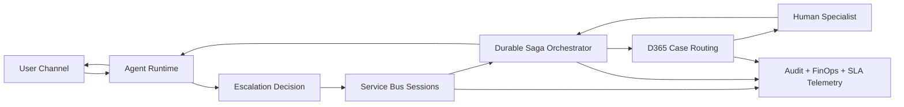
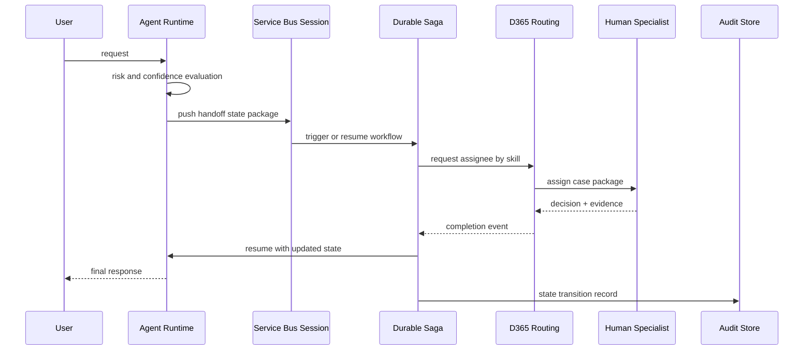

# Enterprise agent human-handoff state-package selection FAQ: Service Bus Session ordering vs Durable Saga recovery vs D365 case routing vs integrated hybrid loop

> **Audience**: Enterprise Cloud & AI Solution Architects, service platform leaders, workflow orchestration owners, SRE teams, and compliance auditors.  
> **Core question**: When agents escalate to human handling, how should teams preserve state continuity, accountability, recoverability, and cost control.

## 1. Problem framing: handoff state packaging defines real production quality

Enterprise agent systems are not fully autonomous.
Human handoff is a normal operating path.

The frequent failure is not escalation itself.
It is broken state continuity after escalation.

Common failure patterns:

- Missing evidence in handoff summaries.
- Lost tool-intermediate states.
- Broken multi-step approval chains.
- Human outcomes not written back into automation context.

Business impact appears quickly:

- Users repeat context and lose trust.
- SLA breaches and rework increase.
- Audit teams cannot reconstruct accountability.
- Resumed automation fails again with stale context.

State-package governance is therefore a core design axis.

## 2. Four enterprise patterns and practical boundaries

This guide compares four patterns:

- Pattern A: `Service Bus Sessions` ordered state-package queueing.
- Pattern B: `Durable Saga` persistent suspend/resume workflows.
- Pattern C: `D365 Case Routing` skill-dispatch package handling.
- Pattern D: integrated hybrid loop combining A/B/C.

Evaluate with a common metric set:

- Handoff success rate.
- State-package completeness ratio.
- Human takeover wait P95.
- Post-handoff first-pass completion rate.
- Blended cost per 1,000 handoffs.

## 3. Pattern A: Service Bus Session ordered packages

This pattern binds each case to one session stream,
ensuring ordered handoff package processing.

Core design points:

- `SessionId = case_id`.
- Structured package payload schema.
- Lock renewal for long-running handlers.
- Dead-letter lane for broken packages.

Strengths:

- Simple and reliable adoption.
- Good burst absorption behavior.
- Clear ordering semantics.

Limitations:

- Limited native support for complex state machines.
- Compensation logic needs extra implementation.
- Skill routing requires external systems.

## 4. Pattern B: Durable Saga recovery orchestration

This pattern models handoff lifecycle as persistent workflows.

Key capabilities:

- Durable suspend/resume checkpoints.
- Timeout escalation and compensation branches.
- Versioned workflow definitions with replay.
- External-event driven workflow continuation.

Strengths:

- Strong long-running recoverability.
- Clear lifecycle traceability.
- Better fit for complex cross-system approvals.

Limitations:

- Higher workflow design complexity.
- Overhead for short-lived simple tasks.
- Ops visualization often needs extra tooling.

## 5. Pattern C: D365 case-routing package dispatch

This pattern operationalizes handoff in contact-center case routing.

Core capabilities:

- Skill tags and priority-aware dispatch.
- Capacity-aware assignment.
- Omnichannel continuity across interactions.
- Built-in quality and supervisor controls.

Strengths:

- Mature human takeover experience.
- Configuration-oriented operations model.
- Strong alignment with service KPIs.

Limitations:

- Less direct fit for non-service workflows.
- Deep customization may require additional integration.
- Automated resume still depends on external orchestration.

## 6. Pattern D: integrated hybrid loop (recommended)

Mature enterprises often combine layers:

- Sessions for ordered intake and buffering.
- Saga orchestration for recovery and compensation.
- D365 routing for skill-based human execution.

Value comes from role separation:

- Queue layer protects flow continuity.
- Workflow layer protects state consistency.
- Routing layer protects human efficiency.

At scale this usually yields strongest blended economics.

## 7. Reference architecture: handoff state-package control plane

Architecture implications:

- State package schema must be standardized.
- Human decisions must feed back into saga state.
- Shared trace lineage is mandatory across layers.

## 8. Request lifecycle: escalation, takeover, resume, audit

Governance essentials:

- Every transition needs version metadata.
- Human evidence should be structured, not free text only.
- Resume logic must validate package completeness.

## 9. 12-dimension enterprise comparison matrix

| Dimension | A Session Queue | B Durable Saga | C D365 Routing | D Hybrid Loop |
|---|---|---|---|---|
| Ordered state continuity | Very high | High | Medium | Very high |
| Long-running recoverability | Medium | Very high | Medium | Very high |
| Skill dispatch depth | Low | Medium | Very high | Very high |
| Omnichannel continuity | Medium | Medium | Very high | Very high |
| Time-to-adopt | High | Medium | High | Medium |
| Audit traceability | High | Very high | High | Very high |
| Implementation complexity | Low to medium | Medium to high | Medium | High |
| Operations friendliness | Medium | Medium | Very high | Very high |
| Compensation capabilities | Medium | Very high | Medium | Very high |
| Cost predictability | High | Medium | Medium | Medium |
| Scale-out fitness | Medium | High | High | Very high |
| Recommended maturity | Early stabilization | Process governance | Service-scale operations | Enterprise scale |

## 10. Quantitative break-even: handoff efficiency and cost

| Metric | A Session | B Saga | C D365 | D Hybrid |
|---|---:|---:|---:|---:|
| State-package completeness | 93.1% | 96.7% | 95.2% | 98.4% |
| Human takeover wait P95 | 12.4 min | 11.1 min | 8.4 min | 6.9 min |
| Post-handoff first-pass completion | 74.8% | 80.3% | 83.7% | 88.5% |
| SLA breach rate | 5.2% | 4.1% | 3.0% | 1.8% |
| Cost per 1k handoffs | $34 | $41 | $47 | $45 |
| Rework loss per 1k handoffs | $22 | $16 | $13 | $7 |

Assumptions:

- 520k handoffs per month.
- 3.9x peak multiplier.
- Omnichannel intake across text, voice, and ticket streams.
- Cost includes platform, workforce, and rework components.

Break-even insights:

- A is practical for low-scale startup phases.
- B fits process-heavy recovery requirements.
- C fits service-center-intensive organizations.
- D usually wins at sustained enterprise scale.

## 11. Decision tree: choose by workflow shape and operating model

Question 1:
Do workflows span multiple business days?

- Yes: prioritize B or D.
- No: continue to Question 2.

Question 2:
Is customer-service intake dominant?

- Yes: prioritize C or D.
- No: continue to Question 3.

Question 3:
Do you require burst buffering under strict SLA?

- Yes: prioritize A or D.
- No: continue to Question 4.

Question 4:
Do auditors require full transition evidence?

- Yes: converge to D.
- No: phase through A/B/C by risk.

## 12. Common anti-patterns and corrective actions

Anti-pattern 1:
Passing only free-text summaries without structured state.

Correction:
Enforce schema-validated state packages for every handoff.

Anti-pattern 2:
Human decisions stay in notes only,
with no machine-readable write-back.

Mitigation:
Map decision fields into saga resume payloads.

Anti-pattern 3:
Static timeout policies never recalibrated.

Fix:
Tune SLA tiers by domain with periodic replay evidence.

Anti-pattern 4:
Audit logs retain final outcomes only.

Action:
Persist full transition history and decision rationale.

## 13. Governance operating model and ownership

Recommended four-party model:

- Platform team: queue/workflow/routing integration baseline.
- Operations team: skills taxonomy and staffing strategy.
- Business team: priority policies and case rules.
- Audit team: evidence standards and retention controls.

Operating rules:

- State-package contracts must be versioned.
- Policy changes require staged rollout plans.
- High-risk updates require dual authorization.

## 14. Five-step rollout guide (Good fit vs Not for)

Step 1: define a unified handoff package contract.  
Include context, evidence, action history, and permission scope.

Step 2: deploy session queue buffering first.  
Protect ordering and burst resilience.

Step 3: add saga-based recovery orchestration.  
Make cross-system transitions deterministic.

Step 4: integrate D365 skill dispatch.  
Improve human takeover precision and speed.

Step 5: run weekly closed-loop reviews.  
Tune wait time, rework rate, and blended cost.

Good fit:

- High-volume multi-channel service organizations.
- Environments with strict compliance evidence needs.
- Teams with sustained platform operations maturity.

Not for:

- Small low-volume internal tools.
- Experiments with no human takeover workflow.
- Short tasks with no recoverable state requirements.

## 15. Practical FAQ (8 questions)

**Q1: Is queue-only handoff enough for complex cases?**  
A1: It handles flow control, but complex recovery usually needs saga orchestration.

**Q2: Does saga orchestration add too much complexity?**  
A2: It adds design effort, but significantly improves recoverability and traceability.

**Q3: Is D365 routing only for support teams?**  
A3: It is strongest there, but can extend to broader service operations.

**Q4: Which fields are critical in handoff packages?**  
A4: Context, evidence references, action history, and permission boundaries.

**Q5: How do we reduce post-handoff rework?**  
A5: Improve package completeness and standardize human decision schemas.

**Q6: When should teams adopt the hybrid model?**  
A6: When handoff volume, rework losses, and audit pressure rise together.

**Q7: Do we need a separate audit stream?**  
A7: Yes, and it should be trace-linked to business transactions.

**Q8: How do we prevent cross-system state divergence?**  
A8: Use idempotent writes and saga compensation to reconcile consistently.

