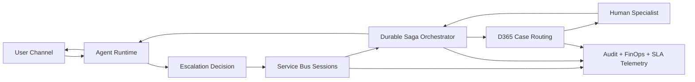
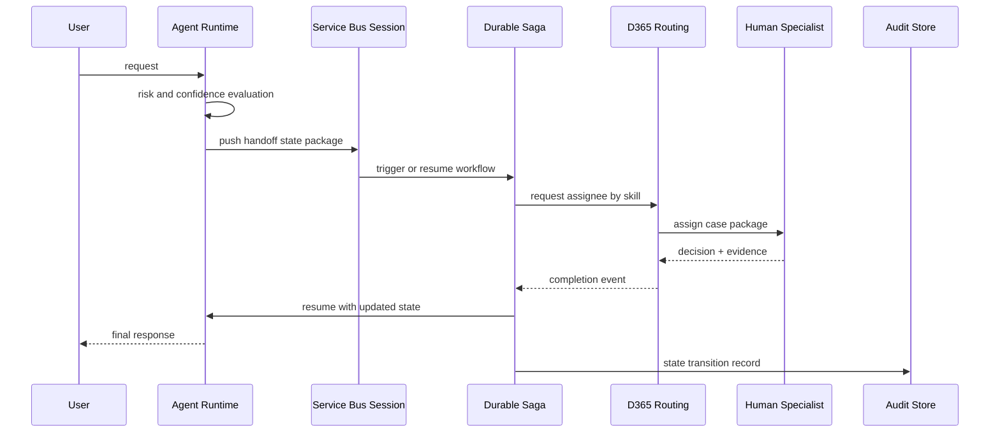

# 企业 Agent 人工接管状态包选型 FAQ：Service Bus Session 顺序队列 vs Durable Saga 恢复编排 vs D365 Case Routing 技能分派 vs 混合闭环

> **适用对象**：企业 Cloud & AI Solution Architect、客服与运营平台团队、流程编排负责人、SRE 与合规审计团队。  
> **目标问题**：当 Agent 升级到人工处理时，如何保证“状态不丢、责任可追、恢复可控、成本可管”。

## 1. 问题定义：为什么人工接管状态包决定 Agent 落地质量

企业 Agent 并非全自动系统，
人工接管是常态能力而非例外路径。

现实中最常见的问题不是“无法升级”，
而是“升级后状态丢失或语义错位”。

典型风险包括：

- 上下文摘要缺失关键证据。
- 工具调用中间态未回填。
- 多轮审批链条断裂。
- 人工处理结论无法回写自动流。

这些问题会带来直接后果：

- 用户重复描述与体验恶化。
- SLA 超时与工单返工上升。
- 审计无法还原责任链。
- 自动恢复后再次出错。

因此“状态包治理”是人机协同架构核心，
不是客服外围功能。

## 2. 四类企业方案与边界

本文比较四种路径：

- 方案 A：`Service Bus Sessions` 顺序队列状态包。
- 方案 B：`Durable Saga` 持久化恢复编排。
- 方案 C：`D365 Case Routing` 技能分派上下文包。
- 方案 D：A+B+C 混合闭环。

评估时建议统一观察：

- 接管成功率。
- 状态包完整率。
- 人工接手等待 P95。
- 恢复后一次完成率。
- 每千次接管综合成本。

## 3. 方案 A：Service Bus Session 顺序状态包

该方案把每个 case 绑定到 Session，
确保状态包按顺序处理。

关键设计：

- `SessionId = case_id`。
- 消息体携带结构化状态快照。
- 锁续约应对长处理窗口。
- Dead-letter 承接异常状态包。

优势：

- 实施简单且稳定。
- 对峰值削峰友好。
- 顺序语义清晰易维护。

短板：

- 缺少复杂审批状态机能力。
- 跨系统补偿逻辑需额外实现。
- 技能分派依赖外部系统。

## 4. 方案 B：Durable Saga 恢复编排

该方案以持久化工作流为核心，
将接管流程显式建模为 Saga。

关键能力：

- 挂起/恢复状态持久化。
- 超时升级与补偿分支。
- 版本化流程定义与回放。
- 外部事件触发恢复执行。

优势：

- 长周期流程可追溯。
- 失败恢复能力强。
- 适合复杂跨系统审批链。

短板：

- 流程设计复杂度较高。
- 高频短任务场景成本偏高。
- 运营可视化需要额外建设。

## 5. 方案 C：D365 Case Routing 技能分派状态包

该方案把接管直接纳入联络中心工单体系，
通过技能与容量做实时派发。

关键能力：

- 技能标签与优先级分派。
- 坐席容量控制与队列重排。
- 多渠道会话上下文连续。
- 质检与运营指标闭环。

优势：

- 人工接管体验成熟。
- 运营规则配置化较强。
- 与客服 KPI 体系天然对齐。

短板：

- 非客服流程适配有限。
- 深度自定义需二次集成。
- 自动恢复编排仍需外部配合。

## 6. 方案 D：混合闭环（推荐终局）

成熟企业常用双层协同：

- Session 队列做入口整形。
- Saga 编排做流程恢复与补偿。
- D365 做技能派发与运营闭环。

该模式价值在于：

- 状态有序不丢失。
- 流程恢复可解释。
- 人工接手效率可持续优化。

在多团队协作环境中，
该模式通常是长期可演进解法。

## 7. 参考架构：人工接管状态包控制平面

架构要点：

- 状态包结构必须标准化。
- 人工结论必须回写 Saga。
- 自动恢复与人工处理共享同一 Trace。

## 8. 请求时序：升级、接管、恢复与审计

治理要点：

- 每个状态变更都需带版本号。
- 人工证据字段必须结构化。
- 恢复执行要校验状态完整性。

## 9. 12 维企业级选型对比矩阵

| 维度 | A Session 队列 | B Durable Saga | C D365 Routing | D 混合闭环 |
|---|---|---|---|---|
| 状态顺序保障 | 很高 | 高 | 中 | 很高 |
| 长流程恢复能力 | 中 | 很高 | 中 | 很高 |
| 技能分派能力 | 低 | 中 | 很高 | 很高 |
| 多渠道连续性 | 中 | 中 | 很高 | 很高 |
| 上线速度 | 高 | 中 | 高 | 中 |
| 审计可追溯性 | 高 | 很高 | 高 | 很高 |
| 实施复杂度 | 低到中 | 中到高 | 中 | 高 |
| 运营友好度 | 中 | 中 | 很高 | 很高 |
| 异常补偿能力 | 中 | 很高 | 中 | 很高 |
| 成本可预测性 | 高 | 中 | 中 | 中 |
| 规模化适应性 | 中 | 高 | 高 | 很高 |
| 推荐阶段 | 起步承接 | 流程治理 | 运营成熟 | 企业规模化 |

## 10. 定量对比：接管效率与综合成本拐点

| 指标 | A Session | B Saga | C D365 | D 混合 |
|---|---:|---:|---:|---:|
| 状态包完整率 | 93.1% | 96.7% | 95.2% | 98.4% |
| 人工接手等待 P95 | 12.4 min | 11.1 min | 8.4 min | 6.9 min |
| 恢复后一次完成率 | 74.8% | 80.3% | 83.7% | 88.5% |
| SLA 违约率 | 5.2% | 4.1% | 3.0% | 1.8% |
| 每千次接管成本（美元） | 34 | 41 | 47 | 45 |
| 每千次返工损失（美元） | 22 | 16 | 13 | 7 |

测算假设：

- 月接管量 52 万。
- 高峰倍率 3.9x。
- 多渠道并发接入（文本/语音/工单）。
- 成本含平台、人工、返工三项。

拐点结论：

- 低规模可先采用 A。
- 强流程治理倾向 B。
- 客服密集场景倾向 C。
- 规模化长期最优通常是 D。

## 11. 选型决策树：按场景特性做组合

第一问：
是否存在跨天长事务？

- 是：优先 B 或 D。
- 否：进入第二问。

第二问：
是否以客服渠道为主？

- 是：优先 C 或 D。
- 否：进入第三问。

第三问：
是否有突发高峰削峰需求？

- 是：优先 A 或 D。
- 否：进入第四问。

第四问：
是否要求全链路审计证据？

- 是：最终收敛 D。
- 否：可阶段化 A/B/C。

## 12. 常见反模式与纠偏

反模式一：
接管仅传自然语言摘要，
没有结构化状态。

纠偏方案：
定义标准状态包 Schema 并强制校验。

反模式二：
人工结论只存在坐席备注，
未回写自动流程。

修复方案：
将结论字段映射为 Saga 恢复输入。

反模式三：
超时策略写死且长期不调。

治理方案：
按业务域分层设置 SLA 与升级策略。

反模式四：
审计只保留最终结果，
缺少过程证据。

改进方案：
保存全量状态迁移与决策原因。

## 13. 平台治理模型与职责分工

建议采用四方协作：

- 平台团队：维护队列、编排、接入规范。
- 运营团队：维护技能模型与排班策略。
- 业务团队：定义优先级与处理规则。
- 审计团队：定义证据标准与留存策略。

治理规则：

- 状态包版本必须可追踪。
- 规则变更必须有灰度计划。
- 高风险变更双人审批。

## 14. 五步落地指南（Good fit vs Not for）

步骤 1：定义统一状态包契约。  
覆盖上下文、证据、动作、权限四类字段。

步骤 2：先接入 Session 队列承接。  
确保峰值不丢单且顺序可控。

步骤 3：引入 Saga 恢复编排。  
把跨系统状态迁移显式化。

步骤 4：接入 D365 技能分派。  
提升人工接手效率与质量稳定性。

步骤 5：建立周度复盘闭环。  
持续优化等待时长、返工率与单位成本。

Good fit：

- 多渠道高并发服务组织。
- 强合规证据要求场景。
- 有长期运营能力的平台团队。

Not for：

- 低流量单团队内部工具。
- 无人工接管流程的轻量试验。
- 无状态可恢复需求的短事务任务。

## 15. 实战 FAQ（8 问）

**Q1：只用队列能满足复杂接管吗？**  
A1：可承接流量，但复杂恢复通常需要 Saga。

**Q2：Saga 会不会增加过多复杂度？**  
A2：会增加设计成本，但显著提升可恢复性。

**Q3：D365 是否必须与客服绑定？**  
A3：最强场景在客服，但也可扩展到服务台。

**Q4：状态包最关键字段有哪些？**  
A4：请求上下文、证据引用、动作历史、权限边界。

**Q5：如何降低接管后的返工率？**  
A5：提升状态包完整率并标准化人工结论格式。

**Q6：如何评估是否该上混合闭环？**  
A6：当接管量、返工率与审计压力同步上升时。

**Q7：是否需要独立审计流水？**  
A7：需要，且应与业务 Trace 统一关联。

**Q8：如何避免跨系统状态不一致？**  
A8：通过 Saga 补偿和幂等写入策略统一收敛。

