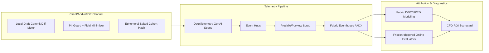
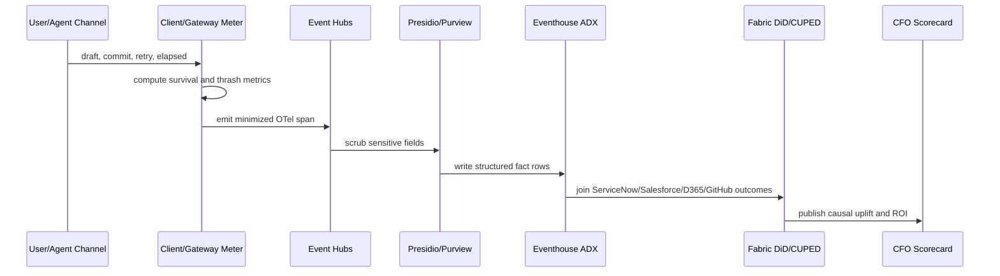
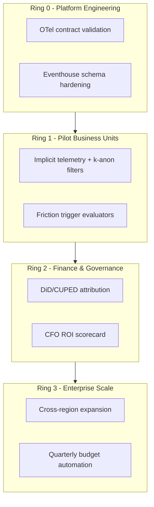

# Enterprise Agent Implicit Feedback and Causal ROI Attribution Selection FAQ: Eventhouse Edit-Distance Survival Telemetry vs Fabric DiD Attribution vs Friction-Triggered Online Evaluation vs Works-Council k-Anonymous Edge Aggregation

> 🌐 **Language Switch**: [中文](./agent-implicit-feedback-edit-distance-causal-roi-attribution-eventhouse-did-vs-explicit-ratings-vs-works-council-k-anonymity-selection-faq.md) | **English (current)**
> **Audience**: Cloud and AI Solution Architects, LLMOps platform leads, enterprise data and BI architects, FinOps and CFO analytics teams, and privacy/governance stakeholders including EU works councils.
> **Scope**: Production architecture for implicit behavioral telemetry, draft-survival quality measurement, causal productivity attribution, and GDPR/works-council safe reporting across OpenTelemetry, Eventhouse/ADX, Fabric, and executive scorecards.

## 1. Why thumbs-up and token dashboards fail CFO renewal governance
Explicit `thumbs-up/thumbs-down` feedback usually stays below `1.2%` response rate in enterprise channels, and the sample is heavily skewed toward extreme experiences, so it does not represent the silent majority of operational interactions.
Token volume, DAU, and call counts can show platform consumption and spend posture, but they cannot prove whether teams actually reduced cycle time, prevented rework, or produced measurable business outcomes.
If raw prompt and per-employee draft content is centralized without strict minimization, organizations often hit GDPR proportionality objections and works-council resistance around latent individual productivity surveillance.
A renewal-ready measurement stack therefore needs broad objective coverage, causal rigor, cost-controlled diagnostics, and legally defensible anonymity controls in one integrated architecture.

## 2. Four architecture paths and responsibility boundaries
**Architecture A** builds a high-coverage implicit telemetry baseline by capturing normalized edit-distance survival, persistence, regeneration, and abandonment friction signals from draft-to-final transitions.
**Architecture B** joins telemetry with business outcomes in Fabric and applies Difference-in-Differences with CUPED-style variance reduction to estimate causal uplift and net dollar benefit per spend unit.
**Architecture C** routes only high-friction sessions into deeper online evaluators and micro-feedback taxonomies, preserving diagnostic power while reducing evaluator token spend by design.
**Architecture D** computes sensitive ratio metrics client-side and enforces `k >= 15` aggregate visibility in ADX/Power BI, preventing individual-level monitoring while preserving operational observability.

## 3. End-to-end reference architecture and minimization boundary

This design separates potentially identifying raw content from governed aggregate indicators early in the flow, so platform teams can still produce enterprise-grade quality and ROI analytics without constructing a central personal-behavior surveillance lake.
Architecture A and D secure safe collection and privacy posture, Architecture B provides auditable causal evidence, and Architecture C keeps diagnostic depth economically viable under real token budgets.
For multi-system attribution, teams should standardize `trace_id`, `tenant_id`, `cohort_id`, and `outcome_id` key contracts before rollout, otherwise join coverage collapses and power degrades in causal models.
If existing monitoring stacks already run in Application Insights/Log Analytics, organizations can dual-write core fields into Eventhouse for long-horizon attribution while retaining real-time SRE alerts in the incumbent stack.

## 4. Architecture A deep dive: implicit draft-survival and friction telemetry
A focuses on what users keep rather than what they click, turning draft survival and rewrite friction into objective quality signals with near-total interaction coverage.
Core metrics typically include token/AST normalized edit distance, 30-minute persistence, regenerate thrash intensity, and time-to-commit, which are stable enough for daily trend governance.
To reduce exposure and cost, metric computation should happen in the client or near-edge gateway, and only compact numeric facts should be shipped centrally instead of raw full drafts.
A creates the durable quality fact table that powers B's causal attribution and C's targeted evaluator triggers, making it the foundational layer of the measurement stack.

## 5. Architecture B deep dive: CFO-grade causal productivity attribution
B upgrades operational analytics from correlation to causal evidence by constructing stratified holdout cohorts and running DiD/CUPED-style estimation across telemetry and business outcome systems.
Service operations can attribute to handle time, first-contact resolution, escalation rates, and MTTR, while sales workflows can map to response-cycle compression, quote velocity, and conversion outcomes.
A strong B implementation requires strict intervention timestamps, exposure definitions, exclusion rules, and release-change logging so that model, prompt, and tool changes do not confound the estimate.
CFO-facing outputs should prioritize `Net Dollar Benefit per $1`, payback period, confidence intervals, and downside bands rather than model-centric vanity metrics.

## 6. Architecture C deep dive: friction-triggered evaluators and micro-feedback
C evaluates deeply only where friction is demonstrably high, for example `edit_ratio > 0.45`, `regenerations >= 3`, repeated abandon/retry loops, or policy/tool mismatch events.
By scoring the riskiest `10-20%` of traffic instead of all sessions, organizations commonly save `80-90%` evaluator spend while retaining high recall for actionable failure clusters.
Micro-feedback should remain low-friction and taxonomy-aligned, such as factual error, format mismatch, tool failure, authorization failure, or policy block confusion, each mapped to a dedicated remediation lane.
C is not a replacement for A or B; it is the cost-control and root-cause acceleration layer that keeps continuous quality diagnosis sustainable quarter after quarter.

## 7. Architecture D deep dive: works-council and GDPR-safe k-anonymous edge aggregation
D shifts sensitive ratio computation to the client and sends only aggregated cohort-level metrics guarded by ephemeral salted hashes and minimum group thresholds.
Rolling salts and bounded hash lifetime reduce longitudinal linkability, while ADX/Power BI hard filters enforce `k >= 15` before any dashboard visibility or export.
When sample inspections are required for corrective action, organizations should use explicit dual-approval and automated redaction workflows, never silent "engineering convenience" bypasses.
D ensures that quality and ROI governance can scale in high-regulation environments without collapsing into person-level ranking artifacts.

## 8. Twelve-dimension comparison matrix
| Dimension | A: Implicit Survival Telemetry | B: DiD/CUPED Attribution | C: Friction-triggered Evaluation | D: k-Anonymous Edge Aggregation |
|---|---|---|---|---|
| Coverage rate | Very high | Medium | Low to medium | High |
| Causal confidence | Low to medium | High | Medium | Low |
| CFO audit readiness | Medium | High | Medium | Medium |
| Delivery complexity | Medium | High | Medium | Medium to high |
| Privacy robustness | Medium | Medium | Medium | High |
| Cost per observed session | Low | Medium | Medium to high | Low |
| Real-time responsiveness | High | Low to medium | Medium | Medium |
| Root-cause actionability | Medium | High | High | Medium |
| Cross-domain portability | High | Medium | Medium | High |
| Data engineering burden | Medium | High | Medium | Medium |
| Governance dependency | Medium | High | Medium | High |
| Best-fit goal | Quality baseline | Budget renewal and investment proof | Failure diagnosis acceleration | Regulated scale-out |

## 9. Quantitative models: quality, sample sizing, ROI, and evaluator throttling
Draft survival score is defined as `S = 1 - edit_distance(draft, committed) / max(len(draft), len(committed))`, and can be weighted by workflow class as `S_weighted = Σ(w_i * S_i)` for portfolio-level quality tracking.
Difference-in-Differences can be represented as `Δ = (Y_treat_post - Y_treat_pre) - (Y_ctrl_post - Y_ctrl_pre)`, while CUPED-style covariance adjustment can reduce variance and improve sensitivity under fixed sample budgets.
A practical approximate sample-size bound is `N ≈ 16 * σ^2 / MDE^2`; for `σ=1.8` and `MDE=0.2`, the per-group requirement is about `648`, then inflated by join-coverage and missingness factors.
Net ROI ratio can be computed as `ROI_net = (hours_saved * loaded_hourly_cost * causal_discount - infra_and_license_cost) / infra_and_license_cost`, where `causal_discount` conservatively absorbs confounding risk.
Friction gating savings are approximated by `Savings ≈ 1 - p_trigger` under similar per-case evaluator cost, so at `p_trigger=0.15`, expected savings approach `85%` before secondary optimizations.
Finance governance should publish `p10/p50/p90` ranges and confidence intervals rather than single-point claims, reducing over-commitment risk during renewal and budget committees.

## 10. Reference sequence from implicit signal to CFO scorecard

The sequence enforces "compute close to source, attribute in governed analytics, report in finance language" so each stage remains auditable and independently evolvable.
If a business line cannot yet provide reliable outcome tables, teams should still deploy A and D first, then onboard B when data contracts mature rather than blocking all progress on full-stack readiness.
For high-sensitivity environments, scrub and write should run within tightly controlled network boundaries, with dead-letter handling and explicit remediation runbooks for failed sanitation events.
When schema drift is detected, downstream attribution jobs should fail closed and raise governance alerts instead of silently filling nulls that poison executive interpretation.

## 11. Reference topology for phased rollout and governance gates

Ring-based delivery separates engineering, statistical, and governance risk so each expansion step has explicit promotion criteria and rollback controls.
A representative gate contract is `Gate_n = (data_quality >= 0.98) ∧ (k_anon_pass_rate = 1.0) ∧ (model_ci_width <= target)`, ensuring expansion follows measurable readiness instead of calendar pressure.
For multi-region rollout, migrate metric semantics and query contracts before model thresholds, preventing same-name/different-meaning KPI drift in executive reporting.
Any policy-version change should ship with a versioned impact statement and regression report so finance and legal teams can trace why scorecard movement occurred.

## 12. Production KQL snippet: survival, friction, and k-anonymous cohort view
```kql
let lookback = 14d;
let base =
    AgentTelemetry
    | where Timestamp >= ago(lookback)
    | where isnotempty(TenantId) and isnotempty(CohortHash)
    | extend DraftLen = todouble(DraftTokenLen), CommitLen = todouble(CommitTokenLen)
    | extend EditDist = todouble(EditDistanceToken)
    | extend SurvivalScore = 1.0 - (EditDist / iff(DraftLen > CommitLen, DraftLen, CommitLen))
    | extend ThrashScore = todouble(RegenerateCount) + todouble(AbandonCount) * 1.5
    | extend Persist30m = iff(MinutesToFirstDelete <= 30, 0, 1);
let cohort_daily =
    base
    | summarize
        Sessions = count(),
        AvgSurvival = avg(SurvivalScore),
        P95Thrash = percentile(ThrashScore, 95),
        PersistRate30m = avg(todouble(Persist30m)),
        AvgTimeToCommitMin = avg(todouble(TimeToCommitMin))
      by TenantId, CohortHash, bin(Timestamp, 1d);
cohort_daily
| summarize
    Sessions = sum(Sessions),
    AvgSurvival = avg(AvgSurvival),
    P95Thrash = avg(P95Thrash),
    PersistRate30m = avg(PersistRate30m),
    AvgTimeToCommitMin = avg(AvgTimeToCommitMin)
  by TenantId, CohortHash, Timestamp
| where Sessions >= 15
| project Timestamp, TenantId, CohortHash, Sessions, AvgSurvival, P95Thrash, PersistRate30m, AvgTimeToCommitMin
| order by Timestamp desc
```
The `Sessions >= 15` visibility gate enforces k-anonymous reporting at query time and blocks accidental dashboard-level deanonymization for small cohorts.
Production deployments should separate analyst-access aggregate views from join keys that can re-identify individuals when combined with external systems.
For multi-tenant governance, include `TenantPolicyVersion` and `TelemetrySchemaVersion` dimensions so policy migrations and data-contract changes can be disentangled from model behavior shifts.
Weekly dashboards can aggregate from this daily layer, but daily granularity should be retained for incident forensics and regression triage.

## 13. Production Python snippet: local diff meter and OTel span emission
```python
from __future__ import annotations

import ast
import hashlib
import time
from dataclasses import dataclass
from difflib import SequenceMatcher
from typing import Dict, Any

from opentelemetry import trace

tracer = trace.get_tracer("agent.feedback.telemetry")


@dataclass
class SurvivalMetrics:
    token_edit_distance: int
    token_survival: float
    ast_edit_distance: int
    ast_survival: float
    regenerate_count: int
    abandon_count: int
    minutes_to_commit: float


def _token_distance(a: str, b: str) -> int:
    return int((1 - SequenceMatcher(None, a, b).ratio()) * max(len(a), len(b), 1))


def _ast_tokens(text: str) -> str:
    try:
        node = ast.parse(text)
        return " ".join(type(n).__name__ for n in ast.walk(node))
    except SyntaxError:
        return text


def compute_survival(
    draft: str,
    committed: str,
    regenerate_count: int,
    abandon_count: int,
    minutes_to_commit: float,
) -> SurvivalMetrics:
    token_dist = _token_distance(draft, committed)
    token_survival = 1 - token_dist / max(len(draft), len(committed), 1)
    draft_ast = _ast_tokens(draft)
    commit_ast = _ast_tokens(committed)
    ast_dist = _token_distance(draft_ast, commit_ast)
    ast_survival = 1 - ast_dist / max(len(draft_ast), len(commit_ast), 1)
    return SurvivalMetrics(
        token_edit_distance=max(token_dist, 0),
        token_survival=max(min(token_survival, 1.0), 0.0),
        ast_edit_distance=max(ast_dist, 0),
        ast_survival=max(min(ast_survival, 1.0), 0.0),
        regenerate_count=max(regenerate_count, 0),
        abandon_count=max(abandon_count, 0),
        minutes_to_commit=max(minutes_to_commit, 0.0),
    )


def emit_span(tenant_id: str, user_id: str, cohort_salt: str, metrics: SurvivalMetrics) -> Dict[str, Any]:
    day_bucket = int(time.time() // 86400)
    cohort_hash = hashlib.sha256(f"{tenant_id}:{cohort_salt}:{day_bucket}".encode()).hexdigest()[:20]
    with tracer.start_as_current_span("agent.feedback.implicit") as span:
        span.set_attribute("tenant.id", tenant_id)
        span.set_attribute("cohort.hash", cohort_hash)
        span.set_attribute("token.edit_distance", metrics.token_edit_distance)
        span.set_attribute("token.survival", metrics.token_survival)
        span.set_attribute("ast.edit_distance", metrics.ast_edit_distance)
        span.set_attribute("ast.survival", metrics.ast_survival)
        span.set_attribute("regenerate.count", metrics.regenerate_count)
        span.set_attribute("abandon.count", metrics.abandon_count)
        span.set_attribute("minutes.to_commit", metrics.minutes_to_commit)
        span.set_attribute("privacy.user_hash", hashlib.sha256(user_id.encode()).hexdigest()[:24])
    return {"tenant_id": tenant_id, "cohort_hash": cohort_hash}
```
This implementation keeps user identity irreversible in telemetry exports and rotates cohort hash scope by day to limit long-horizon linkage risk.
Mixed natural-language and code workflows can blend token and AST survival with task-type weights so one metric does not dominate cross-domain quality interpretation.
Gateway field allowlists and max-length constraints should enforce schema governance so ad-hoc attributes cannot drift into production scorecards without approval.
Before rollout, fuzz and load testing should validate compute stability on pathological drafts and malformed code blocks to prevent telemetry regressions under stress.

## 14. Enterprise scenarios and 3-year TCO
### Scenario A: insurance underwriting and claims drafting copilot
Underwriting teams generate high-volume repetitive narratives where A quickly establishes objective rewrite burden, while B attributes cycle-time compression and quality outcomes to estimate renewal-grade value.
Because this domain is sensitive to individual-performance concerns, D enables legally safer adoption by preserving aggregate visibility without publishing person-level edit behavior.

### Scenario B: customer support and field-operations copilot
Support and operations jointly benefit when B links assistant telemetry to ServiceNow incident outcomes and MTTR trends, showing whether the assistant changes actual resolution economics rather than chat activity alone.
C accelerates issue diagnosis by deeply evaluating only high-friction cases, mapping failures into retrieval, tool, policy, or prompting buckets for faster remediation planning.

### Three-year TCO comparison (example, USD)
| Item | A: Implicit Telemetry | B: Causal Attribution | C: Friction-gated Evaluation | D: k-Anonymous Edge Aggregation |
|---|---:|---:|---:|---:|
| Initial build (Year-0) | 240,000 | 420,000 | 180,000 | 260,000 |
| Annual run (Year-1~3) | 160,000/year | 220,000/year | 140,000/year | 170,000/year |
| Three-year total cost | 720,000 | 1,080,000 | 600,000 | 770,000 |
| Three-year attributable benefit (median) | 1,540,000 | 2,480,000 | 1,320,000 | 1,460,000 |
| Three-year net value | 820,000 | 1,400,000 | 720,000 | 690,000 |
| Best deployment phase | Baseline immediately | Stabilized governance phase | Continuous diagnostics phase | Regulated scale phase |

## 15. Worked quantitative Q&A (6) and Day-0/Day-2 checklists
### 15.1 Worked quantitative Q&A (6)
**Q1: How is draft survival computed consistently?** Use `S = 1 - edit_distance(draft, committed) / max(len(draft), len(committed))`; if distance is `180` and max length is `900`, then `S = 0.80`.
**Q2: How do we size DiD sample demand?** Approximate with `N ≈ 16 * σ^2 / MDE^2`; with `σ=1.6` and `MDE=0.2`, per-group need is around `1,024` before coverage inflation.
**Q3: How do we compute net ROI ratio?** `ROI_net = (hours_saved * loaded_hourly_cost * causal_discount - infra_and_license_cost) / infra_and_license_cost`; if value is `$3.2M` and cost `$1.6M`, net ROI is about `1.0`.
**Q4: How much evaluator savings does friction gating deliver?** Under similar per-case evaluator cost, `Savings ≈ 1 - p_trigger`; at `p_trigger=0.15`, savings are about `85%`.
**Q5: What is the visibility impact of `k >= 15`?** If `22%` of daily cohorts remain below threshold, only `78%` of groups can be displayed and finance must account for this sampling visibility boundary.
**Q6: What rollout gate indicates readiness to scale?** One practical contract is `Go = (AvgSurvival >= 0.72) ∧ (ROI_net_p50 > 0.25) ∧ (k_anon_violation = 0)` sustained for at least two reporting windows.

### 15.2 Day-0 go-live checklist
1. Freeze OTel schema contracts with required-field validation and reject unapproved attributes.
2. Deploy local or gateway diff meters with strict minimization and redaction boundaries.
3. Validate Event Hubs ingestion, scrub pipelines, Eventhouse writes, and dead-letter alerts end to end.
4. Enforce non-bypassable `k >= 15` filters in ADX views and BI semantic layer.
5. Complete legal, DPO, and works-council alignment artifacts before broad user rollout.

### 15.3 Day-2 operations checklist
1. Review weekly survival and friction drift distributions and recalibrate trigger thresholds.
2. Re-run monthly DiD assumptions and CUPED stability checks with confidence tracking.
3. Cluster evaluator failure taxonomies and track remediation closure SLA by owner lane.
4. Audit anonymity-policy version changes and re-validate dashboard access controls.
5. Publish quarterly p10/p50/p90 ROI ranges with explicit confidence notes for budget boards.

### 15.4 Good fit vs Not for
This architecture family is a strong fit where organizations need renewal-grade financial attribution, high telemetry coverage, and strict privacy controls in one measurable operating model.
It is not a strong first step for teams without stable business outcome tables or basic identity/governance contracts, where A and D foundations should be completed before full causal attribution rollout.

### 15.5 Audit field mapping (example)
| Field | Source layer | Governance purpose | Minimum retention |
|---|---|---|---|
| `tenant_id` | Client/Gateway | Tenant attribution | 5 years |
| `cohort_hash` | Client | Anonymous grouping | 2 years |
| `trace_id` | OTel | End-to-end traceability | 2 years |
| `survival_score` | Diff meter | Quality baseline | 3 years |
| `thrash_score` | Diff meter | Friction detection | 3 years |
| `minutes_to_commit` | Client | Productivity signal | 3 years |
| `triggered_evaluator` | Evaluator | Cost accountability | 2 years |
| `failure_taxonomy` | Evaluator | Root-cause routing | 3 years |
| `did_group_flag` | Fabric | Causal cohort definition | 3 years |
| `causal_uplift` | Fabric | Renewal evidence | 5 years |
| `roi_net` | CFO scorecard | Budget governance | 5 years |
| `policy_version` | Governance | Rule traceability | 5 years |
| `k_anon_pass` | ADX view | Privacy gate enforcement | 5 years |
| `pii_scrub_status` | Scrub service | Data protection evidence | 5 years |
| `business_outcome_key` | Domain systems | Outcome join integrity | 3 years |
| `model_version` | Runtime | Drift attribution | 3 years |
| `prompt_pack_version` | Runtime | Release attribution | 3 years |
| `toolchain_version` | Runtime | Change attribution | 3 years |
| `region` | Platform | Cross-region control | 3 years |
| `finance_cycle` | BI | Fiscal replayability | 7 years |

### 15.6 Runtime alert dictionary (example)
| Alert key | Trigger condition | Immediate action | Primary owner |
|---|---|---|---|
| `survival_drop_spike` | Daily survival drops beyond threshold | Roll back recent prompt/tool changes | LLMOps |
| `thrash_ratio_jump` | Regenerate/abandon spikes | Trigger deep evaluator lane | Quality platform |
| `did_parallel_trend_break` | Parallel-trend check fails | Pause causal publication and re-stratify | Data science |
| `k_anon_violation` | Query with `k < 15` detected | Block dashboard and launch audit | Privacy governance |
| `pii_scrub_failure` | Scrub failure ratio rises | Route to quarantine queue and review | Data security |
| `eventhouse_lag_high` | Ingestion lag breaches SLO | Scale consumers and ingest throughput | Platform operations |
| `evaluator_budget_overrun` | Evaluation spend exceeds plan | Tighten trigger thresholds and sampling | FinOps |
| `join_coverage_drop` | Outcome join coverage degrades | Inspect key drift and source nulls | Data engineering |
| `roi_confidence_widen` | Confidence interval widens materially | Increase sample window or cohort size | Finance analytics |
| `policy_version_drift` | Mixed policy versions in scorecard | Enforce version convergence | Governance platform |
| `cohort_hash_collision` | Hash collision anomaly detected | Rotate salts and patch hash scope | Client platform |
| `time_to_commit_regress` | Commit latency regresses continuously | Inspect channel and tool failures | Business apps |
| `feedback_taxonomy_null` | Missing taxonomy spikes | Verify prompt/UI capture hooks | Channel front-end |
| `otlp_drop_detected` | OTel packet drop ratio rises | Enable retries and backpressure guard | Observability |
| `finance_export_mismatch` | Finance export and BI diverge | Freeze publication and reconcile ledgers | Finance systems |

### 15.7 Rollout composition guidance from pilot to renewal loop
In practice, the lowest-risk sequence is A plus D for high-coverage compliant baselines, then C for cost-effective diagnostics, and finally B for causal budget-grade attribution once data contracts stabilize.
Promotion gates can be codified as `Phase2 = (data_completeness >= 0.97) ∧ (k_anon_pass_rate = 1.0)` and `Phase3 = (did_parallel_trend_p > 0.1) ∧ (roi_net_p50 > 0)` so expansion is evidence-driven rather than calendar-driven.
When leadership demands fast decisions, publish a two-axis view of value velocity versus statistical confidence, explicitly separating operational optimization signals from budget-commitment signals.
If cross-system keys drift, prioritize contract remediation over manual patch joins, because manual mapping scales poorly and weakens audit credibility in quarterly review cycles.

### 15.8 Executive packaging guidance for finance, legal, and platform reviews
For finance committees, translate telemetry and attribution outputs into renewal language by pairing every technical chart with a decision statement that includes a confidence band, downside scenario, and spend-control action, because budget owners need to see not only expected value but also controllability under adverse demand and model-drift conditions.
For legal and works-council sessions, present the same architecture with explicit "cannot do" boundaries, showing that no raw employee draft text is exported to central analytics, that visibility is constrained by non-bypassable `k >= 15` views, and that any exception workflow is documented with dual approval and immutable audit evidence.
For platform steering boards, combine data-quality SLOs, schema-version compliance rates, and attribution-join coverage on one operating dashboard so that engineering decisions are driven by measurable contract health instead of anecdotal debugging narratives that do not scale across business units.
When preparing quarterly renewal artifacts, include a reconciliation appendix that traces the path from span-level facts to aggregated financial metrics, because this linkage is often the difference between "interesting analytics" and "audit-ready business evidence" in enterprise governance workflows.
To reduce friction between product and compliance teams, maintain a versioned glossary that locks metric definitions such as survival score, thrash score, and causal uplift across all scorecards, preventing semantic drift that can otherwise invalidate trend comparability during executive reviews.
If the organization operates across jurisdictions, attach a policy matrix mapping each metric to data-residency and retention controls by region, so expansion decisions can be made quickly without reopening foundational privacy debates in every deployment wave.
