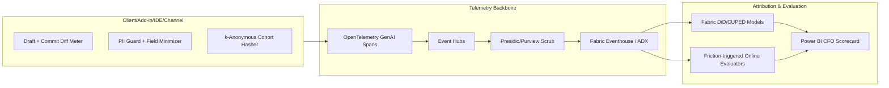
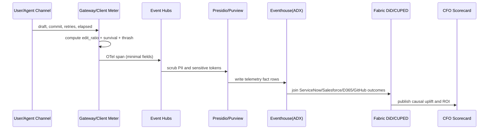
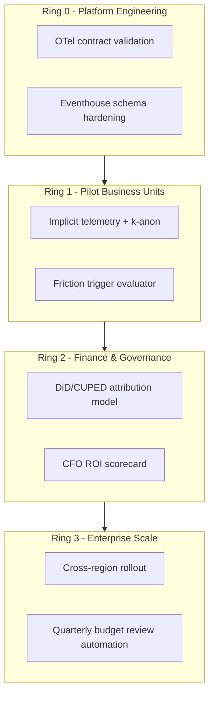

# 企业 Agent 隐式反馈与因果 ROI 归因选型 FAQ：Eventhouse 编辑距离生存率遥测 vs Fabric DiD 因果归因 vs 摩擦触发在线评测 vs 工会合规 k 匿名边缘聚合

> 🌐 **Language Switch**: **中文（当前）** | [English](./agent-implicit-feedback-edit-distance-causal-roi-attribution-eventhouse-did-vs-explicit-ratings-vs-works-council-k-anonymity-selection-faq.en.md)
> **适用对象**：Cloud & AI Solution Architect、企业数据平台与 BI 负责人、LLMOps 平台团队、FinOps 与财务控制团队、DPO/法务与欧洲工会协同治理团队。
> **讨论范围**：面向企业 Agent 生产运营的隐式行为遥测、草稿生存率质量度量、因果 ROI 归因与 GDPR/工会合规保护，覆盖 OpenTelemetry 到 Eventhouse/Fabric 的端到端架构、评测触发门禁、成本核算与三年 TCO。

## 1. 为什么显式 👍/👎 与 Token 看板无法通过 CFO 续约评审
显式点赞点踩在企业环境里通常响应率低于 `1.2%`，并且高摩擦负反馈更容易被提交，导致样本分布与真实使用群体不一致，所以它适合做体验补充而不适合直接做预算续约依据。
仅看 `DAU`、`Token` 或调用次数只能描述“花了多少钱和跑了多少请求”，却无法解释“到底节省了多少人工工时、减少了多少返工、是否带来可归因业务收益”，因此在财务审计语境中证据强度不足。
如果平台把逐员工逐提示词原文直接汇总到中心仓，常会触发 GDPR 最小化原则争议与德国工会对“个人绩效监控”的阻断意见，最终让技术上可行的度量方案在治理上不可落地。
因此真正可持续的企业方案需要同时满足四个条件：高覆盖客观信号、可重复的因果识别、可控评测成本、以及可证明的个人不可识别化。

## 2. 四类架构路径与职责边界
**Architecture A** 将“草稿到最终提交”的编辑距离、生存率、反复重生与放弃等隐式行为信号统一标准化，并通过 OTel 管道进入 Eventhouse/ADX，形成高覆盖质量基线。
**Architecture B** 在 Fabric 中结合分层对照组、Switchback 与 DiD/CUPED 模型，把行为质量变化映射到 MTTR、FCR、工单处理时长、成交转化等业务指标，输出 CFO 可审计的净收益比。
**Architecture C** 仅在高摩擦会话触发 Foundry Online Evaluators 与微反馈，避免对全量会话执行高成本判分，从而在保持问题召回的同时显著压低评测 Token 账单。
**Architecture D** 在客户端本地先完成差异率计算与短期盐化分组，再以 `k >= 15` 阈值上传聚合指标，保证中心侧看不到个人级可逆行为轨迹，满足工会与隐私合规要求。

## 3. 端到端参考架构与数据最小化边界

该架构把“可识别原始内容”与“用于治理的聚合指标”在链路早期分离，确保平台团队可以做跨系统质量与财务归因，而不会把中心仓变成个人行为监控系统。
A 与 D 共同解决“数据能不能安全采”，B 解决“采到的数据能否证明因果价值”，C 解决“证明价值的评测成本是否可持续”，四者合并后才形成生产可用闭环。
在跨系统落地时建议统一 `trace_id`、`tenant_id`、`cohort_id`、`outcome_id` 四类关联键，否则后续 DiD 对齐会出现大量不可连接事件并稀释统计功效。
若组织已有 Application Insights/Log Analytics，也可将核心字段双写到 Eventhouse 作为长期归因湖仓，再把实时告警留在现有监控平面，降低迁移阻力。

## 4. Architecture A：隐式草稿生存率与摩擦遥测基线
A 路径重点不是“模型说自己多好”，而是“用户最终保留了多少模型草稿内容”，其中 `Normalized Edit Distance`、`30 分钟生存率`、`Time-to-Commit`、`Regenerate Thrash` 是最稳定的客观指标。
为了实现 `100%` 会话覆盖并控制延迟，推荐将差异计算放在客户端或近端网关，并上报结构化结果而非原始全文，这样既减轻中心计算压力，也降低敏感信息扩散概率。
在技术实现上可同时支持 token 级和 AST 级差异度量：前者适用于自然语言草稿，后者更适用于代码或结构化模板，二者可按业务域加权融合成统一质量得分。
A 的价值在于构建“每天自动更新”的质量事实表，给 B 的因果归因提供输入底座，也给 C 的摩擦触发门槛提供稳定阈值来源。

## 5. Architecture B：CFO 级因果生产力与业务归因
B 路径的核心是把“相关性”升级为“可审计因果性”，典型做法是用 Entra 组分层抽样构造对照组，再在 Fabric 中对接工单、CRM、代码交付等业务结果表运行 DiD/CUPED。
对于客服与运维场景，可优先归因 `AHT`、`FCR`、`MTTR` 与升级率；对于销售场景可归因报价周期与赢单率；对于工程场景可归因 PR 周期、回滚率与缺陷逃逸率。
在组织层面，B 需要明确干预开始时间、暴露定义与排除条件，并记录每次模型/提示词/工具链变更，避免“多个变更同周上线”导致归因污染。
财务对话中推荐直接输出 `Net Dollar Benefit per $1`、`Payback Months` 与置信区间，而不是只给技术 KPI，这样预算会与业务语言对齐。

## 6. Architecture C：摩擦触发在线评测与微反馈
C 路径采用“先检测摩擦，再触发评测”的策略，当 `edit_ratio > 0.45`、`regenerations >= 3`、或 `abandonment=true` 时才把会话样本送入在线评测和一键失败分类。
这种门控可把高成本判分流量压缩到总会话的 `10–20%`，在多数企业数据下能节省 `80–90%` 的评测成本，同时保留主要失败模式的发现能力。
微反馈设计应尽量低摩擦，例如“事实错误 / 格式错误 / 权限错误 / 无法执行”四类快速标签，并把标签直接映射到 Prompt、检索、工具调用、权限策略四条整改泳道。
C 不是替代 A/B，而是把“持续诊断”做成经济可行的常态机制，避免评测体系因为账单过高而在季度后半段失活。

## 7. Architecture D：工会与 GDPR 安全的 k 匿名边缘聚合
D 路径强调“在端侧完成最小必要计算”，客户端只上传聚合分组指标和不可逆短期哈希，不上传原始编辑文本与个人可识别草稿，从源头规避员工画像风险。
建议采用滚动盐值和短生命周期 cohort hash，使同一人员跨周期不可稳定追踪，同时在 ADX/Power BI 强制 `k >= 15` 才可查询展示，防止小群体反推。
若业务域必须保留样例用于质量复盘，应引入双审批取样流程与自动脱敏审计，不得将“用于模型改进”的样本自动等同于“可用于个人绩效评估”的材料。
D 的目标不是牺牲可观测性，而是在合法合规边界内保留足够统计信息，让平台仍能开展 ROI 归因与发布治理。

## 8. 12 维度对比矩阵
| 维度 | A：隐式生存率遥测 | B：DiD/CUPED 因果归因 | C：摩擦触发在线评测 | D：k 匿名边缘聚合 |
|---|---|---|---|---|
| 数据覆盖率 | 高（接近全量） | 中（依赖可连接业务结果） | 低到中（门控采样） | 高（聚合后上送） |
| 因果识别强度 | 低到中 | 高 | 中 | 低 |
| CFO 可审计性 | 中 | 高 | 中 | 中 |
| 实施复杂度 | 中 | 高 | 中 | 中到高 |
| 合规友好度 | 中 | 中 | 中 | 高 |
| 单会话度量成本 | 低 | 中 | 中到高 | 低 |
| 指标实时性 | 高 | 低到中 | 中 | 中 |
| 诊断可行动性 | 中 | 高 | 高 | 中 |
| 组织协同需求 | 中 | 高 | 中 | 高 |
| 工具依赖程度 | 中 | 高 | 高 | 中 |
| 跨域可迁移性 | 高 | 中 | 中 | 高 |
| 适合目标 | 质量基线 | 预算续约与投资决策 | 快速定位根因 | 合规规模化落地 |

## 9. 定量模型：质量、样本量、ROI 与评测节流
草稿生存率核心公式为 `S = 1 - edit_distance(draft, committed) / max(len(draft), len(committed))`，并可按任务类型赋予不同权重形成业务线总分 `S_weighted = Σ(w_i * S_i)`。
DiD 的简化估计可写作 `Δ = (Y_treat_post - Y_treat_pre) - (Y_ctrl_post - Y_ctrl_pre)`，若再结合 CUPED 可用协变量方差压缩提升统计功效，从而降低同等置信水平所需样本量。
样本量粗估可使用 `N ≈ 16 * σ^2 / MDE^2`（双侧近似），例如 `σ=1.8`、目标 `MDE=0.2` 时，单组约需 `648` 观测；若按席位日聚合需再乘以暴露与可连接率倒数。
净 ROI 比率可定义为 `ROI_net = (hours_saved * loaded_hourly_cost * causal_discount - infra_and_license_cost) / infra_and_license_cost`，其中 `causal_discount` 用于对冲外部因素与模型漂移带来的不确定性。
摩擦门控节流收益可写作 `Savings = 1 - p_trigger * (judge_tokens_per_case / full_eval_tokens_per_case)`，当 `p_trigger=0.15` 且单案评测成本相近时，理论节省约 `85%`。
在财务沟通中建议同时报告区间值，如 `ROI_net_p10 / p50 / p90`，避免把单点估计当作承诺值，提升预算审议中的可信度与可辩护性。

## 10. 参考时序图：从隐式信号到 CFO 看板

该时序强调“端侧先算、中心再归因”的治理顺序，使每一步都可审计且可替换，例如企业可以更换 BI 工具但保留核心数据契约。
如果某条业务线暂时拿不到业务结果表，仍可先上线 A 与 D 建立质量和合规基线，再逐步引入 B 做因果层扩展，避免因为全栈一次到位要求而长期停滞。
对于高敏组织，建议将 PII 清洗与写入 Eventhouse 放在同一受控网络边界内，并对失败写入设置死信队列与人工复核流程。
一旦发生字段漂移，应优先阻断下游归因任务而非默默填充空值，否则 CFO 看板会在“看起来稳定”中积累不可见误差。

## 11. 参考拓扑图：分环上线与合规模型

分环策略把技术风险、统计风险与治理风险拆分处理，确保每个阶段都有明确退出条件和回滚机制，避免在组织尚未达成共识时直接推全域上线。
建议为每环定义统一门槛：`Gate_n = (data_quality >= 0.98) ∧ (k_anon_pass_rate = 1.0) ∧ (model_ci_width <= target)`，只有满足门槛才允许扩大人群和预算。
在跨区域扩展时，优先迁移指标口径与查询视图，再迁移模型参数与看板阈值，这样能减少“指标同名不同义”造成的经营决策偏差。
若监管要求变化，应把治理策略作为可版本化资产纳入发布流程，并对每次策略版本变更附带影响评估与回归报告。

## 12. 生产 KQL 片段：生存率、摩擦与 k 匿名视图
```kql
let lookback = 14d;
let base =
    AgentTelemetry
    | where Timestamp >= ago(lookback)
    | where isnotempty(TenantId) and isnotempty(CohortHash)
    | extend DraftLen = todouble(DraftTokenLen), CommitLen = todouble(CommitTokenLen)
    | extend EditDist = todouble(EditDistanceToken)
    | extend SurvivalScore = 1.0 - (EditDist / iff(DraftLen > CommitLen, DraftLen, CommitLen))
    | extend ThrashScore = todouble(RegenerateCount) + todouble(AbandonCount) * 1.5
    | extend Persist30m = iff(MinutesToFirstDelete <= 30, 0, 1);
let cohort_daily =
    base
    | summarize
        Sessions = count(),
        AvgSurvival = avg(SurvivalScore),
        P95Thrash = percentile(ThrashScore, 95),
        PersistRate30m = avg(todouble(Persist30m)),
        AvgTimeToCommitMin = avg(todouble(TimeToCommitMin))
      by TenantId, CohortHash, bin(Timestamp, 1d);
cohort_daily
| summarize
    Sessions = sum(Sessions),
    AvgSurvival = avg(AvgSurvival),
    P95Thrash = avg(P95Thrash),
    PersistRate30m = avg(PersistRate30m),
    AvgTimeToCommitMin = avg(AvgTimeToCommitMin)
  by TenantId, CohortHash, Timestamp
| where Sessions >= 15
| project Timestamp, TenantId, CohortHash, Sessions, AvgSurvival, P95Thrash, PersistRate30m, AvgTimeToCommitMin
| order by Timestamp desc
```
该查询通过 `Sessions >= 15` 的硬阈值直接执行 k 匿名可见性控制，防止小样本组在看板层被反向识别。
生产环境建议把 `CohortHash` 与业务结果连接键分层管理，分析师仅访问聚合层视图，避免跨域拼接后意外重建个人轨迹。
对于多租户平台，可再加 `TenantPolicyVersion` 维度，以区分不同合规策略版本下指标变化，避免把治理改动误判为模型能力波动。
若需周报可在该视图上追加 `summarize by bin(Timestamp, 7d)`，但应保留日粒度底表用于问题定位。

## 13. 生产 Python 片段：差异度量与 OTel Span 上报
```python
from __future__ import annotations

import ast
import hashlib
import time
from dataclasses import dataclass
from difflib import SequenceMatcher
from typing import Dict, Any

from opentelemetry import trace

tracer = trace.get_tracer("agent.feedback.telemetry")


@dataclass
class SurvivalMetrics:
    token_edit_distance: int
    token_survival: float
    ast_edit_distance: int
    ast_survival: float
    regenerate_count: int
    abandon_count: int
    minutes_to_commit: float


def _token_distance(a: str, b: str) -> int:
    return int((1 - SequenceMatcher(None, a, b).ratio()) * max(len(a), len(b), 1))


def _ast_tokens(text: str) -> str:
    try:
        node = ast.parse(text)
        return " ".join(type(n).__name__ for n in ast.walk(node))
    except SyntaxError:
        return text


def compute_survival(draft: str, committed: str, regenerate_count: int, abandon_count: int, minutes_to_commit: float) -> SurvivalMetrics:
    token_dist = _token_distance(draft, committed)
    token_survival = 1 - token_dist / max(len(draft), len(committed), 1)
    draft_ast = _ast_tokens(draft)
    commit_ast = _ast_tokens(committed)
    ast_dist = _token_distance(draft_ast, commit_ast)
    ast_survival = 1 - ast_dist / max(len(draft_ast), len(commit_ast), 1)
    return SurvivalMetrics(
        token_edit_distance=max(token_dist, 0),
        token_survival=max(min(token_survival, 1.0), 0.0),
        ast_edit_distance=max(ast_dist, 0),
        ast_survival=max(min(ast_survival, 1.0), 0.0),
        regenerate_count=max(regenerate_count, 0),
        abandon_count=max(abandon_count, 0),
        minutes_to_commit=max(minutes_to_commit, 0.0),
    )


def emit_span(tenant_id: str, user_id: str, cohort_salt: str, metrics: SurvivalMetrics) -> Dict[str, Any]:
    cohort_hash = hashlib.sha256(f"{tenant_id}:{cohort_salt}:{int(time.time() // 86400)}".encode()).hexdigest()[:20]
    with tracer.start_as_current_span("agent.feedback.implicit") as span:
        span.set_attribute("tenant.id", tenant_id)
        span.set_attribute("cohort.hash", cohort_hash)
        span.set_attribute("token.edit_distance", metrics.token_edit_distance)
        span.set_attribute("token.survival", metrics.token_survival)
        span.set_attribute("ast.edit_distance", metrics.ast_edit_distance)
        span.set_attribute("ast.survival", metrics.ast_survival)
        span.set_attribute("regenerate.count", metrics.regenerate_count)
        span.set_attribute("abandon.count", metrics.abandon_count)
        span.set_attribute("minutes.to_commit", metrics.minutes_to_commit)
        span.set_attribute("privacy.user_hash", hashlib.sha256(user_id.encode()).hexdigest()[:24])
    return {"tenant_id": tenant_id, "cohort_hash": cohort_hash}
```
该实现把用户标识先哈希化并缩短输出，且 cohort 采用按天滚动盐值，降低跨期关联风险。
若业务使用文本与代码混合场景，可将 `token_survival` 与 `ast_survival` 按任务类型加权，避免单一度量在跨域比较中产生偏差。
建议在网关侧添加字段白名单与长度限制，确保任何新增属性都经过审计审批后才能进入中心指标表。
上线前应对异常输入做压测与模糊测试，防止极端文本导致差异计算放大或耗时异常。

## 14. 企业场景与三年 TCO
### 场景 A：保险核保与理赔文书助手
核保团队每天处理高重复文书，A 路径可稳定给出草稿保留率与重生摩擦，B 路径将处理时长变化与赔付准确率关联，帮助财务判断扩容预算是否继续投入。
该场景对合规解释要求高，D 路径可避免个人编辑习惯被中心化采集，降低与工会沟通阻力，并使平台能够在合规前提下持续优化。

### 场景 B：客服与现场运维联合 Copilot
客服会话与运维处置链路跨系统明显，B 路径通过 ServiceNow 工单与事件恢复数据可形成端到端 DiD 归因，验证助手是否真实缩短 MTTR 而非仅提升聊天活跃度。
C 路径在高摩擦会话触发深评测，可快速定位“检索不准、工具失败、策略拒绝”三类主要根因，减少无效全量评测消耗。

### 三年 TCO 对比（示例，单位：USD）
| 项目 | A：隐式遥测 | B：因果归因 | C：摩擦触发评测 | D：k 匿名边缘聚合 |
|---|---:|---:|---:|---:|
| 初始建设（Year-0） | 240,000 | 420,000 | 180,000 | 260,000 |
| 年运营成本（Year-1~3） | 160,000/年 | 220,000/年 | 140,000/年 | 170,000/年 |
| 三年总成本 | 720,000 | 1,080,000 | 600,000 | 770,000 |
| 三年可归因收益中位数 | 1,540,000 | 2,480,000 | 1,320,000 | 1,460,000 |
| 三年净收益 | 820,000 | 1,400,000 | 720,000 | 690,000 |
| 适配阶段 | 基线期即刻可上 | 稳定期与预算期 | 诊断期持续上 | 合规强约束全周期 |

## 15. 六个定量问答与 Day-0/Day-2 清单
### 15.1 定量问答（6）
**Q1：草稿生存率如何统一定义？** 使用 `S = 1 - edit_distance(draft, committed) / max(len(draft), len(committed))`；若编辑距离 `180`、长度上限 `900`，则 `S = 0.80`。
**Q2：如何估算 DiD 的最小样本需求？** 近似用 `N ≈ 16 * σ^2 / MDE^2`；若 `σ=1.6`、`MDE=0.2`，单组约 `1,024` 观测，实际还需按连接率与缺失率放大。
**Q3：如何计算净 ROI 比率？** `ROI_net = (hours_saved * loaded_hourly_cost * causal_discount - infra_and_license_cost) / infra_and_license_cost`；当节省价值 `$3.2M`、成本 `$1.6M`，则净 ROI 约 `1.0`。
**Q4：摩擦门控能节省多少评测成本？** `Savings = 1 - p_trigger`（单案成本近似时）；若触发率 `0.15`，节省约 `85%`，与实测 `80–90%` 区间一致。
**Q5：k 匿名阈值如何影响可见组数？** 若日内 cohort 分布中 `k<15` 组占 `22%`，则可见组占 `78%`，需在统计功效与隐私强度之间权衡。
**Q6：如何判断是否可从试点进入规模化？** 可设 `Go = (AvgSurvival >= 0.72) ∧ (ROI_net_p50 > 0.25) ∧ (k_anon_violation = 0)`，连续两周满足后再扩环。

### 15.2 Day-0 上线清单
1. 固化 OTel 字段契约与必填校验，禁止未审字段直接入湖。
2. 在客户端或近端网关部署差异计算与最小化上传策略。
3. 打通 Event Hubs、清洗服务、Eventhouse 写入与死信告警。
4. 在 BI 层启用 `k >= 15` 强制过滤并验证不可绕过。
5. 与法务、DPO、工会代表完成口径与边界书面确认。

### 15.3 Day-2 运维清单
1. 每周复核生存率分布漂移与摩擦触发阈值适配性。
2. 每月回放 DiD 假设检验与协变量稳定性报告。
3. 对评测触发样本做失败分类聚类并跟踪修复闭环。
4. 审查匿名化与聚合策略版本变更影响。
5. 在季度预算会输出 P10/P50/P90 三档 ROI 区间。

### 15.4 Good fit vs Not for
该架构适合需要“财务可归因 + 合规可落地 + 工程可持续”的大型企业，因为它将质量、因果、评测、隐私四条链路同时纳入生产治理。
对于数据基础薄弱且无法提供最基本业务结果表的团队，不建议直接上 B 路径，应先完成 A 与 D 的底座建设，再逐步引入因果归因。

### 15.5 审计字段映射（示例）
| 字段 | 来源层 | 治理目的 | 最低保留期 |
|---|---|---|---|
| `tenant_id` | Client/Gateway | 租户归属 | 5 年 |
| `cohort_hash` | Client | 匿名分组 | 2 年 |
| `trace_id` | OTel | 端到端追踪 | 2 年 |
| `survival_score` | Diff Meter | 质量基线 | 3 年 |
| `thrash_score` | Diff Meter | 摩擦识别 | 3 年 |
| `minutes_to_commit` | Client | 效率度量 | 3 年 |
| `triggered_evaluator` | Evaluator | 成本归因 | 2 年 |
| `failure_taxonomy` | Evaluator | 根因治理 | 3 年 |
| `did_group_flag` | Fabric | 对照组定义 | 3 年 |
| `causal_uplift` | Fabric | 因果收益 | 5 年 |
| `roi_net` | CFO Scorecard | 预算决策 | 5 年 |
| `policy_version` | Governance | 规则追溯 | 5 年 |
| `k_anon_pass` | ADX View | 合规门禁 | 5 年 |
| `pii_scrub_status` | Presidio | 隐私控制 | 5 年 |
| `business_outcome_key` | Domain System | 业务连接 | 3 年 |
| `model_version` | Runtime | 漂移归因 | 3 年 |
| `prompt_pack_version` | Runtime | 变更审计 | 3 年 |
| `toolchain_version` | Runtime | 变更审计 | 3 年 |
| `region` | Platform | 多区域对账 | 3 年 |
| `finance_cycle` | BI | 财务复盘 | 7 年 |

### 15.6 运行时告警字典（示例）
| 告警键 | 触发条件 | 立即动作 | 责任团队 |
|---|---|---|---|
| `survival_drop_spike` | 生存率日跌幅超阈值 | 回滚近期提示词与工具变更 | LLMOps |
| `thrash_ratio_jump` | 重生/放弃率突升 | 启动高摩擦会话深度评测 | 质量平台 |
| `did_parallel_trend_break` | 平行趋势检验失败 | 暂停因果对外发布并重建分层 | 数据科学 |
| `k_anon_violation` | 出现 `k < 15` 查询 | 阻断看板并触发审计 | 隐私治理 |
| `pii_scrub_failure` | 清洗失败率升高 | 切换隔离队列并人工复核 | 数据安全 |
| `eventhouse_lag_high` | 摄入延迟超 SLO | 扩容消费与写入吞吐 | 平台运维 |
| `evaluator_budget_overrun` | 在线评测费用超预算 | 收紧触发阈值并降采样 | FinOps |
| `join_coverage_drop` | 业务结果连接率下降 | 排查键漂移与上游缺失 | 数据工程 |
| `roi_confidence_widen` | ROI 区间显著变宽 | 增加样本或延长观测窗 | 财务分析 |
| `policy_version_drift` | 规则版本不一致 | 强制统一版本并回归验证 | 治理平台 |
| `cohort_hash_collision` | 分组冲突异常 | 轮换盐值并修复哈希策略 | 客户端平台 |
| `time_to_commit_regress` | 提交时长持续恶化 | 排查渠道性能与工具失败 | 业务应用 |
| `feedback_taxonomy_null` | 微反馈缺失升高 | 校验 UI 触发与埋点 | 前端渠道 |
| `otlp_drop_detected` | OTel 包丢失升高 | 启用重试与缓冲告警 | 观测平台 |
| `finance_export_mismatch` | 财务导出口径不一致 | 冻结报表发布并对账 | 财务系统 |

### 15.7 组合落地补充（从试点到预算闭环）
在企业推进中，建议先以 A+D 建立“高覆盖且合规安全”的事实底座，再引入 C 提升根因诊断效率，最后在数据稳定后上线 B 做因果归因与 CFO 预算闭环，这样能把组织阻力和技术风险分阶段消化。
分阶段门槛可定义为 `Phase2 = (data_completeness >= 0.97) ∧ (k_anon_pass_rate = 1.0)` 与 `Phase3 = (did_parallel_trend_p > 0.1) ∧ (roi_net_p50 > 0)`，从而让每次扩展都有可复核依据。
当业务线要求更快决策时，可输出“收益速度 vs 统计置信度”双轴图，明确哪些结论可用于运营优化、哪些结论可用于预算承诺，避免将早期信号误当财务承诺。
若出现跨系统键值不一致导致归因失败，应优先修复数据契约而非补人工映射，因为后者会在季度复盘时放大解释成本并削弱审计可信度。
