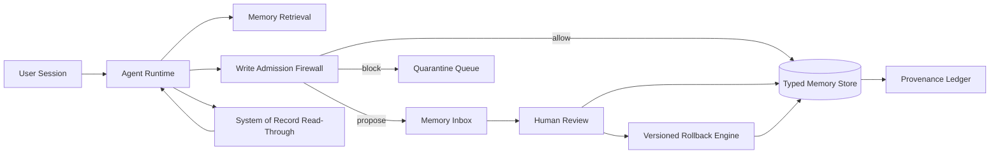
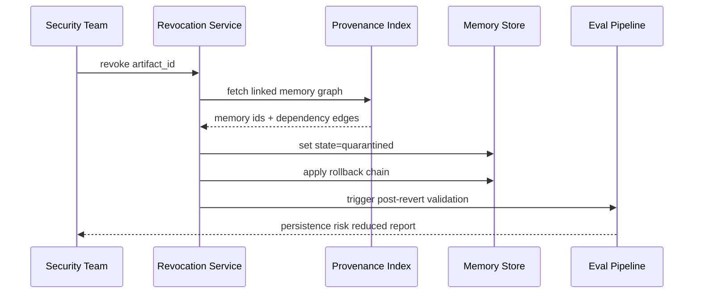
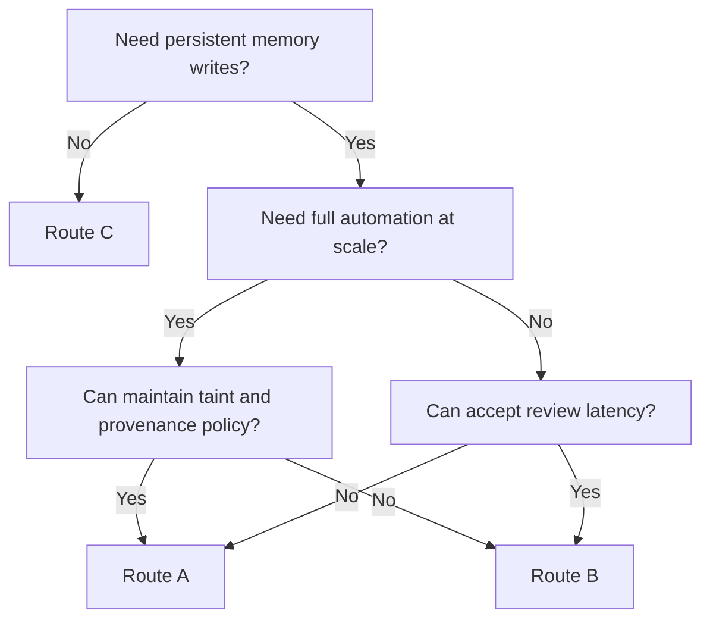

# Enterprise Agent Memory Poisoning Defense Selection FAQ: Taint-Aware Write Firewall and Provenance Ledger vs Human-Confirmed Memory Inbox vs SoR Read-Through vs Auto-Consolidation Anti-Pattern

> **Audience**: Cloud and AI Solution Architects, enterprise agent platform teams, model governance leads, security engineering, and compliance operations.
> **Decision problem**: how to prevent persistent cross-session memory poisoning, self-reinforcing hallucination loops, and stale-belief drift when agents store episodic, semantic, and procedural memory over weeks.

---

## 1) Executive summary: decide memory write rights before you tune prompts

Long-term memory risks are primarily **architecture risks**, not prompt-quality risks.

Recommended route selection:

- Choose **Route A** when you need automated writes with strict taint controls and deterministic rollback.
- Choose **Route B** when high-value memory updates require user-auditable confirmation.
- Choose **Route C** when regulated operations require authoritative facts to remain in systems of record.
- Keep **Route D** only as an anti-pattern baseline for testing and education.

Suggested guardrails:

- Cross-session poison survival probability target: `< 0.5%`.
- Stale-belief exposure window target: `P95 < 24h`.
- High-risk memory false-allow rate: `< 0.1%`.
- Cascade rollback RTO for revoked sources: `< 30 minutes`.

---

## 2) Why memory poisoning is more dangerous than ordinary hallucination

A single-turn hallucination is bounded by one request.
A poisoned long-term memory can repeatedly re-enter inference contexts and shape future decisions.

Typical failure chain:

1. A low-trust external source injects malicious or misleading content.
2. The agent summarizes and persists that content as reusable memory.
3. Retrieval repeatedly surfaces the poisoned memory in later sessions.
4. New generations reinforce that memory, increasing confidence.
5. Business workflows inherit and operationalize the wrong belief.

This is why memory governance must be explicit and typed.

---

## 3) Route definitions (A/B/C/D)

### Route A — Taint-aware provenance-tagged belief ledger plus write firewall

Core design:

- Typed records in Cosmos DB NoSQL or PostgreSQL:
  `{memory_class, source_trust_tier, taint_mask, provenance_turn_id, confidence, ttl_days}`.
- Information-flow policy blocks untrusted sources from mutating procedural rules or standing preferences.
- Every write passes an admission controller before commit.
- Quarantine path captures blocked or low-confidence updates for investigation.

Strengths:

- High automation with strong policy determinism.
- Scales well in high-throughput enterprise assistants.

Trade-offs:

- Requires robust trust-tier taxonomy and policy lifecycle ownership.

### Route B — User-auditable two-phase inbox with versioned rollback

Core design:

- Memory writes begin in `Proposed` state.
- User or delegated reviewer confirms transition to `Confirmed`.
- Every mutation is versioned and reversible.
- Source revocation triggers cascade-revert based on provenance linkage.

Strengths:

- Strong explainability and governance evidence.
- Effective for critical preference and policy memory.

Trade-offs:

- Human review introduces latency and operational overhead.

### Route C — Zero-write persistent memory plus authoritative SoR read-through

Core design:

- No persistent LLM-generated memory writes for business facts.
- Session scratchpad only, with strict TTL.
- Facts are read through from Microsoft Graph, Workday, Dynamics 365, Fabric, and other systems of record.

Strengths:

- Eliminates persistence of poisoned summaries by design.
- Keeps ownership and entitlement semantics in source systems.

Trade-offs:

- Higher read-path latency and dependency on downstream system availability.

### Route D — Unfiltered post-session auto-consolidation into flat vector store

Characteristics:

- No type boundaries.
- No trust-tier gating.
- No rollback discipline.
- No provenance-based quarantine.

Use only as an anti-pattern baseline to demonstrate blast-radius consequences.

---

## 4) Quantitative principles and governing formulas

### 4.1 Cross-session poison persistence under repeated retrieval

Let per-session top-k hit probability for poisoned memory be `p_hit`, and number of future sessions be `S`:

`P_persist = 1 - (1 - p_hit)^S`

Even moderate `p_hit` values produce high long-run persistence.

### 4.2 False-belief reinforcement compounding

If poisoned memory is re-accepted with probability `q` each cycle:

`E_n = E_0 * (1 + q)^n`

This captures feedback-loop amplification over repeated sessions.

### 4.3 Multi-hop taint propagation in tool chains

For tool chain `u1 -> u2 -> ... -> uk`:

`taint_out = OR(taint_u1, taint_u2, ..., taint_uk)`

With class-specific masks:

`mask_out = mask_u1 | mask_u2 | ... | mask_uk`

### 4.4 Cascade purge cost after source revocation

If revoked artifact links to `N_mem` memories and per-memory rollback cost is `c_r`:

`C_cascade = N_mem * c_r + C_index_lookup + C_reindex`

Strong provenance indexing minimizes `C_index_lookup`.

### 4.5 SoR read-through latency vs staleness objective

Given cache TTL `T_cache`, objective:

`min  λ1 * L(T_cache) + λ2 * R_stale(T_cache)`

Use policy tiers to apply different TTLs by data criticality.

### 4.6 Memory quota and token-budget eviction scoring

Retention score:

`Score_i = w1*recency + w2*trust + w3*criticality - w4*taint_risk - w5*token_cost`

Evict lowest score first to preserve high-value memory under finite context budgets.

---

## 5) Mermaid diagram: memory write governance architecture



---

## 6) Mermaid diagram: revoked artifact cascade quarantine flow



---

## 7) Mermaid diagram: route decision tree for enterprise adoption



---

## 8) Twelve-dimension comparison matrix

| Dimension | Route A Taint Firewall | Route B Two-Phase Inbox | Route C SoR Read-Through | Route D Auto-Consolidation |
|---|---|---|---|---|
| Poison persistence defense | High | High | Very high | Low |
| Write throughput | High | Medium | Low | High |
| Explainability for auditors | Medium-high | High | High | Low |
| Rollback precision | High | High | Medium | Low |
| Runtime latency profile | Medium | Medium | Medium-high | Low |
| Engineering complexity | High | Medium | Medium | Low |
| Compliance fit | High | High | Very high | Low |
| Multi-tenant isolation safety | High | High | High | Low |
| Operational overhead | Medium | Medium-high | Medium | Low short-term / high long-term |
| Stale-belief resistance | High | High | Medium-high | Low |
| Blast radius after source compromise | Low | Low-medium | Low | High |
| Recommended usage | Production default in many sectors | Production for critical approvals | Production in strict governance | Anti-pattern baseline only |

---

## 9) Quantitative deep dive Q1..Q6

### Q1 — How quickly does poison persist across sessions under top-k retrieval?

Given `p_hit = 0.07` and `S = 40` sessions:

`P_persist = 1 - (1 - 0.07)^40 ≈ 94.5%`

Implication: without explicit memory controls, eventually poisoned memory becomes statistically unavoidable.

### Q2 — How does false-belief compounding evolve over repeated reinforcement?

Assume `q = 0.10` per cycle and `n = 15`:

`E_15 = E_0 * (1.10)^15 ≈ 4.18E_0`

This quantifies why "harmless temporary mistakes" become systemic when persisted.

### Q3 — How should taint labels propagate through multi-hop tool workflows?

Use monotonic propagation:

- no implicit de-tainting,
- OR aggregation for masks,
- explicit sanitizer tools for controlled downgrades with evidence.

A practical enforcement rule:

`risk_out = max(risk_upstream, risk_current)`

### Q4 — What is the expected cost of cascade purging after a poisoned SharePoint or email artifact is revoked?

If `N_mem = 25,000`, per-record transition `c_r = 2ms`, index lookup `18s`, and reindex `22s`:

`T_total ≈ 25,000 * 2ms + 40s = 90s`

Without provenance indexing, the same operation may require broad scans and exceed operational SLO.

### Q5 — How do SoR read-through latency and staleness trade off?

Example profile:

- direct SoR read: `190ms`
- cached read with `TTL=300s`: `55ms`
- stale probability under fast-changing fields: `2.8%`

Recommended split:

- strict real-time fields (entitlements, account status) bypass cache,
- low-risk descriptive fields use short TTL cache.

### Q6 — How do you optimize memory retention under quota and token constraints?

Define score:

`Score_i = 0.30*recency + 0.25*trust + 0.25*criticality - 0.15*taint - 0.05*token_cost`

Under fixed context budget, this scoring keeps operationally valuable memory while suppressing risky entries.

---

## 10) Production implementation block A: Python taint-aware write admission controller

```python
from dataclasses import dataclass
from enum import Enum
from typing import Dict, Any

class MemoryClass(str, Enum):
    EPISODIC = "episodic"
    SEMANTIC = "semantic"
    PROCEDURAL = "procedural"
    PREFERENCE = "preference"

class Decision(str, Enum):
    ALLOW = "allow"
    PROPOSE = "propose"
    BLOCK = "block"

@dataclass
class CandidateMemory:
    tenant_id: str
    memory_class: MemoryClass
    source_trust_tier: int
    taint_mask: int
    confidence: float
    provenance_turn_id: str
    ttl_days: int
    payload: Dict[str, Any]

def decide(candidate: CandidateMemory) -> Decision:
    high_impact = candidate.memory_class in {
        MemoryClass.PROCEDURAL,
        MemoryClass.PREFERENCE,
    }
    low_trust = candidate.source_trust_tier < 3
    tainted = candidate.taint_mask != 0
    low_conf = candidate.confidence < 0.80

    if high_impact and (low_trust or tainted):
        return Decision.BLOCK
    if tainted or low_conf:
        return Decision.PROPOSE
    return Decision.ALLOW
```

---

## 11) Production implementation block B: Cosmos schema and provenance-driven quarantine query

```json
{
  "id": "mem_01J9QY3V0B4C6E8N",
  "tenant_id": "fabrikam-treasury",
  "memory_class": "preference",
  "source_trust_tier": 2,
  "taint_mask": 9,
  "provenance": {
    "artifact_id": "mail://thread/AAQkAAB5...",
    "session_id": "sess_3f9e",
    "turn_id": "turn_1204",
    "tool_chain": ["graph.mail", "rag.retrieve", "agent.summarize"]
  },
  "confidence": 0.72,
  "ttl_days": 14,
  "state": "proposed",
  "version": 7
}
```

```sql
SELECT c.id, c.state, c.version, c.provenance.artifact_id
FROM c
WHERE c.tenant_id = @tenant
  AND c.provenance.artifact_id = @artifact
  AND c.state IN ("confirmed", "proposed")
```

Operational recommendations:

- partition by `tenant_id`,
- index provenance keys explicitly,
- store immutable version chain to support deterministic rollback.

---

## 12) Enterprise scenario A: executive M365 assistant against poisoned external invites and mail

Context:

- Assistant reads mailbox context, meetings, and external invitations.
- It can persist user preferences and procedural reminders.

Risk:

- Malicious invite text injects fake standing instructions.
- Incorrect preference persistence affects future approvals.

Recommended route:

- Route A baseline for automated flows,
- Route B mandatory for preference/procedural class writes,
- provenance-linked cascade rollback when a source is revoked.

Target outcomes:

- preference-poison false allow below `0.1%`,
- rollback RTO below `15 minutes`,
- no confirmed unauthorized memory mutation.

---

## 13) Enterprise scenario B: B2B treasury and procurement copilot with ERP master-data integrity

Context:

- Copilot handles supplier communications, dispute notes, and payment discussions.
- Critical facts must match ERP vendor master and finance systems.

Risk:

- Email negotiations or outdated notes overwrite authoritative vendor constraints.
- Persisted memory diverges from legal and accounting system records.

Recommended route:

- Route C for critical financial attributes,
- Route A/B for non-critical contextual memory,
- strict class-based policy preventing procedural writes from untrusted sources.

Target outcomes:

- master-data divergence under `0.05%`,
- stable SoR read-through SLO,
- measurable reduction of stale-belief incidents.

---

## 14) Three-year TCO model (illustrative)

| Cost category (USD) | Route A | Route B | Route C | Route D |
|---|---:|---:|---:|---:|
| Platform engineering and policy automation | 1,080,000 | 870,000 | 790,000 | 530,000 |
| Storage, indexing, and retrieval operations | 320,000 | 290,000 | 250,000 | 210,000 |
| Human review and governance operations | 240,000 | 430,000 | 170,000 | 130,000 |
| Incident response and remediation reserve | 95,000 | 140,000 | 75,000 | 560,000 |
| Total 3-year TCO | 1,735,000 | 1,730,000 | 1,285,000 | 1,430,000 |

Interpretation:

- Route D often appears cheap initially but accumulates expensive incident recovery.
- Route C has lowest total cost in strictly controlled environments with strong SoR availability.
- Route A and B remain safer defaults for mission-critical agent memory workflows.

---

## 15) Day-0 / Day-1 / Day-2 rollout checklist

### Day-0: policy and data-model design

- Define memory classes and permitted source tiers.
- Define taint taxonomy and escalation levels.
- Define mandatory provenance fields and retention controls.
- Define rollback evidence requirements and ownership.

### Day-1: implementation and release gates

- Deploy admission firewall and route policies.
- Deploy typed memory schema and provenance index.
- Enable two-phase approval for high-impact memory classes.
- Add SoR read-through adapters for authoritative facts.
- Gate release on poison-injection test scenarios.

### Day-2: operations and continuous hardening

- Track `P_persist`, false-allow rate, rollback RTO, and stale drift.
- Run monthly poisoned-source drills and cascade rollback rehearsal.
- Recalibrate scoring weights for quota eviction as usage evolves.
- Feed incident postmortems back into taint policy updates.

---

## Good fit vs not for

### Good fit

- Enterprise copilots that preserve memory across sessions and users.
- Workflows where wrong memory can impact approvals, payments, compliance, or legal obligations.
- Programs needing auditable rollback and deterministic provenance evidence.

### Not for

- Single-session assistants with no persistent memory footprint.
- Prototype-stage deployments with no governance operating model.
- Teams unwilling to enforce typed memory and source trust boundaries.

---

## Authoritative references

- Microsoft Graph overview: https://learn.microsoft.com/graph/overview
- Azure Cosmos DB NoSQL intro: https://learn.microsoft.com/azure/cosmos-db/nosql/introduction
- PostgreSQL documentation: https://www.postgresql.org/docs/
- OpenTelemetry documentation: https://opentelemetry.io/docs/
- OWASP Top 10 for LLM Applications: https://owasp.org/www-project-top-10-for-large-language-model-applications/
- NIST SP 800-53 Rev. 5: https://csrc.nist.gov/publications/detail/sp/800-53/rev-5/final
- Microsoft Purview governance docs: https://learn.microsoft.com/purview/

