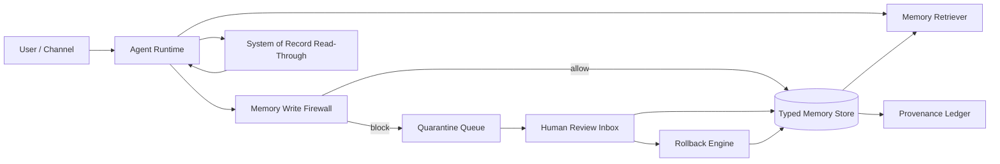
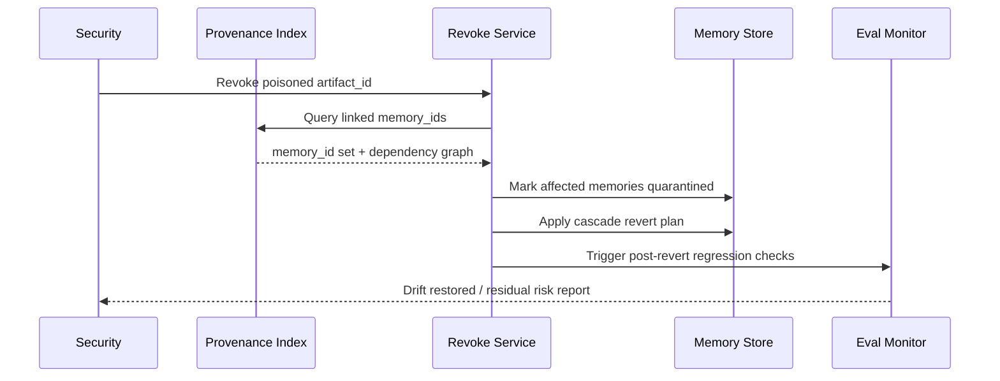
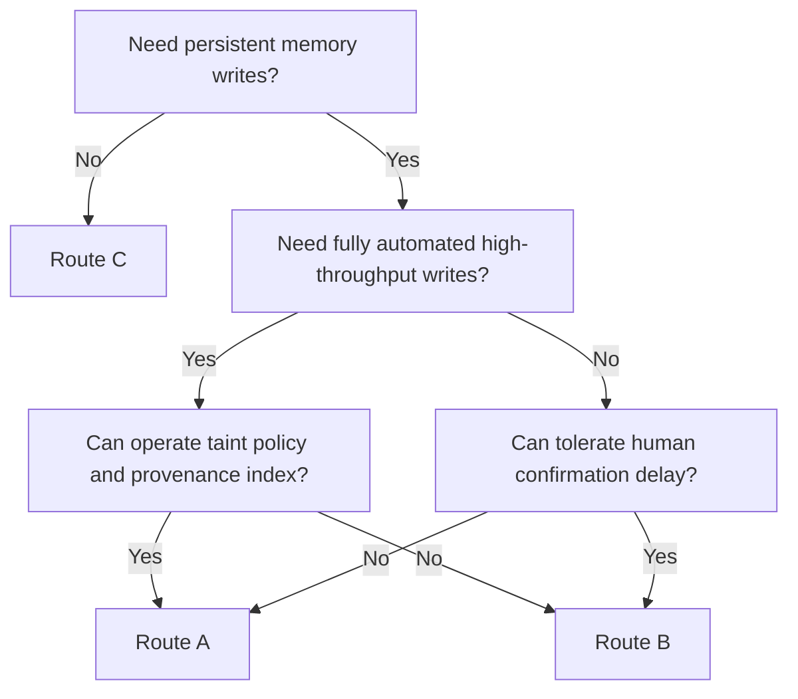

# 企业 Agent 记忆污染防护选型 FAQ：Taint 写入防火墙与溯源账本 vs 人审两阶段记忆收件箱 vs SoR 只读穿透 vs 自动汇总反模式

> **适用对象**：Cloud & AI Solution Architect、Agent 平台负责人、企业安全与合规团队、数据治理与业务系统架构组。
> **核心问题**：当智能体把跨会话的 episodic、semantic、procedural 记忆持久化到周级甚至月级存储后，如何防止跨会话间接注入（XPIA persistence）、自强化幻觉、陈旧信念漂移，以及“错误偏好被永久固化”。

---

## 1. 执行摘要（先选路由，再做工程）

针对“长期记忆是否可写、如何写、谁能写”这个核心治理点：

- **Route A**（Taint 感知 + 写入防火墙）适合高风险生产默认路径。
- **Route B**（人审两阶段）适合需要业务可解释与可回滚的部门。
- **Route C**（零写持久记忆 + SoR 只读穿透）适合合规最严格、流程标准化组织。
- **Route D**（自动汇总平铺向量库）仅用于对照实验，不建议企业生产采用。

建议门槛：

- **跨会话污染存活率**（poison survival）要求 `< 0.5%`。
- **关键事实陈旧窗口**（staleness window）要求 `P95 < 24h`。
- **高风险记忆写入误放行率**要求 `< 0.1%`。
- **记忆回滚 RTO**要求 `< 30min`。

---

## 2. 为什么长期记忆会变成风险放大器

短会话错误通常只影响当前任务；长期记忆错误会跨周期传播。

典型失败链：

1. 外部邮件或网页被注入恶意语句。
2. Agent 在低置信门槛下写入“偏好/规则”类记忆。
3. 后续检索命中该记忆并提升模型先验。
4. 生成结果再次引用该记忆，形成自我强化闭环。
5. 错误扩散到团队协作、审批、采购、财务等关键流程。

长期风险不在“单次幻觉”，而在“幻觉可持续化”。

---

## 3. 四条架构路线定义（A/B/C/D）

### Route A：Taint-Aware 溯源账本 + 写入防火墙

核心机制：

- 记忆记录采用强类型结构：
  `{memory_class, source_trust_tier, taint_mask, provenance_turn_id, confidence, ttl_days}`。
- 信息流控制（IFC）策略禁止低信任来源修改 procedural 规则和 standing preferences。
- 写入前执行策略评估，命中高风险规则时拒绝或降级为临时草稿。

优势：

- 自动化强，污染传播可控。
- 可在不中断业务的前提下保持较高写入吞吐。

代价：

- 需要完整的来源分级、策略维护、审计对账链路。

### Route B：用户可审计两阶段记忆收件箱 + 版本化回滚

核心机制：

- 新记忆先进入 `Proposed` 状态，由用户/审批人确认后才进入 `Confirmed`。
- 每次变更保留 diff 与可逆提交链。
- 当外部文档被隔离时可触发 cascade-revert。

优势：

- 人可解释，利于合规审计。
- 对高价值记忆（偏好、规则、供应商条件）尤其有效。

代价：

- 人工延迟与运营成本增加。
- 大规模写入场景需配合采样和优先级策略。

### Route C：零写持久记忆 + SoR 只读穿透

核心机制：

- 不把 LLM 摘要写入长期记忆。
- 仅使用会话暂存（scratchpad）并设置短 TTL。
- 关键事实实时只读查询系统记录源（Graph、Workday、D365、Fabric）。

优势：

- 最大化避免记忆污染持久化。
- 权限与事实来源边界清晰。

代价：

- 读路径延迟更高。
- 离线与弱网场景体验波动更明显。

### Route D：会后自动汇总写入平铺向量库（反模式）

核心问题：

- 无类型边界，无来源分层。
- 无写入闸门，无审核，无回滚。
- Top-k 命中会让错误记忆高频复活。

用途：

- 仅用于反模式基线评估，不建议生产上线。

---

## 4. 量化原则与公式

### 4.1 跨会话污染存活概率

设污染记忆单会话检索命中概率为 `p_hit`，跨 `S` 次会话后至少命中一次：

`P_persist = 1 - (1 - p_hit)^S`

该值越高，说明错误越可能在后续会话持续影响决策。

### 4.2 错误信念复合放大

若每轮错误被采纳并再次写回概率为 `q`，经过 `n` 轮后错误强度可近似：

`E_n = E_0 * (1 + q)^n`

当 `q` 未被治理压低时，长期会出现“自我证实偏差”。

### 4.3 多跳 taint 传播

对工具链路 `u1 -> u2 -> ... -> uk`，若任一环 taint 不可清除，则：

`taint_out = OR(taint_u1, taint_u2, ..., taint_uk)`

并可附加类别位图：

`mask_out = mask_u1 | mask_u2 | ... | mask_uk`

### 4.4 撤销文档后的级联清理成本

若被撤销源文档关联 `N_mem` 条记忆、每条回滚成本 `c_r`：

`C_cascade = N_mem * c_r + C_reindex`

Route A/B 通过 provenance 索引将 `N_mem` 精准定位，避免全库扫描。

### 4.5 SoR 只读穿透的延迟-陈旧权衡

缓存 TTL 为 `T_cache` 时：

- 平均延迟下降 `ΔL(T_cache)`
- 陈旧风险上升 `R_stale(T_cache)`

目标是解下面的优化：

`min  λ1 * L + λ2 * R_stale`

### 4.6 记忆配额与 token 预算淘汰评分

给定记忆条目 `i`，定义保留评分：

`Score_i = w1*recency + w2*trust + w3*business_criticality - w4*taint_risk - w5*token_cost`

低分优先淘汰，避免“高风险高成本低价值”条目占满预算。

---

## 5. Mermaid：企业记忆写入与治理总览



---

## 6. Mermaid：污染源撤销后的级联回滚序列



---

## 7. Mermaid：Route 选择决策树



---

## 8. 12 维度对比矩阵（A/B/C/D）

| 维度 | Route A Taint 防火墙 | Route B 两阶段收件箱 | Route C SoR 只读穿透 | Route D 自动汇总反模式 |
|---|---|---|---|---|
| 污染持久化防护 | 高 | 高 | 极高 | 低 |
| 写入自动化能力 | 高 | 中 | 低 | 高 |
| 人审可解释性 | 中 | 高 | 中 | 低 |
| 回滚速度 | 高 | 中高 | 高 | 低 |
| 运行时延迟 | 中 | 中 | 中高 | 低 |
| 工程复杂度 | 高 | 中 | 中 | 低 |
| 合规可审计性 | 高 | 高 | 高 | 低 |
| 业务适配弹性 | 高 | 中 | 中 | 高（但不安全） |
| 多租户隔离能力 | 高 | 高 | 高 | 低 |
| 成本可控性 | 中高 | 中 | 中 | 表面低，隐性高 |
| 漂移抑制能力 | 高 | 高 | 中 | 低 |
| 推荐等级 | 生产推荐 | 生产推荐 | 高合规推荐 | 仅对照 |

---

## 9. 定量深挖 Q1..Q6

### Q1：跨会话 Top-k 命中会把污染留多久？

当单次会话命中概率 `p_hit=0.08`，30 次会话后：

`P_persist = 1 - (1 - 0.08)^30 ≈ 91.3%`

结论：如果污染记忆没有隔离与淘汰，几乎必然在月度窗口内复发。

### Q2：自强化幻觉如何复合放大？

若每轮错误再写回概率 `q=0.12`，12 轮后：

`E_12 = E_0 * (1.12)^12 ≈ 3.9E_0`

解释：一次看似轻微的错误，会在持续写回机制下变成系统性偏差。

### Q3：taint 标签跨工具多跳传播怎么控制？

建议采用“不可降级继承”：

- 任意上游命中高风险 taint，下游默认继承。
- 仅允许白名单净化器在有证据时降低 taint。
- 未知来源默认按高风险处理。

公式层可保守定义：

`risk_out = max(risk_in_i)`

### Q4：撤销 SharePoint/邮件污染源后，清理成本怎么估计？

若污染文档关联 12,000 条记忆，回滚平均 `2.5ms/条`，再加索引开销 `30s`：

`T_purge ≈ 12000 * 2.5ms + 30s = 60s`

前提是有 provenance 索引。
若无索引则需全库检索，耗时可能上升到小时级。

### Q5：SoR 只读穿透延迟与陈旧如何权衡？

假设：

- 无缓存读延迟 `180ms`
- `TTL=5min` 缓存延迟 `45ms`
- 5 分钟内事实变更概率 `2.2%`

可采用分层策略：

- 低风险属性走缓存。
- 高风险属性（权限、限额、账号状态）强制直连 SoR。

### Q6：记忆配额不足时如何做淘汰最优？

采用评分淘汰：

`Score_i = 0.35*recency + 0.25*trust + 0.25*criticality - 0.10*taint - 0.05*token_cost`

低分淘汰能在固定 token 预算下提升关键记忆保留率，同时降低污染复活概率。

---

## 10. 生产实现示例 A：Python Taint 感知写入准入控制器

```python
from dataclasses import dataclass
from enum import Enum
from typing import Dict, Any

class MemoryClass(str, Enum):
    EPISODIC = "episodic"
    SEMANTIC = "semantic"
    PROCEDURAL = "procedural"
    PREFERENCE = "preference"

@dataclass
class MemoryRecord:
    tenant_id: str
    memory_class: MemoryClass
    source_trust_tier: int
    taint_mask: int
    provenance_turn_id: str
    confidence: float
    ttl_days: int
    payload: Dict[str, Any]

class AdmissionDecision(str, Enum):
    ALLOW = "allow"
    PROPOSE = "propose"
    BLOCK = "block"

def admit(record: MemoryRecord) -> AdmissionDecision:
    high_risk_class = record.memory_class in {MemoryClass.PROCEDURAL, MemoryClass.PREFERENCE}
    untrusted_source = record.source_trust_tier < 3
    tainted = record.taint_mask != 0
    low_conf = record.confidence < 0.82

    if high_risk_class and (untrusted_source or tainted):
        return AdmissionDecision.BLOCK
    if low_conf or tainted:
        return AdmissionDecision.PROPOSE
    return AdmissionDecision.ALLOW
```

---

## 11. 生产实现示例 B：Cosmos 溯源 schema 与级联隔离查询

```json
{
  "id": "mem_01J9M4R4N3V5A7",
  "tenant_id": "contoso-eu",
  "memory_class": "procedural",
  "source_trust_tier": 2,
  "taint_mask": 5,
  "provenance": {
    "artifact_id": "sp://site/hr/doc/benefit-policy-v4",
    "turn_id": "turn_982113",
    "session_id": "sess_77a2",
    "tool_chain": ["sharepoint.search", "rag.rank", "agent.summarize"]
  },
  "confidence": 0.74,
  "ttl_days": 30,
  "state": "proposed",
  "version": 18
}
```

```sql
SELECT c.id, c.state, c.version
FROM c
WHERE c.tenant_id = @tenant_id
  AND c.provenance.artifact_id = @artifact_id
  AND c.state IN ("confirmed", "proposed")
```

实现建议：

- 对 `provenance.artifact_id` 建组合索引。
- 回滚服务基于版本链批量写 `quarantined` 状态。
- 回滚后触发回归评测作业，验证污染影响已收敛。

---

## 12. 企业场景一：高管 M365 邮件助手防污染

背景：

- 高管收到外部会议邀请、邮件附件、外部域链接。
- 助手会从邮件上下文抽取“偏好”和“常规规则”。

风险：

- 外部邀请可伪造偏好（如“始终自动批准”）。
- 一旦写入长期偏好，后续审批场景持续受影响。

落地：

- Route A 作为默认写入策略。
- 对偏好类记忆强制 Route B 确认。
- 当外部域被标记恶意时触发 provenance 级联回滚。

指标目标：

- 偏好类污染写入拦截率 `> 99.9%`。
- 高风险回滚 RTO `< 15min`。
- 误拦截率 `< 2%`。

---

## 13. 企业场景二：B2B 司库/采购 Copilot 与 ERP 主数据隔离

背景：

- Copilot 处理供应商往来邮件、账期协商、付款争议。
- 关键事实必须来自 ERP Vendor Master 与财务主数据。

风险：

- 邮件里的“临时约定”被错误写成长期规则。
- LLM 摘要覆盖 SoR，导致后续支付或采购决策偏差。

落地：

- Route C 负责关键字段（供应商状态、付款条款）读取。
- Route A/B 仅用于非关键辅助记忆（沟通风格、会议偏好）。
- 每次写入都带 `source_trust_tier` 与 `ttl_days`。

指标目标：

- 主数据一致性差错率 `< 0.05%`。
- SoR 读取可用性 `> 99.95%`。
- 非关键记忆命中率保持在业务可接受区间。

---

## 14. 三年 TCO 模型（示例）

| 成本项（USD） | Route A | Route B | Route C | Route D |
|---|---:|---:|---:|---:|
| 平台研发与治理 | 1,050,000 | 860,000 | 780,000 | 520,000 |
| 数据与存储 | 310,000 | 280,000 | 240,000 | 190,000 |
| 人工审核与运营 | 260,000 | 420,000 | 180,000 | 120,000 |
| 污染事故处置预留 | 90,000 | 130,000 | 70,000 | 540,000 |
| 总计 | 1,710,000 | 1,690,000 | 1,270,000 | 1,370,000 |

解读：

- Route D 表面实施快，但事故成本显著偏高。
- Route C 成本最低且风险可控，但对实时体验要求高的场景需优化 SoR 读路径。
- Route A/B 在高业务价值流程中更稳妥。

---

## 15. Day-0 / Day-1 / Day-2 落地清单

### Day-0：策略设计与分层建模

- 定义记忆类型与写入权限矩阵。
- 建立来源信任分级与 taint taxonomy。
- 定义高风险记忆（procedural/preference）的默认阻断策略。
- 确认回滚与审计证据标准。

### Day-1：实现与发布门禁

- 落地写入防火墙与准入控制器。
- 建立 provenance 索引与版本链。
- 接入人审收件箱与可逆提交。
- SoR 读穿透路径加入缓存与失效策略。
- 发布前压测污染注入与回滚演练。

### Day-2：运营与持续校准

- 周度统计 `P_persist`、`R_stale`、误放行率。
- 月度执行污染演练与回滚演习。
- 季度调整 `ttl_days`、评分权重、路由策略。
- 把事故复盘结论回写到 taint 规则库。

---

## Good Fit / Not For

### Good Fit

- 长期记忆直接影响业务决策与审批的企业。
- 有明确数据主权、审计与回滚要求的组织。
- 需要跨会话连续体验，但不能容忍错误持久化。

### Not For

- 单次会话工具、无长期记忆需求的简单助手。
- 无法投入治理与审计能力的短期 PoC。
- 把“自动写入”优先级高于“正确性与可回滚性”的场景。

---

## 参考资料（标准与官方）

- Microsoft Graph: https://learn.microsoft.com/graph/overview
- Azure Cosmos DB: https://learn.microsoft.com/azure/cosmos-db/nosql/introduction
- PostgreSQL docs: https://www.postgresql.org/docs/
- NIST SP 800-53 Rev.5: https://csrc.nist.gov/publications/detail/sp/800-53/rev-5/final
- OWASP LLM Top 10: https://owasp.org/www-project-top-10-for-large-language-model-applications/
- OpenTelemetry: https://opentelemetry.io/docs/
- Microsoft Purview Data Governance: https://learn.microsoft.com/purview/

