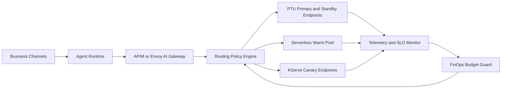
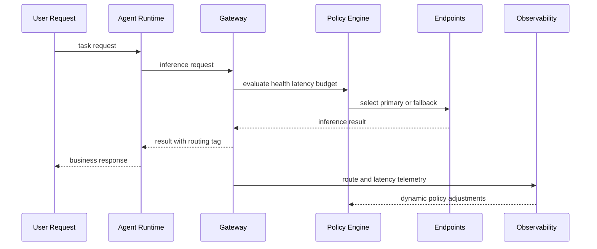

# Enterprise agent model-endpoint failover selection FAQ: PTU primary-standby vs serverless warm pools vs AKS KServe canary releases

> **Audience**: Enterprise Cloud & AI Solution Architects, model platform owners, SRE teams, FinOps teams, and business continuity stakeholders.  
> **Core question**: When inference endpoints degrade, throttle, or fail by region, how do you keep agent workloads resilient with controlled latency, consistent outcomes, and predictable cost.

## 1. Problem framing: user-visible instability often starts at endpoint failover design

Many enterprises optimize model quality first,
then discover availability is the true production gate.

Agent workloads are more fragile than simple chat calls.
One timeout can collapse a full task workflow.

Common incident classes:

- Primary endpoint queues drive TTFT spikes.
- Fallback endpoints are not warm and add cold-start jitter.
- Model-family drift across endpoints changes business outcomes.
- Regional failover collides with budget guardrails.

Endpoint resiliency must be treated
as a platform capability, not an afterthought.

## 2. Design objective: availability, latency, and cost together

Failover success is not only about switching traffic.
It must preserve business continuity targets.

Recommended objective set:

- Keep P95 response within business SLO bands.
- Meet RTO goals for failover windows.
- Avoid success-rate cliffs during transitions.
- Keep monthly spend inside budget envelopes.

Without aligned targets,
teams rely on ad hoc incident decisions.

## 3. Pattern A: PTU primary-standby dual track

Pattern A uses PTU primary capacity
with same-family standby capacity.

Core mechanics:

- Primary sized for normal peak load.
- Standby sized for degraded-mode load.
- Gateway health checks trigger route changes.
- Trace context preserved through reroute.

Strengths:

- Very stable latency profile.
- Strong throughput predictability.
- Good fit for mission-critical flows.

Limitations:

- Higher fixed baseline cost.
- Requires sustained utilization optimization.
- Less flexible across model-family transitions.

## 4. Pattern B: serverless fallback with warm pool

Pattern B uses serverless elasticity
to absorb spikes and fallback traffic.

Typical setup:

- Primary on PTU or managed endpoints.
- Fallback on serverless endpoints.
- Warm pool keeps minimum hot concurrency.
- Auto-scale and throttle protections at peaks.

Strengths:

- High elasticity for burst traffic.
- Lower fixed spend baseline.
- Good fit for volatile demand curves.

Limitations:

- Warm policy mistakes can reintroduce cold starts.
- Unit-price variance impacts budget certainty.
- Sudden surges require strict threshold governance.

## 5. Pattern C: AKS KServe canary and multi-version routing

Pattern C runs KServe on AKS
for release control and rollback.

Key capabilities:

- Revision canary traffic splitting.
- Side-by-side model version validation.
- Automated rollback on quality/health failures.
- Service-mesh policy integration.

Strengths:

- Strong release controllability.
- Fits private and customized inference stacks.
- Supports fine-grained experimentation.

Limitations:

- Higher platform operations complexity.
- Larger engineering investment.
- Ongoing capacity planning required.

## 6. Pattern D: layered hybrid model (recommended)

Enterprises often combine layers:

- PTU primary-standby for critical paths.
- Serverless warm pools for long-tail bursts.
- KServe canaries for release-safe evolution.

Layered policy gives balanced
stability, agility, and cost performance.

## 7. Reference architecture: inference resiliency control plane

Architecture implications:

- Routing and budget policy must co-evaluate.
- Health and quality signals need layered telemetry.
- Rollback paths require pre-tested runbooks.

## 8. Request flow: detect, reroute, stabilize

Flow governance essentials:

- Every reroute must carry a deterministic reason code.
- Responses should include endpoint-route metadata.
- Stabilization windows must prevent route flapping.

## 9. 12-dimension enterprise comparison matrix

| Dimension | A PTU Dual Track | B Serverless Warm Pool | C KServe Canary | D Hybrid Layer |
|---|---|---|---|---|
| Availability stability | Very high | High | High | Very high |
| Failover speed | High | Medium | High | High |
| Peak elasticity | Medium | Very high | High | Very high |
| Cost predictability | High | Medium | Medium | High |
| Release agility | Medium | Medium | Very high | High |
| Operations complexity | Medium | Medium | High | High |
| Multi-version governance | Medium | Low | Very high | High |
| Quality regression control | High | Medium | High | High |
| Audit and compliance fit | High | Medium | High | High |
| Private-stack adaptability | Medium | Low | Very high | High |
| Platform extensibility | High | High | High | Very high |
| Recommended maturity phase | Core stability | Elastic growth | Deep platforming | Enterprise scale |

## 10. Quantitative break-even: SLA and spend profile

| Metric | A PTU | B Serverless | C KServe | D Hybrid |
|---|---:|---:|---:|---:|
| Request success rate | 99.35% | 98.91% | 99.12% | 99.47% |
| Failover RTO P95 | 18s | 31s | 22s | 16s |
| TTFT P95 | 1280ms | 1510ms | 1390ms | 1210ms |
| Cost per 1k requests | $42 | $36 | $39 | $38 |
| Failure-window drop rate | 0.9% | 1.8% | 1.3% | 0.7% |
| Manual intervention frequency | 14/mo | 19/mo | 16/mo | 9/mo |

Assumptions:

- Monthly volume around 22M requests.
- Peak load multiplier around 4.8.
- Critical transaction share around 22%.
- Multi-timezone business operation windows.
- 40% of requests perform secondary inference after tool calls.
- Regional failover drills are executed at least quarterly.
- Fallback routes retain replayable traces for 7 days.
- Budget alarms trigger at 85% monthly budget burn.

Interpretation:

- A delivers strongest stability at higher fixed cost.
- B delivers strongest elasticity with higher jitter risk.
- C excels in release governance and private control.
- D provides strongest balanced enterprise outcomes.
As multi-region footprints expand, probe consistency should be validated as a first-class control.
Fast model-family evolution also requires explicit fallback-compatibility regression suites.

## 11. Decision tree: choose by criticality and volatility

Question 1:
Do core business paths have strict SLA penalties?

- Yes: prioritize A or D.
- No: continue to Question 2.

Question 2:
Does traffic volatility exceed 3x regularly?

- Yes: prioritize B or D.
- No: continue to Question 3.

Question 3:
Do you require frequent model canary releases?

- Yes: prioritize C or D.
- No: continue to Question 4.

Question 4:
Do teams have mature platform engineering capability?

- Yes: C or D is realistic.
- No: phase from A/B first.

## 12. Anti-patterns and corrections

Anti-pattern 1:
Single primary endpoint with no exercised fallback path.

Correction:
Run quarterly failover drills across all route tiers.

Anti-pattern 2:
Failover decisions rely on manual judgement only.

Mitigation:
Automate health-driven policy thresholds for reroute.

Anti-pattern 3:
Only availability is monitored, cost spikes ignored.

Action:
Embed budget guardrails into failover decisions.

Anti-pattern 4:
Canary release has no business KPI acceptance gate.

Fix:
Bind traffic scale-up to quality and business KPI checks.

## 13. Governance model: ownership and release discipline

Recommended ownership split:

- Platform team owns routing framework and endpoint tiers.
- SRE team owns probes, drills, and incident runbooks.
- FinOps team owns budget thresholds and anomaly alerts.
- Business team owns SLA tiers and critical path mapping.

Release discipline:

- Rollback policy must be versioned.
- High-risk failover rules need dual approval.
- Major route updates require stress and drill evidence.

## 14. Five-step rollout guide (Good fit vs Not for)

Step 1:
Define endpoint tiers by business criticality.

Step 2:
Template primary, fallback, and degrade routes.

Step 3:
Instrument telemetry with deterministic reason codes.

Step 4:
Inject budget constraints into route-policy decisions.

Step 5:
Review failover events weekly and retune thresholds.

Good fit:

- Multi-domain enterprises sharing inference platform capacity.
- Teams with strict SLA and continuity obligations.
- Environments needing both reliability and spend control.

Not for:

- Small internal tools with low throughput.
- Teams without incident-drill capability.
- Scenarios with minimal latency and continuity requirements.

## 15. Practical FAQ (8 questions)

**Q1: Is PTU dual-track always the best option?**  
A1: It is often best for critical paths, but cost and utilization must justify it.

**Q2: How do warm pools reduce serverless cold starts?**  
A2: Maintain minimum hot concurrency by schedule and trigger pre-warm on leading indicators.

**Q3: Who should use KServe canary as default?**  
A3: Teams with mature platform engineering and release governance practices.

**Q4: How do we prevent failover route flapping?**  
A4: Use stabilization windows and dual-threshold routing conditions.

**Q5: Do budget guardrails hurt reliability?**  
A5: They can if rigid; use tiered guardrails with protected critical-path budgets.

**Q6: How do we quantify hybrid-model value?**  
A6: Compare drop rate, manual interventions, and spend volatility over failure windows.

**Q7: Should failover remain in one model family?**  
A7: Prefer same-family fallback; cross-family fallback needs explicit business validation.

**Q8: When should we evolve from single pattern to hybrid?**  
A8: Evolve when failure frequency, release cadence, and spend volatility all increase together.
Include this evolution checkpoint in quarterly capacity-planning governance.
For cross-region workloads, validate inter-region model behavior parity explicitly.
Regulated windows should maintain a non-degradable critical request list.
Platform teams should maintain a canonical failover-reason codebook and replay runbook.

