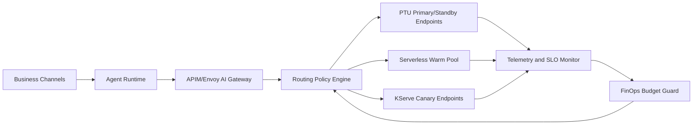
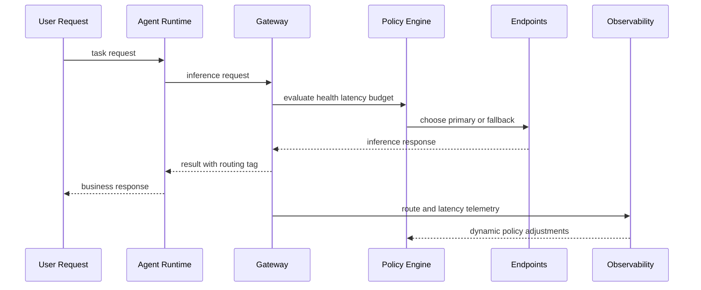

# 企业 Agent 模型端点故障切换选型 FAQ：PTU 主备 vs Serverless 预热池 vs AKS KServe 金丝雀

> **适用角色**：企业 Cloud & AI SA、模型平台团队、SRE 团队、FinOps 团队、业务连续性负责人。  
> **核心问题**：当 Agent 依赖的推理端点发生拥塞、降级或区域故障时，如何在可控成本下实现快速切换、SLA 保持与结果一致性。

## 1. 问题定义：Agent 体验抖动常由推理端点切换策略缺陷引发

许多企业先关注模型精度，
后续才发现可用性才是上线门槛。

Agent 请求链路通常比普通应用更脆弱。
一次超时会放大为整轮任务失败。

高频事故类型：

- 主端点排队导致首字节时间飙升。
- 回退端点未预热导致冷启动抖动。
- 多端点回复风格差异触发业务误判。
- 区域故障时切换策略与预算冲突。

因此模型端点容灾必须作为平台级能力设计。

## 2. 目标设定：可用性、时延、成本三者并重

端点切换不是单纯“能切走”。
还要满足连续业务约束。

建议统一目标：

- P95 响应时间稳定在业务阈值内。
- 故障切换时间满足 RTO 目标。
- 切换期间成功率不出现断崖。
- 月度成本在预算护栏内波动。

若缺少统一目标，
团队会在事故中反复手工决策。

## 3. 模式 A：PTU 主备双轨（同模型族）

模式 A 采用 PTU 主轨承载稳定流量，
并配置同模型族备轨。

关键机制：

- 主轨按常态峰值配置。
- 备轨按降级容量配置。
- 网关基于健康探针切换。
- 切换时保留请求追踪上下文。

优点：

- 稳定性高，抖动小。
- 吞吐可预测性强。
- 适合高价值核心流程。

限制：

- 固定成本基线较高。
- 容量利用率需长期优化。
- 跨模型族迁移灵活性较低。

## 4. 模式 B：Serverless + 预热池弹性回退

模式 B 以按量端点承接突发与回退。

常见做法：

- 主轨常态走 PTU 或托管端点。
- 回退轨采用 Serverless。
- 预热池维持最小并发热度。
- 峰值时自动扩展并限流保护。

优点：

- 弹性强，峰值吸收能力高。
- 固定成本较低。
- 适合流量波动明显业务。

限制：

- 预热策略不当会有冷启动。
- 单价波动对预算敏感。
- 流量骤升时需精细阈值控制。

## 5. 模式 C：AKS KServe 金丝雀与多版本路由

模式 C 用 KServe 在 AKS 上实现
版本化发布与故障回退。

核心能力：

- Revision 金丝雀分流。
- 模型版本并存对比。
- 失败自动回滚。
- 与服务网格策略联动。

优点：

- 发布可控性强。
- 适合私有化与定制推理栈。
- 可做细粒度流量试验。

限制：

- 运维门槛更高。
- 平台工程投入较大。
- 容量规划需要持续治理。

## 6. 模式 D：分层混合（推荐）

企业常见最优解是分层组合：

- 核心交易流程走 PTU 主备。
- 长尾流量走 Serverless 预热池。
- 新模型发布走 KServe 金丝雀。

通过策略分层实现
稳定性、敏捷性与成本平衡。

## 7. 参考架构：模型端点韧性控制平面

架构要点：

- 路由策略与预算策略必须联动。
- 端点健康与质量信号要分层采集。
- 回滚路径需要预先演练而非临场决定。

## 8. 请求流程：探测、切换、回稳

流程治理重点：

- 每次切换都必须有原因码。
- 结果回传要包含端点标签。
- 回稳策略要避免频繁抖动切换。

## 9. 12 维企业选型对比矩阵

| 维度 | A PTU 主备 | B Serverless 预热池 | C KServe 金丝雀 | D 混合分层 |
|---|---|---|---|---|
| 可用性稳定度 | 极高 | 高 | 高 | 极高 |
| 故障切换速度 | 高 | 中 | 高 | 高 |
| 峰值弹性能力 | 中 | 极高 | 高 | 极高 |
| 成本可预测性 | 高 | 中 | 中 | 高 |
| 发布敏捷性 | 中 | 中 | 极高 | 高 |
| 运维复杂度 | 中 | 中 | 高 | 高 |
| 多版本治理能力 | 中 | 低 | 极高 | 高 |
| 质量回归可控性 | 高 | 中 | 高 | 高 |
| 合规与审计友好 | 高 | 中 | 高 | 高 |
| 私有化适配能力 | 中 | 低 | 极高 | 高 |
| 平台扩展性 | 高 | 高 | 高 | 极高 |
| 推荐成熟阶段 | 稳态核心业务 | 弹性扩展期 | 平台深度化 | 企业规模化 |

## 10. 量化拐点：SLA 与成本测算

| 指标 | A PTU | B Serverless | C KServe | D 混合 |
|---|---:|---:|---:|---:|
| 请求成功率 | 99.35% | 98.91% | 99.12% | 99.47% |
| 切换 RTO P95 | 18s | 31s | 22s | 16s |
| 首字节延迟 P95 | 1280ms | 1510ms | 1390ms | 1210ms |
| 每千请求成本 | $42 | $36 | $39 | $38 |
| 故障期丢单率 | 0.9% | 1.8% | 1.3% | 0.7% |
| 人工干预频次 | 14/月 | 19/月 | 16/月 | 9/月 |

测算前提：

- 月请求量 2,200 万。
- 高峰放大系数 4.8。
- 核心交易请求占比 22%。
- 业务窗口跨多个时区运营。
- 40% 请求需要工具调用后再二次推理。
- 区域级演练按季度至少一次。
- 回退链路默认保留 7 天可追溯日志。
- 预算告警阈值设置为月度预算 85%。

结论摘要：

- A 稳定度最好但成本较高。
- B 弹性强但抖动风险更高。
- C 适合持续发布与私有化栈。
- D 在综合维度最均衡。
当企业进入多区域扩张阶段，建议优先完善跨区探针一致性。
若模型族频繁迭代，应同步升级回退兼容性回归套件。
容量评审建议引入峰值前置演练与预算联合签核。

## 11. 决策树：按业务关键度与流量波动选择

问题 1：
核心流程是否有严格 SLA 罚则？

- 是：优先 A 或 D。
- 否：进入问题 2。

问题 2：
流量波动是否超过 3 倍？

- 是：优先 B 或 D。
- 否：进入问题 3。

问题 3：
是否需要高频模型版本灰度？

- 是：优先 C 或 D。
- 否：进入问题 4。

问题 4：
团队是否有成熟平台工程能力？

- 是：可落地 C 或 D。
- 否：以 A/B 渐进演进。

## 12. 反模式与纠偏路径

反模式一：
只配置单一主端点无演练回退。

纠偏：
建立主备与回退端点的季度演练机制。

反模式二：
切换仅依赖人工判断。

纠偏：
引入自动探针与策略阈值驱动切换。

反模式三：
只看可用性不看成本突增。

纠偏：
把预算护栏纳入切换判定。

反模式四：
金丝雀发布没有业务验收指标。

改进：
绑定业务 KPI 与质量门禁后再放量。

## 13. 平台治理：角色协同与发布治理

建议职责划分：

- 平台团队：维护端点路由与发布框架。
- SRE 团队：维护健康探针与故障演练。
- FinOps 团队：维护预算阈值与告警。
- 业务团队：定义关键流程 SLA 等级。

发布治理原则：

- 回退策略必须可版本化。
- 高风险切换规则需双人审批。
- 重大变更前需压测与故障演练。

## 14. 五步落地指南（Good fit vs Not for）

步骤 1：
按业务价值定义端点分层与优先级。

步骤 2：
建立主备、回退与降级策略模板。

步骤 3：
接入统一遥测并固化原因码。

步骤 4：
将预算护栏嵌入路由策略引擎。

步骤 5：
每周复盘切换事件并优化阈值。

Good fit：

- 多业务线共享模型平台。
- 需要跨区域连续可用能力。
- 对预算与 SLA 同时敏感。

Not for：

- 单一低流量内部工具。
- 无故障演练与运维能力团队。
- 对延迟与稳定性要求很低场景。

## 15. 实战 FAQ（8 问）

**Q1：PTU 主备是否一定最优？**  
A1：对核心流程通常最稳，但需结合成本与利用率评估。

**Q2：Serverless 预热池怎样防冷启动？**  
A2：按时段维持最小热度，并用动态阈值触发提前预热。

**Q3：KServe 金丝雀适合哪些团队？**  
A3：适合具备平台工程与模型发布治理能力的团队。

**Q4：切换策略如何避免抖动？**  
A4：引入回稳时间窗与双阈值判定，避免频繁来回切换。

**Q5：预算护栏会不会影响可用性？**  
A5：需设计分级护栏，核心请求应有保底额度。

**Q6：如何评估混合模式收益？**  
A6：比较故障期丢单、人工干预与成本曲线即可量化。

**Q7：是否要统一模型族再做容灾？**  
A7：尽量保持同族兼容，跨族回退需额外业务验证。

**Q8：什么时候应从单模式升级到混合？**  
A8：当故障频次、发布频次和成本波动同时上升时应升级。
建议将升级评估纳入季度容量规划例会。
对于跨区域业务，需单独验证区域间模型一致性。
若业务存在强监管窗口，还应定义不可降级请求清单。
平台团队应维护统一的切换原因码字典与回放手册。

