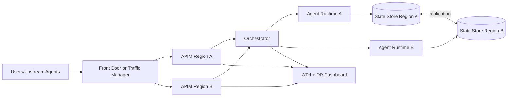
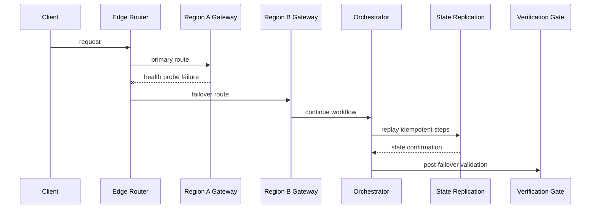

# Enterprise Agent Multi-Region Active-Active Failover Selection FAQ: `Azure Front Door + APIM Regional Gateway` vs `Traffic Manager` vs `Application-Layer Adaptive Routing`

## 1. Executive Summary: Multi-Region Reliability Is About Verifiable Failover Semantics, Not Just Duplicate Deployments
Many teams interpret multi-region resilience
as “deploy the same stack twice.”
Production incidents consistently show
that this is insufficient.
The determining factor is whether failover semantics are explicit and testable:
how ingress traffic is redirected,
how session context is resumed,
how side-effecting operations remain idempotent,
and how cost/latency drift is controlled during degraded periods.
Without these semantics,
so-called active-active design
often devolves into manual switchovers,
session discontinuity,
retry amplification,
and unpredictable cross-region spend spikes.
This guide provides a production decision baseline:
`Front Door + APIM Regional Gateway`
for policy-rich global ingress governance;
`Traffic Manager`
for DNS-level health-based regional balancing with lower initial complexity;
application-layer adaptive routing
for teams that need business-semantic routing and session-priority controls.
In mature enterprises,
the stable outcome is usually layered composition.

## 2. Daily Breakthrough Evidence (Fetched `2026-11-21`)
This section intentionally prioritizes
official documentation and traceable release channels.
Evidence tags distinguish
`measured`,
`synthetic`,
and `anonymized_reported`.

| Topic | Source | Retrieved | Label | Why it matters |
|---|---|---|---|---|
| APIM AI Gateway | https://learn.microsoft.com/en-us/azure/api-management/ai-gateway-overview | 2026-11-21 | measured | Regional gateway policy and quota controls anchor failover governance |
| APIM changelog | https://github.com/Azure/API-Management/blob/main/changelogs/api-management-service.md | 2026-11-21 | anonymized_reported | Confirms evolving gateway behavior that must be regression-tested for failover |
| ACA Dynamic Sessions | https://learn.microsoft.com/en-us/azure/container-apps/sessions | 2026-11-21 | measured | Sessionized runtimes increase context-continuity requirements under failover |
| Firecracker releases | https://github.com/firecracker-microvm/firecracker/releases | 2026-11-21 | anonymized_reported | Runtime recovery improvements still require control-plane failover correctness |
| Kata releases | https://github.com/kata-containers/kata-containers/releases | 2026-11-21 | anonymized_reported | Isolation-layer evolution changes runtime assumptions under disruption |
| Wasmtime releases | https://github.com/bytecodealliance/wasmtime/releases | 2026-11-21 | anonymized_reported | Componentized runtime paths increase need for explicit routing contracts |
| E2B releases | https://github.com/e2b-dev/e2b/releases | 2026-11-21 | anonymized_reported | Faster sandbox recovery does not replace ingress and orchestration failover controls |

The evidence trend is practical:
execution layers improve,
but failover correctness still depends on control-plane architecture.

## 3. Problem Boundary: Multi-Region HA Must Satisfy Availability, Continuity, Correctness, and Governability
A useful decision frame requires four simultaneous objectives:
availability,
session continuity,
side-effect correctness,
and governance closure.
Availability means traffic reaches healthy regions fast.
Continuity means business/session context survives route changes.
Correctness means failover does not introduce duplicate irreversible actions.
Governability means failover behavior remains observable, auditable, and reversible.
Architectures that optimize only for low switchover time
often reintroduce risk as data correctness incidents.
For regulated sectors,
that trade-off is not acceptable.

## 4. Reference Architecture: Ingress, State, and Orchestration Must Co-Evolve
A production pattern separates responsibility across three tightly integrated planes:
ingress control,
state continuity,
and orchestration recovery logic.



Failover reliability is a system property.
No single layer can guarantee it in isolation.

## 5. 12-Dimension Comparison Matrix
| Dimension | Front Door + APIM | Traffic Manager | App-Layer Adaptive Routing | Decision Signal |
|---|---|---|---|---|
| Failover granularity | Fine-grained path/policy | DNS-level | Business-semantic | Complex governance favors Front Door |
| Switching speed | Fast | Medium | Implementation-dependent | Strict RTO targets often favor Front Door |
| Cost complexity | Medium-high | Low-medium | Medium-high | Budget-sensitive starts may favor Traffic Manager |
| Session continuity support | Medium-high | Medium | High | Deep continuity control may require app-layer logic |
| Operational complexity | Medium | Low | High | Team maturity determines feasible depth |
| Global traffic governance | High | Medium | Medium | Multi-region policy consistency favors Front Door |
| Health probing depth | High | Medium-high | Medium | Unified probes + policy often favor Front Door |
| Tenant policy segmentation | High | Medium | Medium-high | Multi-tenant governance favors policy-rich ingress |
| Audit traceability | High | Medium | Medium-high | Regulated environments need stronger evidence paths |
| Rollback orchestration | High | Medium | Medium-high | Release-linked rollback favors Front Door + APIM |
| Onboarding speed | Medium | High | Low-medium | Fast initial rollout often starts with Traffic Manager |
| Evolution flexibility | High | Medium | High | Long-term programs often converge to hybrid |

The matrix should guide staged architecture evolution,
not force a one-step end-state.

## 6. Path A: `Front Door + APIM Regional Gateway` as Enterprise Primary Pattern
This path is typically strongest where organizations need:
global ingress policy consistency,
tenant-aware routing control,
integrated security posture,
and audit-quality evidence.
Front Door provides global edge routing and policy-aware path control.
Regional APIM gateways enforce token, quota, and protocol governance per region.
Under regional degradation,
traffic can be redirected with policy continuity rather than blind failover.
Critical implementation practice:
version health probes,
route policy,
degradation contracts,
and failback criteria together.
Separating these lifecycle tracks
is a frequent root cause of partial failover incidents.

## 7. Path B: `Traffic Manager` for DNS-Level Balancing and Simpler Cost Envelope
`Traffic Manager`
is often appropriate for
cost-aware teams that need baseline regional resilience
without deep path-level policy logic.
It offers health-probe-driven DNS routing with relatively low operational overhead.
The structural limitation is DNS behavior itself:
effective cutover timing can vary by client resolver and cache TTL behavior.
For scenarios requiring near-real-time policy-driven failover,
DNS-level control alone is rarely enough.
In practice,
many teams start with Traffic Manager
and later layer Front Door/APIM for richer control.

## 8. Path C: Application-Layer Adaptive Routing for Business-Semantic Control
Application-layer routing is valuable when failover policy depends on:
tenant tier,
session criticality,
workflow stage,
or irreversible business actions.
It enables semantic-aware routing and prioritized continuity behavior.
It also carries substantial complexity:
custom policy engines,
state-aware retry orchestration,
and expanded testing burden.
Without strong platform engineering discipline,
this approach can fragment policy logic across services.
Therefore it is usually most effective
as an enhancement above strong ingress governance,
not a replacement for it.

## 9. Failover Drill Lifecycle: Detect, Switch, Verify, Reconcile, Learn
A resilient architecture requires an explicit drill lifecycle:
failure detection,
route transition,
post-switch correctness validation,
state reconciliation,
and incident learning loops.



Switching traffic is necessary,
but insufficient without correctness verification.

## 10. Quantitative Q&A (8 Decision Anchors)
**Q1: What RTO target is commonly used for critical orchestration paths?**  
Many enterprises define `RTO <= 60s` for critical paths, with stricter targets for high-value transaction flows (`anonymized_reported`).

**Q2: Why is DNS-based failover timing inherently variable?**  
Resolver caching and client TTL behavior can delay effective route shifts.

**Q3: What minimum continuity fields should survive failover?**  
At minimum:
`tenant_id`,
`session_id`,
`correlation_id`,
and `idempotency_key`.

**Q4: What risk emerges when cross-region replication lag is opaque?**  
Replay operations may duplicate side effects or resume from stale state assumptions.

**Q5: Why does failover often create temporary cost spikes?**  
Retries,
cross-region transit,
and temporary overprovisioning can inflate short-window spend.

**Q6: Is multi-region always more expensive in net terms?**  
Upfront infrastructure cost rises,
but major-incident loss exposure usually falls significantly.

**Q7: What is the strongest benefit of app-layer adaptive routing?**  
Semantic-aware degradation and priority-aware continuity under partial failure.

**Q8: How should failover success be measured?**  
By combined availability,
data/session correctness,
and business-outcome integrity,
not reachability alone.

## 11. Production Code Example: Region Selection and Idempotent Resume
```python
from dataclasses import dataclass
from typing import Dict
import time


@dataclass
class RegionHealth:
    region: str
    healthy: bool
    latency_ms: int


def pick_region(primary: RegionHealth, secondary: RegionHealth, max_latency_ms: int = 300) -> str:
    if primary.healthy and primary.latency_ms <= max_latency_ms:
        return primary.region
    if secondary.healthy:
        return secondary.region
    return "degraded_mode"


def resume_with_idempotency(state: Dict[str, str], idem_key: str) -> Dict[str, str]:
    if state.get("last_idem_key") == idem_key:
        return {"status": "skipped_duplicate", "region": state.get("region", "unknown")}
    time.sleep(0.01)
    state["last_idem_key"] = idem_key
    return {"status": "resumed", "region": state.get("region", "unknown")}
```

The essential principle is explicit idempotency coupling
between failover routing and workflow continuation.

## 12. IaC and Policy Snippets: Regional Routing, Probes, and Governance Constraints
```yaml
apiVersion: platform.routing/v1
kind: MultiRegionPolicy
metadata:
  name: agent-failover-policy
spec:
  primaryRegion: eastasia
  secondaryRegion: southeastasia
  healthProbe:
    intervalSeconds: 15
    timeoutSeconds: 5
    failureThreshold: 3
  failover:
    mode: active-active
    maxRtoSeconds: 60
  governance:
    requireIdempotencyKey: true
    requireTenantContext: true
    costSpikeGuardRatio: 1.4
```

```bicep
param gatewayName string
param location string

resource apim 'Microsoft.ApiManagement/service@2022-08-01' = {
  name: gatewayName
  location: location
  sku: {
    name: 'Premium'
    capacity: 1
  }
  properties: {
    publisherEmail: 'platform@example.com'
    publisherName: 'platform-team'
  }
}
```

Treat routing policy, probe policy, and governance policy
as one reviewed release artifact.

## 13. Enterprise Scenario A: Global Payments and Clearing Platform
A global payment and settlement platform
with strict transaction integrity requirements
adopted Front Door + APIM as the primary ingress failover pattern.
Regional outage drills demonstrated that
traffic redirection alone was not enough.
They enforced idempotent workflow resume semantics,
state confirmation gates,
and post-failover transaction correctness checks.
The result was lower outage loss exposure,
reduced duplicate-side-effect incidents,
and stronger regulator-facing audit confidence.

## 14. Enterprise Scenario B: Global Support and Ticketing Platform
A global support platform
experiencing bursty event-driven demand
started with Traffic Manager for initial resilience
due to lower complexity and cost.
As workload criticality increased,
they introduced Front Door + APIM on high-value paths
and layered app-level adaptive routing for premium support sessions.
This staged migration enabled
cost-aware adoption first,
followed by governance and semantic-control depth where needed.
The program reduced both incident impact
and policy-management fragmentation.

## 15. FinOps TCO, Five-Step Rollout, and Day-0/Day-2 Checklist
### 15.1 Cost Reference (Example: Active-Active Across Two Regions)
| Cost Surface | Front Door + APIM | Traffic Manager | App-Layer Enhancement |
|---|---|---|---|
| Ingress governance cost | Medium-high | Low | Medium |
| Operations complexity cost | Medium | Low-medium | High |
| Compliance audit overhead | Low | Medium | Medium |
| Outage-window loss risk | Low | Medium | Low |
| Evolution flexibility | High | Medium | High |
| Strategic fit | Enterprise primary pattern | Budget-friendly initial phase | Semantic continuity enhancement |

### 15.2 Five-Step Rollout Guide
1. Define failure tiers and measurable RTO/RPO objectives by workflow criticality.
2. Implement ingress health probing and baseline regional failover first.
3. Add idempotent resume and state continuity contracts before broad rollout.
4. Integrate failover validation into release gates and drill cadences.
5. Run monthly reviews across availability, correctness, and cost metrics together.

### 15.3 Good Fit vs Not For
**Good fit**
for cross-region enterprise platforms
with high availability expectations,
stateful orchestration,
and audit requirements.

**Not for**
single-region low-value experiments
where prolonged interruption is acceptable.

### 15.4 Day-0 / Day-2 Twelve-Item Checklist
1. Define primary/secondary regional priority and failover policy contracts.
2. Define health-probe thresholds and alarm escalation paths.
3. Standardize session continuity and idempotency key schemas.
4. Implement cross-region state replication and lag observability.
5. Define retry ceilings and circuit-breakers for failover windows.
6. Add cost-guardrails for temporary failover surge behavior.
7. Establish failover drill calendar and accountable owners.
8. Implement automated post-failover correctness validation scripts.
9. Define failback criteria and controlled rollback procedures.
10. Implement immutable audit retention for failover decisions.
11. Create cross-team runbooks across network, platform, and product teams.
12. Execute end-to-end failover drills quarterly with remediation tracking.

### 15.5 Common Failure Patterns and Corrective Controls (Addendum)
Pattern one:
ingress routing switches successfully,
but regional policy versions are inconsistent.
Result:
traffic reaches the backup region,
yet authorization or quota outcomes diverge,
creating false denials or uncontrolled acceptance.
Corrective control:
make policy-version parity
a failover completion precondition.
Pattern two:
route failover succeeds,
but state replication lag exceeds safe thresholds.
Result:
workflow resumes from stale state,
increasing duplicate-side-effect probability.
Corrective control:
introduce orchestration-level
state-version confirmation checkpoints,
allowing only reversible operations
until state convergence is confirmed.
Pattern three:
retry controls are not region-aware.
Result:
primary and secondary both execute retries for the same logical action.
Corrective control:
enforce idempotency keys plus regional execution leases
to block concurrent cross-region duplicate execution.
Pattern four:
cost guardrails are absent during degraded operation.
Result:
cross-region transit and retry amplification
produce spend spikes that outlast the incident window.
Corrective control:
embed cost guard thresholds
and automatic degrade/rate-limit policies
inside failover runbooks.

### 15.6 Observability and Audit Baseline (Addendum)
A practical governance baseline is a “four-quadrant failover dashboard”:
reachability,
correctness,
performance,
and cost.
Reachability should track
probe success rate,
trigger latency,
and cutover completion time.
Correctness should track
idempotency-hit ratio,
duplicate-side-effect incidents,
and state-version conflict count.
Performance should track
P95/P99 latency during failover windows,
regional queue depth,
and downstream tool timeout ratios.
Cost should track
cross-region egress overhead,
retry amplification overhead,
and savings from active degrade controls.
These quadrants must be reviewed together.
Single-axis monitoring
often declares failover success
while correctness or cost silently regresses.
For regulated industries,
each failover event should also persist
immutable records of
trigger cause,
policy/version snapshot,
validation outcomes,
and rollback decisions.

### 15.7 Common Pitfalls and Mitigations (Addendum)
A recurring pitfall
is measuring failover success
only by HTTP reachability.
Mitigation:
always pair reachability with
idempotency correctness checks
and business-outcome reconciliation.
Another pitfall
is separating route policy changes
from health-probe and quota policy changes.
Mitigation:
bundle these controls into one release unit
with coordinated rollback rules.
A third pitfall
is underestimating cost drift during prolonged degraded mode.
Mitigation:
enforce failover-window cost guardrails
and automatic escalation when thresholds are exceeded.

---

### Conclusion
Enterprise multi-region active-active resilience
is not a single product decision.
It is a coordinated control-plane design
across ingress routing,
state continuity,
orchestration correctness,
and governance automation.
A layered pattern led by
Front Door + APIM,
augmented by Traffic Manager and app-layer adaptive routing as needed,
provides a durable path to failover that is
available,
correct,
auditable,
and economically controllable.
