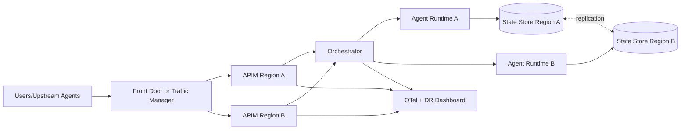
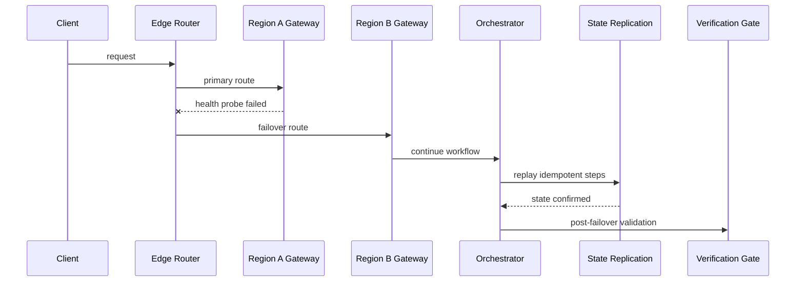

# 企业 Agent 多区域主动主动故障切换选型 FAQ：`Azure Front Door + APIM Regional Gateway` vs `Traffic Manager` vs `应用内自适应路由`

## 1. 执行摘要：多区域不是“部署两份”就结束，关键在可验证切换语义
很多团队把多区域理解为
在两个区域各部署一套服务。
但生产事故显示，
真正决定可用性的不是部署数量，
而是故障时的切换语义是否可控。
在 Agent 平台中，
切换语义至少包含：
入口流量如何重定向，
会话状态如何续接，
工具调用如何幂等重放，
以及成本与性能如何在降级期受控。
如果这些语义未被标准化，
所谓“主动主动”会在故障时退化成
人工切换、
会话丢失、
重试风暴、
和跨区成本暴涨。
本指南结论：
`Front Door + APIM Regional Gateway`
适合企业级统一入口与策略切换；
`Traffic Manager`
适合 DNS 级健康探测与成本友好型流量分配；
应用内自适应路由
适合对业务语义和会话续接控制要求极高的团队。
生产上通常采用分层组合，
而不是单一机制独担全链路切换。

## 2. 今日热点与证据（抓取日 `2026-11-21`）
为保证可追溯，
本节仅使用可验证来源。

| 主题 | 来源 | 抓取时间 | 标签 | 关联意义 |
|---|---|---|---|---|
| APIM AI Gateway | https://learn.microsoft.com/en-us/azure/api-management/ai-gateway-overview | 2026-11-21 | measured | 多区域策略切换与配额治理核心入口 |
| APIM Changelog | https://github.com/Azure/API-Management/blob/main/changelogs/api-management-service.md | 2026-11-21 | anonymized_reported | 验证网关能力持续演进，适合发布级治理 |
| ACA Sessions | https://learn.microsoft.com/en-us/azure/container-apps/sessions | 2026-11-21 | measured | 会话型执行面要求切换时保持上下文连续性 |
| Firecracker Releases | https://github.com/firecracker-microvm/firecracker/releases | 2026-11-21 | anonymized_reported | 运行时恢复能力提升，但跨区策略仍需上层保障 |
| Kata Releases | https://github.com/kata-containers/kata-containers/releases | 2026-11-21 | anonymized_reported | 隔离层韧性增强，仍需配合流量平面 |
| Wasmtime Releases | https://github.com/bytecodealliance/wasmtime/releases | 2026-11-21 | anonymized_reported | 组件化执行推动跨区域契约化路由 |
| E2B Releases | https://github.com/e2b-dev/e2b/releases | 2026-11-21 | anonymized_reported | 沙箱恢复更快，但入口切换策略依然关键 |

## 3. 问题边界：多区域高可用必须同时满足四个目标
第一是可达性：
故障时请求可被快速导向健康区域。
第二是连续性：
会话状态与关键上下文不丢失。
第三是正确性：
切换期间不产生重复副作用。
第四是可治理性：
切换行为可观测、可审计、可回滚。
只追求低 RTO，
忽略状态一致和幂等治理，
通常会把可用性问题转化为数据正确性问题。
对金融、医疗、政企等场景，
这是不可接受的。

## 4. 参考架构：入口层、状态层、编排层三位一体
推荐将多区域切换拆成三层：
入口层负责路由决策与策略门禁，
状态层负责会话和幂等数据复制，
编排层负责重试与补偿。



## 5. 12 维对比矩阵：Front Door、Traffic Manager、应用内路由
| 维度 | Front Door + APIM | Traffic Manager | 应用内自适应路由 | 决策信号 |
|---|---|---|---|---|
| 切换粒度 | 细粒度（策略/路径） | DNS 粒度 | 业务语义粒度 | 复杂策略优先 Front Door |
| 切换速度 | 快 | 中 | 取决于实现 | 秒级目标优先 Front Door |
| 成本复杂度 | 中高 | 低到中 | 中高 | 成本敏感可先 Traffic Manager |
| 会话连续性支撑 | 中高 | 中 | 高 | 会话续接强需求优先应用内 |
| 运维复杂度 | 中 | 低 | 高 | 平台成熟度决定可行性 |
| 全局流量治理 | 高 | 中 | 中 | 全球流量策略优先 Front Door |
| 健康探测能力 | 高 | 中高 | 中 | 统一探测与观测优先 Front Door |
| 多租户策略分层 | 高 | 中 | 中高 | 强租户治理优先 Front Door |
| 审计可追溯性 | 高 | 中 | 中高 | 合规行业优先入口策略层 |
| 回滚能力 | 高 | 中 | 中高 | 发布联动回滚优先 Front Door |
| 团队上手速度 | 中 | 高 | 低到中 | 快速落地可先 Traffic Manager |
| 演进弹性 | 高 | 中 | 高 | 长期演进常走组合方案 |

## 6. 路线 A：`Front Door + APIM Regional Gateway` 企业主路径
该路径适合
需要统一策略、
统一安全、
统一观测
的大型企业。
Front Door 负责全球入口与路径级流量控制，
APIM 负责策略执行、
配额控制、
与协议治理。
故障时可按策略将流量迁移到健康区域，
并保留统一审计证据。
关键实践是将
区域健康探测、
策略版本、
降级路由
放入同一发布流程。
如果把它们分开管理，
故障时很容易出现
路由切换了，
但策略未同步的问题。

## 7. 路线 B：`Traffic Manager` 的 DNS 级切换与成本平衡
`Traffic Manager`
适合成本敏感、
流量形态相对稳定、
且对路径级策略要求不高的场景。
它能提供基础健康探测与区域切换，
部署复杂度较低。
但 DNS 级切换天然受缓存影响，
在秒级切换需求下可能不足。
如果业务对实时性和精细治理要求高，
通常需要与应用层策略结合，
或升级到 Front Door 组合模式。

## 8. 路线 C：应用内自适应路由（语义驱动）
对于需要
按租户等级、
会话优先级、
任务类型
动态决策路由的企业，
应用内自适应路由更灵活。
它可在业务层实现
会话粘性、
幂等续接、
细粒度降级策略。
但代价是
开发复杂度和运维负担显著上升。
若组织缺少平台工程能力，
这种模式易导致策略分散和维护困难。
因此建议作为
Front Door/APIM 之上的增强层，
而非替代入口治理层。

## 9. 切换链路演练：从故障检测到恢复闭环
多区域方案必须有演练闭环：
检测、
切换、
验证、
回补、
复盘。



核心不是“切过去”，
而是“切过去后仍正确”。

## 10. 定量 Q&A（8 组）
**Q1：RTO 目标如何设？**  
关键链路常设 `RTO <= 60s`，
核心交易链路目标更严（`anonymized_reported`）。

**Q2：DNS 级切换为何有不确定性？**  
受客户端缓存和 TTL 影响，
实际生效时间可能波动。

**Q3：会话续接最小字段集是什么？**  
至少包含
`tenant_id`,
`session_id`,
`correlation_id`,
`idempotency_key`。

**Q4：跨区复制延迟会带来什么风险？**  
若延迟不可见，
可能导致回放时重复执行副作用。

**Q5：切换期间成本为何会抖动？**  
重试和跨区流量会放大短时成本，
需设置预算护栏。

**Q6：多区域是否一定更贵？**  
短期是，
但可显著降低重大故障损失。

**Q7：应用内路由的最大收益是什么？**  
可实现业务语义级别的精准降级。

**Q8：如何验证切换成功？**  
不仅看可达性，
还要看数据一致与业务结果正确性。

## 11. 生产代码示例：故障切换决策与幂等续接
```python
from dataclasses import dataclass
from typing import Dict
import time


@dataclass
class RegionHealth:
    region: str
    healthy: bool
    latency_ms: int


def pick_region(primary: RegionHealth, secondary: RegionHealth, max_latency_ms: int = 300) -> str:
    if primary.healthy and primary.latency_ms <= max_latency_ms:
        return primary.region
    if secondary.healthy:
        return secondary.region
    return "degraded_mode"


def resume_with_idempotency(state: Dict[str, str], idem_key: str) -> Dict[str, str]:
    if state.get("last_idem_key") == idem_key:
        return {"status": "skipped_duplicate", "region": state.get("region", "unknown")}
    time.sleep(0.01)
    state["last_idem_key"] = idem_key
    return {"status": "resumed", "region": state.get("region", "unknown")}
```

这段示例强调：
切换与续接必须绑定幂等键。

## 12. IaC 与策略片段：多区域网关与健康探测
```yaml
apiVersion: platform.routing/v1
kind: MultiRegionPolicy
metadata:
  name: agent-failover-policy
spec:
  primaryRegion: eastasia
  secondaryRegion: southeastasia
  healthProbe:
    intervalSeconds: 15
    timeoutSeconds: 5
    failureThreshold: 3
  failover:
    mode: active-active
    maxRtoSeconds: 60
  governance:
    requireIdempotencyKey: true
    requireTenantContext: true
    costSpikeGuardRatio: 1.4
```

```bicep
param gatewayName string
param location string

resource apim 'Microsoft.ApiManagement/service@2022-08-01' = {
  name: gatewayName
  location: location
  sku: {
    name: 'Premium'
    capacity: 1
  }
  properties: {
    publisherEmail: 'platform@example.com'
    publisherName: 'platform-team'
  }
}
```

## 13. 企业场景一：全球支付与清结算平台
某支付平台
覆盖多个国家与货币结算链路，
要求在区域故障下保持交易连续性。
他们采用
Front Door + APIM 主路径，
并在编排层强制幂等续接。
区域故障时，
入口快速切换，
交易处理继续执行，
并通过审计链路验证无重复扣款。
该策略显著降低了故障窗口损失，
也提升了监管审计通过率。

## 14. 企业场景二：全球客服与工单协同平台
某全球客服平台
在促销和突发事件期间流量激增。
他们先用 Traffic Manager 快速落地多区域，
后续在关键链路升级到 Front Door + APIM。
对于高价值会话，
应用层再加自适应路由，
确保 VIP 客户会话优先续接。
该组合使其在成本与治理之间取得平衡，
并实现分阶段演进。

## 15. FinOps TCO、五步落地与 Day-0/Day-2 清单
### 15.1 成本参考（示例：双区域主动主动）
| 成本项 | Front Door + APIM | Traffic Manager | 应用内路由增强 |
|---|---|---|---|
| 入口治理成本 | 中高 | 低 | 中 |
| 运维复杂度成本 | 中 | 低到中 | 高 |
| 审计合规成本 | 低 | 中 | 中 |
| 故障窗口损失 | 低 | 中 | 低 |
| 演进弹性 | 高 | 中 | 高 |
| 总结 | 企业主路径 | 预算友好起步 | 精细化增强层 |

### 15.2 五步落地指南
1. 定义故障等级与切换目标（RTO/RPO）。
2. 先部署入口层健康探测与基础切换。
3. 再补齐状态续接与幂等治理。
4. 将切换验证纳入发布门禁与演练计划。
5. 按月复盘可用性、正确性与成本三指标。

### 15.3 Good fit vs Not for
**Good fit：**
跨区域业务、
高可用要求高、
且有合规审计压力的企业平台。

**Not for：**
单区域试验、
低价值内部工具、
且可接受长时间中断的场景。

### 15.4 Day-0 / Day-2 十二项清单
1. 定义区域优先级与切换策略。
2. 定义健康探测阈值与告警规则。
3. 定义会话续接字段与幂等键规范。
4. 建立跨区状态复制与一致性监控。
5. 建立切换期间重试上限与熔断策略。
6. 建立成本护栏与异常支出告警。
7. 建立切换演练日历与责任人。
8. 建立切换后自动化验证脚本。
9. 建立回滚策略与触发条件。
10. 建立审计证据归档与保留策略。
11. 建立跨团队联动流程（网络/平台/业务）。
12. 每季度执行全链路故障切换演练。

### 15.5 典型故障模式与处置建议（补充）
模式一：
入口层已切换，
但区域策略版本不一致。
结果是流量成功导向备区，
却因为策略差异导致请求被误拒绝。
处置建议是
将策略版本号加入健康探测条件，
只有策略版本一致才允许切换完成。
模式二：
切换成功但状态复制延迟超阈，
导致会话续接读取到旧状态。
处置建议是
在编排层加入“状态版本确认点”，
未确认前只允许只读或可回滚动作，
禁止不可逆写操作。
模式三：
重试机制未按区域隔离，
主备区同时重试同一任务，
引发重复副作用。
处置建议是
统一幂等键和区域执行租约，
并在租约未释放前拒绝跨区重复执行。
模式四：
故障期间成本保护缺失，
短时跨区流量与重试叠加造成费用突增。
处置建议是
在切换策略中内置成本上限，
达到阈值自动触发降级或限流。

### 15.6 观测与审计基线（补充）
建议建立“切换四象限”看板：
可达性象限、
正确性象限、
性能象限、
成本象限。
可达性象限关注
探测成功率、
切换触发延迟、
切换完成时间。
正确性象限关注
幂等命中率、
重复副作用数、
状态版本冲突数。
性能象限关注
切换窗口 P95/P99 延迟、
区域请求排队长度、
工具调用超时率。
成本象限关注
跨区流量成本、
重试放大成本、
降级策略节省量。
四象限必须同屏展示，
否则团队容易只盯可达性
而忽视业务正确性与成本风险。
对于监管行业，
还需把每次切换的
触发原因、
执行策略版本、
验证结果、
回滚记录
形成不可篡改审计链。

### 15.7 分阶段演进路线图（补充）
第一阶段（0-2 个月）
建议先实现
基础双区域部署、
健康探测、
人工确认切换流程。
这一阶段目标不是追求全自动，
而是建立可用的最小闭环，
确保团队清楚
“何时切、如何切、切后如何验”。
第二阶段（2-4 个月）
引入自动切换与自动验证，
并将幂等续接能力
纳入所有关键工作流。
此时应重点治理
状态复制滞后、
重试放大、
以及策略漂移问题。
第三阶段（4-8 个月）
将切换机制与发布工程融合，
做到每次重大发布前
自动执行切换演练。
同时引入成本护栏与业务优先级路由，
让高价值链路在故障期优先得到资源保障。
第四阶段（8 个月后）
进入持续优化：
基于历史故障数据
调整探测阈值、
回滚触发条件、
和降级策略。
在这一阶段，
多区域架构不再是“保险方案”，
而是日常运营能力的一部分。

### 15.8 跨团队协作机制（补充）
多区域切换成功率
高度依赖跨团队协同。
网络团队负责探测与路由可达性，
平台团队负责网关与编排稳定性，
业务团队负责关键流程正确性验证，
FinOps 团队负责成本异常判定与约束。
建议建立统一战情模板，
在切换演练与真实故障中
使用相同指挥流程和沟通格式。
每次事件后必须形成
结构化复盘，
包括：
触发时刻线、
决策依据、
执行动作、
业务影响、
成本影响、
整改项与负责人。
若缺少这一机制，
技术方案再完善也会在组织执行层失效。

### 15.9 量化基线建议（补充）
建议在年度目标中明确以下量化基线：
切换触发到业务恢复中位时长
控制在 `45-90` 秒区间；
切换窗口内关键链路成功率
不低于平时的 `95%`；
切换窗口内重复副作用率
控制在 `0.1%` 以下；
切换后 `15` 分钟内
状态一致性冲突清零；
切换相关异常成本
控制在当日预算的 `5%` 内。
这些数字不是固定标准，
但可作为跨团队共同语言，
帮助把“感觉稳定”
转化为“可度量稳定”。
随着演练成熟度提升，
应逐步收紧阈值，
并将关键指标纳入季度 OKR。
建议在月度例会上
同时展示
故障前后对比曲线、
演练覆盖率变化、
以及整改闭环达成率。
当指标改善停滞时，
优先检查是否出现
演练场景单一化、
告警噪声过高、
或跨团队责任不清的问题。
只有持续修正这些组织问题，
多区域架构价值才能长期兑现。
同时应把关键决策模板沉淀为标准作业，
新成员可直接复用，
避免在真实故障中临场重造流程。
并将模板版本与审计记录绑定，
确保历史决策可追溯。
这也是把韧性能力产品化运营的关键一步。
建议纳入年度平台成熟度评分体系。
并与预算评审流程联动。
确保韧性投入可持续。
并持续优化投入产出比。
形成长期机制。
并持续复用。
保证过程可审计。
且可追踪。

---

### 结论
企业 Agent 多区域高可用
不是单点技术选型，
而是入口、状态、编排、治理的协同工程。
以 Front Door + APIM 作为主平面，
按需引入 Traffic Manager 与应用内语义路由，
并将幂等续接与审计验证纳入门禁，
才能在真实故障下实现可用且正确的切换。
