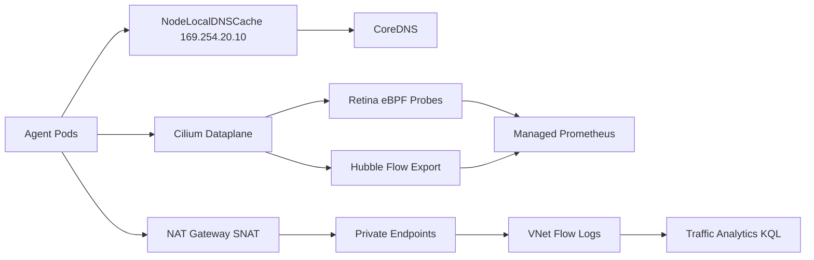
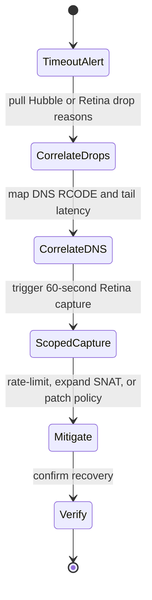

# Enterprise Agent Network Drop, CoreDNS Tail-Latency, and Private-Endpoint/SNAT Observability Selection FAQ (ACNS Retina/Hubble eBPF vs VNet Flow Logs vs Istio Ambient)
> Topic ID: #457
> Domain: 3.8 Autonomous Cloud Ops, BCDR resilience, and enterprise landing-zone operations
> Objective: diagnose and govern high-concurrency Agent tool-call timeouts with root-cause-grade network evidence
## 1) Production symptom pattern: spans show timeout, but root cause remains invisible
Enterprise agents frequently fan out `50–200` MCP/REST/private-endpoint calls in one turn.
Common targets include Azure OpenAI, AI Search, Cosmos DB, Redis, and internal gateway services.
During healthy periods, application spans provide adequate latency and status-code context.
During incident windows, spans often collapse into generic `TimeoutError` or deadline-exceeded traces.
Those messages cannot isolate DNS race, policy denial, conntrack exhaustion, SNAT depletion, or node pressure.
Blindly adding retries can hide the real defect while amplifying downstream load and contention.
Therefore root-cause workflows need kernel and network-plane observability, not application logs alone.
## 2) Root-cause families: drop reasons, DNS amplification, SNAT pressure, and policy blocking
`IPTABLES_DROP` and `POLICY_DENIED` can terminate packets before application-level telemetry notices.
`nf_conntrack` saturation can reject new flows even when upstream services are healthy.
`ndots:5` often amplifies DNS query volume and increases CoreDNS UDP timeout probability near `5,000 ms`.
Shared outbound SNAT ports can deplete quickly under bursty short-lived egress connections.
Cross-subnet private endpoint paths become hard to debug when boundary-level evidence is missing.
These failures look similar in app logs but require very different mitigation paths.
## 3) Four architecture paths and practical fit boundaries
Pattern A uses `AKS ACNS + Microsoft Retina + Cilium Hubble eBPF` as the primary observability lane.
Pattern A captures kernel-level drop reasons, DNS behavior, packet forwarding, and conntrack pressure.
Pattern A should pair with `NodeLocalDNSCache` and `ndots:2` to reduce DNS amplification.
Pattern A fits platforms that need second-level alerting and deterministic triage evidence.
Pattern B uses `VNet Flow Logs + Traffic Analytics + Connection Monitor` as boundary telemetry.
Pattern B is strong for Hub-Spoke, ExpressRoute, and private endpoint path verification.
Pattern B is weaker for first-response diagnosis due minute-level aggregation latency.
Pattern C uses `Istio Ambient/Sidecar` for L7 retries, status semantics, and policy governance.
Pattern C is valuable for service behavior but cannot expose `kfree_skb` or conntrack internals.
Pattern D relies on ad-hoc privileged tcpdump and unbounded high-cardinality labels in production.
Pattern D introduces security exposure, runaway cost, and low reproducibility in incident analysis.
## 4) Twelve-dimension quantified matrix for architecture boards
| Dimension | Pattern A (ACNS + eBPF) | Pattern B (Flow Logs) | Pattern C (Istio) | Pattern D (ad-hoc capture) |
|:-|:-:|:-:|:-:|:-:|
| Packet-drop root-cause granularity | kernel reason code | aggregated 5-tuple | L7 semantic only | manual sample |
| CoreDNS `5s` tail visibility | high | medium | low | medium |
| Private endpoint boundary visibility | medium-high | high | medium | low |
| Sub-second alert potential | high | low | medium | low |
| Overhead at `100 Gbps` node throughput | CPU `<1.8%` | very low | medium-high | uncontrolled |
| High-cardinality metric governance | strong | medium | medium | poor |
| mTLS payload versus metadata balance | metadata-safe | summary-safe | semantic-rich | risky |
| On-demand packet evidence latency | seconds | minutes | medium | manual-slow |
| Managed Prometheus cost control | high | medium | medium | low |
| Correlation with app traces | medium | medium-high | high | low |
| Multi-tenant compliance posture | high | high | high | low |
| Final recommendation | primary path | boundary complement | L7 complement | anti-pattern |
## 5) Control-plane/data-plane topology from pods to private endpoints

The key is a unified observation domain across pod, DNS, kernel, SNAT, and private endpoint paths.
Any single-layer-only view tends to misclassify network faults as pure application defects.
## 6) Automated timeout triage state machine

Each transition should store trigger evidence, execution action, and recovery proof.
That discipline turns incident handling into auditable engineering rather than oral history.
## 7) Q1: why `ndots:5` can amplify DNS traffic by `5x–6x`
Short hostnames are expanded through search domains before absolute resolution fallback.
Under high fan-out load, that amplification increases CoreDNS and UDP conntrack pressure.
A practical estimate is `Q_total = Q_base * (1 + S)` where `S` is search-domain attempts.
Moving to `ndots:2` with NodeLocalDNSCache often reduces tail latency and timeout spikes.
## 8) Q2: SNAT port sizing for bursty parallel tool calls
Each public IP on NAT Gateway contributes up to `64,512` SNAT ports.
A planning heuristic is `Ports_need = Concurrency * Fanout * Reuse_factor`.
Burst planning should use peak fan-out behavior, not long-term averages.
Capacity gates should include utilization thresholds and automated expansion triggers.
## 9) Q3: cardinality economics for managed metrics
Unbounded label sets can explode active time series through multiplicative combinations.
A first-order model is `Series = Nodes * Pods * DestIPs * Labels`.
Pattern A should aggregate destination dimensions before ingestion to control cost.
Cost governance should report signal-value-per-series, not only raw series count.
## 10) Q4: eBPF overhead versus sidecar overhead
eBPF introduces kernel-event collection and user-space export overhead, typically low single-digit CPU.
Sidecars add proxy hops and queueing, often increasing P99 latency with call-path depth.
These are complementary tools: eBPF for root cause, mesh for L7 policy semantics.
Benchmarking must pin workload shape and sampling settings to remain comparable.
## 11) Q5: reconciling one-minute flow-log lag with sub-second drop alerts
Flow Logs are excellent for boundary audit and trend analysis across network zones.
eBPF streams are better for immediate triage and fast mitigation loops.
A two-tier model works well: eBPF drives response, flow logs provide boundary evidence.
This combination balances speed, governance, and cross-domain explainability.
## 12) Q6: packet evidence without sensitive payload exposure
Use `-s 128` header-only capture to keep essential protocol metadata with minimal payload surface.
Capture windows should be short and scoped to specific namespaces or tuple filters.
Evidence artifacts should be written to immutable storage with incident and operator metadata.
In multi-tenant clusters, enforce least privilege and isolated retrieval paths for capture files.
## 13) Production code blocks specific to #457
### 13.1 Bicep enabling advanced networking observability, NAT, and monitor workspace
```bicep
param location string = resourceGroup().location
resource amw 'Microsoft.Monitor/accounts@2023-04-03' = {
  name: 'amw-agent-net'
  location: location
}
resource natPip 'Microsoft.Network/publicIPAddresses@2023-09-01' = {
  name: 'pip-agent-nat-01'
  location: location
  sku: { name: 'Standard' }
  properties: { publicIPAllocationMethod: 'Static' }
}
resource nat 'Microsoft.Network/natGateways@2023-09-01' = {
  name: 'nat-agent'
  location: location
  sku: { name: 'Standard' }
  properties: {
    publicIpAddresses: [{ id: natPip.id }]
    idleTimeoutInMinutes: 10
  }
}
resource aks 'Microsoft.ContainerService/managedClusters@2024-02-01' = {
  name: 'aks-agent-prod'
  location: location
  properties: {
    networkProfile: {
      networkDataplane: 'cilium'
      advancedNetworking: {
        observability: { enabled: true }
      }
    }
  }
}
```
### 13.2 Retina capture CRD plus pod DNS tuning snippet
```yaml
apiVersion: retina.sh/v1alpha1
kind: Capture
metadata:
  name: timeout-triage-capture
spec:
  durationSeconds: 60
  snapLen: 128
  filters:
    namespace: agent-runtime
    podSelector:
      matchLabels:
        app: agent-worker
---
apiVersion: v1
kind: Pod
metadata:
  name: agent-worker-sample
spec:
  dnsConfig:
    options:
    - name: ndots
      value: "2"
```
### 13.3 PromQL and KQL correlation queries for drops, DNS errors, and SNAT pressure
```python
promql_drop = 'sum(rate(networkobservability_drop_count{reason=~\"POLICY_DENIED|CT_MAP_INSERTION_FAILED\"}[5m])) by (node,reason)'
promql_dns = 'sum(rate(networkobservability_dns_response_count{rcode!=\"NOERROR\"}[5m])) by (node,rcode)'
kql_snat = \"\"\"\nAzureDiagnostics\n| where Category == 'NetworkSecurityGroupFlowEvent'\n| summarize dcount_snat= dcount(SrcPort_d) by bin(TimeGenerated, 1m), Subnet_s\n| where dcount_snat > 50000\n\"\"\"\nprint(promql_drop)\nprint(promql_dns)\nprint(kql_snat)\n```
print(promql_drop)\nprint(promql_dns)\nprint(kql_snat)\n```
## 14) Enterprise scenarios and three-tier TCO
### 14.1 Scenario A: global payment-orchestration agent platform under flash-sale bursts
Burst profile reaches `8,000 RPS` with deep downstream fan-out per user request.
Incidents combine CoreDNS tail spikes and transient SNAT depletion under short-lived connection storms.
Recommended stack uses Pattern A for root-cause diagnostics, Pattern B for boundary evidence, and Pattern C for L7 controls.
Key outcome is replacing unknown timeouts with actionable drop reasons, DNS codes, and port-utilization proof.
### 14.2 Scenario B: regulated healthcare multi-tenant AKS deployment
Operations must diagnose intermittent private-link policy drops to FHIR and AI Search endpoints.
Constraint: no PHI payload capture is allowed during troubleshooting.
Scoped `snapLen=128` capture plus policy-event correlation satisfies both privacy and forensic needs.
The workflow enables cross-team triage without broadening sensitive-data exposure.
### 14.3 Three-year TCO for `20 / 100 / 500` nodes
| Tier | Node scale | Pattern A | Pattern B | Pattern C |
|:-|:-:|:-:|:-:|:-:|
| Department | 20 | $0.71M | $0.43M | $0.66M |
| Regional | 100 | $2.95M | $1.84M | $3.22M |
| Enterprise | 500 | $11.8M | $7.6M | $14.9M |
Cost driver one: collection granularity versus active-series growth economics.
Cost driver two: incident isolation time and associated engineer-hour impact.
Cost driver three: boundary-audit storage and query overhead.
Cost driver four: service-mesh proxy depth and long-term compute consumption.
### 14.4 Scenario KPI gates and governance thresholds
For payment workloads, target median time from timeout alert to root-cause attribution at `<= 7 min`.
For healthcare workloads, target policy-failure to remediated rollout in `<= 20 min`.
Maintain a standing SRE metric for network-observability false-positive rate at `<= 8%`.
Track unknown-timeout share as a first-class KPI and drive quarterly reduction to `<= 3%`.
Include CoreDNS `P99`, SNAT utilization, and DropReason TopN in weekly review packets.
When `CT_MAP_INSERTION_FAILED` repeats in burst windows, auto-enter traffic-protection mode.
Traffic-protection mode should throttle fan-out first, then scale resources to avoid retry storms.
Every mitigation action should link to a tracked configuration change and immutable evidence.
## 15) Day-0 / Day-1 / Day-2 action plan and references
Day-0 action: inventory downstream dependencies and map tool-call fan-out topology.
Day-0 action: baseline current `ndots`, DNS query patterns, and CoreDNS peak QPS.
Day-0 action: define SNAT capacity model and expansion thresholds.
Day-0 action: codify drop-reason severity classes and alert priorities.
Day-0 action: formalize capture authorization flow, evidence schema, and immutable sink paths.
Day-1 action: enable ACNS observability and calibrate label dimensions.
Day-1 action: roll out NodeLocalDNSCache and `ndots:2` through canary waves.
Day-1 action: connect Retina/Hubble telemetry to managed dashboards and triage playbooks.
Day-1 action: activate eBPF-driven alert-to-mitigation automation.
Day-1 action: integrate flow-log and connection-monitor views for boundary contexts.
Day-2 action: review weekly drop-reason top contributors and DNS anomaly clusters.
Day-2 action: evaluate monthly SNAT utilization and public-IP scaling posture.
Day-2 action: run quarterly drills for private-endpoint, policy, and rollback incidents.
Day-2 action: continuously optimize cardinality-reduction rules to control observability spend.
Day-2 action: publish reusable incident runbooks across product domains.
Day-2 action: maintain trend charts for mean-time-to-root-cause by business domain.
Day-2 action: baseline cross-AZ and cross-region path jitter quarterly and track drift.
Day-2 action: include private-endpoint probe health in release readiness gates.
Day-2 action: audit alert-suppression rules to prevent stale muting of new failure modes.
Day-2 action: calibrate eBPF sampling ratios to preserve fidelity while controlling cost.
### 15.1 Collaboration model across platform, network, and application teams
Platform engineering should own telemetry pipelines, cardinality policies, and alert templates.
Network engineering should own boundary visibility, route consistency, and private-endpoint hygiene.
Application teams should map timeout semantics to business impact and rollback plans.
Use one shared incident identifier to avoid fragmented evidence across parallel responders.
After each major incident, publish a minimal reproducible experiment for resilience drills.
### 15.2 Change control and rollback guardrails
Network-facing rollouts should follow an observability-first release sequence.
All `NetworkPolicy` and egress ACL changes should include canary namespace validation.
Rollback order should prioritize restoring connectivity before re-enabling optimization layers.
DNS and NodeLocalDNSCache changes should use dedicated maintenance and verification windows.
Release systems should record before/after distributions for DropReason and DNS RCODE.
### 15.3 Common mistakes and anti-pattern corrections
Mistake one: blaming all timeouts on model latency while ignoring transport bottlenecks.
Mistake two: relying only on minute-level aggregates and missing second-level failure bursts.
Mistake three: collecting every label dimension and turning observability into a cost failure.
Mistake four: ad-hoc packet capture without controls, causing compliance and audit exposure.
Correction principle: use structured, repeatable, minimum-exposure diagnostics rather than manual one-offs.
### 15.4 Quantitative acceptance criteria for quarterly operations
Criterion one: `P95` timeout incidents are root-caused within `10 minutes` with a mapped runbook.
Criterion two: unknown-cause share in network-major incidents declines quarter-over-quarter.
Criterion three: high-cardinality series growth stays controlled while alert hit quality improves.
Criterion four: cross-region drill evidence is complete, replayable, and audit signable.
Criterion five: no unauthorized packet capture or cross-tenant observability leakage events.
### 15.5 Terminology and metric-definition standardization
Classify `DropReason` into policy denial, state-table failure, forwarding anomaly, and congestion.
Track DNS with volume, error codes, tail latency, and retry counts, not averages alone.
Track SNAT with utilization, retry failures, and connection-lifecycle distributions.
All dashboards should state sampling interval, aggregation window, and unit definitions.
Aligned terminology materially improves cross-team incident response speed and quality.
Adoption guidance: high-concurrency agent platforms should anchor on Pattern A and layer B/C where needed.
Risk guidance: long-term dependence on Pattern D leads to non-reproducible incidents and escalating cost risk.
ACNS reference (retrieved 2026-11-26): https://learn.microsoft.com/azure/aks/container-network-observability-how-to
Retina repository (retrieved 2026-11-26): https://github.com/microsoft/retina
Hubble reference (retrieved 2026-11-26): https://docs.cilium.io/en/stable/observability/hubble/
NodeLocal DNSCache reference (retrieved 2026-11-26): https://kubernetes.io/docs/tasks/administer-cluster/nodelocaldns/
Azure NAT Gateway reference (retrieved 2026-11-26): https://learn.microsoft.com/azure/nat-gateway/nat-gateway-resource
Azure CNI Powered by Cilium reference (retrieved 2026-11-26): https://learn.microsoft.com/azure/aks/azure-cni-powered-by-cilium
Azure Network Watcher Flow Logs reference (retrieved 2026-11-26): https://learn.microsoft.com/azure/network-watcher/network-watcher-nsg-flow-logging-overview
Azure Connection Monitor reference (retrieved 2026-11-26): https://learn.microsoft.com/azure/network-watcher/connection-monitor-overview
Azure Monitor Managed Prometheus reference (retrieved 2026-11-26): https://learn.microsoft.com/azure/azure-monitor/essentials/prometheus-metrics-overview
