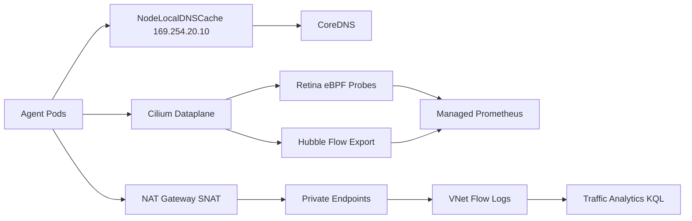
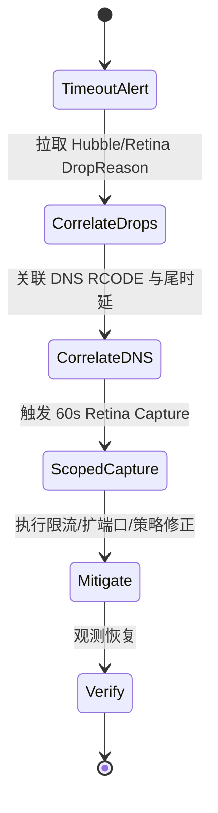

# 企业智能体网络丢包、CoreDNS 尾时延与私网出口可观测架构选型 FAQ（ACNS Retina/Hubble eBPF vs VNet Flow Logs vs Istio Ambient）
> 主题编号：#457
> 章节归属：3.8 智能云运维 AIOps、多区域容灾韧性与企业 Landing Zone
> 目标问题：解释并治理高并发 Agent 工具调用下的“应用超时但链路不可见”故障
## 1) 生产故障画像：应用 Span 看见超时，却看不见丢包成因
企业 Agent 在单轮任务中常并发发起 `50–200` 次 MCP/REST/Private Endpoint 调用。
调用目标通常包含 Azure OpenAI、AI Search、Cosmos DB、Redis 与内部 API 网关。
当链路健康时，应用 OTel span 只显示正常 RTT 与状态码分布。
当链路异常时，应用层多数只看到 `TimeoutError` 或 `context deadline exceeded`。
这类报错无法区分是 DNS、策略拒绝、SNAT 枯竭、conntrack 饱和还是节点抖动。
传统“加重试”策略会掩盖根因并放大下游压力，最终把局部问题扩散成全站抖动。
因此此类问题必须引入内核与网络平面的可观测信号，不可只依赖应用日志。
## 2) 典型根因族：丢包、DNS 放大、SNAT 端口耗尽和策略拒绝
`IPTABLES_DROP` 或 `POLICY_DENIED` 会在内核路径提前终止包转发。
`nf_conntrack` 表在突发并发下可能达到上限，导致新连接无法插入状态表。
`ndots:5` 会放大 DNS 查询次数，触发 CoreDNS UDP 竞争与 `5,000 ms` 尾超时。
节点出口共享 SNAT 端口时，突发短连接会迅速消耗可用端口池。
私有终结点跨子网访问若缺少边界可视化，定位会在网络与应用团队之间来回拉扯。
这些故障在应用日志中表现相似，但治理路径完全不同，必须分类处置。
## 3) 四种架构路径与适配边界
Pattern A：`AKS ACNS + Microsoft Retina + Cilium Hubble eBPF` 作为主观测平面。
Pattern A 直接采集 dropreason、dns、packetforward、conntrack 等内核级指标。
Pattern A 推荐叠加 `NodeLocalDNSCache` 与 `ndots:2`，降低 DNS 查询放大与 UDP 竞争。
Pattern A 适合需要秒级告警与根因定位的高并发智能体平台。
Pattern B：`VNet Flow Logs + Traffic Analytics + Connection Monitor` 作为网络边界补视角。
Pattern B 对 Hub-Spoke、ExpressRoute、Private Endpoint 跨边界路径更友好。
Pattern B 适合补齐云网络拓扑级证据，但分钟级聚合延迟不适合瞬态抖动首诊。
Pattern C：`Istio Ambient/Sidecar` 提供 L7 重试、状态码、熔断等语义治理能力。
Pattern C 擅长服务间治理与策略实施，但看不到 `kfree_skb` 或 conntrack 内核细节。
Pattern D：生产上临时拉 privileged tcpdump + 无约束高基数指标，属于反模式。
Pattern D 会制造新风险：权限暴露、成本失控、诊断不可复现与多租户干扰。
## 4) 十二维量化矩阵（定位能力与运维成本并看）
| 维度 | Pattern A（ACNS+eBPF） | Pattern B（Flow Logs） | Pattern C（Istio） | Pattern D（临时抓包） |
|:-|:-:|:-:|:-:|:-:|
| 丢包根因颗粒度 | 内核原因码级 | 五元组聚合级 | L7 语义级 | 人工样本级 |
| CoreDNS `5s` 尾超时可见性 | 强 | 中 | 弱 | 中 |
| 私有终结点跨边界可见性 | 中强 | 强 | 中 | 弱 |
| 亚秒告警能力 | 强 | 弱 | 中 | 弱 |
| `100 Gbps` 节点开销 | CPU `<1.8%` | 极低 | CPU+内存中高 | 不可控 |
| 指标高基数治理 | 可聚合降维 | 中 | 中高 | 极差 |
| mTLS 负载可见权衡 | 看元数据 | 看流量摘要 | 看 L7 指标 | 可能看明文 |
| 现场按需取证时延 | 秒级触发 | 分钟级 | 中 | 人工慢 |
| Prometheus 成本可控性 | 高 | 中 | 中 | 低 |
| 与 OTel 关联难度 | 中 | 中高 | 低 | 高 |
| 合规与多租户安全 | 高 | 高 | 高 | 低 |
| 企业推荐结论 | 主路径 | 边界补位 | L7 补位 | 禁用 |
## 5) 控制面/数据面联动图（从 Pod 到私网终结点）

图中关键是把 Pod、DNS、内核、SNAT、私网终结点全部纳入同一观察域。
若只看其中任一层，往往会把根因误判为应用缺陷而不是网络资源瓶颈。
## 6) 自动化排障状态机（超时告警到缓解动作）

状态机要求每次转移都保留“触发依据、执行动作、恢复证据”三元记录。
这样做可以把网络故障处置从经验驱动转成审计可复盘的工程流程。
## 7) Q1：`ndots:5` 为什么会导致 `5x–6x` DNS 查询放大
短主机名请求会先按搜索域拼接多次查询，直到命中或回退绝对域名。
当并发调用密集时，放大后的查询会冲击 CoreDNS 与节点 UDP conntrack 槽位。
可近似估算 `Q_total = Q_base * (1 + S)`，`S` 为搜索域尝试次数。
把 `ndots` 调到 `2` 并启用 NodeLocalDNSCache 通常能显著收敛尾时延抖动。
## 8) Q2：NAT Gateway SNAT 端口如何按并发工具调用估算
每个公网 IP 提供 `64,512` 可分配 SNAT 端口上限。
估算可用公式 `Ports_need = Concurrency * Fanout * Reuse_factor`。
当平台出现秒级短连接洪峰时，应按峰值而非均值进行 SNAT 容量规划。
建议在容量门禁中加入端口利用率阈值与突发保护策略。
## 9) Q3：高基数指标成本如何从“节点×Pod×目的地址”降维
未经治理的标签组合会让活动时序数量线性乘法增长。
可用公式 `Series = Nodes * Pods * DestIPs * Labels` 预估成本风险。
Pattern A 推荐在采集端做目的地址聚类与标签重写，避免直接暴露 Pod IP 全量维度。
成本看板应同时展示“有效告警价值/新增时序成本”比值，避免盲目增采。
## 10) Q4：eBPF 开销与 Sidecar 开销如何做可比评估
eBPF 方案主要增加内核事件采集与用户态聚合开销，通常在低个位数 CPU 百分比。
Sidecar 模式会在每跳引入代理处理与缓冲排队，P99 时延更受链路深度影响。
两者并非互斥：推荐 eBPF 做根因定位，Service Mesh 做 L7 治理与策略执行。
评估时需固定流量模型和采样策略，否则结论容易被负载差异扭曲。
## 11) Q5：一分钟 Flow Logs 延迟与亚秒告警如何协调
Flow Logs 适合边界审计、容量趋势和跨网络域追踪，不适合瞬态首诊。
eBPF 流式指标适合秒级告警与即时缓解联动。
可采用“双层告警”：eBPF 触发短周期动作，Flow Logs 提供事后证据补全。
这样既能快速止损，又能保留跨边界审计的完整性。
## 12) Q6：抓包如何做到取证而不泄露业务敏感内容
建议采用 `-s 128` 头部截断策略，仅保留必要网络头与最小负载片段。
抓包窗口应限制在短时段与特定五元组，避免全网无界采集。
产出文件应写入不可变存储并附带会话 ID、告警 ID、执行人信息。
多租户环境下必须绑定最小权限并隔离下载路径，防止横向读取。
## 13) 生产代码片段（#457 专用）
### 13.1 Bicep：AKS advancedNetworking + NAT Gateway + Monitor Workspace
```bicep
param location string = resourceGroup().location
resource amw 'Microsoft.Monitor/accounts@2023-04-03' = {
  name: 'amw-agent-net'
  location: location
}
resource natPip 'Microsoft.Network/publicIPAddresses@2023-09-01' = {
  name: 'pip-agent-nat-01'
  location: location
  sku: { name: 'Standard' }
  properties: { publicIPAllocationMethod: 'Static' }
}
resource nat 'Microsoft.Network/natGateways@2023-09-01' = {
  name: 'nat-agent'
  location: location
  sku: { name: 'Standard' }
  properties: {
    publicIpAddresses: [{ id: natPip.id }]
    idleTimeoutInMinutes: 10
  }
}
resource aks 'Microsoft.ContainerService/managedClusters@2024-02-01' = {
  name: 'aks-agent-prod'
  location: location
  properties: {
    networkProfile: {
      networkDataplane: 'cilium'
      advancedNetworking: {
        observability: { enabled: true }
      }
    }
  }
}
```
### 13.2 Retina Capture + Pod DNSConfig + NodeLocalDNSCache 片段
```yaml
apiVersion: retina.sh/v1alpha1
kind: Capture
metadata:
  name: timeout-triage-capture
spec:
  durationSeconds: 60
  snapLen: 128
  filters:
    namespace: agent-runtime
    podSelector:
      matchLabels:
        app: agent-worker
---
apiVersion: v1
kind: Pod
metadata:
  name: agent-worker-sample
spec:
  dnsConfig:
    options:
    - name: ndots
      value: "2"
```
### 13.3 PromQL + KQL：丢包/DNS/SNAT 联合告警
```python
promql_drop = 'sum(rate(networkobservability_drop_count{reason=~\"POLICY_DENIED|CT_MAP_INSERTION_FAILED\"}[5m])) by (node,reason)'
promql_dns = 'sum(rate(networkobservability_dns_response_count{rcode!=\"NOERROR\"}[5m])) by (node,rcode)'
kql_snat = \"\"\"\nAzureDiagnostics\n| where Category == 'NetworkSecurityGroupFlowEvent'\n| summarize dcount_snat= dcount(SrcPort_d) by bin(TimeGenerated, 1m), Subnet_s\n| where dcount_snat > 50000\n\"\"\"\nprint(promql_drop)\nprint(promql_dns)\nprint(kql_snat)\n```
print(promql_drop)\nprint(promql_dns)\nprint(kql_snat)\n```
## 14) 企业场景与三档三年 TCO
### 14.1 场景 A：全球支付编排智能体平台（闪购峰值）
平台在活动高峰可到 `8,000 RPS`，单次请求会触发多下游工具扇出。
问题表现为 CoreDNS 尾延迟骤增与 SNAT 端口阶段性耗尽并发出现。
落地策略是 Pattern A 主观测，Pattern B 补边界，Pattern C 提供 L7 治理语义。
关键结果是把“超时未知”转成“可定位的丢包原因码 + DNS 异常类别 + 端口证据”。
### 14.2 场景 B：受监管医疗多租户 AKS 平台
平台需要定位 Private Link 到 FHIR/AI Search 的间歇性策略拒绝。
约束是不能抓取 PHI 负载明文，只允许最小化网络头证据。
采用 `snapLen=128` 的短时 scoped capture 与策略事件关联，满足审计与隐私双要求。
该方案可在不扩大数据暴露面的前提下完成跨团队联合排障。
### 14.3 三档三年 TCO（`20 / 100 / 500` 节点）
| 档位 | 节点规模 | Pattern A | Pattern B | Pattern C |
|:-|:-:|:-:|:-:|:-:|
| 部门级 | 20 | $0.71M | $0.43M | $0.66M |
| 区域级 | 100 | $2.95M | $1.84M | $3.22M |
| 集团级 | 500 | $11.8M | $7.6M | $14.9M |
成本主驱动一：采集粒度与指标基数带来的监控成本差异。
成本主驱动二：故障定位时长对业务损失与工程人力的反向影响。
成本主驱动三：网络边界审计要求导致的日志存储与查询成本。
成本主驱动四：服务网格代理链路深度对计算资源的长期占用。
### 14.4 场景 KPI 与治理门槛建议
支付场景建议把“超时告警到可归因根因”的中位时长压缩到 `<= 7 min`。
医疗场景建议把“疑似策略拒绝到策略修复上线”的闭环时长控制在 `<= 20 min`。
SRE 班表应维护“网络层告警误报率”并长期压在 `<= 8%`。
建议单独跟踪“无根因超时占比”，目标季度内下降到 `<= 3%`。
建议把 CoreDNS `P99` 查询时延、SNAT 利用率、DropReason TopN 纳入周报固定章节。
当 `CT_MAP_INSERTION_FAILED` 连续出现时，应自动进入突发流量保护模式。
突发流量保护模式应先限并发再扩资源，避免错误顺序导致放大重试风暴。
应将故障处置动作与配置变更单做强关联，确保每次缓解都有可审计回放。
## 15) Day-0 / Day-1 / Day-2（15 项执行动作）与参考
Day-0：盘点关键下游依赖并建立工具扇出拓扑基线。
Day-0：收集现网 `ndots`、DNS 查询模式与 CoreDNS QPS 峰值。
Day-0：设定 SNAT 端口容量模型与扩容阈值策略。
Day-0：定义丢包原因码分级和告警优先级映射。
Day-0：明确抓包授权流程、留痕字段与不可变存储路径。
Day-1：启用 ACNS observability 并校准采集标签维度。
Day-1：部署 NodeLocalDNSCache 与 `ndots:2` 灰度策略。
Day-1：联通 Hubble/Retina 与 Managed Prometheus 指标面板。
Day-1：上线 eBPF 告警到自动化 triage 状态机。
Day-1：在边界网络接入 Flow Logs 与 Connection Monitor 补视角。
Day-2：每周复盘 DropReason TopN 与 DNS RCODE 异常来源。
Day-2：每月评估 SNAT 利用率与公网 IP 扩容需求。
Day-2：每季度演练私网故障、策略误配与回滚预案。
Day-2：持续优化指标降维规则，压缩无效高基数时序。
Day-2：沉淀标准化故障剧本并推广到各业务单元。
Day-2：按业务域维度维护“超时到根因”趋势图，识别平台共性瓶颈。
Day-2：对跨可用区与跨区域路径建立季度基线，评估链路抖动漂移。
Day-2：把私有终结点健康探针结果纳入发布准入，避免带病变更进入生产。
Day-2：定期校验告警抑制规则，防止历史静默规则掩盖新型故障。
Day-2：评估 eBPF 采样策略与采样比，保持观测精度和成本平衡。
### 15.1 组织协同建议（平台、网络、应用三方）
平台团队负责维护采集链路、标签治理与告警模板基线。
网络团队负责维护 VNet 边界可见性、私有终结点策略与路由一致性。
应用团队负责把超时语义与业务影响绑定，提供可执行回退策略。
联合值班机制应使用统一事件编号，避免跨团队并行处置时证据割裂。
每次重大故障后应输出“可复现最小实验”，用于演练平台回归验证。
### 15.2 变更发布与回滚护栏
与网络相关的发布必须配套“观测先行”检查，确保采集和告警先上线再变更。
所有 `NetworkPolicy` 与 egress ACL 发布都应包含 canary 命名空间验证步骤。
回滚预案应预定义优先级：先恢复连通性，再恢复细粒度策略，再恢复优化项。
对涉及 DNS 参数和 NodeLocalDNSCache 的变更，应设立独立维护窗口与观测窗口。
发布系统应记录变更前后 `DropReason` 与 DNS RCODE 的差异分布。
### 15.3 常见误区与反模式修正
误区一：把超时全部归咎模型慢响应，忽略底层链路和连接状态资源瓶颈。
误区二：只看分钟级汇总日志，不做秒级流式信号联动，导致故障窗口错失。
误区三：为追求“全量可见”而无限扩标签，最终观测平台本身成为成本瓶颈。
误区四：临时抓包没有边界和留痕，触发合规和审计风险并造成组织不信任。
修正原则：优先用结构化、可重复、最小暴露面的诊断链路替代临时手工命令。
### 15.4 量化验收标准（建议作为季度目标）
标准一：`P95` 超时事件在 `10 分钟` 内完成根因分类并指向明确处置 Runbook。
标准二：与网络相关的重大事故中，“未知根因”比例季度环比持续下降。
标准三：每月高基数时序增长率受控，且告警有效命中率持续提升。
标准四：跨区域演练中，恢复过程全链路证据完整可回放且审计可签收。
标准五：多租户环境下无越权抓包和跨租户可见性泄露事件。
### 15.5 术语与指标口径统一建议
`DropReason` 建议按策略拒绝、状态表失败、转发表异常、链路拥塞分四大类维护。
DNS 指标建议同时保留查询量、失败码、尾时延与重试次数，不可只看平均值。
SNAT 指标建议同时看端口占用、失败重试与连接生命周期分布。
所有指标看板需标明采样间隔、聚合窗口和单位，避免跨团队口径偏差。
统一术语与口径可以显著降低跨团队沟通损耗并提升处置速度。
治理建议：对高并发 Agent 平台优先落地 Pattern A，再叠加 B/C 做边界与语义补位。
风险提示：若长期依赖 Pattern D，故障证据不可复现且成本与风险会同步失控。
ACNS 文档（抓取 2026-11-26）：https://learn.microsoft.com/azure/aks/container-network-observability-how-to
Retina 项目（抓取 2026-11-26）：https://github.com/microsoft/retina
Hubble 文档（抓取 2026-11-26）：https://docs.cilium.io/en/stable/observability/hubble/
NodeLocal DNSCache（抓取 2026-11-26）：https://kubernetes.io/docs/tasks/administer-cluster/nodelocaldns/
Azure NAT Gateway（抓取 2026-11-26）：https://learn.microsoft.com/azure/nat-gateway/nat-gateway-resource
Azure CNI Powered by Cilium（抓取 2026-11-26）：https://learn.microsoft.com/azure/aks/azure-cni-powered-by-cilium
Azure Network Watcher Flow Logs（抓取 2026-11-26）：https://learn.microsoft.com/azure/network-watcher/network-watcher-nsg-flow-logging-overview
Azure Connection Monitor（抓取 2026-11-26）：https://learn.microsoft.com/azure/network-watcher/connection-monitor-overview
Azure Monitor Managed Prometheus（抓取 2026-11-26）：https://learn.microsoft.com/azure/azure-monitor/essentials/prometheus-metrics-overview
