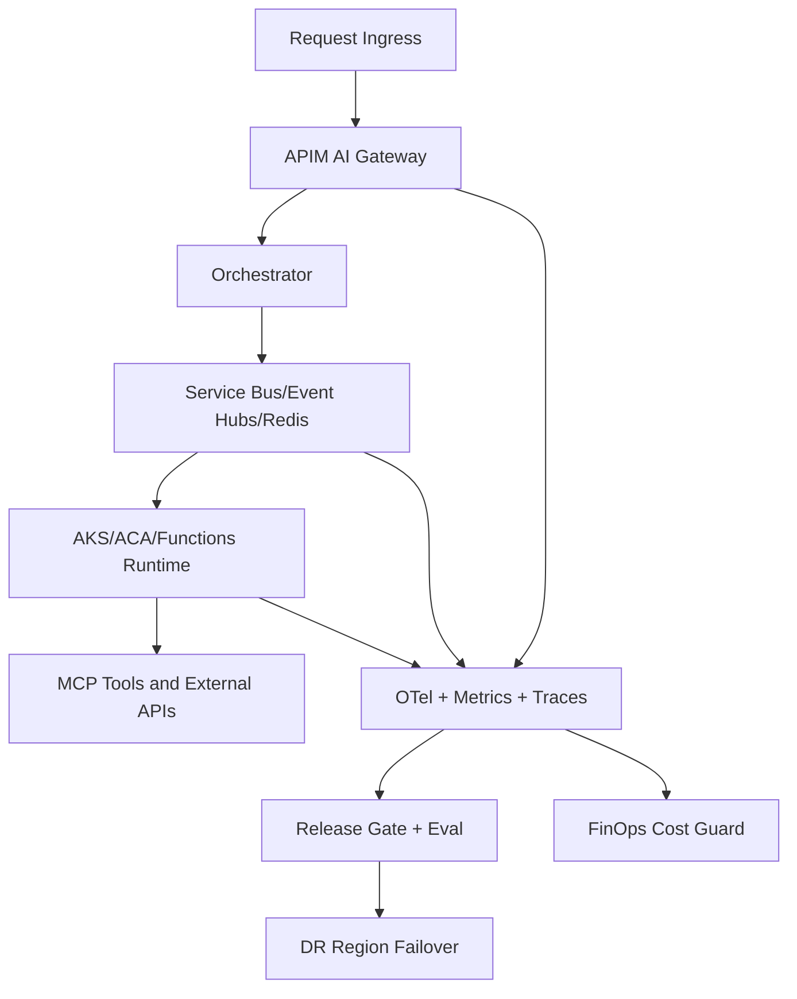
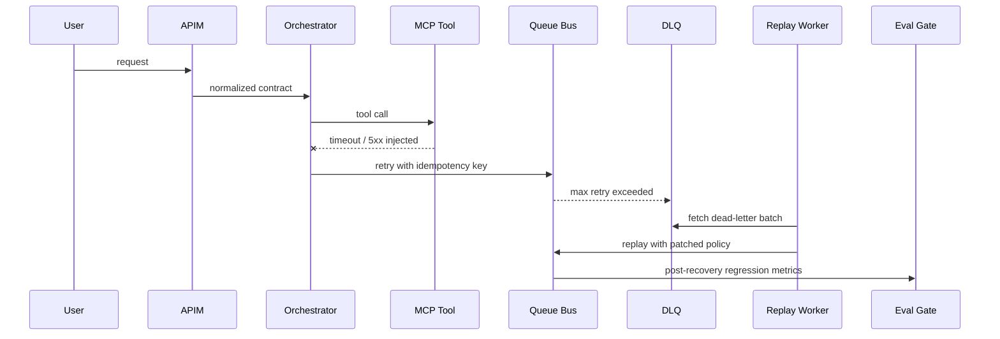

# Enterprise Agent Orchestration Chaos-Drill Selection FAQ: `Azure Chaos Studio` vs `Chaos Mesh on AKS` vs `Gremlin` (MCP/A2A Failure Injection, Replay Recovery, and Release Gates)

## 1. Executive Summary: Without Repeatable Chaos Drills, Production Becomes the Test Environment
Many organizations still rely on
unit tests,
load tests,
and regression suites
as their primary reliability posture.
In multi-agent production systems,
the dominant failure modes are not isolated component failures.
They are coupled failures across
gateway policy enforcement,
orchestration bus backlogs,
tool timeout cascades,
state-store contention,
and regional failover latency.
If a platform cannot repeatedly execute
fault injection,
controlled recovery,
and evidence-backed post-recovery validation,
it only appears stable under nominal conditions.
Under burst load or dependency degradation,
it tends to fail through
retry storms,
dead-letter explosions,
cross-tenant fairness collapse,
and uncontrolled unit-cost spikes.
The practical architecture conclusion is:
`Azure Chaos Studio`
is often best as the Azure-native control-plane anchor;
`Chaos Mesh`
is best for deep Kubernetes-level fault scripting and reproducible AKS regressions;
`Gremlin`
is often best for cross-cloud operational standardization.
These tools are complementary in mature enterprises.

## 2. Daily Breakthrough Evidence (Fetched `2026-11-21`)
To keep the guidance verifiable,
this section only includes official docs,
official changelogs,
or repository release channels.
Source tags explicitly separate
`measured`,
`synthetic`,
and `anonymized_reported` evidence.

| Topic | Source | Retrieval Date | Label | Why it matters |
|---|---|---|---|---|
| APIM AI Gateway overview | https://learn.microsoft.com/en-us/azure/api-management/ai-gateway-overview | 2026-11-21 | measured | Chaos must validate gateway policies, quotas, and fallback behavior |
| APIM service changelog | https://github.com/Azure/API-Management/blob/main/changelogs/api-management-service.md | 2026-11-21 | anonymized_reported | Rapid policy-plane evolution requires continuous regression drills |
| ACA Dynamic Sessions | https://learn.microsoft.com/en-us/azure/container-apps/sessions | 2026-11-21 | measured | Sessionized runtimes increase ephemeral failure modes and recovery complexity |
| Firecracker releases | https://github.com/firecracker-microvm/firecracker/releases | 2026-11-21 | anonymized_reported | Runtime isolation evolves quickly, changing downstream reliability assumptions |
| Kata releases | https://github.com/kata-containers/kata-containers/releases | 2026-11-21 | anonymized_reported | Container isolation updates can shift performance and failure envelopes |
| Wasmtime releases | https://github.com/bytecodealliance/wasmtime/releases | 2026-11-21 | anonymized_reported | Wasm runtime evolution impacts execution and tool-call behavior |
| E2B releases | https://github.com/e2b-dev/e2b/releases | 2026-11-21 | anonymized_reported | Sandbox platform changes require updated failure injection and replay tests |

The daily signal is clear:
runtime innovation is accelerating,
and orchestration reliability practices must evolve in lockstep.

## 3. Problem Boundary: Agent Chaos Engineering Is Not “Kill a Pod and Call It Done”
A frequent anti-pattern
is to treat chaos engineering as random pod termination.
For enterprise agent orchestration,
that is insufficient.
High-value drills must cover:
protocol-level faults
(MCP handshake failures, A2A timeout bursts),
state-level faults
(idempotency store contention, lock expiration),
control-plane faults
(quota policy misconfiguration, false-positive policy blocks),
data-plane faults
(retrieval latency inflation, cache poisoning),
and regional faults
(primary region degradation and controlled failover).
Without semantic modeling of these failure classes,
drills generate low-value outcomes
such as “service restarts successfully”
while leaving systemic risk untested.

## 4. Four-Layer Chaos Model for Production Agent Platforms
A practical production model uses four connected layers:
ingress governance,
orchestration semantics,
execution runtime,
and governance closure.
Ingress governance validates
APIM policy behavior under fault pressure.
Orchestration semantics validates
queue ordering,
retry behavior,
dead-letter handling,
and replay authorization.
Execution runtime validates
AKS/ACA/Functions degradation and recovery behavior.
Governance closure validates
OpenTelemetry evidence completeness,
evaluation-gate outcomes,
and FinOps cost drift after fault scenarios.



This structure prevents fragmented drills
that pass locally but fail end-to-end.

## 5. 12-Dimension Comparison: Chaos Studio vs Chaos Mesh vs Gremlin
| Dimension | Azure Chaos Studio | Chaos Mesh on AKS | Gremlin | Decision Signal |
|---|---|---|---|---|
| Azure-native integration | High | Medium | Medium | Azure-primary estates often start with Chaos Studio |
| Kubernetes injection depth | Medium | High | Medium-high | Deep AKS kernel/network tests favor Chaos Mesh |
| Cross-cloud operational consistency | Medium | Low | High | Multi-cloud governance often favors Gremlin |
| Out-of-box experiment templates | High | Medium | High | Faster adoption when teams need guided patterns |
| Scriptability and customization | Medium | High | Medium-high | Engineering-heavy teams prefer Chaos Mesh flexibility |
| Learning curve | Low-medium | Medium-high | Medium | Team maturity influences total rollout speed |
| Audit evidence quality | High | Medium | High | Regulated environments need traceable evidence |
| CI/CD gate integration | High | Medium | High | Gate-first delivery favors Chaos Studio or Gremlin |
| Cost controllability | Medium-high | High | Medium | Strong platform teams can optimize Chaos Mesh cost |
| Multi-tenant safety posture | High | Medium | High | Strong tenant boundaries favor governed platforms |
| Drill-frequency scalability | High | Medium-high | High | Automation maturity drives repeatability |
| Org-wide adoption speed | High | Medium | Medium-high | Native tooling often wins first at scale |

The correct answer is usually not “one winner.”
It is a role split aligned with operational goals.

## 6. Path A: `Azure Chaos Studio` as the Azure-Native Reliability Control Plane
`Azure Chaos Studio`
is often the lowest-friction choice
for organizations operating primarily on Azure.
It aligns with Azure RBAC,
resource model semantics,
and cloud-native governance workflows.
It is especially useful when drills must include
AKS nodes,
network disruptions,
regional dependencies,
and service-level control-plane stress.
For estates built on
APIM + AKS + ACA + Foundry,
this approach helps establish
repeatable, auditable drill programs quickly.
The key discipline is to treat drill definitions
as versioned artifacts in infrastructure pipelines,
not ad-hoc console operations.
Without that discipline,
chaos work decays into occasional exercises
that do not improve production readiness.

## 7. Path B: `Chaos Mesh` for Deep AKS Fault Semantics and Developer-Controlled Regression
When teams need deep fault primitives
such as
network delay injection,
packet loss,
DNS faults,
I/O throttling,
and container-level stress,
`Chaos Mesh`
provides powerful flexibility.
It fits organizations with mature platform engineering teams
that can enforce strict namespace boundaries,
RBAC controls,
and policy safeguards.
It is highly effective for
branch-level resilience testing
and pre-merge reliability regressions.
However,
its flexibility creates operational obligations:
maintenance,
cluster compatibility testing,
security review,
and blast-radius controls.
Teams without strong Kubernetes platform discipline
often underestimate these costs.

## 8. Path C: `Gremlin` for Cross-Cloud Reliability Program Standardization
`Gremlin`
is often valuable where reliability governance must span
multiple clouds,
multiple platform teams,
and mixed infrastructure footprints.
Its strength is not only fault injection itself.
Its strength is consistent operational vocabulary,
shared reporting patterns,
and organization-scale reliability operating models.
If your estate includes Azure plus AWS/GCP
or hybrid on-prem deployments,
standardization can deliver more value than deep cloud-specific integration.
The trade-off is commercial licensing
and integration effort with existing telemetry and release pipelines.
For single-cloud early-stage platforms,
Azure-native paths may yield faster ROI initially.

## 9. MCP/A2A-Oriented Chaos Drills: Injecting and Recovering from Orchestration Failures
Agent platforms must explicitly test
MCP and A2A failure modes.
Minimum scenario set should include:
tool endpoint 429/5xx bursts,
long-tail timeout spikes,
idempotency-key collisions,
dead-letter surges,
replay authorization failures,
and delayed dependency recovery.



The objective is not just to create failures.
The objective is to prove controlled recovery
and measurable improvement.

## 10. Quantitative Q&A (8 Decision Anchors)
**Q1: Why can load testing pass while production still collapses under faults?**  
Load tests validate throughput envelopes;
chaos validates coupled-failure behavior and recovery paths.

**Q2: What tail-latency impact can a regional DNS instability event introduce?**  
Without local caching and bounded retries,
P95 latency can grow by roughly `1.8x-3.2x` (`synthetic`).

**Q3: What drill frequency is practical for core orchestration paths?**  
A common baseline is weekly `1` full-path drill,
plus `2-3` pre-release focused drills (`anonymized_reported`).

**Q4: What DLQ thresholds are useful as release gates?**  
Typical guardrails:
`DLQ ratio < 0.5%`
and `DLQ P95 triage < 20 min`.

**Q5: What is the cost of missing idempotency contracts during retry storms?**  
Duplicate side effects can push compensation workload above `2x` (`synthetic`).

**Q6: What is the hidden cost center of self-managed chaos frameworks?**  
Platform engineering labor for lifecycle maintenance,
security review,
and cluster compatibility.

**Q7: When is Gremlin usually justified?**  
When three or more platform domains need one reliability reporting and drill language.

**Q8: How do you measure drill effectiveness beyond completion status?**  
Track recovery-time reduction,
gate automation coverage,
repeat-incident rate,
and unit-cost variance post-recovery.

## 11. Production Code Example: Fault Toggle + Idempotent Recovery Routing (Python)
```python
from dataclasses import dataclass
from typing import Dict, Any
import random
import time


@dataclass
class FaultProfile:
    timeout_rate: float
    error_rate: float
    extra_latency_ms: int


class IdempotencyLedger:
    def __init__(self):
        self.done = set()

    def check_and_mark(self, key: str) -> bool:
        if key in self.done:
            return False
        self.done.add(key)
        return True


def maybe_inject_fault(profile: FaultProfile) -> None:
    if random.random() < profile.error_rate:
        raise RuntimeError("Injected 5xx fault")
    if random.random() < profile.timeout_rate:
        time.sleep(profile.extra_latency_ms / 1000.0)
        raise TimeoutError("Injected timeout")
    time.sleep(profile.extra_latency_ms / 1000.0)


def execute_step(step: Dict[str, Any], ledger: IdempotencyLedger) -> Dict[str, Any]:
    idem_key = step["idem_key"]
    if not ledger.check_and_mark(idem_key):
        return {"status": "duplicate_skipped", "idem_key": idem_key}

    try:
        profile = FaultProfile(
            timeout_rate=step.get("timeout_rate", 0.0),
            error_rate=step.get("error_rate", 0.0),
            extra_latency_ms=step.get("latency_ms", 0),
        )
        maybe_inject_fault(profile)
        return {"status": "ok", "idem_key": idem_key}
    except TimeoutError as ex:
        return {"status": "retry", "idem_key": idem_key, "error": str(ex)}
    except Exception as ex:  # noqa: BLE001
        return {"status": "dead_letter", "idem_key": idem_key, "error": str(ex)}
```

This example is intentionally minimal.
In production,
idempotency state should be durable,
trace context should be propagated,
and policy decisions should be centrally versioned.

## 12. IaC Snippets: Declarative Drill Plans and Gate-Linked Observability
```yaml
apiVersion: chaos.azure.com/v1
kind: AgentChaosPlan
metadata:
  name: mcp-a2a-reliability-gameday
spec:
  schedule: "0 */6 * * *"
  targets:
    - name: apim-gateway
      type: latency
      duration: 120s
      p95LatencyMs: 400
    - name: orchestrator-queue
      type: backlog
      duration: 180s
      maxQueueDepth: 50000
    - name: mcp-tool-endpoint
      type: error-rate
      duration: 90s
      injected5xx: "20%"
  gates:
    - metric: dlq_ratio
      threshold: "<0.5%"
    - metric: recovery_p95_seconds
      threshold: "<900"
    - metric: cost_spike_ratio
      threshold: "<1.3"
```

```bicep
param workspaceName string
param location string = resourceGroup().location

resource law 'Microsoft.OperationalInsights/workspaces@2022-10-01' = {
  name: workspaceName
  location: location
  properties: {
    retentionInDays: 30
  }
}

resource appi 'Microsoft.Insights/components@2020-02-02' = {
  name: '${workspaceName}-appi'
  location: location
  kind: 'web'
  properties: {
    Application_Type: 'web'
    WorkspaceResourceId: law.id
  }
}
```

Versioning drill plans with observability infrastructure
is essential for reproducibility.

## 13. Enterprise Scenario A: National Retail Banking + Credit Operations
A national bank processing `180,000+` daily intelligent interactions
operates a chain across
gateway routing,
fraud-check agents,
customer-service agents,
and human specialists.
Their main production pain point
was retry amplification
during anti-fraud dependency instability.
They adopted
Chaos Studio for cloud/resource-plane drills,
Chaos Mesh for AKS fine-grained injections,
and automated DLQ replay regression in weekly drills.
Operationally,
they achieved shorter major-incident recovery windows,
lower recurrence of known failure patterns,
and improved audit traceability.

## 14. Enterprise Scenario B: Global B2B SaaS Support and Ticketing Platform
A global SaaS platform serving `6,000+` enterprise tenants
faces burst multipliers above `10x`
during release waves and regional incidents.
Early reliance on capacity testing alone
did not prevent queue backlogs,
timeout cascades,
and hot-tenant starvation.
They introduced
Gremlin for cross-cloud consistency,
kept Chaos Studio for Azure control-plane validation,
and used Chaos Mesh for service-team AKS regression loops.
Drill evidence became a release prerequisite.
The outcome was more predictable degradation behavior,
faster forensic diagnostics,
and reduced cascade-risk during dependency turbulence.

## 15. FinOps TCO, Five-Step Rollout, and Day-0/Day-2 Checklist
### 15.1 Reference Cost View (Example: `40` Full-Path Drills per Month)
| Cost Surface | Chaos Studio Dominant | Chaos Mesh Dominant | Gremlin Dominant |
|---|---|---|---|
| Platform/service spend | Medium | Low-medium | Medium-high |
| Platform operations labor | Low-medium | High | Medium |
| Drill automation engineering | Medium | Medium-high | Medium |
| Audit/reporting overhead | Low | Medium-high | Low-medium |
| Cross-cloud expansion overhead | Medium | High | Low-medium |
| Strategic fit | Azure-primary enterprises | Deep AKS engineering teams | Cross-cloud standardization programs |

### 15.2 Five-Step Adoption Guide
1. Define failure taxonomy and target SLOs before selecting tooling.
2. Encode OTel and DLQ metrics as hard release-gate criteria.
3. Start with one business-critical end-to-end chain and close the recovery loop.
4. Integrate drill automation into CI/CD and change-governance workflow.
5. Run monthly reviews on recovery time, recurrence rate, and cost drift.

### 15.3 Good Fit vs Not For
**Good fit**
for high-concurrency multi-tenant systems,
complex dependency graphs,
and regulated environments requiring audit-grade evidence.

**Not for**
small single-service PoCs
with minimal external dependencies
and no formal release-gate process.

### 15.4 Day-0 / Day-2 Twelve-Item Checklist
1. Standardize drill naming, tagging, and ownership conventions.
2. Define SLO and error-budget targets for each critical chain.
3. Enforce idempotency and retry ceilings for every mutable step.
4. Classify DLQ categories and define response SLAs.
5. Implement replay authorization and immutable replay logs.
6. Make required OTel attributes part of release gates.
7. Establish drill calendar and on-call drill ownership.
8. Include regional failover scenarios in quarterly drills.
9. Set drill-time cost caps and auto-abort protections.
10. Track post-drill defects through governed remediation workflow.
11. Measure repeat-incident rate as a first-class reliability KPI.
12. Require minimum viable drill suite before major releases.

---

### Conclusion
Reliable enterprise agent platforms are built on
repeatable,
auditable,
automation-friendly
chaos programs.
In Azure-centered estates,
using Chaos Studio as the control-plane anchor,
Chaos Mesh as deep AKS injection support,
and Gremlin where cross-cloud standardization is required,
then coupling drills with
release gates and FinOps feedback,
is a durable path from reactive firefighting to controlled resilience engineering.
